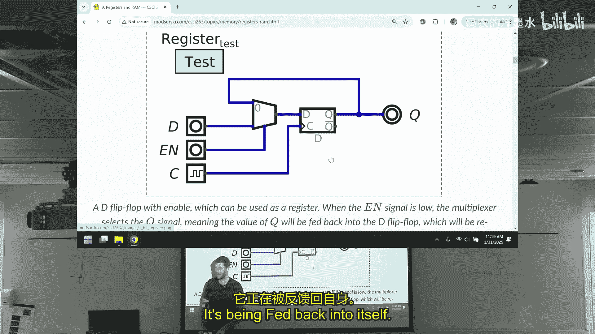

# 010：D锁存器与D触发器 🔧

在本节课中，我们将学习两种重要的数字电路元件：D锁存器和D触发器。它们是构成计算机内存的基础单元，能够存储单个比特的信息。我们将从SR锁存器的问题出发，逐步改进设计，最终得到一个能够稳定存储数据并与系统时钟同步的电路。

---

## SR锁存器的回顾与问题

上一节我们介绍了SR锁存器，它由两个交叉耦合的或非门构成，可以实现置位（Set）和复位（Reset）功能。

然而，SR锁存器存在一个不理想的状态：当S和R输入同时为高电平（1）时，输出Q和Q非会同时变为低电平（0），这是一个未定义且无意义的状态。我们希望在电路中消除这种可能性。

---

## D锁存器：消除不确定状态

为了解决SR锁存器的不确定状态，我们可以对电路进行微小的修改，使其无法同时进行置位和复位。

以下是实现方法：
*   取一个SR锁存器。
*   将单个数据输入（D）直接连接到S端。
*   将数据输入（D）取反后，连接到R端。

这样，我们就得到了一个**D锁存器**。其核心逻辑是：
*   当 `D = 1` 时，`S = 1`, `R = 0`，输出Q被置为1。
*   当 `D = 0` 时，`S = 0`, `R = 1`，输出Q被复位为0。

这个设计确保了S和R永远不会同时为高电平。但是，我们也失去了SR锁存器中“保持”状态（即S和R同时为0时，输出保持不变）的能力。在D锁存器中，只要D变化，Q就会立刻跟随变化，这并不能“存储”数据。

---

## 带使能端的D锁存器：实现“保持”功能

为了重新获得“保持”或“存储”数据的能力，我们需要一种方法让电路在需要时忽略输入的变化。

解决方案是引入一个**使能端（Enable）**。以下是其工作原理：
*   在D锁存器的输入路径上增加两个与门。
*   使能信号同时控制这两个与门。
*   当 `Enable = 1` 时，D的值可以传递到SR锁存器，电路正常工作。
*   当 `Enable = 0` 时，无论D是什么值，与门的输出都是0。这意味着 `S = 0` 且 `R = 0`，电路进入“保持”状态，输出Q维持原值不变。

现在，我们有了一个功能完整的存储单元：可以设置数据（D），然后通过关闭使能端（Enable）来“锁存”并存储这个数据。

---

## 时钟与同步需求

在计算机中，几乎所有操作都需要协调一致地发生。这是通过一个全局的**时钟信号**来实现的。

时钟信号是一个周期性变化的方波，其频率单位是赫兹（Hz），表示每秒的周期数。例如，1 GHz的时钟意味着每秒有10亿个时钟周期。

我们希望数据存储操作与时钟信号同步。一个简单的想法是将时钟信号直接用作D锁存器的使能端。但这样有一个问题：在时钟信号为高电平的整个期间，如果输入数据（D）发生变化，输出（Q）也会随之变化。我们真正需要的，是只在时钟信号变化的**瞬间**（例如从低到高的跳变沿）捕获并存储数据。

---

## D触发器：边沿触发的存储

为了实现边沿触发的存储，我们使用一个巧妙的设计：将两个带使能端的D锁存器**串联**起来。

以下是该电路的结构：
*   **第一个D锁存器（主锁存器）**：其使能端直接连接时钟信号。
*   **第二个D锁存器（从锁存器）**：其使能端连接**取反后**的时钟信号。

其工作过程分为两个阶段：
1.  **当时钟为低电平（0）时**：主锁存器使能，从锁存器禁用。输入数据D可以自由进入并改变主锁存器的输出，但从锁存器保持原状，因此最终输出Q不变。
2.  **当时钟从低变高（上升沿）的瞬间**：主锁存器立刻被禁用，锁存住跳变前瞬间的D值。同时，从锁存器被使能，将主锁存器刚锁存的值传递到最终输出Q。

此后，在时钟为高电平期间，无论D如何变化，都无法影响已被锁存的值。直到下一个时钟上升沿到来，才会捕获新的D值。

这个电路就是**D触发器**。它只在时钟边沿（通常是上升沿）更新存储的值，完美实现了与时钟的同步。在电路符号中，时钟输入端常用一个小三角形（▶）表示。

---

## 寄存器与内存

一个D触发器可以存储**1比特**的信息。这是构建更大规模存储器的基石。

以下是扩展存储容量的方法：
*   **寄存器**：将多个D触发器并联，共享同一个时钟信号，就可以存储一个多比特的数据字，例如一个8位或32位的寄存器。
*   **内存（RAM）**：通过组合大量的存储单元（可以是触发器或其他电路，如DRAM中使用的电容）、地址解码器和控制电路，就能构建出随机存取存储器。

在实际计算机中，我们还会为寄存器等组件添加额外的控制逻辑（例如“载入”使能信号），但核心的存储功能依然依赖于D触发器这样的边沿触发存储单元。

---

## 重要设计原则：保持时钟信号纯净

在数字电路设计中，有一条关键原则：**尽量避免对时钟信号进行逻辑操作**（例如用与门去门控时钟）。因为任何额外的逻辑门都会给时钟信号带来微小的延迟，可能导致电路不同部分之间的时钟不同步（时钟偏移），在高速系统中引发严重错误。控制数据存储的时机，应通过控制数据路径来实现，而非直接操控时钟路径。

---

本节课中我们一起学习了从SR锁存器到D触发器的演进过程。D触发器通过两个锁存器的级联，利用时钟边沿稳定地存储数据，是构成计算机中寄存器、缓存乃至内存的核心元件。理解它的工作原理，是理解计算机如何保存和处理信息的关键一步。