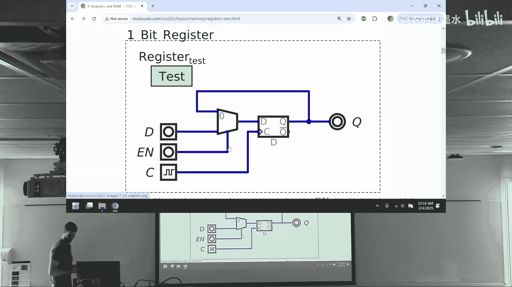

# 011：寄存器与随机存取存储器 🧠

在本节课中，我们将要学习如何构建计算机中用于存储数据的基本单元：寄存器和随机存取存储器（RAM）。我们将从D触发器出发，探讨如何通过增加控制逻辑来构建更实用的存储单元，并最终理解RAM的工作原理。


## 从D触发器到寄存器 🔄


上一节我们介绍了D触发器，它能存储一个比特的数据。其核心功能是：在每个时钟脉冲到来时，它会锁存数据线D上的当前值。


**公式**：`Q(t+1) = D(t)` （在时钟上升沿）


然而，这种设计存在一个问题：数据总线上的数据随时都在变化，但我们并不希望寄存器在每次时钟脉冲时都无条件地存储总线上的新数据。我们需要一个“使能”信号来控制何时进行数据写入。


为了解决这个问题，我们引入了一种带使能端的D触发器设计。以下是其核心结构：


**代码/逻辑图描述**：
```
数据输入 D ──┐
            │
            ▼
        ┌─────────┐
使能 En ┤ 多路复用器 ├───> D触发器 ──> 输出 Q
        └─────────┘
            ▲
            │
            └────── 反馈 ─── Q
```

其工作原理如下：
*   当使能信号 `En = 0`（低电平）时，多路复用器选择反馈回来的Q值作为D触发器的输入。这样，在时钟脉冲到来时，触发器只是将自身的值重新锁存一次，实现了“保持”功能。
*   当使能信号 `En = 1`（高电平）时，多路复用器选择外部数据线D的值作为输入。在时钟脉冲到来时，触发器将锁存这个新值，实现了“写入”功能。


你可能会问，为什么不简单地用一个与门来屏蔽数据或时钟信号呢？原因如下：
1.  **屏蔽数据线**：如果通过使能信号将数据线强制设为0，那么当我们需要保持原数据但数据线恰好为0时，就无法区分是“保持”还是“写入0”。
2.  **屏蔽时钟信号**：虽然技术上可行，但给时钟路径添加逻辑门会引入延迟，破坏整个系统的同步性。最佳实践是保持时钟信号的纯净。


因此，带有内部反馈回路的设计是必要且优雅的解决方案。这种结构被称为**带使能的D触发器**，它可以作为一个1位寄存器使用。


## 构建多位寄存器 🧱

一个1位寄存器的存储能力有限。在计算机中，我们通常需要同时存储多位数据（如8位、16位、32位）。构建一个多位寄存器非常简单：只需将多个1位寄存器并联即可。


以下是构建一个8位寄存器的关键点：
*   **并行连接**：将8个带使能的D触发器并排连接。
*   **共享控制信号**：所有触发器的**时钟信号**和**使能信号**都连接在一起，确保它们同步工作。
*   **独立数据线**：每个触发器有自己独立的**数据输入线**（D0-D7）和**数据输出线**（Q0-Q7）。

这样，当我们置位使能信号并发出一个时钟脉冲时，8位数据总线上的所有比特将被同时锁存到寄存器中。这种设计具有良好的可扩展性。

在电路图中，我们不会每次都画出所有内部细节，而是使用一个**寄存器符号**来抽象表示这个多位存储单元。这个符号会标明数据位宽、时钟端、使能端、数据输入和输出端。

## 寄存器阵列与随机存取存储器（RAM） 🗂️

单个寄存器可以存储一个数据字（例如8位）。而RAM则是由大量这样的存储单元组成的阵列，可以存储许多数据字，并且能够根据地址随机访问其中任何一个。


让我们回顾RAM的基本构想，现在我们可以用真实的寄存器（带使能的D触发器）来实现它。


假设我们要构建一个4x4的RAM，即4个存储位置，每个位置存放4位数据。

以下是其核心模块与工作原理：


**1. 地址解码器**
*   **功能**：将输入的2位地址（例如00， 01， 10， 11）转换为4根“字线”信号。在任何时刻，只有一根字线为高电平（1），其余为低电平（0）。
*   **作用**：选中要访问的特定行（存储位置）。


**2. 存储单元阵列**
*   这是一个4行x4列的寄存器阵列。每一行对应一个4位存储字，每一列对应所有字相同位置上的一个比特。
*   同一行所有寄存器的**使能端**都连接到对应的字线。当某行字线被地址解码器置为高电平时，该行所有寄存器同时被“使能”，准备进行写入操作。


**3. 写入控制**
*   仅有地址选中还不够，我们还需要一个全局的**写使能**信号来控制是否真的进行写入。
*   实现方法：将地址解码器输出的每根字线，与全局“写使能”信号通过一个**与门**连接，再将与门的输出连接到对应行寄存器的使能端。
*   这样，只有当“写使能”和“地址选中”同时有效时，数据才会在时钟脉冲下被写入目标行。


**4. 读取控制与三态逻辑**
*   **读取问题**：每一列中，所有寄存器的输出（Q）始终连接到一个垂直的“位线”上。如果我们直接用多路选择器根据地址选择其中一行的值输出，那么这个输出会一直存在，可能与其他正在使用总线的设备冲突。
*   **解决方案**：引入**三态缓冲器**。
    *   三态缓冲器有一个使能端。当使能时，它像导线一样传输输入信号（0或1）。
    *   当禁用时，它进入**高阻抗状态**，输出端相当于断开连接，既不是0也不是1。
*   在RAM设计中，我们将每列位线通过一个三态缓冲器连接到最终的数据输出线。所有缓冲器的使能端连接到一个全局的**读使能**信号。
*   只有当“读使能”有效时，被地址选中的那一行数据才会被驱动到输出总线上；否则，RAM的输出端呈现高阻态，不会干扰总线。


通过地址选择、写控制、读控制（三态输出）这三个机制的配合，我们就实现了一个可以随机读写的基本静态RAM模块。

## 静态RAM与动态RAM ⚡


我们上面讨论的基于触发器的RAM属于**静态RAM**。只要不断电，其中存储的数据就会一直保持，无需额外操作。静态RAM速度快、稳定，但每个存储单元需要多个晶体管（如6个），成本高、密度低。

现代计算机主内存广泛使用的是**动态RAM**。其核心存储单元是一个晶体管加一个电容。
*   **写入**：通过晶体管对电容充电（存1）或放电（存0）。
*   **读取**：检测电容上的电荷状态。
*   **缺点**：电容会缓慢漏电，导致数据丢失。因此，DRAM需要额外的**刷新电路**，定期读取并重写每个存储单元的数据，以维持电荷。
*   **优点**：结构简单，一个单元只需一个晶体管加一个电容，密度极高，成本低廉。


因此，在计算机系统中，高速缓存通常使用SRAM，而大容量主内存则使用DRAM，在性能与成本之间取得平衡。

## 总结 📚

本节课中我们一起学习了计算机存储层次结构的基础模块。
1.  我们从**D触发器**出发，通过添加多路复用器和反馈回路，构建了带使能端的**1位寄存器**，实现了可控的数据存储。
2.  通过并联多个1位寄存器，我们得到了**多位寄存器**，用于存储一个数据字。
3.  为了存储大量数据字并能随机访问，我们将寄存器排列成阵列，并配合**地址解码器**、**写使能控制**和基于**三态缓冲器**的读使能控制，构建了**随机存取存储器**的基本模型。
4.  最后，我们了解了**静态RAM**和**动态RAM**的区别，知道了现代计算机是如何利用不同特性的存储技术来构建高效、经济的存储系统的。



理解寄存器和RAM的工作原理，是理解CPU如何与内存交互、程序和数据如何被存储和访问的关键一步。