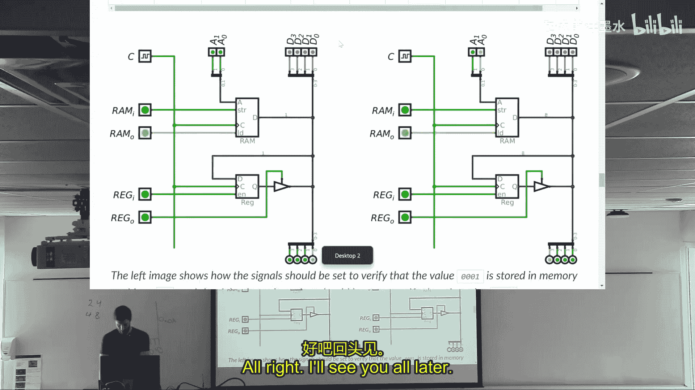

# 012：总线与RAM到寄存器的数据传输 🚌

在本节课中，我们将学习计算机系统中数据移动的核心机制——总线。我们将探讨总线如何连接不同组件，以及如何通过控制信号在RAM和寄存器之间安全地传输数据。

## 总线概述

上一节我们介绍了驱动器和RAM的基本概念。本节中，我们来看看如何将这些组件连接起来协同工作。

总线是计算机系统中用于传输数据的公共信号线。多个组件可以连接到同一条总线上，但必须严格协调，确保同一时间只有一个组件向总线输出数据。

以下是三种主要的总线类型：
*   **数据总线**：负责在组件之间传输实际数据。
*   **地址总线**：用于传输内存地址，指定要访问的RAM位置。
*   **控制总线**：由一系列控制信号组成，用于管理哪个组件在何时进行输入或输出操作。

## 三态逻辑与总线冲突

我们之前讨论的三态逻辑对于总线操作至关重要。驱动器可以处于三种状态：输出高电平（1）、输出低电平（0）或高阻态（Z，即不输出任何信号）。

对于共享的总线，必须确保同一时刻只有一个组件处于输出状态（输出0或1）。如果多个组件同时向总线输出不同的电平，就会发生短路冲突。例如，一个组件输出1（连接电压源），另一个输出0（连接地线），将导致电源直接对地短路。

**核心概念**：输出0（接地）不等于不输出（高阻态Z）。只有高阻态Z才表示组件与总线“断开连接”。

## 系统组件连接示例

现在，让我们看一个具体的系统示例，它将RAM、寄存器通过数据总线连接起来。

系统包含以下主要部分：
*   **4x4 RAM**：一个具有4个地址（2位地址线控制）且每个地址存储4位数据的RAM。
*   **4位寄存器**：一个可以临时存储4位数据的寄存器。
*   **数据总线**：一组4位的共享信号线。
*   **地址总线**：2位线，用于选择RAM的地址。
*   **控制总线**：包括 `RAM_in`、`RAM_out`、`REG_in`、`REG_out` 等信号，控制数据的流向。
*   **时钟信号**：同步所有操作的时钟脉冲。

在这个设计中，寄存器的输出端增加了一个驱动器，以便我们可以控制它何时将数据放到总线上，这与我们之前实验中寄存器持续输出的情况不同。

## 数据传输操作步骤

我们将通过一系列步骤来演示如何编程这个系统，实现数据的存储和移动。每个步骤对应一个时钟周期，我们需要在时钟脉冲到来前设置好所有控制信号、地址和数据。

### 步骤1：将数据存入RAM

假设我们要将二进制数 `0001`（十进制1）存入内存地址 `00`，然后将 `1000`（十进制8）存入地址 `01`。

以下是每个时钟周期需要配置的信号：

**存入地址 00 (`0001`)**：
*   `RAM_in` = 1 （允许写入RAM）
*   `RAM_out` = 0 （RAM不输出）
*   `REG_in` = 0, `REG_out` = 0 （寄存器不参与）
*   `地址线` = 00
*   `数据线` = 0001
*   **触发时钟脉冲**，数据被存入RAM地址00。

**存入地址 01 (`1000`)**：
*   `RAM_in` = 1
*   `RAM_out` = 0
*   `REG_in` = 0, `REG_out` = 0
*   `地址线` = 01
*   `数据线` = 1000
*   **触发时钟脉冲**，数据被存入RAM地址01。

### 步骤2：从RAM读取数据到总线

要验证数据是否存入，或为后续操作准备数据，我们需要将RAM中的数据放到总线上。

例如，读取地址 `00` 的数据：
*   `RAM_in` = 0 （不写入）
*   `RAM_out` = 1 （允许RAM输出）
*   `REG_in` = 0, `REG_out` = 0 （寄存器不参与）
*   `地址线` = 00
*   `数据线` = ZZZZ （设置为高阻态，不向总线输出数据，让出总线控制权）
*   此时，数据总线上的信号会变为 `0001`（RAM地址00的值），**无需时钟脉冲**，输出立即生效。

### 步骤3：将总线数据存入寄存器

现在，假设我们想将总线上当前的数据（来自RAM）存入寄存器。

例如，将地址 `00` 的数据 (`0001`) 存入寄存器：
1.  首先，如步骤2所述，将地址 `00` 的数据输出到总线。
2.  然后配置控制信号：
    *   `RAM_in` = 0
    *   `RAM_out` = 1 （保持输出）
    *   `REG_in` = 1 （允许寄存器从总线输入）
    *   `REG_out` = 0 （寄存器不输出）
    *   `地址线` = 00 （保持不变）
    *   `数据线` = ZZZZ （保持高阻态）
3.  **触发时钟脉冲**。在脉冲上升沿，寄存器会读取当前总线上的值 (`0001`) 并存储起来。

### 步骤4：将寄存器数据写回RAM

我们还可以将寄存器中的数据写回RAM的另一个地址。

例如，将寄存器中的值写入RAM地址 `01`：
1.  首先，让寄存器输出数据到总线：
    *   `REG_out` = 1
    *   `REG_in` = 0
    *   `RAM_out` = 0 （RAM停止输出，避免冲突）
    *   `数据线` = ZZZZ
    *   此时，总线上的数据变为寄存器存储的值。
2.  然后配置写入RAM：
    *   `RAM_in` = 1
    *   `RAM_out` = 0
    *   `REG_out` = 1 （保持输出）
    *   `地址线` = 01 （目标地址）
3.  **触发时钟脉冲**。总线上的数据（来自寄存器）被写入RAM地址01。

## 核心总结与抽象层次

本节课中我们一起学习了计算机内部数据通路的基础。我们看到了如何通过操纵简单的0和1信号（控制线、地址线、数据线），在RAM和寄存器之间精确地移动数据。这个过程本质上就是**编程**——我们通过设定一系列二进制控制模式来指挥硬件工作。

这让我们更接近计算机的底层本质：
1.  **机器代码层**：我们手动设置的0/1序列就是最原始的机器指令。
2.  **汇编层**：为了便于人类阅读，我们用 `ADD`、`LOAD`、`STORE` 等助记符代替二进制序列，汇编器会将其翻译成机器码。
3.  **高级语言层**：如C语言，编译器将其翻译成汇编代码，进而再变成机器码。

我们目前正在构建的，正是能够理解并执行这些底层指令的硬件系统。通过继续学习，我们将把这些分散的组件组合成一台功能完整的、可编程的计算机。