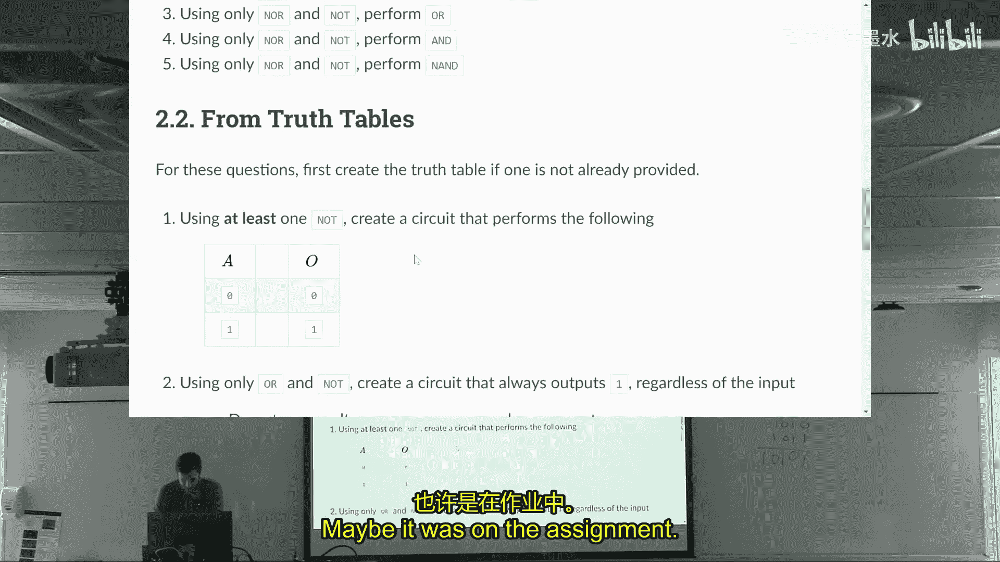
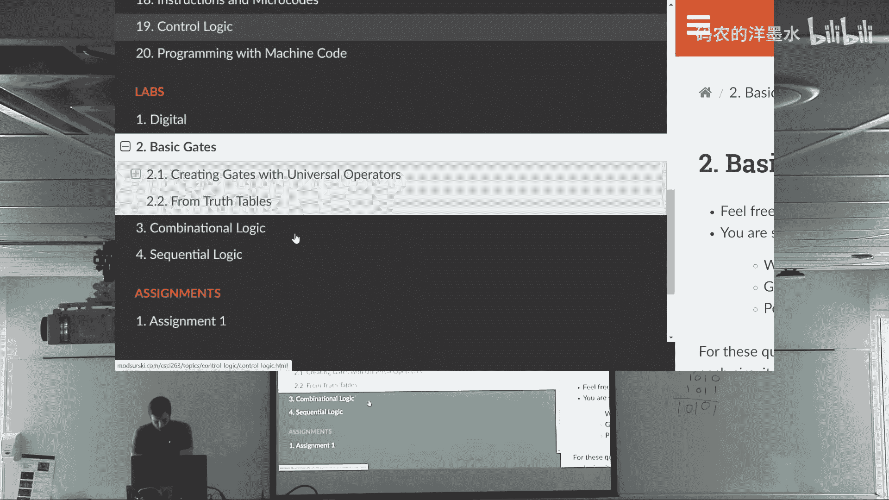
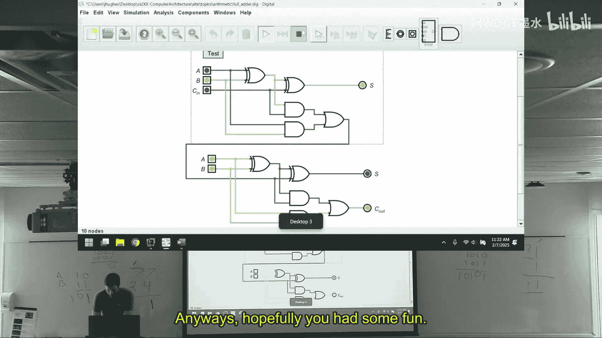

# 013：半加器与全加器 🧮

在本节课中，我们将学习计算机如何执行最基本的算术运算——二进制加法。我们将从理解如何将两个比特相加开始，并构建出实现这一功能的逻辑电路，即半加器和全加器。

---

上一节我们介绍了如何通过控制信号来在硬件中移动数据。本节中，我们来看看如何让硬件进行计算，特别是二进制加法。

二进制加法与我们熟悉的十进制加法原理相同，只是符号更少。例如，计算 `1010` 加 `1101`：
*   最低位：`0 + 1 = 1`
*   下一位：`1 + 0 = 1`
*   再下一位：`0 + 1 = 1`
*   最高位：`1 + 1 = 10`（结果为 `0`，并产生一个进位 `1`）

因此，当我们将两个比特相加时，结果可能不止一个比特，因为 `1 + 1` 会产生进位。

---

## 半加器 (Half Adder)

半加器是用于将两个 **1比特** 二进制数相加的最基本电路。

以下是两个1比特数相加的所有可能情况（A 和 B 是输入，S 是和，C 是进位）：

| A | B | S (和) | C (进位) |
|---|---|--------|---------|
| 0 | 0 | 0      | 0       |
| 0 | 1 | 1      | 0       |
| 1 | 0 | 1      | 0       |
| 1 | 1 | 0      | 1       |

观察上表，我们可以发现：
*   **和 (S)** 位只有在输入 **A 和 B 不同** 时才为 `1`。这正是 **异或 (XOR)** 逻辑运算：`S = A XOR B`。
*   **进位 (C)** 位只有在输入 **A 和 B 同时为 `1`** 时才为 `1`。这正是 **与 (AND)** 逻辑运算：`C = A AND B`。

因此，一个半加器电路可以仅由两个逻辑门构成：
*   一个 **异或门** 用于计算和 (S)。
*   一个 **与门** 用于计算进位 (C)。

其逻辑表达式为：
```
S = A ⊕ B
C = A · B
```



---



## 从半加器到全加器

半加器虽然简单，但有一个主要限制：它 **无法处理来自低位的进位**。在实际的多位二进制加法中（如我们开头的例子），每一位的加法都需要考虑三个输入：两个加数位和一个来自低位的进位输入。

为了能处理进位输入，我们需要一个更强大的电路：**全加器 (Full Adder)**。

---

## 全加器 (Full Adder)

全加器用于将三个 **1比特** 二进制数相加：两个加数位 (A, B) 和一个进位输入位 (Cin)。

以下是全加器的真值表：

| A | B | Cin | S (和) | Cout (进位输出) |
|---|---|-----|--------|----------------|
| 0 | 0 | 0   | 0      | 0              |
| 0 | 0 | 1   | 1      | 0              |
| 0 | 1 | 0   | 1      | 0              |
| 0 | 1 | 1   | 0      | 1              |
| 1 | 0 | 0   | 1      | 0              |
| 1 | 0 | 1   | 0      | 1              |
| 1 | 1 | 0   | 0      | 1              |
| 1 | 1 | 1   | 1      | 1              |

分析这个表：
*   **和 (S)** 位在 **输入中 `1` 的个数为奇数** 时为 `1`。这可以通过将两个异或门串联来实现：`S = (A XOR B) XOR Cin`。
*   **进位输出 (Cout)** 位在 **至少有两个输入为 `1`** 时为 `1`。这可以简化为两种情况：
    1.  A 和 B 同时为 `1`（无论 Cin 是什么）。
    2.  A 和 B 的和（即 `A XOR B` 的结果）为 `1` **并且** Cin 也为 `1`。
    其逻辑表达式可以优化为：`Cout = (A AND B) OR ((A XOR B) AND Cin)`。

因此，一个全加器可以用两个异或门、两个与门和一个或门来构建。

---

## 构建多位加法器

单个全加器只能处理一位的加法。为了将两个多比特的二进制数相加（例如两个8位数），我们可以将多个全加器 **串联** 起来。

以下是构建一个4位加法器的思路：
1.  最低位（第0位）的全加器，其进位输入 (Cin) 通常设为 `0`。
2.  第1位的全加器，其进位输入 (Cin) 连接到第0位全加器的进位输出 (Cout)。
3.  第2位的全加器，其进位输入连接到第1位全加器的进位输出。
4.  以此类推，直到最高位。
5.  最高位全加器的进位输出 (Cout) 就是整个加法运算的最终进位，它和所有位的和 (S) 一起构成了完整的（n+1位）结果。

通过这种方式，我们可以构建出任意位宽的加法器，这是CPU中算术逻辑单元(ALU)的核心部件之一。

---



本节课中我们一起学习了二进制加法的硬件实现。我们从最简单的**半加器**开始，它只能处理两个比特的相加。然后，我们引入了能处理进位输入的**全加器**。最后，我们了解到通过串联多个全加器，可以构建出能够计算任意大小二进制数加法的电路。这标志着我们已经掌握了计算机进行基本算术运算的核心原理。