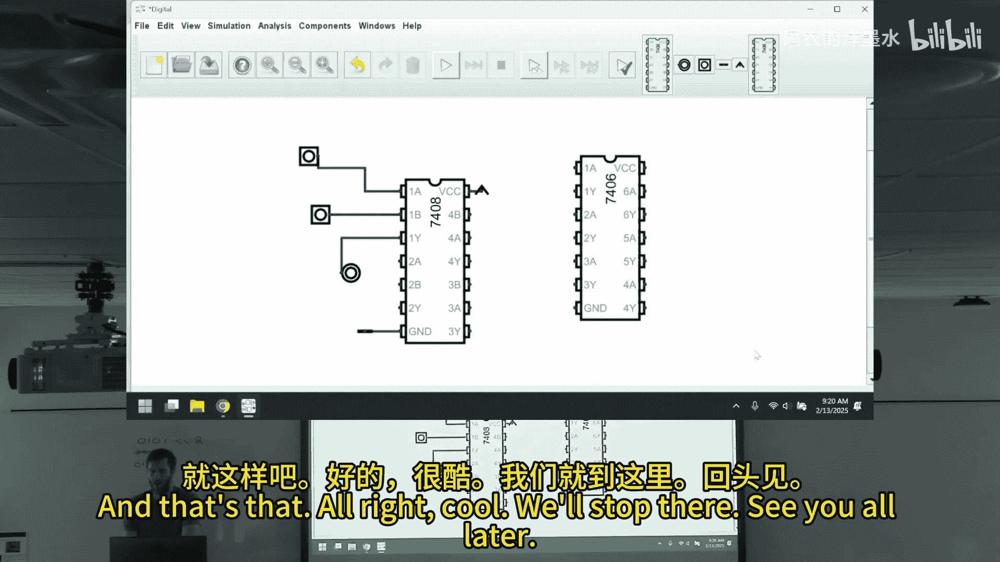

# 015：数的取反与减法运算 🧮

在本节课中，我们将要学习二进制数的取反（求补）操作，以及如何利用加法器来实现减法运算。我们将深入探讨补码的原理，并构建一个能够执行加法和减法运算的电路。

## 概述

上一节我们介绍了补码的概念。本节中我们来看看如何利用补码来实现减法运算，并构建一个算术逻辑单元（ALU）的雏形。

## 补码回顾

补码的生成分为两步：
1.  对原数的每一位进行取反（即应用 `NOT` 操作）。
2.  将取反后的结果加 `1`。

用公式可以表示为：`-X = ~X + 1`。

补码的关键在于，它将后续运算中需要“额外加1”的步骤，直接编码到了负数的表示中。这使得加法器无需修改就能处理正数和负数的加法（即减法）。

## 取反操作的电路实现

如果我们想对一个数进行取反（求其补码），一个简单的方法是：
1.  使用一个多位的 `NOT` 门对输入进行按位取反。
2.  将取反后的结果与 `0` 相加，同时将加法器的进位输入（Carry In）设置为 `1`。

这相当于执行了 `~A + 0 + 1`，即 `~A + 1`，完美实现了补码运算。

以下是该电路的关键配置：
*   **A 输入**：原始数字取反后的结果（`~A`）。
*   **B 输入**：全部设置为 `0`。
*   **进位输入（Carry In）**：设置为 `1`。

这样，加法器计算 `(~A) + 0 + 1`，输出的就是 `A` 的补码（即 `-A`）。

## 数据的多义性与上下文

一个二进制序列本身没有固定的含义。`11111011` 这个序列：
*   如果解释为**无符号整数**，它的值是 `251`。
*   如果解释为**有符号整数（补码）**，它的值是 `-5`。

计算机如何知道该用哪种方式解释呢？这完全依赖于**上下文**，即程序或指令事先声明的数据类型（如 `int`, `unsigned int`, `char`）。在硬件层面，它只是一系列高电平和低电平，我们必须谨慎地根据操作意图来理解和处理这些数据。

## 构建一个加减法器

我们知道，减法 `A - B` 可以转化为加法 `A + (-B)`。因此，我们可以通过修改加法器，使其能够有条件地对 `B` 输入进行取反并加 `1`，来实现减法功能。

以下是实现思路：
1.  我们引入一个控制信号 `SUB`。当 `SUB = 0` 时，电路执行加法 `A + B`；当 `SUB = 1` 时，电路执行减法 `A - B`。
2.  要实现减法，就需要计算 `A + (~B + 1)`。

具体电路实现如下：
*   **可控取反器**：利用**异或门（XOR）** 的特性。将 `B` 的每一位与 `SUB` 信号进行异或。
    *   当 `SUB = 0` 时，输出等于 `B`（因为 `B XOR 0 = B`）。
    *   当 `SUB = 1` 时，输出等于 `~B`（因为 `B XOR 1 = NOT B`）。
*   **加1操作**：直接将 `SUB` 信号连接到加法器的**进位输入（Carry In）**。当执行减法时（`SUB=1`），进位输入为 `1`，相当于完成了加 `1` 的操作。

这样，当 `SUB=1` 时，电路实际计算的是 `A + (B XOR 1) + 1 = A + (~B) + 1`，即 `A - B`。

## 关于算术逻辑单元（ALU）的初步认识

算术逻辑单元（ALU）是CPU的核心部件，用于执行各种算术和逻辑运算。它是一个**组合逻辑电路**，意味着给定输入后，输出会立即产生，无需等待时钟周期。

一个通用的ALU通常包含：
*   **输入**：两个操作数（Operand）。
*   **控制信号**：操作码（Op Code），指定进行何种运算（如加、减、与、或等）。
*   **输出**：运算结果。
*   **状态标志**：一些额外的输出位，用于记录运算的特定状态，例如：
    *   结果是否为零（Zero Flag）。
    *   是否产生了进位（Carry Flag）。
    *   结果的最高位（符号位）是否为1（Negative Flag）。
    *   是否发生溢出（Overflow Flag）。

这些状态标志对于实现程序中的条件跳转（如 `if` 语句）至关重要。虽然在高层次编程中我们强调避免“副作用”，但在硬件层面，这些状态输出是必要的“副作用”，为处理器提供决策依据。

我们的加减法器可以看作一个功能简单的ALU雏形，它的操作码就是 `SUB` 信号，实现了加和减两种功能。更复杂的ALU会集成乘法器、移位器、逻辑运算单元等，并通过一个大型的多路选择器（Multiplexer）根据操作码选择对应的输出结果。

## 总结

本节课中我们一起学习了：
1.  **补码取反的电路实现**：通过 `NOT` 门和设置进位输入为 `1` 的加法器来完成。
2.  **二进制数据的多义性**：比特位的含义取决于解释它的上下文（数据类型）。
3.  **减法运算的实现**：通过引入 `SUB` 控制信号，利用异或门作为可控取反器，并将 `SUB` 信号同时作为进位输入，巧妙地将减法 `A - B` 转化为 `A + (~B + 1)` 来计算。
4.  **算术逻辑单元（ALU）的概念**：了解了ALU作为组合逻辑电路的基本功能、输入输出以及状态标志的重要性。

通过将减法转化为加法，我们极大地简化了计算机底层硬件的设计，这是补码表示法带来的巨大优势。