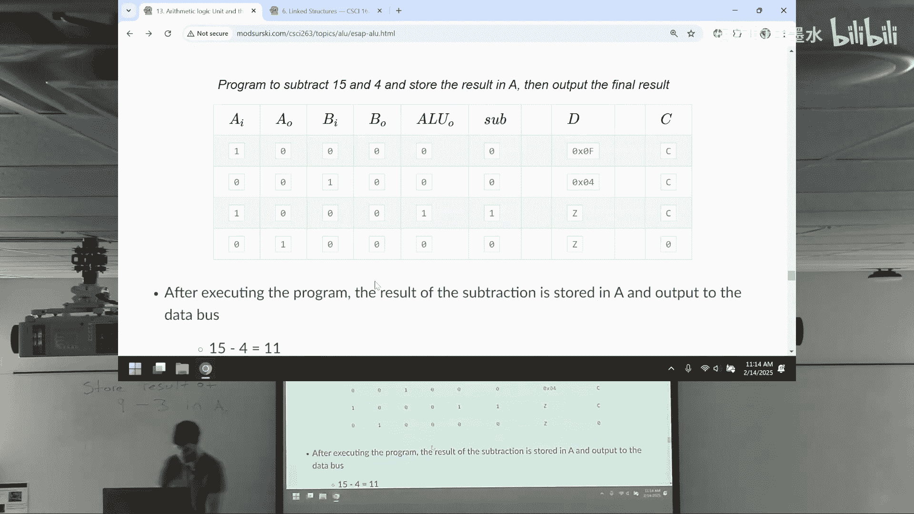

# 016：算术逻辑单元与ESAP架构 🧮

在本节课中，我们将学习算术逻辑单元（ALU）的基本概念，并探索一个名为“尽可能简单”（ESAP）的计算机架构。我们将了解ALU如何执行加法和减法，以及它如何作为更复杂计算系统的基础模块。

---

## 算术逻辑单元（ALU）简介

上一节我们介绍了计算机的基本组件。本节中，我们来看看算术逻辑单元（ALU）。ALU是计算机的核心部件，负责执行算术和逻辑运算。

我们的ALU设计相对简单，仅执行加法和减法。相比之下，一些现成的ALU（例如Digital软件中的示例）功能更丰富，包含一系列操作（如与、或、异或、非等）。这些操作通过一个多路复用器根据输入信号选择输出结果。

**核心概念：** ALU本质上是一个函数，接收输入并产生输出。其基本设计可以概括为一系列运算单元加上一个多路复用器。

```verilog
// 简化的ALU概念模型
output = multiplexer(operation_select, add(A, B), subtract(A, B), and(A, B), or(A, B), ...);
```

然而，ALU函数可能产生“副作用”，例如改变系统状态标志。在计算机底层架构中，这种状态性是普遍存在的。

---

## ESAP架构概述

为了将ALU等组件整合成一个连贯的系统，我们需要一个路线图。这个路线图就是“尽可能简单”（Eater Simple As Possible, ESAP）架构。

ESAP架构旨在成为功能完整但设计最简单的计算机。它包含以下核心组件，通过一条公共总线连接：

*   **时钟：** 同步整个计算机中所有顺序操作。
*   **RAM：** 存储程序和数据。
*   **内存地址寄存器：** 临时保存要访问的RAM地址，将其与数据总线隔离。
*   **指令寄存器：** 存储当前正在执行的指令。
*   **控制信号：** 控制各个模块何时启用、禁用、读取或写入。
*   **程序计数器：** 跟踪当前（或下一条）要执行的指令在RAM中的地址。
*   **寄存器A和B：** 临时存储正在处理的数据。
*   **ALU（加法器/减法器）：** 对寄存器A和B中的值执行运算。
*   **输出寄存器：** 将数据发送到显示设备（如七段数码管）。

以下是该架构中数据流动的关键：
通过控制信号（如 `AI`、`AO`、`BI`、`BO`、`ALU_OUT`）来管理数据在总线、寄存器和ALU之间的移动。例如，要将数据从总线存入寄存器A，需要置位 `AI` 信号并在时钟上升沿触发。


---

## 我们的ALU设计

现在，让我们聚焦于ESAP架构中的ALU部分。我们已有一个包含总线、寄存器和加法器的基本设计。

我们的ALU设计巧妙之处在于：寄存器A和B始终将其存储的值输出给加法器。加法器因此总是在计算 `A + B`（或 `A - B`，当减法信号置位时）。我们通过一个驱动器来控制是否将ALU的结果输出到总线上。

**核心概念：** 减法通过二进制补码实现。当减法信号 (`sub`) 为高电平时，B寄存器的值被按位取反，并且加法器的进位输入 (`Cin`) 被置为1，从而计算 `A + (~B + 1)`，即 `A - B`。

```verilog
// 减法操作的核心思想
if (sub == 1) {
    B_input_to_adder = ~B_value; // 按位取反
    carry_in = 1;                // 加1
} else {
    B_input_to_adder = B_value;
    carry_in = 0;
}
result = A_value + B_input_to_adder + carry_in;
```

### 操作示例

假设我们想计算 `10 + 11`：
1.  将数据 `10` 置于总线上，启用 `AI`，触发时钟，将 `10` 存入寄存器A。
2.  将数据 `11` 置于总线上，启用 `BI`，触发时钟，将 `11` 存入寄存器B。
3.  此时，加法器已持续计算 `10 + 11 = 21`。启用 `ALU_OUT` 信号（无需时钟），即可在总线上看到结果 `21`（十六进制为 `0x15`）。

若想计算 `10 - 11`：
1.  前两步同上，将 `10` 和 `11` 分别存入A和B。
2.  置位 `sub`（减法）信号。
3.  启用 `ALU_OUT` 信号，总线上将显示 `-1` 的二进制补码形式（所有位均为1）。

我们还可以实现循环计数：将ALU的输出通过总线存回寄存器A。每次时钟触发时，A的值增加B的值，从而实现累加。

---

## ALU在ESAP中的整合

我们的ALU模块已经包含了ESAP架构的多个核心要素：数据总线、时钟、寄存器A和B以及ALU本身。控制总线则体现在管理各个模块输入输出的信号线上。

我们的设计与标准ESAP的一个细微区别在于：在我们的设计中，寄存器B既可以读取也可以写入总线，这提供了更大的编程灵活性，而在一些硬件实现中，寄存器B可能设计为只读。

### 操作步骤表格化


为了清晰规划数据流动，我们可以使用表格来列出每个时钟周期需要激活的控制信号。

例如，执行 `15 - 4` 并将结果存回寄存器A：

| 步骤 | 操作描述                     | 控制信号 (AI, AO, BI, BO, SUB, ALU_O) | 时钟脉冲 |
| :--- | :--------------------------- | :------------------------------------ | :------- |
| 1    | 将值 `15` (0xF) 从总线存入A | `AI=1`                                | 是       |
| 2    | 将值 `4` (0x4) 从总线存入B  | `BI=1`                                | 是       |
| 3    | 设置减法模式并输出ALU结果    | `SUB=1`, `ALU_O=1`                    | 否       |
| 4    | 将ALU结果从总线存回A         | `AI=1`                                | 是       |

**重要提示：** 需注意系统当前状态。在步骤4的时钟脉冲后，寄存器A变为新值（11），ALU会立即基于新的A值（11）和B值（4）计算 `11 - 4 = 7`。虽然我们看到ALU输出变化，但我们关心的最终结果（11）已安全存储在寄存器A中。

---

## 活动：实践操作序列

请根据上述ALU设计，规划出计算 `9 - 3` 并将结果存储到寄存器A所需的操作序列。仿照示例，填写每一步的控制信号状态。

**你的任务：**
1.  将 `9` 存入寄存器A。
2.  将 `3` 存入寄存器B。
3.  执行减法计算。
4.  将结果存回寄存器A。


请列出每一步所需的控制信号（`AI`, `AO`, `BI`, `BO`, `SUB`, `ALU_O`）并指出是否需要时钟脉冲。

---

## 总结 🎯

本节课中我们一起学习了：
1.  **算术逻辑单元（ALU）** 的基本功能与简单设计，它能够执行加法和减法运算。
2.  **ESAP（尽可能简单）计算机架构** 的整体蓝图，包括其核心组件（时钟、RAM、寄存器、ALU等）如何通过公共总线连接。
3.  如何通过**控制信号**精确地在总线、寄存器和ALU之间移动数据并执行运算。
4.  通过表格化步骤来规划和理解**多步骤计算过程**（如 `15 - 4`）。



通过将ALU集成到这个更大的架构中，我们正在向构建一台功能完整、可编程的计算机迈进。虽然当前设计简单，但它已具备图灵完备性，能够执行任何计算任务的基础。