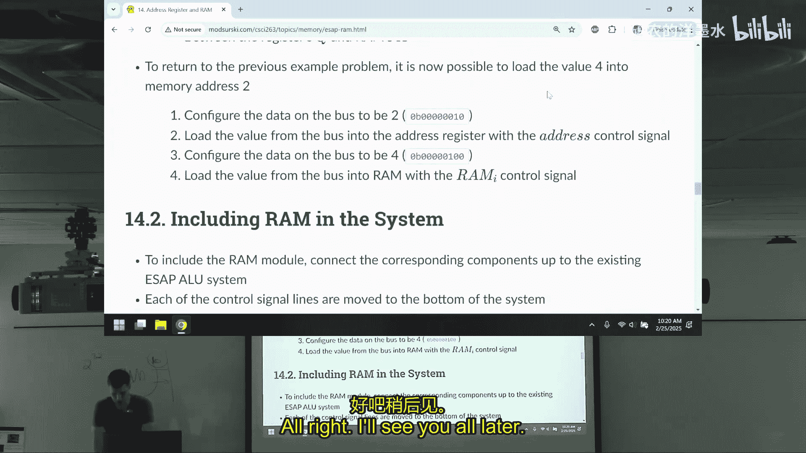

# 017：地址寄存器与随机存取存储器 🧠


在本节课中，我们将学习如何将随机存取存储器（RAM）集成到我们的计算机系统中，并解决地址与数据共享总线所带来的问题。我们将引入一个关键的组件——地址寄存器，并了解它在数据存取流程中的作用。

上一节我们介绍了通过控制信号在寄存器与算术逻辑单元（ALU）之间移动数据。本节中我们来看看如何将内存（RAM）接入系统，并处理地址与数据在总线上可能发生的冲突。

## 内存基础回顾

内存用于存储计算机当前正在使用的指令和数据。在我们的系统中，RAM将仅用于临时存储，而非长期存储。

*   **地址空间**：可寻址的唯一内存位置数量。在我们的例子中，有16个地址。
*   **地址能力**：每个内存位置存储的数据量。我们的系统是**字节可寻址**的，即每个地址存储一个字节（8位）。
*   **总存储容量**：地址空间 × 地址能力。对于16个地址、每个地址1字节的系统，总容量为 **16字节**。

以下是内存的一个简化表示，其中每个地址（如0x0, 0x1）存储一个字节的数据（如‘A’, ‘B’）：

```
地址 (十六进制) | 数据 (字节)
0x0           | ‘A’
0x1           | ‘B’
...
0xF           | ‘P’
```

## 共享总线带来的挑战


在我们正在构建的系统中，地址总线和数据总线是共享的。这意味着用于传输数据的8位总线，其中只有4位用于指定内存地址（可寻址16个位置），另外4位将留作它用（例如，编码指令）。


这种设计导致了一个问题：当我们需要从RAM读取或写入数据时，必须先后在总线上放置地址和数据。如果同时尝试放置，会造成冲突。

例如，若想将数值 `4` 存入内存地址 `2`：
1.  需将地址 `2` 放到总线上，告诉RAM目标位置。
2.  需将数据 `4` 放到总线上，让RAM存入。

但总线在同一时刻只能承载一个值。我们无法同时放置地址 `2` 和数据 `4`。

## 解决方案：地址寄存器

解决上述冲突的方法非常简单：使用一个寄存器来临时保存地址。这个专门的寄存器称为**地址寄存器**。

其工作原理如下：
1.  将目标地址（例如 `2`）通过共享总线放入地址寄存器。
2.  地址寄存器持续输出这个地址给RAM，此时总线被释放。
3.  现在，我们可以将数据（例如 `4`）通过共享总线发送给RAM。
4.  RAM接收到地址寄存器提供的地址和总线上提供的数据，完成写入操作。

这个过程需要一个额外的时钟脉冲来将地址存入地址寄存器，但完美地解决了总线冲突问题。地址寄存器就像一个“地址中转站”，将瞬态的总线信号转化为稳定的地址输入。

在我们的设计中，地址寄存器是4位的，因为只需要4位来寻址16个内存位置。

## 集成到系统

现在，我们可以将RAM模块和地址寄存器集成到之前的系统设计中。地址寄存器位于共享总线与RAM模块之间。

以下是核心连接关系的简化描述：

```
共享数据/地址总线 (8位) --> [地址寄存器 (4位)] --> RAM地址输入端口
                              |
RAM数据输入/输出端口 <---------> 共享数据/地址总线 (8位)
```

控制信号方面，除了原有的寄存器A/B和ALU控制信号外，我们现在新增了：
*   `ARin`：控制地址寄存器从总线载入地址。
*   `RAMin`：控制RAM从总线载入数据（写入）。
*   `RAMout`：控制RAM将数据输出到总线（读取）。

## 操作示例

假设我们要执行一个简单程序：计算 `(15 + 4) - 7`，并利用RAM存储中间数据。

以下是需要执行的高级步骤：
1.  将数据 `15`, `4`, `7` 分别存入RAM的指定地址（例如地址0, 1, 2）。
2.  从RAM中读取 `15` 到寄存器A，读取 `4` 到寄存器B。
3.  执行加法（`A + B`），并将结果存回RAM的另一个地址。
4.  从RAM中读取上一步的“和”到寄存器A，读取 `7` 到寄存器B。
5.  执行减法（`A - B`），并将最终结果存入RAM。

这个过程虽然步骤较多，但本质就是通过精确控制 `ARin`, `RAMin`, `RAMout`, `Ain`, `Bin`, `ALUout` 等信号，在总线、寄存器、ALU和RAM之间有序地移动数据。

## 总结



本节课中我们一起学习了如何将RAM集成到计算机系统。我们认识到共享地址/数据总线会带来访问冲突，并通过引入**地址寄存器**这一简单而有效的组件解决了该问题。地址寄存器临时保存内存地址，使得地址信息和数据可以分时复用总线，从而安全地对RAM进行读写操作。我们还了解了如何通过新增的控制信号来协调整个数据存取流程。这为我们的系统增添了数据存储能力，使其功能更加完整。