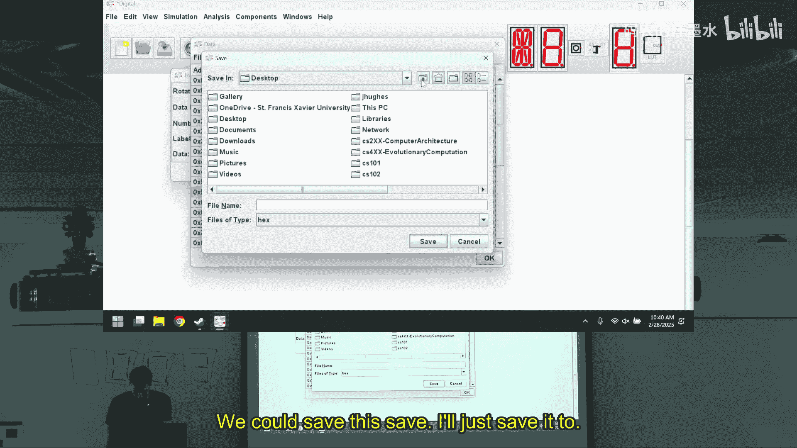

# 019：七段数码管查找表 📟

在本节课中，我们将学习如何将计算机的输出连接到七段数码管进行显示。我们将重点探讨如何设计一个查找表，将计算机内部的二进制数值转换为驱动数码管所需的特定信号模式。通过本节课，你将理解查找表的工作原理，并学会如何通过编程自动生成其数据文件。

---

上一节我们回顾了七段数码管的基本原理。本节中，我们来看看如何为计算机设计一个高效的显示输出系统。

我们面临的核心问题是：计算机内部使用8位二进制数（可表示0-255），但每个七段数码管需要8位信号来控制其各段亮灭。要显示一个三位数（例如123），我们需要三个数码管，总共需要24位输出信号。此外，如果考虑显示负数，还需要一个额外的符号位，因此总共需要25位输出。




手动为256个可能的输入值逐一编写25位的输出模式是极其繁琐的。因此，我们将使用查找表（Lookup Table）来解决这个问题。查找表就像一个字典或映射，它将输入的二进制模式（键）直接映射到我们想要的输出二进制模式（值）。

### 查找表的设计思路

查找表的输入和输出位数可以不同。在我们的设计中：
*   **输入**：8位数据 + 1位符号选择位 = 9位。这1位符号选择位用于指示输入的8位数是应解释为无符号整数（0-255）还是有符号的二进制补码整数（-128到127）。
*   **输出**：25位。其中24位用于控制三个数码管（每个8位），1位用于控制负号指示灯的亮灭。

通过将符号选择位也作为查找表的输入，我们巧妙地将“选择显示无符号数模式还是有符号数模式”这个逻辑整合进了查找表本身，从而避免了在外部再使用一个多路复用器（Multiplexer）。

### 生成查找表数据文件

手动填写拥有512行（2^9）数据的查找表依然不现实。我们将编写一个Python脚本来自动生成所需的数据文件（.hex文件）。

以下是生成数据文件的核心步骤：

1.  **定义数码管编码**：首先，我们定义数字0-9在七段数码管上对应的8位二进制编码。在Python中，我们用整数常量表示这些编码。
    ```python
    # 七段数码管编码 (a, b, c, d, e, f, g, dp)
    ZERO = 0x3F  # 二进制 0011 1111
    ONE = 0x06   # 二进制 0000 0110
    TWO = 0x5B   # 二进制 0101 1011
    # ... 定义 TWO 到 NINE
    ```

2.  **分离数字的各位**：对于一个给定的整数（如123），我们需要分别得到它的百位、十位和个位数字。
    *   百位：`数字 // 100`
    *   十位：`(数字 // 10) % 10`
    *   个位：`数字 % 10`

3.  **组合输出位模式**：得到每个数字对应的8位编码后，我们需要将它们组合成一个24位的模式。这通过**位左移（<<）**和**位或（|）**操作实现。
    *   将百位编码左移16位，使其占据输出的第17-24位。
    *   将十位编码左移8位，使其占据输出的第9-16位。
    *   个位编码不移位，占据输出的第1-8位。
    *   最后，将这三个移位后的值进行**位或**运算，合并成一个24位的整数。
    ```python
    pattern = (digits[hundreds] << 16) | (digits[tens] << 8) | digits[ones]
    ```

4.  **处理有符号数**：对于有符号数（二进制补码形式），我们同样分离其各位数字。如果是负数，则在组合24位模式后，再通过**位或**运算加上符号位（左移24位）。
    ```python
    if num < 0:
        pattern |= (SIGN_BIT_PATTERN << 24)  # 添加负号位
    ```

5.  **写入文件**：循环生成0-255（无符号）以及-128到127（有符号）所有输入值对应的输出模式，并按顺序写入一个文本文件，文件首行需包含`v2.0 raw`标识。Python的`hex()`函数可以方便地将整数转换为十六进制字符串。

生成的.hex文件可以直接导入到Digital仿真软件的查找表组件中，完成硬件设计的配置。

---

### 在Digital中配置查找表

在Digital中，查找表组件位于逻辑元件库中。配置步骤如下：
1.  右键点击查找表组件，选择“编辑内容”。
2.  将输入位数设置为9，输出位数设置为25。
3.  选择“从文件加载”，然后选择我们生成的.hex文件。
4.  将查找表的25位输出正确连接到三个七段数码管和一个负号指示灯上。注意，负号指示灯通常只连接25位中的某一位。

通过这样的设计，当计算机将计算结果的二进制值连同符号指示位一起送入这个查找表时，查找表就能立即输出正确的信号，驱动数码管显示出对应的十进制数字（或带负号的数字）。

---


本节课中我们一起学习了如何为计算机的显示输出设计查找表。我们理解了查找表作为硬件“字典”的功能，掌握了通过编程自动生成其数据文件以简化设计流程的方法，并了解了如何在仿真软件中配置它。这为我们下一步将显示系统集成到完整的计算机中打下了基础。下一节，我们将开始着手进行这项集成工作。