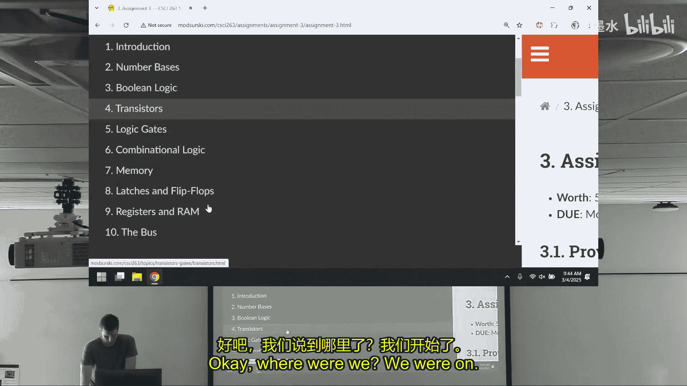
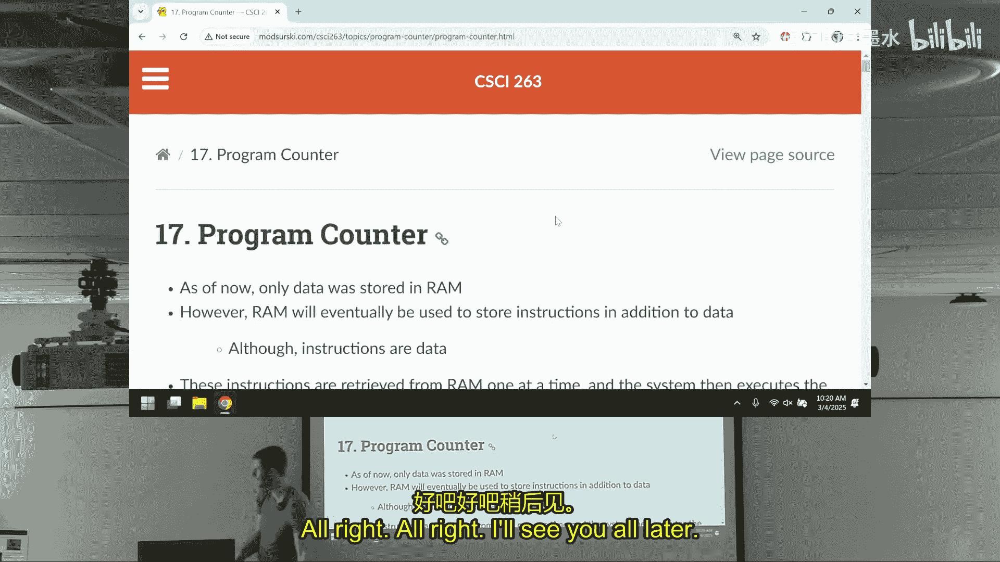

# 020：输出寄存器与程序计数器




在本节课中，我们将学习如何将七段数码管显示功能集成到我们的计算机系统中，并引入一个关键的组件——输出寄存器。我们还将初步探讨程序计数器的概念，这是实现系统自动执行指令的关键一步。

## 输出寄存器设计回顾

上一节我们介绍了如何生成七段数码管的查找表。本节中，我们来看看如何将这个显示模块与我们的系统总线连接起来。

核心问题在于，数据总线上的数据是不断变化的。如果我们直接将总线数据送入显示模块，显示内容会不停地闪烁，无法稳定输出我们想要的值。

解决方案是使用一个**输出寄存器**。其工作原理与地址寄存器类似：当我们需要输出一个特定值时，就将数据总线上的值存入这个寄存器。之后，无论总线上的数据如何变化，输出寄存器都会保持其值不变，并稳定地驱动七段数码管进行显示。

以下是输出寄存器模块的核心设计思路：
```verilog
// 伪代码示意：将数据总线上的8位数据和符号控制信号锁存到输出寄存器
always @(posedge clock) begin
    if (output_enable) begin
        output_register <= {sign_bit, data_bus[7:0]};
    end
end
// 输出寄存器的值（包含符号位）作为查找表的输入，驱动数码管
seven_seg_display <= lookup_table[output_register];
```

## 将输出模块集成到系统

现在，我们将这个设计集成到现有的计算机系统中。

我们的系统现在包含以下主要模块：
*   RAM 和地址寄存器
*   两个通用寄存器 A 和 B
*   算术逻辑单元 (ALU)
*   **输出寄存器与显示模块**

通过控制各种控制信号（如 `ram_out`, `a_out`, `alu_out`, `output_in` 等），我们可以将数据在总线、寄存器、ALU和输出设备之间移动。例如，要计算并显示 `A + B` 的结果，需要以下步骤：
1.  将数据从 RAM 加载到寄存器 A。
2.  将数据从 RAM 加载到寄存器 B。
3.  设置 ALU 为加法模式，并将其结果输出到总线。
4.  将总线上的结果存入输出寄存器进行显示。

这个过程虽然功能完整，但需要手动操作每一个控制信号，非常繁琐。这引出了我们下一个核心需求：让系统能够自动执行一系列指令。

## 迈向自动化：程序计数器简介

目前，我们的系统缺乏自我控制能力。执行一个简单的加法并输出，就需要我们手动触发多个步骤。在高级语言中，我们编写程序后，计算机会自动按顺序执行指令。

这种自动顺序执行的能力，依赖于一个称为**程序计数器** 的部件。程序计数器可以理解为“指令指针”，它存储着下一条将要执行的指令在内存中的地址。

其基本工作流程如下：
1.  根据程序计数器的值，从内存中取出指令。
2.  执行该指令。
3.  程序计数器自动递增，指向下一条指令的地址。
4.  重复此过程。

引入程序计数器是让我们的系统从“可操控的计算器”迈向“可存储程序、自动运行的计算机”的关键一步。它引入了**自我引用**的能力——系统能够读取并修改自己下一步要做什么的“计划”。

自我引用在计算中非常强大，但有时也会带来有趣的逻辑悖论（例如“这句话是假的”）。然而，正是这种能力赋予了计算机自动运行程序的魔力。

## 课程总结

本节课中我们一起学习了：
1.  **输出寄存器的作用与设计**：通过锁存数据，将易变的总线数据稳定地输出到显示设备。
2.  **完整系统的集成**：将RAM、寄存器、ALU和输出设备通过数据总线与控制信号连接起来，形成一个可手动编程的计算系统。
3.  **当前系统的局限性**：手动控制信号效率低下，系统无法自动执行指令序列。
4.  **程序计数器的引入**：作为实现指令自动顺序执行的核心部件，它是我们构建真正“存储程序式计算机”的下一块基石。



通过本节课，你应该能清晰地看到，复杂的计算机功能是如何从晶体管、逻辑门等基础部件一层层构建起来的。我们距离一个能够自动运行程序的完整计算机模型又近了一步。