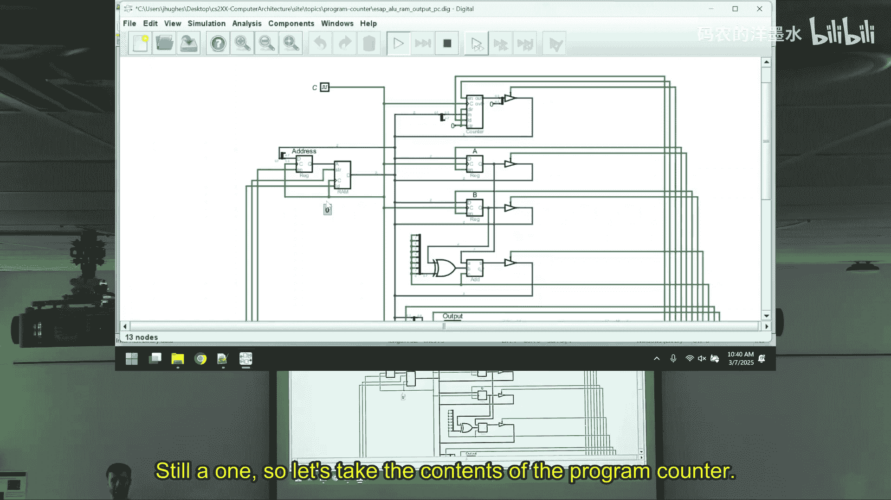
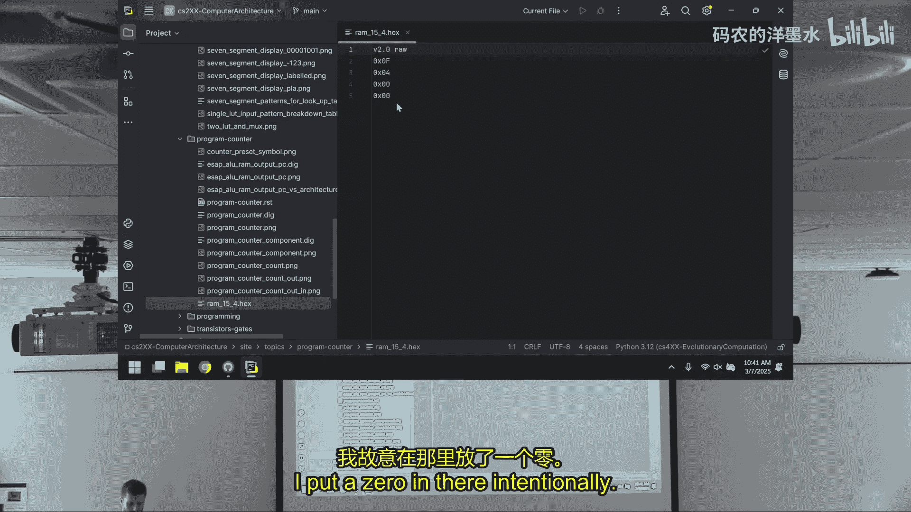
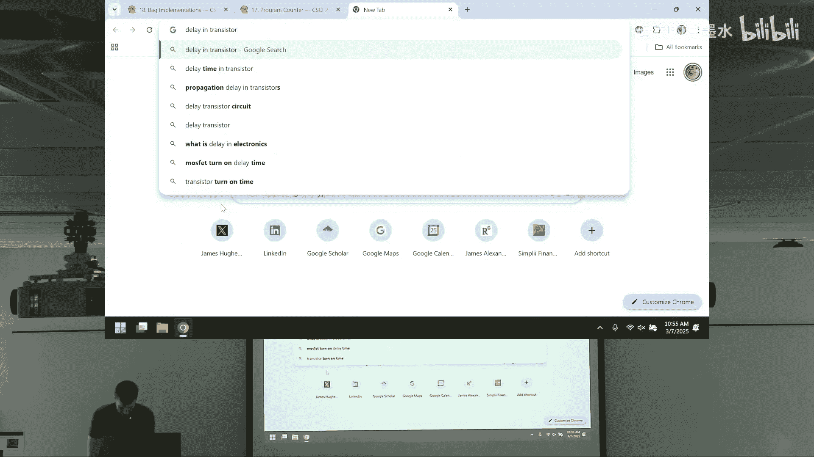
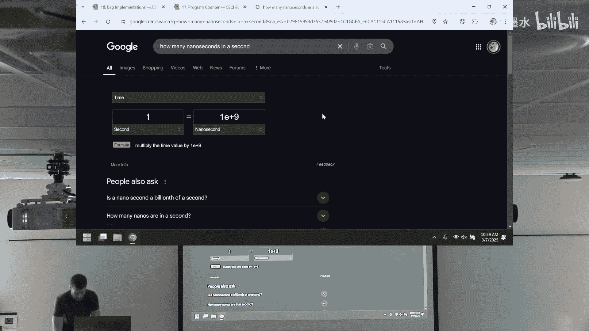
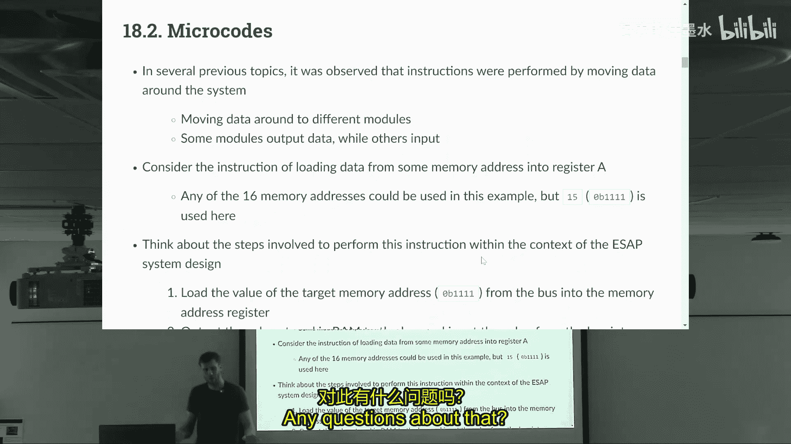

# 022：程序计数器的操作与指令启动 🚀

在本节课中，我们将学习如何操作程序计数器来运行程序，并探讨如何在不手动输入数据的情况下，让系统自主执行指令。我们将看到程序计数器如何引导指令的读取与执行，并初步了解指令和微码的概念。

## 程序计数器的基本操作

上一节我们介绍了程序计数器的基本结构。本节中，我们来看看如何使用它来启动一个程序。

程序计数器当前保存着值0。当系统运行时，地址寄存器和其他寄存器初始值都是0。但在实际硬件中，它们可能包含任意值。为了演示，我们假设它们从0开始。

我们需要将地址0处的数据（例如15）加载到寄存器A中。以下是操作步骤：

1.  将程序计数器的值输出到数据总线。
2.  将该值锁存到地址寄存器中。
3.  从RAM中读取该地址的数据。
4.  将数据锁存到寄存器A中。

同时，在读取当前指令后，我们需要递增程序计数器，为获取下一条指令做好准备。关键点在于，**递增程序计数器**和**将RAM数据加载到寄存器B**这两个操作可以同时进行，因为程序计数器的递增独立于数据总线。

通过以上步骤，我们成功执行了“将地址0的数据加载到A，将地址1的数据加载到B”的操作，而无需手动拨动任何数据输入开关。

## 实现循环与跳转

现在，程序计数器的值是2。假设我们需要回头再次读取地址0和地址1的数据（例如为了执行减法），但程序计数器已经指向了2。

我们可以利用内存中的内容来更新程序计数器。例如，地址2处存储的值是`A0`（在演示中代表0）。操作步骤如下：

1.  将程序计数器的当前值（2）输出。
2.  将其锁存到地址寄存器。
3.  从该地址（2）读取数据（`A0`，即0）。
4.  将这个数据（0）锁存回程序计数器。

这样，程序计数器的值就被重置为0。现在，我们可以重复之前的步骤，再次从地址0和地址1加载数据。这演示了**利用程序计数器实现循环**的能力。本质上，我们可以通过修改程序计数器的值，跳转到内存中的任意地址。

## 同步性与时序警告 ⚠️

在尝试同时进行“程序计数器输出”和“程序计数器递增”操作时，我们需要考虑物理时序问题。

理论上，如果所有信号完美同步，在时钟脉冲边沿，地址寄存器会锁存旧值（例如0），而程序计数器会同时递增为新值（例如1）。但在物理现实中，信号通过晶体管和线路存在纳秒级的延迟。

如果“程序计数器递增并输出新值”的路径延迟，小于“地址寄存器锁存输入值”的延迟，那么地址寄存器就有可能错误地锁存到递增后的新值（1），而不是预期的旧值（0）。这种**竞争条件**是超频计算机可能不稳定的根本原因之一。因此，更安全的做法是避免在从程序计数器读取数据的同时使其递增。

## 迈向自动执行：指令与微码

到目前为止，我们仍需手动控制每一个控制信号来执行操作。然而，我们观察到，每一个基本操作（如从RAM加载数据到寄存器）都遵循一个固定的、可重复的控制信号序列。

这引出了核心概念：**指令**。我们希望用一条高级命令（如“LOAD A, [0]”）来替代这一系列繁琐的低级控制信号操作。这条命令就是一条指令。

我们的系统设计约束决定了指令的格式：
*   数据总线宽度为8位，因此每条指令也必须为8位。
*   为了直接寻址16字节的RAM，我们需要4位来指定地址（操作数）。
*   剩下的4位用于指定操作类型（操作码）。

这意味着我们的系统最多支持 **2^4 = 16** 条不同的指令。操作码（高4位）指定“做什么”，操作数（低4位）指定“对谁操作”。例如，指令 `0001 1111` 可能表示“将地址15（1111）的数据加载到寄存器A（假设操作码0001代表LOAD A）”。

而执行一条指令所需的一系列低级控制步骤（如“程序计数器输出 -> 地址寄存器输入 -> RAM输出 -> 寄存器A输入”），就称为**微码**。微码是硬件真正执行的动作序列，是指令在更底层的具体实现。

## 设计指令集的考量

作为设计者，我们需要决定指令集的复杂度。这是一个权衡：
*   **复杂指令**：一条指令可以完成较多工作（如直接从内存加载数据到寄存器），但需要更多微码步骤，硬件控制逻辑更复杂。
*   **简单指令**：指令非常基础（如“将数据从总线移动到寄存器A”），硬件简单，但编写程序时需要更多指令，代码更冗长。

我们的ESAP系统采用了折中的设计：指令包含一个操作码和一个操作数，足够表达“从内存某地址加载到寄存器”或“将某寄存器值加到另一寄存器”这样的基本操作。

本节课中我们一起学习了程序计数器的核心操作，包括读取指令、递增和跳转。我们探讨了硬件时序同步的重要性，并初步引入了**指令**与**微码**的关键概念，理解了我们的8位系统如何通过 `4位操作码 + 4位操作数` 的格式来编码命令，为接下来实现一个能够自动执行指令的计算机奠定了基础。