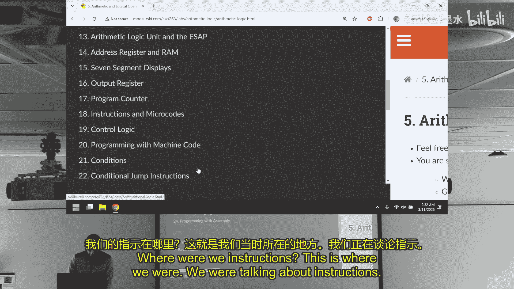
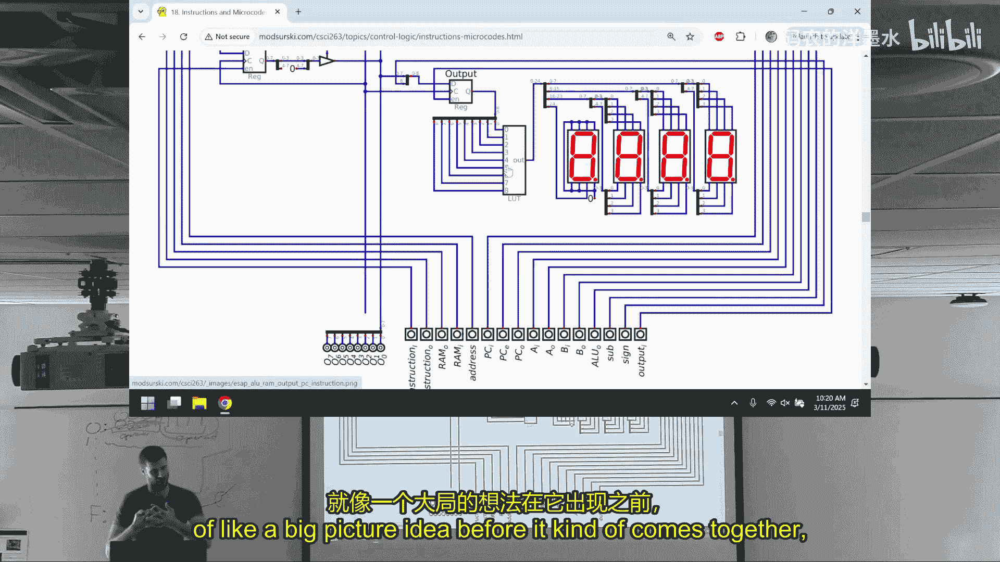

# 023：指令、微码与取指

在本节课中，我们将要学习计算机指令、微码以及指令的取指过程。我们将探讨如何设计指令集，理解微码如何控制硬件执行指令，并详细说明计算机如何从内存中获取指令以开始执行。

## 指令与微码

上一节我们介绍了计算机通过控制信号进行计算。本节中我们来看看如何让计算机自己控制这些信号，即通过编写指令来实现。

我们有一个8位宽的数据总线，可以从RAM中一次取出8位数据。当这8位是数据时，它可以表示0到255之间的值。但当它作为指令时，情况就不同了。

指令通常包含操作码和操作数。我们决定使用4位表示操作码，4位表示操作数。这意味着我们可以有 **2^4 = 16** 种不同的操作，以及 **2^4 = 16** 种不同的操作数。由于我们的RAM有16个地址，用4位来指定地址是完美的。

我们作为系统设计者，可以决定指令集包含哪些指令。我们希望指令具有一定的通用性，但又不能过于复杂。指令的执行步骤被称为**微码**，即控制信号的位模式。

考虑一个将数据从某个RAM地址加载到寄存器A的指令。其执行步骤如下：
1.  将操作数（内存地址）放入地址寄存器。
2.  将该地址对应的RAM数据输出到寄存器A。

每个步骤需要一个时钟脉冲，因此这个指令需要两个微码（即两个时钟周期）。我们可以将这两个微码步骤组合成一个“加载到A”的指令，而不是设计两个独立的、功能单一的指令，这样可以节省宝贵的指令编码空间。

**核心概念**：一条指令可能对应多个微码步骤。微码是控制硬件信号的低级位模式，而指令是程序员（或编译器）使用的高级命令。

## 指令集设计权衡

我们只有16条指令的编码空间，因此必须谨慎选择指令。我们需要在指令的**特异性**和**通用性**之间取得平衡。

*   **过于具体**：例如，设计一条“将值放入地址寄存器”的指令。虽然这是许多操作的必要步骤，但它本身很少独立使用，会占用一条指令编码。
*   **适度通用**：例如，设计一条“从地址X加载数据到寄存器A”的指令。它内部包含“放入地址寄存器”和“从RAM加载到A”两个微码步骤。这样更实用，且节省了指令空间。

通过将常用的微码序列组合成单条指令，我们提高了编程的便利性，同时保持了接近硬件的控制能力。历史上，像《过山车大亨》这样的游戏因其大量使用汇编语言（接近微码级别）而能高效利用硬件性能。然而，现代编译器在生成优化代码方面通常已超越人类。

## 冯·诺依曼架构与指令存储

我们的系统采用**冯·诺依曼架构**，即指令和数据共享同一内存空间。这与哈佛架构（指令和数据内存分开）不同。

在RAM中，我们既存储指令，也存储数据。例如，内存地址0可能存储一条指令 `01011111`（前4位`0101`是操作码，后4位`1111`是操作数），而地址15（`1111`）则可能存储一个数据，比如 `01101111`。

计算机需要区分这些位模式是作为指令还是数据来解释，这取决于上下文和使用方式。

## 取指周期与指令寄存器

要执行任何指令，计算机首先必须从内存中获取它。这个过程称为**取指周期**。

由于数据总线是共享的且数据是瞬态的，我们需要一个专门的**指令寄存器**来保存取出的指令，以便解码和执行，同时释放总线用于数据传输。

取指周期的步骤如下：
1.  **程序计数器输出**：程序计数器（PC）存储下一条要执行的指令地址（初始为0）。将其值放到总线上。
2.  **地址寄存器输入**：将总线上的地址值锁存到地址寄存器中。
3.  **RAM输出**：读取该地址对应的指令数据到总线上。
4.  **指令寄存器输入**：将总线上的指令锁存到指令寄存器中。
5.  **程序计数器递增**：同时，程序计数器自动加1，指向下一条指令地址。此操作不占用总线。

**核心流程**：
`PC_out -> Address_in, RAM_out -> IR_in, PC++`

因此，**每条指令的执行都从取指周期开始**，这需要2个时钟周期。加上指令本身执行所需的微码步骤（例如加载指令需要2步），执行一条完整的指令总共可能需要4个时钟周期。

## 指令寄存器设计

指令寄存器需要存储完整的8位指令，并能将其中的操作数（低4位）放回总线，以便传输到系统其他部分（如地址寄存器）。

其设计思路是：输入时接收8位数据；输出时，只将低4位操作数补零后放到8位总线上，而高4位操作码则保留在寄存器内部，用于后续的解码和控制。

考虑之前从RAM加载数据到寄存器A的例子，其完整的微码序列如下：
1.  **取指1**：`PC_out`, `Address_in`
2.  **取指2**：`RAM_out`, `IR_in`, `PC++`
3.  **执行1**：`IR_out` (低4位), `Address_in`
4.  **执行2**：`RAM_out`, `A_in`

## 总结与展望

本节课中我们一起学习了：
1.  **指令与微码**：指令由操作码和操作数组成，一条指令的执行可能对应多个微码步骤。
2.  **设计权衡**：指令集设计需要在特异性与通用性、控制力与编码空间之间取得平衡。
3.  **冯·诺依曼架构**：我们的系统使用统一的内存存储指令和数据。
4.  **取指周期**：执行任何指令前，必须通过一个固定的步骤（取指）将指令从内存加载到指令寄存器，这需要2个时钟周期。
5.  **指令寄存器**：用于暂存指令，隔离总线，并能提供操作数供系统使用。

目前遗留的核心问题是：系统如何根据指令寄存器中的操作码（高4位）来确接下来需要执行哪些具体的微码步骤？这就是**指令解码与控制单元**的工作，这将是我们下节课要探讨的内容。理解了这个过程，计算机自动运行程序的完整图景就将拼凑完整。