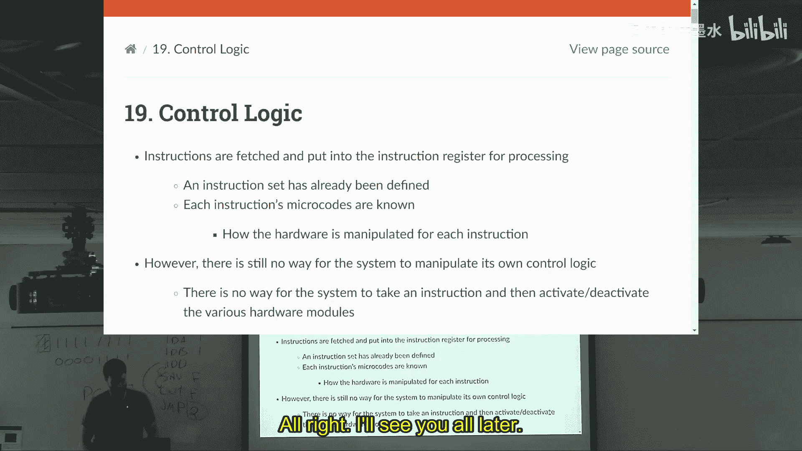

# 024：指令集 📚

在本节课中，我们将学习计算机指令集的基本概念，了解如何为我们的硬件系统定义一组具体的指令，并探讨在设计指令集时需要考虑的各种权衡。

上一节我们介绍了指令寄存器和取指周期，本节中我们来看看如何定义一套完整的指令集，让计算机能够执行具体的任务。

## 指令集概述

指令集是特定硬件可以执行的一系列指令的集合。例如，从RAM加载数据到寄存器A，我们的硬件可以做到，因此这可以成为我们指令集的一部分。我们的硬件没有乘法能力，因此指令集中不能包含乘法指令（至少在硬件层面）。我们最多可以定义16条不同的指令，因为我们的指令码只有4位。

## 我们的指令集设计

以下是我们的系统将包含的13条指令。每条指令都有一个唯一的4位二进制码（操作码）来标识。我们预留了3个位置（操作码）以备将来添加新指令。

以下是13条指令的列表：

*   **`NOP` (0000)**：无操作。这条指令不执行任何动作，但可以作为精确的时间延迟使用。
*   **`LDA` (0001)**：从RAM加载到A。操作数指定要从中加载数据的RAM地址。**高级微码步骤**：1. 取指。2. 将操作数（地址）输出到地址寄存器。3. 将RAM中的数据输出到寄存器A。
*   **`LDI` (0010)**：直接加载到A。操作数本身就是要加载到A的4位数据。**高级微码步骤**：1. 取指。2. 将操作数（数据）输出到寄存器A。
*   **`LDB` (0011)**：从RAM加载到B。功能同`LDA`，但目标寄存器是B。
*   **`LDI` (0100)**：直接加载到B。功能同`LDI`，但目标寄存器是B。
*   **`STA` (0101)**：将A保存到RAM。操作数指定要保存到的RAM地址。**高级微码步骤**：1. 取指。2. 将操作数（地址）输出到地址寄存器。3. 将寄存器A的值输出到RAM。
*   **`STB` (0110)**：将B保存到RAM。功能同`STA`，但源寄存器是B。
*   **`ADD` (0111)**：A加B。将寄存器A和B的值相加，结果存回A寄存器（A = A + B）。这条指令不需要操作数。
*   **`SUB` (1000)**：A减B。将寄存器A的值减去B的值，结果存回A寄存器（A = A - B）。这条指令不需要操作数。
*   **`JMP` (1001)**：无条件跳转。操作数指定要跳转到的指令地址（即下一条要执行的指令地址）。**高级微码步骤**：1. 取指。2. 将操作数（地址）输出到程序计数器。
*   **`OUT` (1010)**：输出无符号整数。操作数指定包含要输出数据的RAM地址。**高级微码步骤**：1. 取指。2. 将操作数（地址）输出到地址寄存器。3. 将RAM中的数据输出到输出寄存器（无符号模式）。
*   **`OUT` (1011)**：输出有符号整数。功能同`OUT`，但输出寄存器设置为有符号整数模式。
*   **`HLT` (1111)**：停机。停止程序的执行。

## 设计考量与权衡

设计指令集是一个工程权衡的过程。我们选择的这13条指令旨在提供基本功能的同时，尽量减少程序占用的RAM空间和指令执行所需的时钟周期数。

*   **指令的通用性与专用性**：例如，我们可以设计一条`ADD`指令，将结果直接保存到RAM或输出寄存器，而不是累加器A。这可能会减少某些特定程序的指令条数，但会占用一个宝贵的指令码位置。对于通用系统，我们选择更基础的指令，将复杂操作留给软件（多条指令组合）完成。
*   **硬件能力与指令定义**：指令必须基于现有硬件能力。我们的硬件可以执行加法，所以可以有`ADD`指令。硬件不能直接执行乘法，所以不能有`MUL`指令（但可以通过软件实现）。
*   **操作数限制**：`LDI`（直接加载）指令只能加载4位数据（0-15），无法直接加载负数，因为4位操作数在放入8位寄存器时高位补零，无法形成负数的二进制补码形式。这是系统设计带来的一个限制。
*   **寄存器的作用**：在我们的设计中，B寄存器主要作为算术运算的第二个操作数。我们也可以选择不设计加载/保存B的指令，从而腾出指令码给其他操作，但这会增加编程时数据移动的步骤。

## 指令执行流程

每条指令的执行都始于**取指周期**：
1.  程序计数器输出地址到地址寄存器。
2.  RAM在该地址的数据被读入指令寄存器。
3.  程序计数器加1，指向下一条指令。

取指完成后，指令寄存器中的操作码被解码，控制系统随后执行该指令对应的具体微码步骤（如上面列表所述）。

本节课中我们一起学习了指令集的概念，并为我们设计的计算机定义了一套包含13条指令的集合。我们探讨了每条指令的含义、执行步骤，以及在设计指令集时面临的通用性与效率之间的重要权衡。理解这些是理解计算机如何从底层硬件执行高级任务的关键。下一节，我们将探讨**控制逻辑**，即系统如何自动解码指令并执行相应的微码步骤。