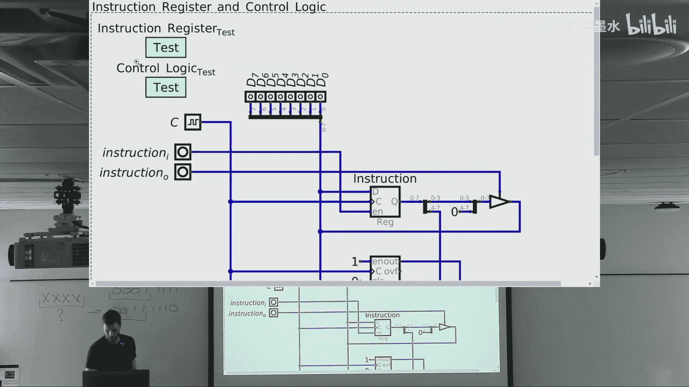

# 025：控制逻辑 🧠


在本节课中，我们将要学习如何将指令与计算机的控制逻辑连接起来，从而实现指令的自动执行。我们将探讨指令解码、微码步骤的概念，以及如何通过一个查找表将指令操作码映射到具体的控制信号。


---


## 指令集设计的灵活性


上一节我们介绍了指令集的设计。本节中我们来看看指令集设计的一个核心特点：灵活性。


我们花费了大量时间讨论将要包含在系统中的指令。需要强调的是，这些指令的具体定义完全由我们决定。它们如何工作、具体执行什么操作，都由我们定义。例如，输出指令可以总是输出寄存器A的值，或者输出特定内存地址的值。加法指令可以总是与寄存器A相加，或者与特定内存地址的值相加。我们在这里采用了一种方式，但这并不意味着这是唯一正确或更好的方式，它只是众多可能方式中的一种。


此外，指令的编码顺序，例如“从RA加载到A”的编码是`0001`，这本身并没有特殊含义。顺序基本上是任意的。虽然并非完全随意，但顺序在这里并不重要。我是按照逻辑分组来排列它们的：加载指令、保存指令、算术指令等。但`0001`这个编码本身并不承载特殊意义。


一个例外是，`0000`被定义为“无操作”指令。因为`0`代表“无”，无操作指令也代表“无”。所以这里有一些逻辑。但其他指令的编码顺序并不重要。即使将“停机”指令放在最后，或者将“无操作”设为`0000`，也并非绝对必要，但将`0000`设为无操作有最充分的理由：它全是零，代表“无”。


---


## 连接指令与控制逻辑

我们已经明确了指令包含操作码和操作数，它们以比特模式存在。我们知道指令需要经过取指（需要几个步骤），并放入指令寄存器中开始解码。但我们仍然缺乏让系统自动操纵其控制逻辑的方法。

我们能够手动控制控制逻辑。想象一下系统启动时，我们手动设置所有控制信号。我们也有办法获取指令并将其隔离，准备执行。但我们还没有将指令与系统控制信号的自动操纵连接起来，以实现自动计算。


我们需要一种物理方式，让系统知道如何实际执行一条指令。这里的“物理”指的是电路中的实际连接，即使在模拟器中也是如此。我们需要将指令以某种方式连接到控制信号上，这些信号能物理地激活或停用系统的各个部分。


我们讨论过指令寄存器。指令由操作码和操作数组成。操作数（最低有效4位）可以输出到总线（高位补零）。而操作码（最高有效4位）则悬置在此，需要以某种方式处理。但我们之前也看到，不能简单地使用一个静态查找表，直接将指令映射到控制信号，因为像“加载A”这样的指令需要多个步骤（不包括取指周期）。我们不能说“取这个指令，然后执行那个控制信号”，因为我们有多个步骤。


但是，我们可以通过一个巧妙的小技巧来实现。


---


## 微码与微码计数器 🧩

考虑一下：操作码指定了要执行的指令。每个指令都需要一定数量的步骤（微码步骤）。例如，“从RAM加载到A”需要两个步骤（加上之前取指的两个步骤），总共四个步骤。无论执行什么指令，我们都需要一定数量的步骤，这些步骤称为微码。

因此，我们需要一个**微码计数器**。这是另一个计数器，其目的是跟踪我们当前处于哪个微码步骤。在数字模拟器中，有内置的计数器组件。虽然它也是一个计数器，但它与程序计数器类型不同，我们不会向它加载数据，它只是持续计数。


操作码可以用来指定为执行该指令而需要按顺序执行的步骤。操作码将操纵系统的控制信号。但问题在于，每个指令（操作码）需要多个控制信号，所以每个操作码实际上需要多次改变控制信号。

以“从RAM加载数据到寄存器A”这个指令为例，它有四个微码步骤。我们需要让操作码`0001`意味着依次执行这四个步骤。首先执行步骤A，然后B，然后C，然后D。


在我们设计的13条指令中：
*   一条指令（无操作）需要2个步骤（仅取指）。
*   6条指令需要3个步骤。
*   另外6条指令需要4个步骤。


为了简单和一致，我们将每个指令视为一组四个步骤。这样，我们可以将操作码和微码步骤计数结合起来，唯一地标识每个指令的每一个微码步骤。


---


## 组合标识与查找表 📚

我们可以将操作码（4位）和微码步骤计数（2位）组合成一个6位的标识符。这样就有 `2^6 = 64` 个唯一的微码步骤。我们可以将其逻辑上分解为16组，每组4个步骤，每组对应一个指令。


因此，在有了跟踪微码步骤的机制（计数器）后，我们仍然可以使用一个查找表。这个查找表将操作码和2位微码计数器步骤映射到特定微码步骤的控制逻辑信号。


例如，如果输入是 `000110`（操作码`0001`，微码步骤`10`），查找表就会输出对应于“指令寄存器输出，地址寄存器输入”的控制信号模式。

微码计数器与程序计数器不同，它每个时钟周期都会计数，因为我们不需要控制它的使能，每个微码步骤都必须在一个时钟周期内发生。


---


## 实现细节：查找表与脚本

在当前ESAP系统配置下，我们有17个控制信号。因此，我们需要一个将6位输入映射到17位输出的查找表。输出的每一位对应一个特定的控制信号。

以下是标记这17个控制信号的常量定义（使用下划线增强可读性）：
```python
HALT = 0b1_0000000_00000000
ADDR_IN = 0b0_1000000_00000000
RAM_IN = 0b0_0100000_00000000
RAM_OUT = 0b0_0010000_00000000
IRO = 0b0_0001000_00000000 # 指令寄存器输出
IRI = 0b0_0000100_00000000 # 指令寄存器输入
B_IN = 0b0_0000010_00000000
ALU_SIGN = 0b0_0000001_00000000
ALU_SUB = 0b0_0000000_10000000
ALU_OUT = 0b0_0000000_01000000
B_OUT = 0b0_0000000_00100000
A_OUT = 0b0_0000000_00010000
A_IN = 0b0_0000000_00001000
PC_OUT = 0b0_0000000_00000100
PC_ENABLE = 0b0_0000000_00000010
PC_IN = 0b0_0000000_00000001
```
这些常量的数值代表了其对应控制信号为高电平时的比特模式。顺序是为了视觉清晰而设定的，只要连接正确，顺序本身并不重要。

要创建一个需要多个控制信号同时为高的微码步骤，我们可以使用**按位或**操作来组合这些常量。例如，要表示“指令寄存器输出”和“地址寄存器输入”这两个信号同时有效，只需计算 `IRO | ADDR_IN`。结果是一个新的整数，其比特模式就是这两个信号比特模式的合并。

我们将为16条指令中的每一条定义一个包含最多4个微码步骤的列表。每个微码步骤就是通过按位或组合相应控制信号常量得到的整数。前两个微码步骤对所有指令都是相同的，即**取指周期**。

例如，无操作指令的微码列表可能是：
```python
[PC_OUT | ADDR_IN, RAM_OUT | IRI | PC_ENABLE, 0, 0]
```
而“从RAM加载到A”指令的列表可能是：
```python
[PC_OUT | ADDR_IN, RAM_OUT | IRI | PC_ENABLE, IRO | ADDR_IN, RAM_OUT | A_IN]
```
通过编写一个脚本，我们可以自动生成包含所有64种（16指令 x 4步骤）映射关系的查找表十六进制文件，从而避免手动填写的繁琐和错误。


---


## 启动与执行流程的思考

最后，思考一下系统启动时的执行流程会很有趣。当系统首次上电时，指令寄存器中的内容是未知的（在物理电路中）或为零（在数字模拟器中默认值）。为了执行第一条指令，我们必须先取指。但取指操作本身是作为当前指令（可能是无操作或随机值）的微码步骤的一部分来执行的。

实际上，我们总是在执行**上一条指令**的取指步骤，来获取**下一条指令**。由于所有指令的取指步骤都是相同的，因此无论当前指令寄存器里是什么，系统都能正确地开始取指周期，并将下一条指令加载进来。这形成了一个连贯的流水线：一个指令的执行步骤和下一个指令的取指步骤在时间上是重叠的。

这种设计确保了指令流的连续性。理解这一点有助于厘清控制逻辑中指令解码与执行的时序关系。

---




本节课中我们一起学习了如何通过微码计数器和查找表将指令操作码转换为控制信号序列，从而实现指令的自动执行。我们了解了指令执行的步骤化本质（微码），以及如何灵活地定义和修改指令集。这是连接软件指令与硬件操作的核心机制，是理解计算机如何工作的关键一步。