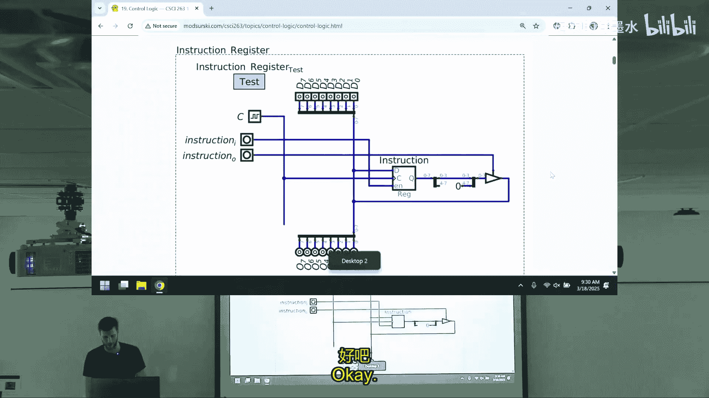
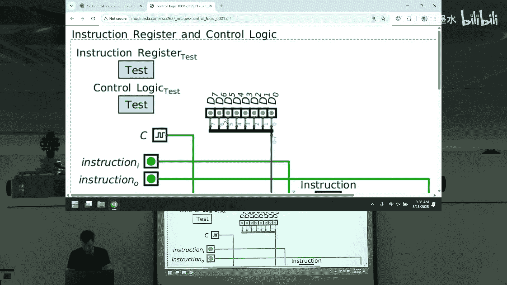
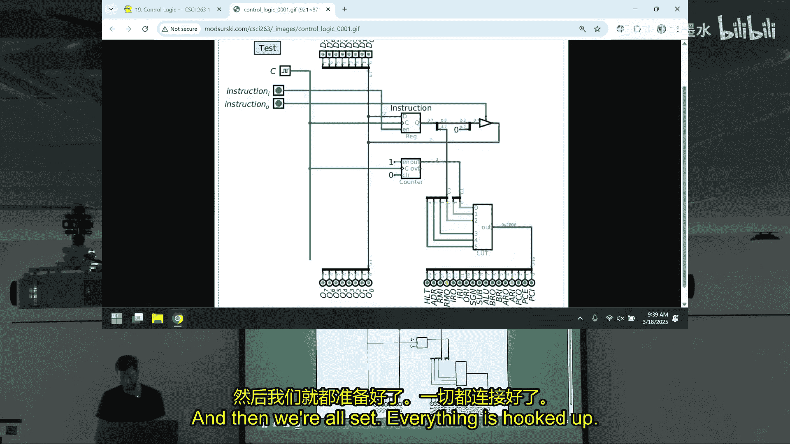
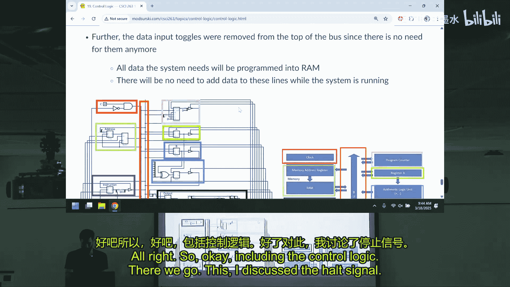
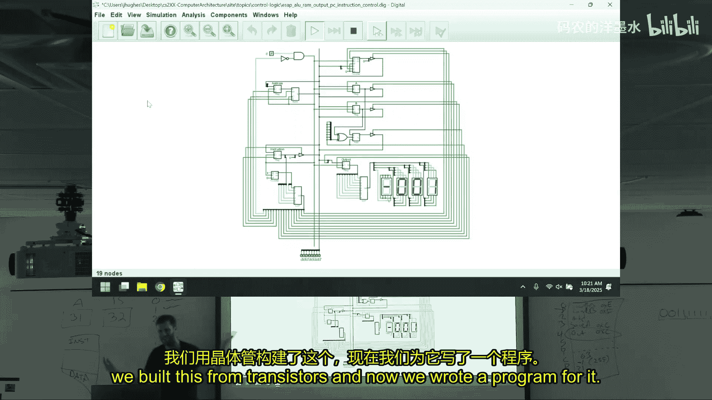

# 026：机器码编程



在本节课中，我们将学习如何为我们的计算机系统编写机器码程序。我们将回顾控制逻辑的实现，并编写一个简单的程序来执行加法和减法运算，最终在输出寄存器中显示结果。

---

## 回顾控制逻辑

上一节我们介绍了控制逻辑的核心组件。我们通过一个查找表（Lookup Table）将指令的操作码（Opcode）和微码计数器（Microcode Counter）的当前步骤映射到具体的控制信号。



这个查找表有6个输入位：4位用于指令操作码，2位用于标识当前是四步微指令中的哪一步。输出是17位的控制信号，每一位对应计算机中一个特定模块（如程序计数器、寄存器A等）的使能信号。



我们通过Python脚本生成了这个查找表的内容，并将其保存为十六进制文件，供我们的硬件模拟器加载。

---

## 将控制逻辑集成到系统



现在，我们需要将这个控制逻辑集成到我们的ESAP计算机设计中。这主要涉及添加微码计数器和查找表，并将查找表的17个输出信号连接到对应的硬件模块控制线上。

集成完成后，系统就具备了自动执行指令的能力。时钟信号会驱动微码计数器步进，查找表则根据当前指令和步骤输出正确的控制信号序列，从而执行完整的指令。

---

## 编写机器码程序

系统搭建完毕后，我们就可以开始为它编程了。与高级语言不同，我们需要直接编写机器码，即由0和1（或十六进制表示）组成的指令序列。

我们的目标是编写一个程序，计算 `31 + 32` 和 `31 - 32` 并输出结果。

以下是解决此问题的步骤分解：

1.  **加载数据**：将数值31和32从RAM加载到寄存器A和B。
2.  **执行加法**：将A和B相加，结果存回A。
3.  **保存结果**：将加法结果（A中的值）保存回RAM的特定地址。
4.  **输出结果**：从RAM中读取加法结果并输出到无符号输出寄存器。
5.  **重新加载数据**：为了做减法，需要重新将31加载到A（32已在B中）。
6.  **执行减法**：计算A减B，结果存回A。
7.  **保存结果**：将减法结果保存到RAM的另一个地址。
8.  **输出结果**：从RAM中读取减法结果并输出到有符号输出寄存器（因为结果可能是负数）。
9.  **停止程序**：执行HALT指令。

---

## 程序实现细节

以下是具体的实现考量：

*   **数据存储**：由于31和32大于4位二进制能表示的范围（0-15），我们必须将它们预先存储在RAM中。我们选择将31放在地址`E`，32放在地址`F`。
*   **指令编码**：我们需要将每一步操作翻译成对应的4位操作码。
*   **操作数处理**：对于不需要操作数的指令（如ADD、SUB、HALT），我们习惯上将操作数字段设为`0`，以使代码更清晰。
*   **内存布局**：我们需要小心安排指令和数据的存储位置，避免运行时的数据覆盖了程序指令。通常将数据放在程序指令区域之后。

根据我们的指令集，程序的机器码（十六进制表示）如下所示：

```
v2.0 raw
1E
3F
70
5C
DC
1E
3F
80
6D
ED
F0
00
00
00
1F
20
```

**代码行解释：**

*   `1E`: **LOAD A from RAM**，操作数为`E`（地址）。
*   `3F`: **LOAD B from RAM**，操作数为`F`（地址）。
*   `70`: **ADD A, B**，操作数`0`被忽略。
*   `5C`: **SAVE A to RAM**，操作数为`C`（目标地址）。
*   `DC`: **OUTPUT UNSIGNED**，操作数为`C`（源地址）。
*   `1E`: **LOAD A from RAM**，从地址`E`重新加载31。
*   `3F`: **LOAD B from RAM**，从地址`F`重新加载32（此步可省略，但为清晰保留）。
*   `80`: **SUB A, B**，操作数`0`被忽略。
*   `6D`: **SAVE B to RAM**，操作数为`D`（目标地址）。注意：减法结果在A中，但SAVE B指令会将当前B的值（仍是32）存入D，这里原叙述有误，正确应为SAVE A到地址D。
*   `ED`: **OUTPUT SIGNED**，操作数为`D`（源地址）。
*   `F0`: **HALT**，操作数`0`被忽略。
*   `00`: **NO-OP**，填充。
*   `00`: **NO-OP**，填充。
*   `00`: **NO-OP**，填充。
*   `1F`: **数据** 31（十进制）。
*   `20`: **数据** 32（十进制）。

---

## 在系统中运行程序

将上述机器码文件加载到系统的RAM中。启动时钟后，系统开始自动执行：

1.  程序计数器从0开始，依次获取并执行指令。
2.  执行加法指令后，计算结果63被存入RAM地址`C`，并输出到无符号输出寄存器。
3.  执行减法指令后，计算结果-1（其二进制补码形式为`FF`）被存入RAM地址`D`，并输出到有符号输出寄存器，显示为-1。
4.  执行HALT指令后，时钟信号被阻断，程序停止运行。

通过观察输出寄存器的值，我们可以验证程序正确计算出了63和-1。

---

## 总结

本节课中我们一起学习了机器码编程。我们从回顾控制逻辑的实现开始，了解了微码如何驱动硬件。然后，我们详细探讨了如何将一个简单的高级语言任务分解为底层机器指令，并考虑了数据表示、内存布局等细节问题。最后，我们编写了具体的机器码程序，并在我们构建的计算机系统上成功运行，看到了加法`31+32=63`和减法`31-32=-1`的正确结果。



这个过程清晰地展示了高级软件功能与底层硬件操作之间的桥梁——指令集架构。我们做出的每一个硬件设计决策（如有哪些指令、指令如何工作）都直接决定了软件编写的方式和可能性。