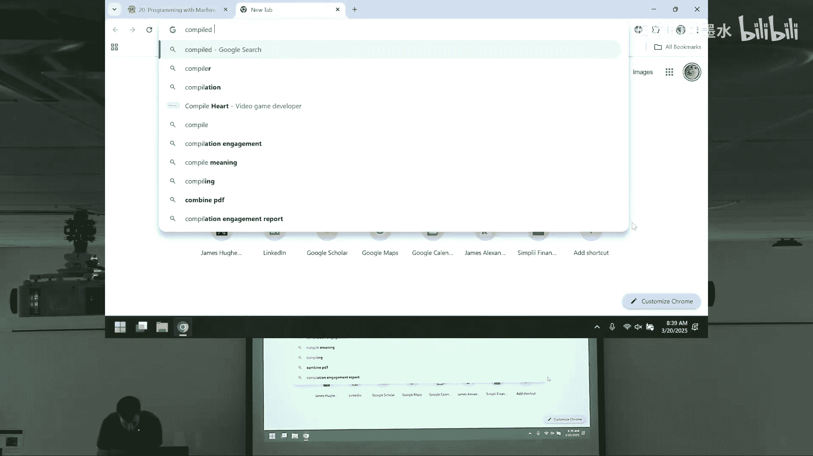
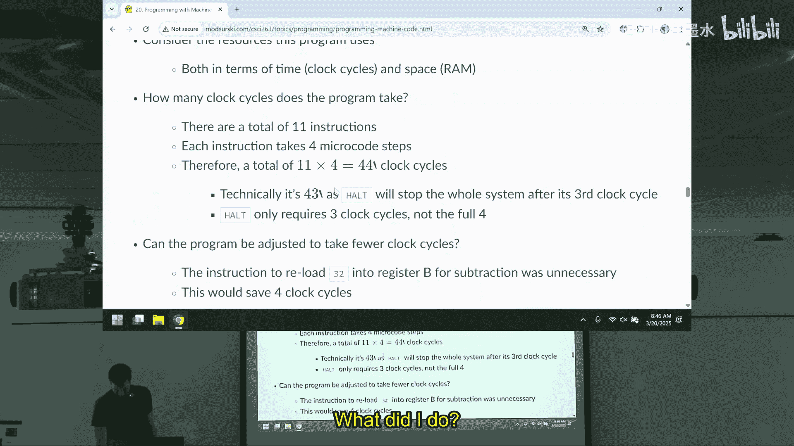
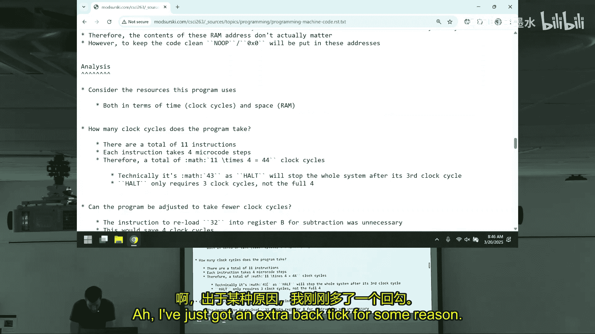
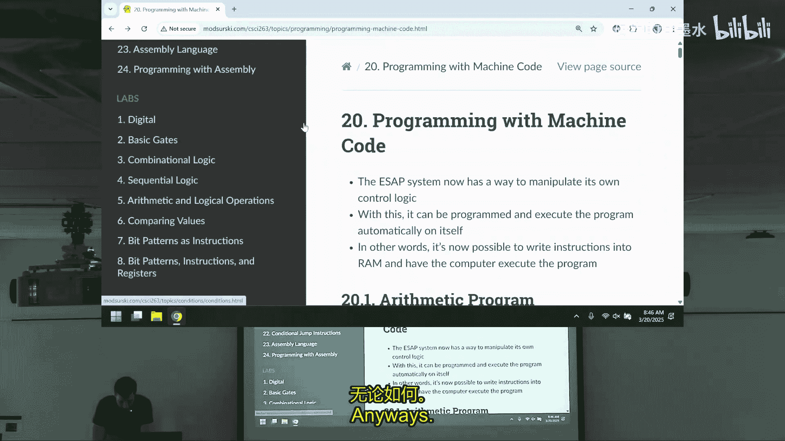
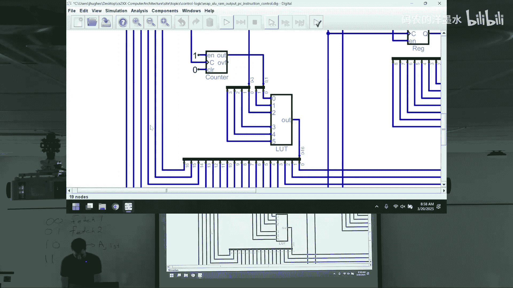
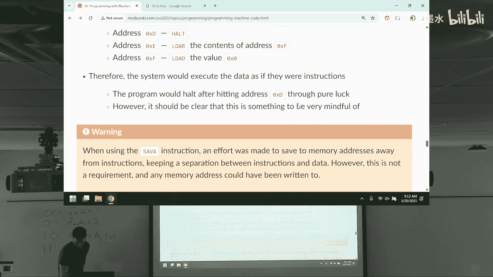
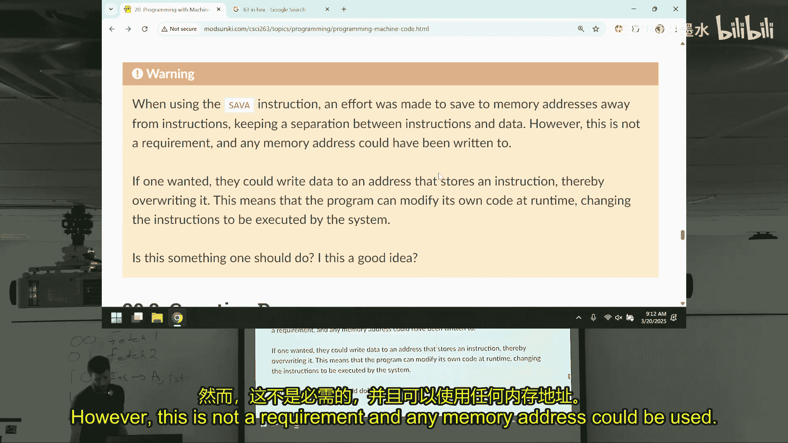
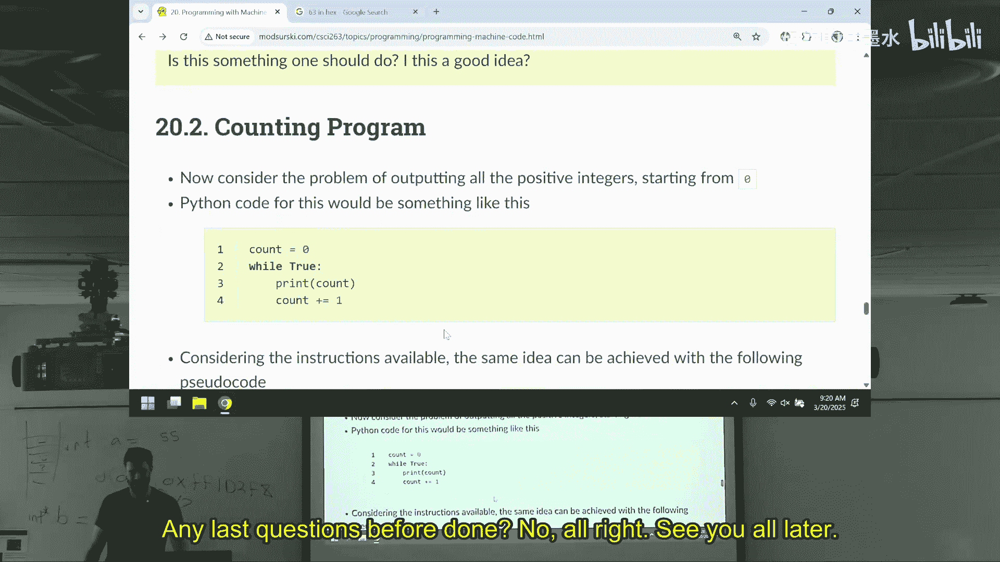

# 027：机器码分析 🧮

在本节课中，我们将深入分析一段用于执行加法和减法运算的机器码程序。我们将探讨其工作原理、资源消耗（时间和空间），并讨论如何对其进行优化。通过这个过程，你将理解机器码的本质以及程序设计与硬件之间的权衡。

---

## 程序回顾

上一节我们介绍了机器码的基本概念。本节中，我们来看看之前用于计算 `31 + 32` 和 `31 - 32` 的程序。

该程序完全由机器码构成。我们记得，这部分是指令，而这一部分是数据（即数字31和32）。如果想改变运算的数字，只需修改此处的数据即可。

这些数字以十六进制表示，但本质上它们是二进制。例如，`1E` 在二进制中是 `00011110`。使用十六进制是因为它更简洁，每四位二进制数对应一位十六进制数，便于阅读。

观察这段代码，我们可以清楚地知道其含义：从RAM加载到A寄存器，从RAM加载到D寄存器，执行加法，保存无符号结果；然后再次加载，执行减法，保存有符号结果。这些字母和数字直接对应着具体的操作。

顺便说明，这就是我们所说的**机器码**。我们输入0和1，它告诉计算机执行特定操作。这些就是指令。

这是程序真正在硬件上运行的地方。查找表虽然提供了一层抽象，但它本质上只是可编程逻辑阵列的替代品。我们完全可以用门电路和晶体管来构建硬件，直接解释这些二进制模式（如 `00 01` 表示加法）。查找表只是一个从输入映射到输出的工具，但它仍然运行在硬件之上。

因此，机器码是软件与硬件交互的最终形式。虽然这里显示为十六进制，但它对应着电路中的高低电压，正是这些电压驱动着计算。

我们之前能够手动操作控制信号来完成计算，而现在系统可以自动执行。此外，我们使用了两个内存地址来存储和与差的结果。需要明确的是，硬件会在运行时将结果保存到这些RAM地址中。

---

## 从高级语言到机器码

现在我们对硬件及其上运行的软件有了一些了解。让我们花点时间思考一下，高级语言代码是如何变成机器码的。

当我们用机器码编写程序来解决问题时，其思路与用其他任何语言编写代码是一样的。区别在于这种语言的能力。在Python中，我可以直接写 `print(31 + 32)`，它就执行了。但在机器码中，这涉及更多步骤。

在Python代码实际运行于计算机之前，它需要经过许多步骤（例如编译），最终转换成能在计算机上运行的机器码。你们使用的计算机很可能是X86架构，它有自己的一套指令集。我们这里使用的系统比X86简单得多，但从技术上讲，它正变得同样强大。

当你编写C语言代码并编译时，它就会变成能在你计算机上运行的0和1，最终形式就类似于我们看到的这段机器码。

以C语言中的 `int a = 31;` 为例。这相当于把31存入某个位置。但在机器码层面，我们需要知道这个值具体存储在哪个地址（例如地址 `E`）。每次访问它，都需要知道这个地址。此外，高级语言中的“类型”（如整数、字符）信息在机器码中并不存在，这需要由程序员自己来管理和解释。

从 `int a = 31;` 这样的简单语句到具体的机器码指令，中间涉及许多转换步骤。

---

## 程序结构与未使用的空间

由于程序中的每一行都对应一个RAM地址，所以在运行前，每个地址都应该有内容。然而，在运行时之前，地址B、C和D的内容并未被使用（尽管C和D在程序运行中会被写入）。

如果我们在文件中留空这些行，模拟器可能会自动填入0。因此，这些行在运行前未被使用，但为了规范，我们可以填入0。

另外，因为程序中存在 `halt`（停止）指令，地址A处的指令永远不会被执行（程序会在那之前停止）。程序计数器不再移动，无法获取下一条指令。因此，我们在这些地址中放入什么内容实际上并不重要，可以填入0。

以上内容主要是对之前知识的回顾。

---

## 程序资源分析

接下来，我们对这段代码进行一些分析。我们不是做计算复杂度分析（这个程序是常数时间复杂度），而是思考它使用了多少资源。

我们主要关注两种资源：
1.  **时间**：以时钟周期衡量。
2.  **空间**：以占用的RAM衡量。

### 时间消耗分析

程序总共有11条指令。在我们的系统中，每条指令无论内容如何，都需要 **4个** 时钟周期（因为包含取指阶段）。

因此，总时钟周期数为 `11 * 4 = 44`。

严格来说，是 **43** 个时钟周期。因为 `halt` 指令实际上只需要3个时钟周期。在第三个微码步骤中，它会停掉时钟，因此无法执行第四个微码步骤。如果时钟停了，微码计数器就不会运行，意味着什么都不会发生。所以，`halt` 只需要3个时钟周期。

那么，能否调整程序以减少时钟周期数，从而节省时间呢？

回顾程序：前三条指令加载31到A，加载32到B，然后相加。当我们进行减法 `31 - 32` 时，第8条指令需要将31重新加载到A（因为A是累加器，值会被覆盖），然后下一条指令又将32重新加载到B。

这第二次加载 `32` 到 `B` 是**完全不必要的**。我们可以去掉这条指令。这样我们就节省了1条指令，也就是 **4个时钟周期**。

这节省了多少呢？大约是总工作量的 **9.1%**，接近10%的速度提升，这相当不错。

当然，这里存在权衡。显式地重新加载数据使代码意图更清晰、更易于理解。但这牺牲了近10%的运行时间。在高级语言中，我们可以编写非常自描述的代码，因为编译器会将其优化为高效的机器码。而机器码本身则倾向于为了速度而变得“丑陋”和紧凑。在这个层面上，我们追求的是节省资源。

### 空间消耗分析

程序总共占用了 **15** 个内存地址：11条指令，2个数据地址，以及运行时还会使用2个地址（存储结果）。

我们可以将其减少到 **12** 个地址。冗长的代码可能易于理解，但如果我们有更大的程序，需要用到所有16个内存地址，而程序需要17个时，我们就需要优化以使其能装入16个地址。

以下是节省空间的方法：
1.  首先，如上所述，去掉那条不必要的 `load 32 into B` 指令，这既节省时间，又节省一个内存地址。
2.  其次，在设计中，我将加法结果存入地址C，减法结果存入地址D。但实际上，我可以将加法结果存入地址D，输出它，然后用减法结果**覆盖**地址D中的值再输出。因为我不需要永久保存加法结果，这样可以节省一个内存地址。
3.  更进一步，我甚至可以覆盖最初存储数据 `32` 的地址F。一旦将32加载到B寄存器，这个地址的数据就不再需要了，我可以把结果存到F地址，从而节省更多RAM。

这可能会让你感觉有点奇怪，因为我们在用数据覆盖“程序代码”区域。但请记住，在冯·诺依曼架构中，**指令和数据共享同一个内存空间**。因此，我们可以随意“破坏”RAM。

---

## 代码与数据的交织及其风险

我可以将结果存储到地址0（即第一条指令的位置）。这会覆盖第一条指令。这可行吗？从系统角度看，**可以**。因为一旦那条指令被执行完毕，在这个程序的逻辑下就再也用不到它了，那块空间就空闲了。

但这感觉很奇怪，我们在用数据覆盖指令。然而，本质上我们只是用一组0和1替换了另一组0和1。重要的是这个位模式的含义。

想象一下，如果我说“将结果存入地址4”（即 `halt` 指令的位置）会怎样？这可能不是个好主意，因为这会改变计算机认为的下一条指令。

考虑一下，如果程序中没有包含 `halt` 指令会怎样？系统会继续取指并执行。它可能会取到我们刚刚存入的结果数据（例如63，即十六进制的 `3F`），并将其作为指令解码（巧合的是，`3F` 对应 `load B from RAM address 15`）。然后它可能继续执行后续内存中的内容，将所有数据都当作指令来执行。

这完全是巧合，因为数据的位模式恰好对应某些有意义的（或无意义的）指令。系统只是忠实地获取内存内容，并将这些0和1解释为指令，因为它就是这样设计的。

这一切都是指令和数据共享内存的结果。这有好有坏。它意味着**程序实际上可以修改自己的代码**。

例如，如果我有一条指令是 `load A from RAM E`，后来我想把它改成 `load A from RAM F`，理论上我可以通过运算直接修改内存中该指令的位模式。这可以实现动态代码修改，甚至用于创建病毒或非常灵活的编程技巧，但也极其危险，容易导致系统崩溃。

在高级语言如C/C++中，通过指针算术，程序员也能直接操作内存地址，修改任意位置的内容，这同样非常强大但也非常危险。集成开发环境（IDE）可能会警告你，但语言本身是允许这样做的。

因此，在使用 `save A` 这类指令时，我们通常努力将数据保存在远离指令的区域，保持指令和数据的分离。然而，这并不是硬性要求，任何内存地址都可以被使用。我们必须非常清楚自己在做什么。

---

## 总结

本节课中，我们一起学习了：
1.  **机器码的本质**：它是直接在硬件上运行的二进制指令。
2.  **程序资源分析**：我们分析了示例程序的时间和空间消耗，计算其需要约43个时钟周期和15个内存地址。
3.  **优化权衡**：探讨了通过移除冗余指令来优化程序性能（节省约10%时间）和内存占用，并理解了代码可读性与运行效率之间的权衡。
4.  **冯·诺依曼架构的特点**：指令与数据共享内存空间，这使得程序可以修改自身代码，既带来了灵活性，也引入了风险。
5.  **从高级语言到机器码**：理解了高级语言语句需要经过编译等步骤转换为底层机器码，以及在机器码层面管理数据地址和类型信息的必要性。

通过这次分析，你应该对程序如何在最底层运行，以及如何思考和优化底层代码有了更深入的认识。