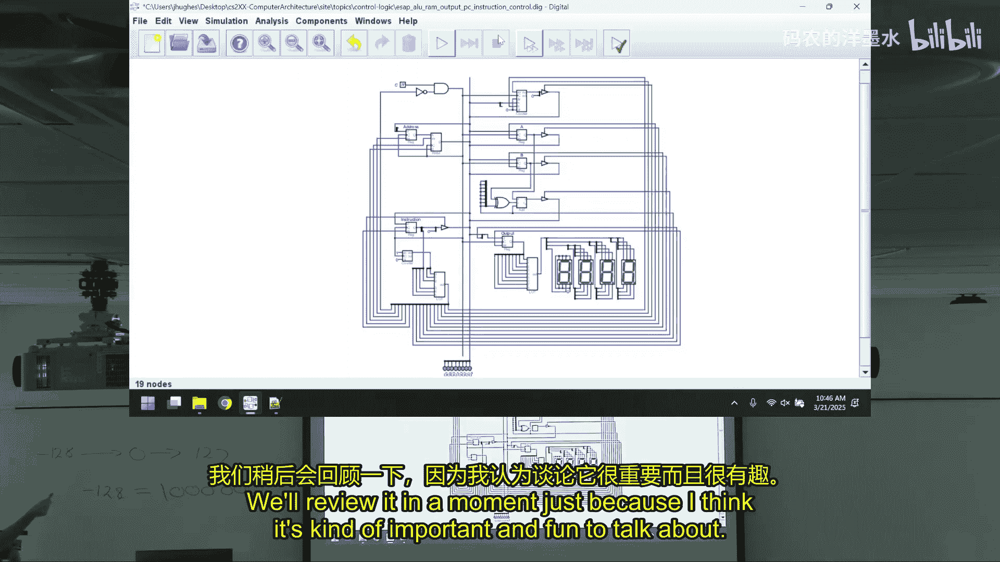
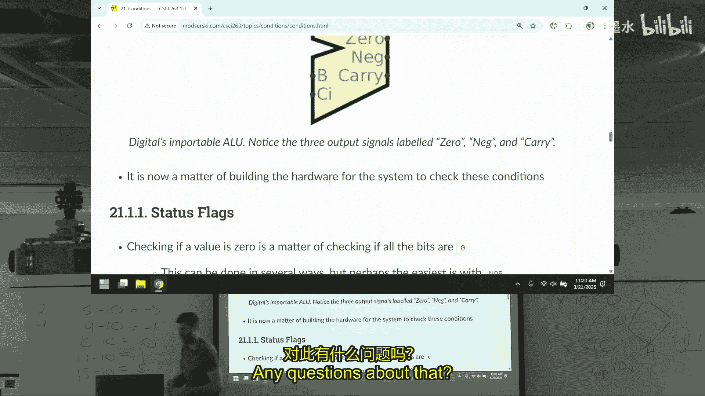

# 028：计数程序与条件判断 🧮

在本节课中，我们将学习如何编写一个简单的计数程序，并探讨当前计算机系统在实现条件判断（如if语句）方面的局限性。我们将从编写机器码开始，逐步分析如何让程序循环计数，并思考如何为系统添加“决策”能力。

---

## 计数程序示例 🔢

上一节我们讨论了向内存地址保存数据可能带来的问题。本节中，我们来看看如何编写一个简单的计数程序。

我们的目标是创建一个程序，能够从0开始计数，一直数到255，然后重新从0开始，如此循环往复。在Python中，这样的程序可能如下所示：
```python
count = 0
while True:
    print(count)
    count += 1
```

### 机器码实现思路

为了实现这个功能，我们需要将其转化为机器指令。以下是实现该逻辑所需的步骤：
1.  将0加载到寄存器A中。
2.  将1加载到寄存器B中。
3.  将寄存器A的值保存到内存。
4.  输出保存的值。
5.  执行加法操作（A = A + B）。
6.  跳转回第3步，重复执行。




以下是该程序的完整机器码（十六进制表示）：
```
2 0    // 将0直接加载到寄存器A
4 1    // 将1直接加载到寄存器B
5 F    // 将寄存器A的值保存到内存地址F
D      // 输出无符号整数
7      // 执行加法 (A = A + B)
9 2    // 跳转到地址2（即保存指令）
```

**核心循环**由`保存 -> 输出 -> 加法 -> 跳转`这几个步骤构成。程序没有停止指令，因此会无限运行下去。当计数值达到255（二进制`11111111`）后加1，进位会丢失，寄存器A的值会回绕到0，计数重新开始。

### 程序演示与变体

运行该程序，可以观察到从0到255的循环计数。我们还可以轻松地修改程序行为：
*   **有符号输出**：将输出指令从`D`（无符号）改为`E`（有符号），计数将从0到127，然后跳到-128，再回到0。
*   **修改计数步长**：将加载到寄存器B的值从1改为其他数（如3），程序就会以该步长进行计数。
*   **反向计数**：将加法指令`7`替换为减法指令`8`，即可实现递减计数。

---

## 当前系统的关键限制：无法进行条件判断 ⚠️

虽然我们的系统可以执行循环和算术运算，但它缺少一个关键功能：**根据条件做出决策（即分支）**。

例如，我们无法实现这样一个逻辑：“如果某个值小于10，则输出1，否则输出0”。用高级语言描述如下：
```python
value = load_from_memory()
if value < 10:
    output(1)
else:
    output(0)
halt()
```

### 理想的分支逻辑

如果我们的指令集包含一条“条件跳转”指令，我们就可以将上述逻辑重构为：
1.  从内存加载待检查的值到寄存器A。
2.  **如果 A < 10，则跳转**到输出1的代码段。
3.  否则，顺序执行输出0的代码段。
4.  停止。

这要求硬件能够根据某个“条件”（如“值是否小于0”、“结果是否为0”）来决定是否执行跳转。然而，我们当前的系统只有**无条件跳转**指令，它总是会跳转，无法实现条件判断。

---

## 迈向条件判断：需要什么？🔧

要为系统添加决策能力，我们需要引入**条件跳转**指令。这需要额外的硬件支持来检测和记录运算的“状态”。

### 核心状态标志

通常，算术逻辑单元(ALU)会生成几个关键的状态标志，这些标志是条件判断的基础：
1.  **零标志(Z)**：当运算结果等于0时置位。
2.  **负标志(N)**：当运算结果的最高位（符号位）为1时置位。在解释为有符号数时，这通常表示结果为负。
3.  **进位/溢出标志(C/V)**：当加法或减法操作产生进位或溢出时置位。

### 条件跳转的设计思路

有了这些状态标志，我们就可以定义新的指令，例如：
*   `JUMP_IF_ZERO`：如果零标志为真，则跳转。
*   `JUMP_IF_NEGATIVE`：如果负标志为真，则跳转。
*   `JUMP_IF_CARRY`：如果进位标志为真，则跳转。

仅凭检测**一个条件**（例如结果是否为0），理论上就足以构建出图灵完备的系统，可以计算任何可计算的问题。然而，提供更多样的条件判断（如是否小于0、是否溢出）可以**极大地提高编程的灵活性和效率**。

例如，仅用“等于零”判断来实现“是否小于10”，可能需要循环递减并多次检查，效率较低。而如果硬件能直接提供“小于零”的状态，我们只需计算`value - 10`并检查其负标志即可，一步完成。

---

## 总结 📝

本节课中我们一起学习了：
1.  如何用机器码编写一个**无限循环的计数程序**，并理解了其底层执行流程。
2.  认识到我们当前设计的计算机系统一个主要限制是**缺乏条件判断（分支）能力**，这阻碍了其实现更复杂的逻辑。
3.  探讨了为实现条件判断所需引入的**硬件特性**，即由ALU产生的**状态标志**（零、负、进位/溢出）。
4.  理解了**条件跳转指令**如何基于这些状态标志工作，以及为什么添加这些指令能显著增强系统的能力和编程便利性。



下一讲，我们将开始着手设计这些状态标志电路，并为我们的计算机系统添加至关重要的条件判断功能。