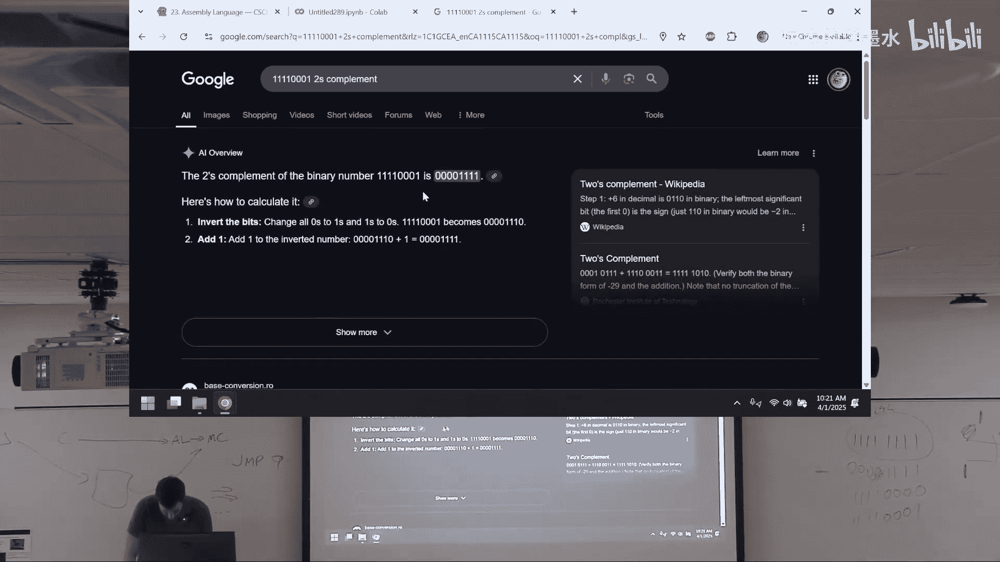

# 031：汇编器 🧩

在本节课中，我们将学习如何通过汇编语言来简化机器码编程。我们将了解汇编器的基本概念、工作原理，并探讨如何为我们的EAP系统构建一个简单的汇编器。

---

上一节我们介绍了如何使用条件跳转进行编程。本节中，我们来看看如何通过汇编语言让编程过程变得更加简单和直观。

## 汇编器的必要性

EAP系统虽然功能完整，但直接使用机器码编程并不方便。机器码容易出错，且需要记忆二进制或十六进制模式。汇编语言通过使用助记符（mnemonics）和更友好的语法，在机器码之上增加了一层抽象，使编程体验得到显著改善。

汇编器是一个将汇编语言转换为机器码的程序。它本质上是一个查找和替换工具，将人类可读的指令标签和字面值转换为机器能够理解的二进制代码。

## 汇编语言的核心特性

以下是汇编语言相较于机器码的两个关键改进：


1.  **使用助记符**：用易于记忆的标签代替二进制操作码。例如，用 `LOAD A DIRECT 5` 代替二进制码 `00100101`。
2.  **灵活的字面值表示**：允许程序员以十进制、二进制或十六进制等多种格式表示数字。汇编器会负责将其转换为正确的二进制值。

一个典型的汇编语句与一条机器码指令是一一对应的关系。


## EAP汇编器设计

我们将为EAP系统设计一个汇编器。它主要实现以下功能：
*   将16条指令的助记符转换为对应的4位操作码。
*   解析不同进制的数字（如 `10`、`0b1010`、`0xA`）并将其转换为正确的二进制值。
*   处理负数，将其转换为补码形式。
*   进行基本的错误检查，例如程序是否超出RAM容量、操作数是否缺失或超出范围等。

我们不会实现更高级的功能（如内存地址标签），因为对于仅有16字节RAM的EAP系统来说过于复杂。

### 关键数据结构与函数

汇编器的核心是一个将助记符映射到操作码的字典：

```python
OPERATORS = {
    "NOP": 0b0000,
    "LDA": 0b0001,
    # ... 其他指令
    "HALT": 0b1111
}
```

此外，还需要以下辅助函数：
*   `parse_number(string)`: 将字符串形式的数字（如 `"10"`, `"0b1010"`, `"0xA"`）解析为整数。
*   `verify_number(num, max_bits)`: 验证数字是否能在指定的位数（如4位或8位）内表示。
*   `fix_negative(num, max_bits)`: 将负数正确处理为补码形式（由于Python整数存储的特殊性，此步骤需要额外注意）。

### 汇编过程示例

以下是一个判断数值是否小于10的程序的汇编代码与机器码对比：


**汇编代码:**
```
LDA RAM 0xF
LDB DIRECT 10
SUB
JUMPS 0x6
OUT UNSIGNED 0xD
HALT
OUT UNSIGNED 0xE
HALT
# 数据区
0x0
0x0
0x5
```


**对应的机器码 (十六进制):**
```
1F
28
5
C6
D0
F0
E0
F0
00
00
05
```

汇编器会读取汇编代码的每一行，将助记符替换为操作码，将数字转换为二进制值，并最终输出可供EAP系统直接加载的机器码。

---




本节课中，我们一起学习了汇编器的概念及其价值。我们了解到，汇编器作为机器码与程序员之间的桥梁，通过引入助记符和更灵活的数字表示法，显著降低了底层编程的复杂性。虽然我们的EAP汇编器功能简单，但它清晰地展示了从高级抽象到机器指令的转换过程。理解这一层，有助于我们更全面地认识计算机系统从软件到硬件的完整工作链条。