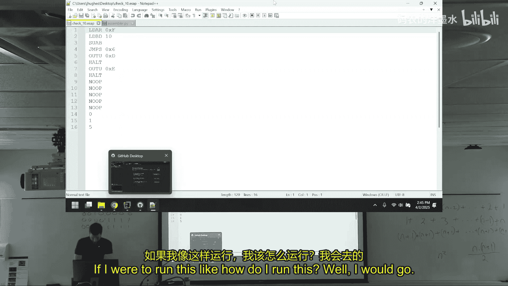
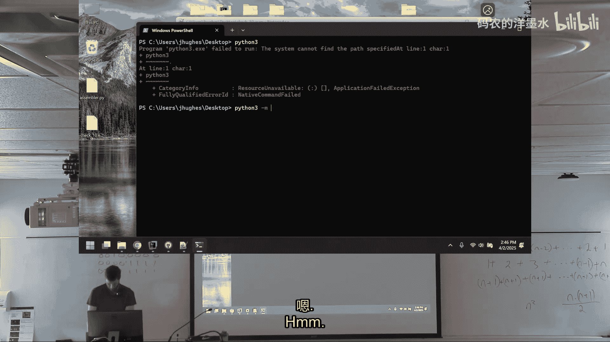
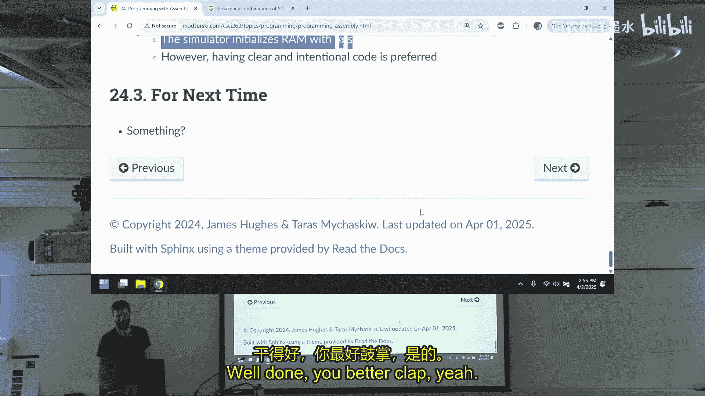

# 032：汇编器与汇编语言 🖥️

在本节课中，我们将学习汇编器的工作原理以及如何使用汇编语言编写程序。我们将从回顾上节课的常量解析开始，逐步深入到汇编器的核心逻辑，并通过具体示例展示如何将汇编代码转换为机器码。

## 概述

上节课我们介绍了常量解析和补码转换。本节中，我们将看看如何构建一个简单的汇编器，它能够读取汇编语言编写的程序，并将其转换为我们的ESAP计算机可以执行的机器码。

## 汇编器核心逻辑解析

汇编器的主要任务是将人类可读的汇编指令（如 `LOAD A, 15`）转换为机器码（如 `0x0F`）。其核心流程如下：

以下是汇编器工作的主要步骤：

1.  **读取命令行参数**：汇编器接受一个或两个参数。第一个参数是待汇编的源文件名。如果提供了第二个参数，则将其作为输出文件名；否则，默认输出文件为 `a.hex`。
2.  **读取并解析源文件**：打开源文件，逐行读取内容，并去除不必要的空白字符。程序大小被限制在16行以内，以匹配RAM的容量。
3.  **语法验证与指令解析**：对每一行程序进行语法验证。然后，将每行拆分为操作符和操作数两部分。
4.  **生成机器码**：
    *   如果该行是**指令**（操作符为字母），则从操作符字典中查找对应的机器码值，将其左移4位，然后与操作数进行按位或（`|`）运算，生成最终的机器码。
    *   如果该行是**数据**（直接是一个数字），则直接解析该数字作为机器码。
5.  **输出结果**：将生成的所有机器码行写入到指定的输出文件中。

## 代码实现详解

现在，我们来具体看看汇编器关键部分的实现逻辑。

### 常量与辅助函数

在脚本开始部分，我们定义了一些常量（如操作符到机器码的映射字典）和辅助函数（如 `parse_number` 用于解析数字）。

### 主程序流程

主程序逻辑封装在以下结构中：



```python
if __name__ == "__main__":
    # 检查命令行参数数量
    if len(sys.argv) not in [2, 3]:
        print("用法: python assembler.py <输入文件> [输出文件]")
        sys.exit(1)

    input_file = sys.argv[1]
    output_file = sys.argv[2] if len(sys.argv) == 3 else "a.hex"

    # 读取源文件
    with open(input_file, 'r') as f:
        program_lines = [line.strip() for line in f.readlines()]

    # 检查程序长度
    if len(program_lines) > 16:
        raise ValueError("程序过长，无法装入RAM。")

    machine_code = []
    # 主循环：逐行汇编
    for line in program_lines:
        verified_line = verify_syntax(line)
        parts = verified_line.split()
        
        if parts[0].isalpha():  # 处理指令
            op_code = OPERATOR_DICT[parts[0]]
            if parts[0] not in HAS_OPERAND:  # 无操作数指令
                operand = 0
            else:  # 有操作数指令
                operand = parse_number(parts[1])
            # 生成机器码: (操作码 << 4) | 操作数
            machine_line = (op_code << 4) | operand
        else:  # 处理数据
            machine_line = parse_number(parts[0])
        
        machine_code.append(machine_line)

    # 写入输出文件
    with open(output_file, 'w') as f:
        for code in machine_code:
            f.write(f"{code:02X}\n")
```



### 运行汇编器

要运行此汇编器，需要在命令行中执行以下命令：
```bash
python assembler.py 程序源文件.esap [输出文件.hex]
```
其中，`.esap` 是我们自定义的汇编源文件扩展名，`.hex` 是输出的机器码文件扩展名。文件扩展名本身并不重要，仅为标识用途。

## 汇编语言编程实践

使用汇编器，我们可以更轻松地编写程序。让我们回顾几个之前用机器码实现的例子，看看用汇编语言如何编写。

### 示例一：31 + 32 与 31 - 32

以下是实现31加32，然后计算31减32的汇编程序：

```
LOAD A, E
LOAD B, F
ADD
SAVE D
OUT D
LOAD A, E
SUB
SAVE D
OUTS D
HLT
E: 31
F: 32
```
这段代码比直接写机器码 `0x1E, 0x2F, 0x30, 0x7D, 0x90, 0x1E, 0x40, 0x7D, 0xA0, 0x00, 0x1F, 0x20` 更清晰易懂。

### 示例二：无限计数程序

这是一个从0开始无限计数的程序：

```
LOAD A, 0
LOAD B, 1
SAVE F
OUT F
ADD
JMP 2
```
其核心逻辑是不断将A和B相加（B固定为1），实现循环累加。

### 示例三：计数到10的程序

这个程序结合了循环和条件判断，计数到10后停止：

```
LOAD A, 0
SAVE F
LOAD A, F
LOAD B, 1
ADD
SAVE F
OUT F
LOAD B, 10
SUB
JNS 2
HLT
```
**关键点**：在进行减法比较以检查计数值是否达到10之前，必须先将当前的计数值（存储在寄存器A中）保存到RAM（如地址F）。因为减法操作会覆盖寄存器A中的值。比较后，如果结果小于10（符号位为负），则跳回地址2继续循环；否则顺序执行 `HLT` 停止。

## 总结



本节课中我们一起学习了汇编器的基本构造和工作原理。我们看到了一个简单的汇编器如何通过解析助记符、处理操作数来生成机器码。通过使用汇编语言，编程变得比直接操作机器码更加直观和高效。我们通过几个示例程序实践了汇编语言的编写，并理解了在流程控制中保存中间状态的重要性。掌握汇编器是理解高级语言如何最终被计算机执行的关键一步。