# 001：形式语言入门 🧠

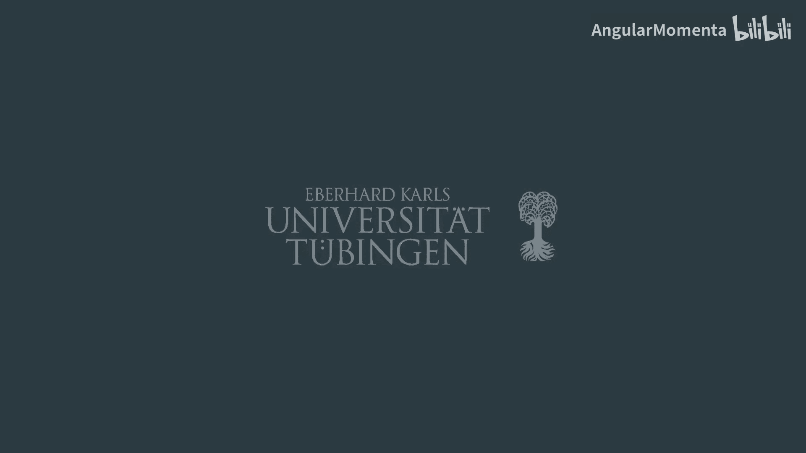

在本节课中，我们将要学习理论计算机科学的基础——形式语言。我们将从计算机科学的哲学与数学根源讲起，逐步引入形式语言的核心概念，包括字母表、字符串和语言的定义。内容将尽可能简单直白，让初学者能够看懂。

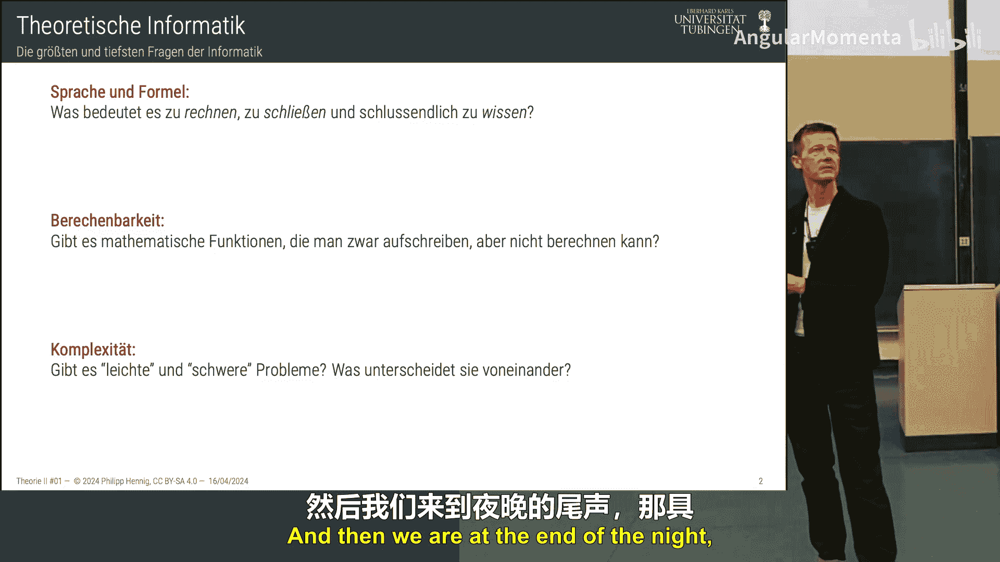

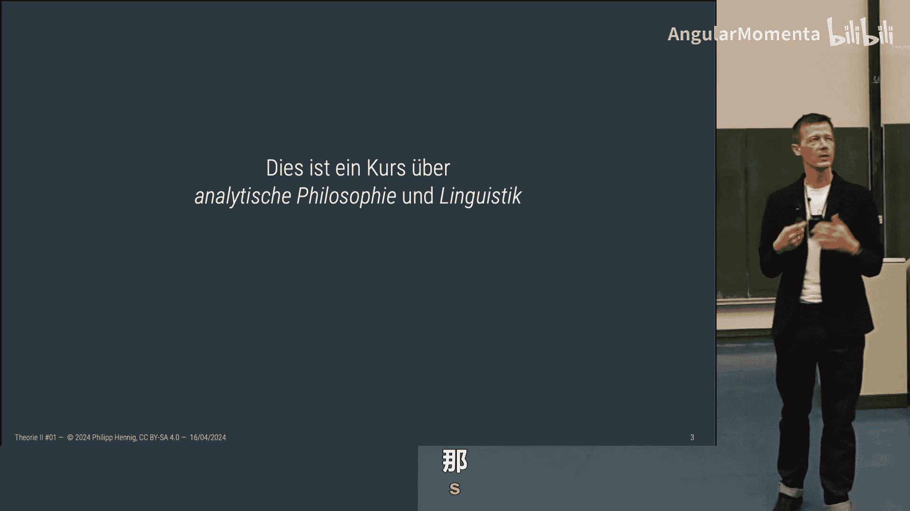

## 课程背景与哲学根源

理论计算机科学并非凭空产生，它深深植根于数学与哲学之中。上一节我们介绍了课程的总体框架，本节中我们来看看其思想渊源。

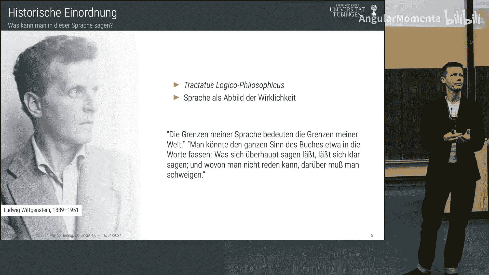

它始于对“计算”本质的哲学思考。数学家与哲学家如**希尔伯特**、**哥德尔**和**图灵**，为理解计算的界限奠定了基础。特别是库尔特·哥德尔的不完备性定理，表明了任何足够强大的形式系统都存在既不能被证明也不能被证伪的命题。

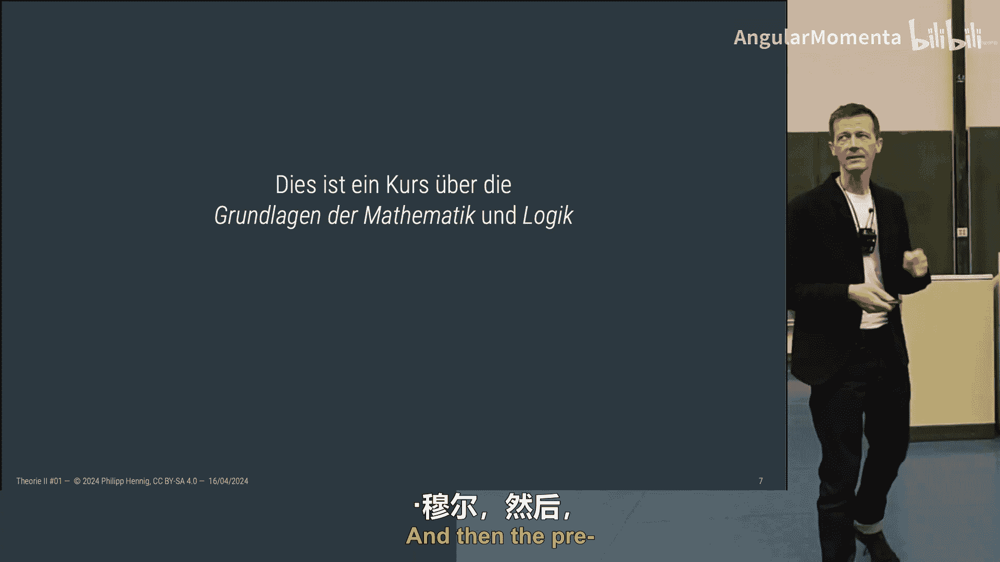

这直接引出了一个问题：什么是“可计算”的？阿兰·图灵通过定义**图灵机**（Turing Machine）为此提供了答案。图灵机是一个抽象的数学模型，它定义了什么是“算法”或“有效计算”。

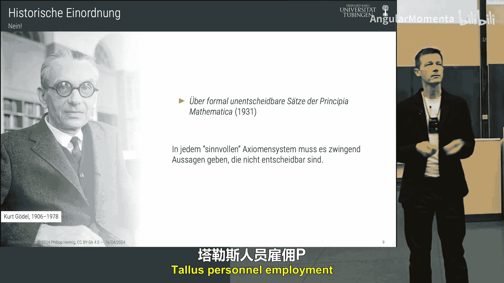

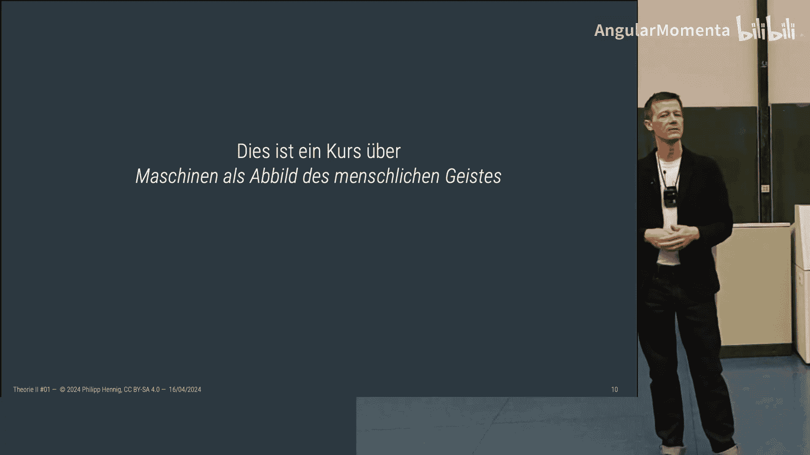

**图灵机**可以用以下方式简单理解：
```
一个无限长的纸带 + 一个读写头 + 一套状态转移规则 = 图灵机
```
它虽然简单，但被证明可以模拟任何现代计算机的算法过程。

因此，理论计算机科学位于数学、哲学和工程学的交叉点。它使用数学的精确工具（如集合、函数、逻辑）来形式化地研究计算过程、算法以及它们的能力与极限。

## 形式语言：沟通的数学基础

理解了计算模型的由来后，我们自然要问：计算机处理的是什么？答案是：**符号**和**由符号组成的结构**。这就是形式语言的研究范畴。

形式语言是**符号串**的集合，它为编程语言、编译器设计、协议规范等提供了严格的数学基础。它剥离了自然语言的歧义性，专注于语法结构。

## 核心概念定义

以下是形式语言中最基础的几个概念，我们将逐一进行定义。

### 1. 字母表

一切始于最基础的符号集合。

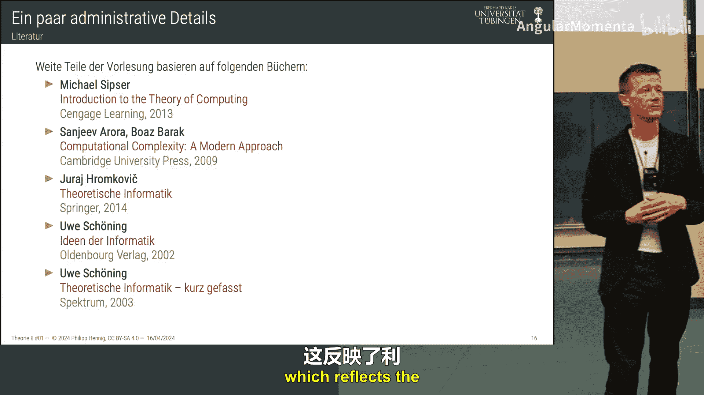

*   **定义**：字母表是一个**有限**的、**非空**的符号集合。通常用大写希腊字母 **Σ**（Sigma）表示。
*   **示例**：
    *   二进制字母表：**Σ = {0, 1}**
    *   ASCII字符集：**Σ = {a, b, c, ..., A, B, C, ..., !, @, #, ...}**
    *   英文字母表：**Σ = {a, b, c, ..., z}**

### 2. 字符串

字母表中的符号可以组合起来。

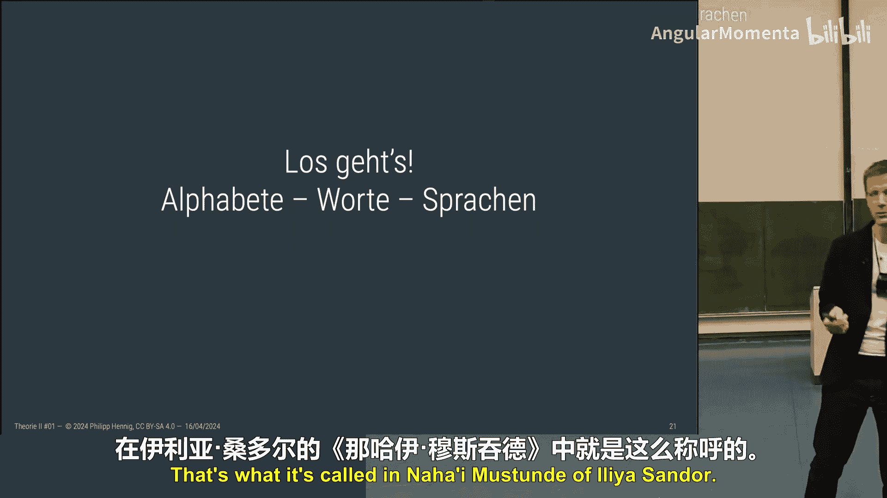

*   **定义**：字符串（或字）是字母表 **Σ** 中符号的一个**有限序列**。
*   **长度**：字符串中符号的个数，记为 **|w|**。例如，对于字符串 w = “abc”，其长度 |w| = 3。
*   **空串**：长度为0的特殊字符串，记为 **ε**（Epsilon）。它是任何字母表上的字符串。
*   **操作**：
    *   **连接**：将两个字符串首尾相接。若 x = “ab”, y = “cd”，则它们的连接 xy = “abcd”。
    *   **幂运算**：字符串 w 的 k 次幂 (w^k) 表示将 w 连接 k 次。例如，(“ab”)^2 = “abab”。特别地，w^0 = ε。

### 3. 语言

字符串的集合构成了语言。

*   **定义**：给定字母表 **Σ**，**Σ** 上的一个**语言 L** 是 **Σ*** 的一个子集。
    *   这里 **Σ*** 表示由 **Σ** 中所有符号生成的所有**有限字符串**（包括空串 ε）的集合，也称为 **Σ 的克林闭包**。
    *   **Σ+** 表示 **Σ*** 中去掉空串 ε 的集合，即所有非空字符串的集合。
*   **示例**：
    *   所有由偶数个0组成的字符串：**L = {ε, 00, 0000, 000000, ...}**
    *   所有合法的C语言程序。
    *   所有回文串（正读反读都一样的串）的集合。

### 4. 语言的运算

既然语言是集合，我们可以对它们进行标准的集合运算。

以下是常见的语言运算：
*   **并集**：L₁ ∪ L₂ = { w | w ∈ L₁ 或 w ∈ L₂ }
*   **交集**：L₁ ∩ L₂ = { w | w ∈ L₁ 且 w ∈ L₂ }
*   **补集**：对于语言 L ⊆ Σ*，其补集 ¬L = Σ* \ L
*   **连接**：两个语言的连接 L₁L₂ = { xy | x ∈ L₁ 且 y ∈ L₂ }
*   **克林星号**：语言 L 的克林星号 L* 表示由 L 中字符串通过有限次连接所能构成的所有字符串的集合，包括空串 ε。

## 总结与展望

本节课中我们一起学习了理论计算机科学的起源和形式语言的基础。我们了解到，这门学科源于对数学基础与计算本质的深刻哲学思考，并通过**图灵机**等模型将计算概念形式化。在形式语言部分，我们定义了最核心的三个概念：**字母表（Σ）**、**字符串（如 w）** 和**语言（L ⊆ Σ*）**，并介绍了语言的基本运算。

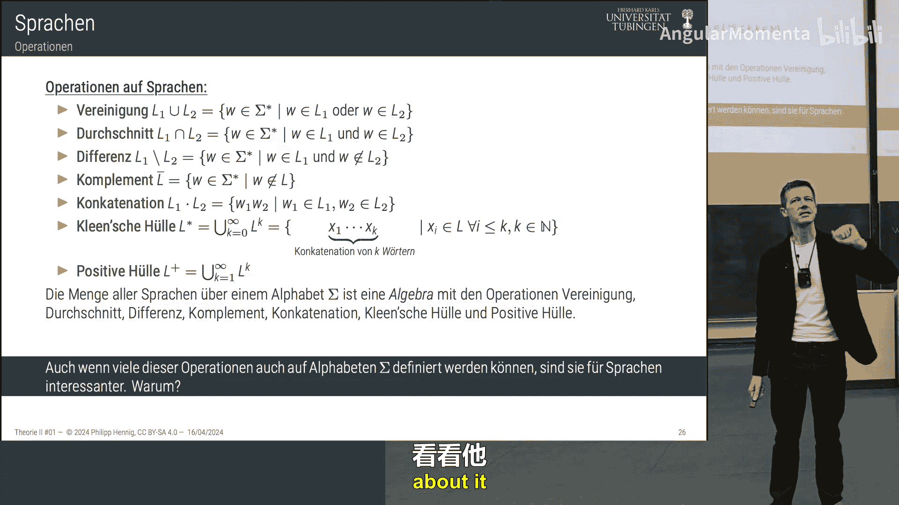

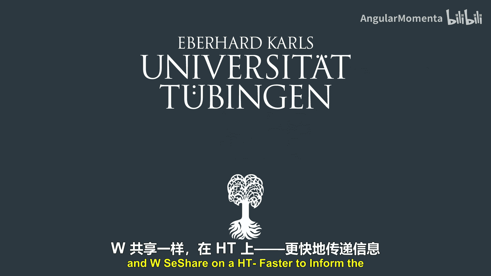

这些抽象定义是后续学习的基础。在下节课中，我们将利用这些概念，探讨如何形式化地描述（即“生成”）一种语言，从而引入**文法**的概念，特别是著名的**乔姆斯基谱系**。这将是我们理解编程语言语法和编译器工作的第一步。