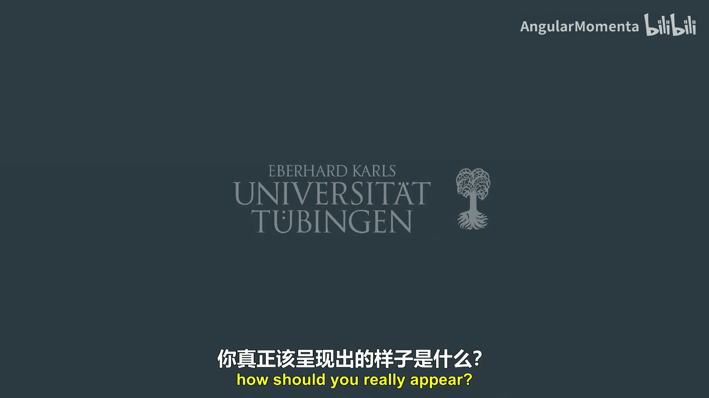
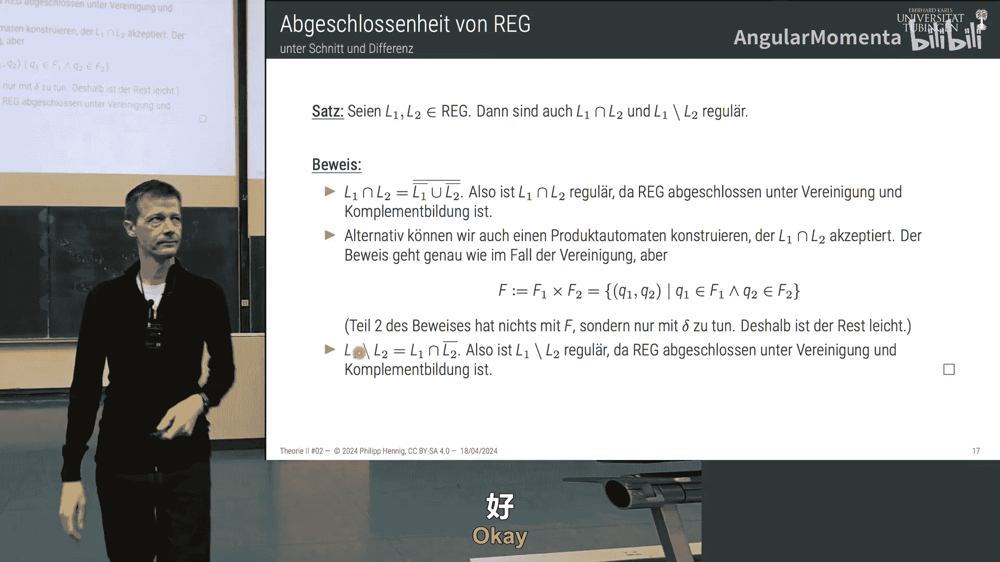
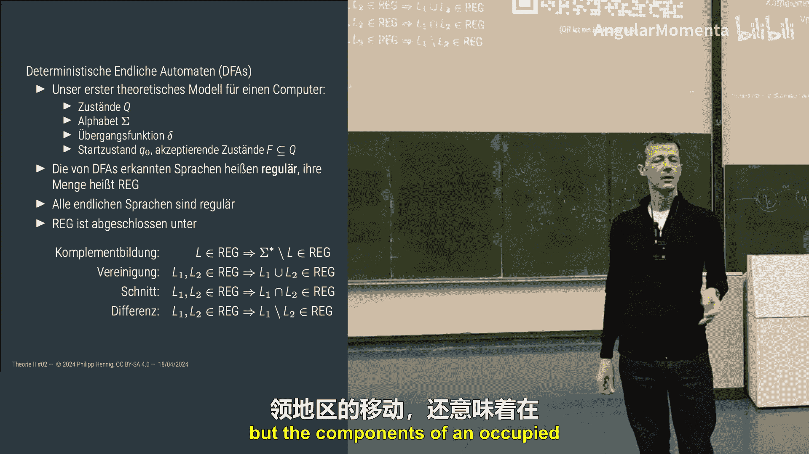
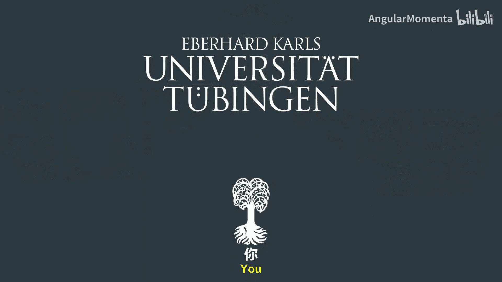

# 002：确定性有限自动机

在本节课中，我们将学习计算理论中的一个核心概念：**确定性有限自动机**。这是一种用于描述简单计算过程的数学模型，是理解形式语言和更复杂计算模型的基础。

## 概述

确定性有限自动机是一种抽象的、状态有限的机器。它读取一个由符号组成的输入字符串，并根据预定义的规则在状态之间转移。我们将学习它的形式化定义、工作原理以及如何用它来定义一种被称为“正则语言”的语言类别。

---

## 形式化定义 🧩

上一节我们介绍了DFA的基本概念，本节中我们来看看如何用数学语言精确地描述一个确定性有限自动机。

一个**确定性有限自动机** 是一个五元组：
`M = (Q, Σ, δ, q0, F)`

以下是每个组成部分的解释：
*   **Q**：一个有限的状态集合。
*   **Σ**：一个有限的输入字母表。
*   **δ**：状态转移函数，其形式为 `δ: Q × Σ → Q`。它定义了在当前状态和输入符号下，机器应转移到哪个**唯一**的下一个状态。
*   **q0**：初始状态，属于Q，即 `q0 ∈ Q`。
*   **F**：接受状态（或终结状态）的集合，是Q的子集，即 `F ⊆ Q`。

---

## 工作原理与图示 🔄

理解了形式定义后，我们来看看DFA是如何实际运行的。通常，我们可以用两种方式来描述它。

### 状态转移图

这是一种直观的图形表示法。
*   每个状态用一个圆圈表示。
*   接受状态用双圈表示。
*   初始状态用一个指向它的箭头标明（不来自任何其他状态）。
*   状态转移用带标记的有向边表示。例如，从状态 `q` 到状态 `p` 且标记为 `a` 的边表示 `δ(q, a) = p`。

### 状态转移表

这是一种表格表示法，清晰地列出了转移函数。
*   行代表当前状态。
*   列代表输入符号。
*   表格单元格中的内容表示下一个状态。

---

## 扩展转移函数与语言接受 📜

机器如何一步步处理整个字符串呢？这需要扩展转移函数的概念。

扩展转移函数 `δ^` 描述了机器从某个状态开始，处理完整个输入字符串后所到达的状态。其递归定义如下：
1.  `δ^(q, ε) = q` （处理空字符串 ε 后，状态不变）
2.  `δ^(q, wa) = δ( δ^(q, w), a)` （先处理字符串 w，再根据最后一个符号 a 转移）

基于此，我们可以定义DFA **接受** 的语言：
`L(M) = { w ∈ Σ* | δ^(q0, w) ∈ F }`
即，所有能使机器从初始状态 `q0` 开始，运行完整串 `w` 后，停止在某个**接受状态**（属于F）的字符串 `w` 的集合。

---

## 封闭性操作 🔒

一个重要的性质是，正则语言类在多种操作下是**封闭**的。这意味着，如果你对正则语言进行这些操作，得到的新语言仍然是正则的。本节我们探讨其中三种。

### 补运算

如果 `L` 是一个正则语言（即能被某个DFA `M` 接受），那么它的补集 `L^c = Σ* \ L` 也是正则的。
**构造方法**： 给定接受 `L` 的DFA `M = (Q, Σ, δ, q0, F)`，构造一个新的DFA `M'` 来接受 `L^c`。只需将 `M` 中的接受状态集取补即可：
`M' = (Q, Σ, δ, q0, Q \ F)`

### 交运算

如果 `L1` 和 `L2` 都是正则语言，那么它们的交集 `L1 ∩ L2` 也是正则的。
**构造方法**： 使用**乘积自动机** 的思想。给定接受 `L1` 和 `L2` 的DFA `M1` 和 `M2`，构造一个新的DFA `M`，其状态是 `M1` 和 `M2` 状态的笛卡尔积。`M` 模拟两台机器同时运行，仅当 `M1` **且** `M2` 都进入接受状态时，`M` 才进入接受状态。

### 并运算

如果 `L1` 和 `L2` 都是正则语言，那么它们的并集 `L1 ∪ L2` 也是正则的。
**构造方法**： 同样使用乘积自动机。构造方式与交运算类似，但 `M` 的接受状态集定义为：`M1` **或** `M2` 进入接受状态的状态对集合。

---

## 总结

本节课中，我们一起学习了**确定性有限自动机**的核心内容。
1.  我们首先给出了DFA的**形式化五元组定义** `(Q, Σ, δ, q0, F)`。
2.  接着，我们探讨了它的**两种表示方法**：状态转移图和状态转移表。
3.  然后，我们通过**扩展转移函数** `δ^` 定义了DFA所**接受的语言** `L(M)`。
4.  最后，我们证明了正则语言在**补、交、并**运算下是封闭的，并了解了通过修改接受状态集或构造乘积自动机来实现这些运算的方法。

DFA是计算理论中一个简洁而强大的模型，它为理解计算的可能性与局限性奠定了第一块基石。