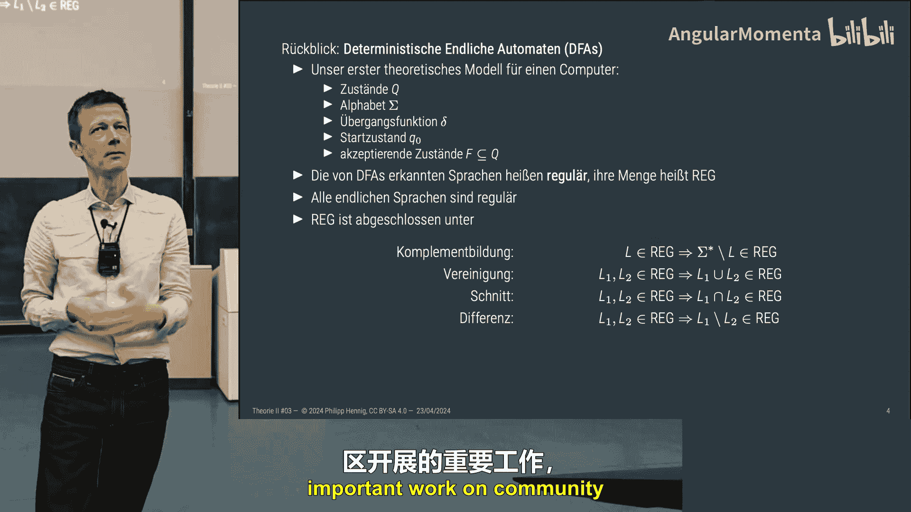
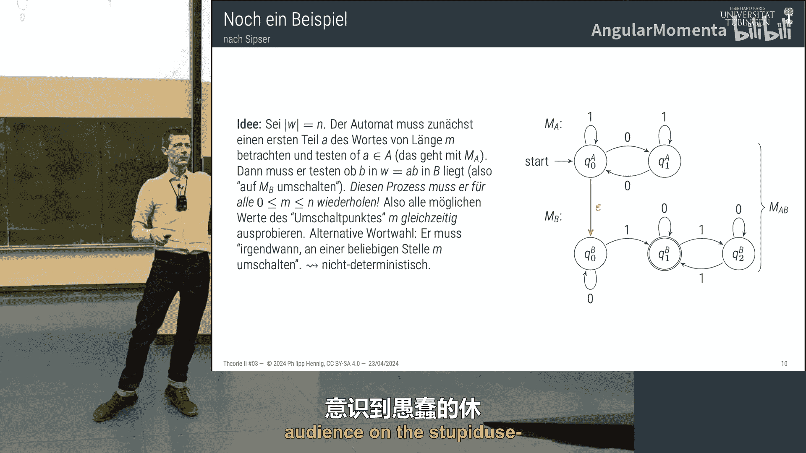
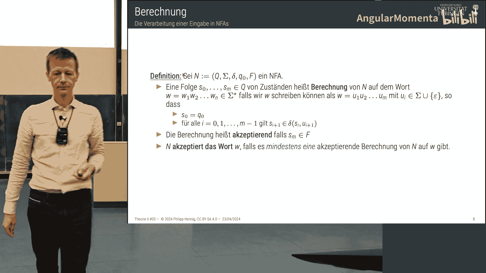
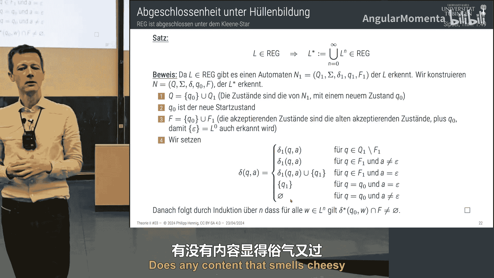

# 003：非确定性有限自动机

## 概述
在本节课中，我们将要学习**非确定性有限自动机**。这是一种与确定性有限自动机不同的计算模型，它允许机器在特定状态下，对于同一个输入符号，有多个可能的下一个状态。我们将探讨其定义、工作原理、与确定性自动机的关系，以及它在理论计算机科学中的重要性。

## 非确定性有限自动机的定义

上一节我们介绍了确定性有限自动机，本节中我们来看看它的一个变体：非确定性有限自动机。

一个**非确定性有限自动机**是一个五元组 `(Q, Σ, δ, q0, F)`，其中：
*   `Q` 是一个有限的状态集合。
*   `Σ` 是一个有限的输入字母表。
*   `δ` 是**转移函数**，其形式为 `δ: Q × (Σ ∪ {ε}) → P(Q)`。这里 `P(Q)` 表示 `Q` 的幂集（即所有子集的集合）。这意味着对于给定的状态和输入符号（或空串 `ε`），机器可以转移到**一组**可能的状态，而不仅仅是一个。
*   `q0 ∈ Q` 是初始状态。
*   `F ⊆ Q` 是接受状态（或终结状态）的集合。

与确定性有限自动机的核心区别在于转移函数 `δ`。NFA 允许**不确定性**：在某个状态下读取一个符号后，机器可以“选择”进入多个可能的后继状态之一。此外，NFA 还可以进行 **`ε`-转移**，即不消耗任何输入符号就从一个状态转移到另一个状态。

## NFA 如何工作？

为了理解 NFA 如何判断一个字符串是否被接受，我们需要引入**计算路径**的概念。

当 NFA 处理一个输入字符串时，它并非只有一条确定的路可走。相反，由于非确定性，它可能同时探索多条路径。我们可以将 NFA 想象成一棵树，根节点是初始状态，每个分支代表一种可能的选择。

NFA **接受**一个输入字符串，当且仅当**至少存在一条**从初始状态 `q0` 开始，到某个接受状态 `f ∈ F` 结束的计算路径，并且该路径上转移的符号（忽略 `ε`）连接起来正好等于输入字符串。

如果所有可能的路径都无法在消耗完输入字符串后到达接受状态，或者路径在半途“卡住”（没有定义相应的转移），则该字符串被**拒绝**。

## NFA 与 DFA 的等价性

一个关键的理论结果是：**非确定性有限自动机和确定性有限自动机在识别语言的能力上是等价的**。也就是说，任何能被一个 NFA 识别的语言，也一定能被某个 DFA 识别，反之亦然。

以下是证明思路：
1.  **从 NFA 构造等价的 DFA**：这个构造称为**子集构造法**。其核心思想是，让 DFA 的每个状态对应原 NFA 的一个**状态集合**。这个 DFA 状态代表了 NFA 在读取了部分输入后，所有可能处于的状态的集合。
    *   DFA 的初始状态是 NFA 初始状态的 `ε`-闭包（即从初始状态出发，仅通过 `ε`-转移所能到达的所有状态的集合）。
    *   DFA 的转移函数定义为：对于当前状态集合 `S` 和输入符号 `a`，下一个状态集合是 `S` 中每个状态通过 `a` 转移所能到达的所有状态的 `ε`-闭包的并集。
    *   DFA 的接受状态是那些包含了至少一个 NFA 接受状态的集合。
2.  **复杂度分析**：这种构造法可能导致**状态数指数级增长**。如果原 NFA 有 `n` 个状态，那么构造出的 DFA 最多可能有 `2^n` 个状态。这表明，虽然 NFA 和 DFA 能力等价，但 NFA 在描述某些语言时可能比 DFA **简洁得多**。

## NFA 的优势与应用

尽管 NFA 和 DFA 能力等价，但 NFA 在理论和实践中都有其独特优势：

*   **设计更简洁直观**：对于某些模式，用 NFA 描述比用 DFA 更简单、更自然。例如，包含“或”关系的模式。
*   **作为理论工具**：NFA 是研究正则表达式、正则语言性质的重要桥梁。正则表达式可以很容易地转换为等价的 NFA。
*   **模型某些计算过程**：非确定性可以抽象地模拟并行计算或“猜测”过程。

## 总结

本节课中我们一起学习了非确定性有限自动机。我们首先定义了 NFA，理解了其非确定性和 `ε`-转移的核心特性。接着，我们探讨了 NFA 通过计算路径接受字符串的方式。然后，我们学习了 NFA 与 DFA 等价的关键定理，以及通过子集构造法将 NFA 转换为 DFA 的方法，并认识到这种转换可能导致状态数指数增长。最后，我们了解了 NFA 在简洁性和作为理论工具方面的优势。NFA 是理解计算模型多样性和正则语言理论的重要一步。