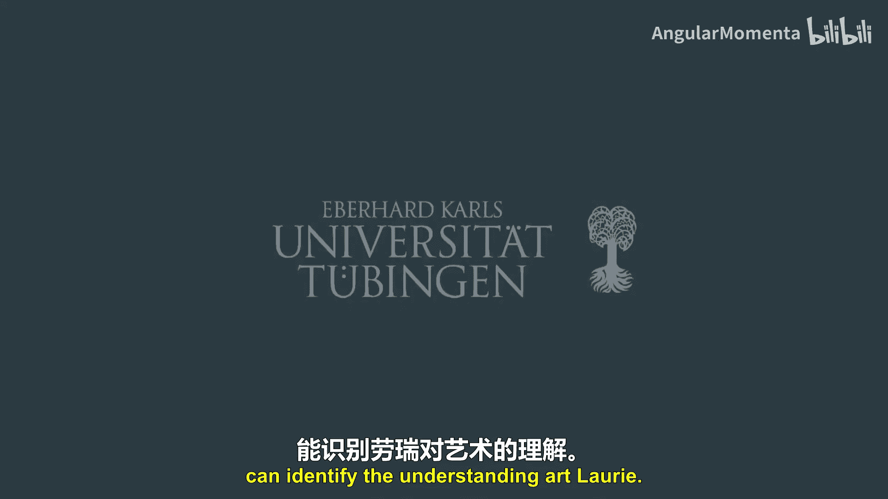
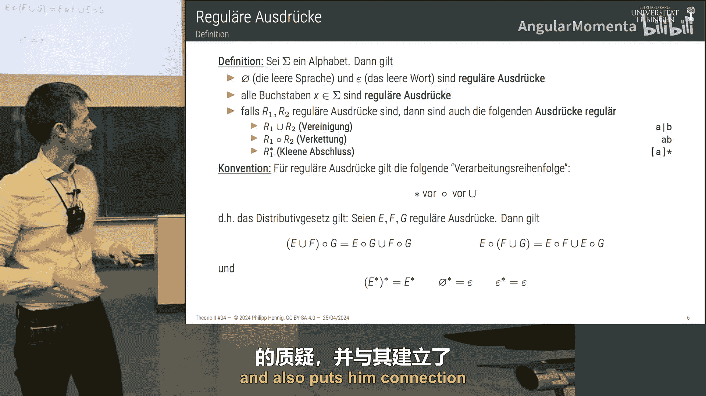
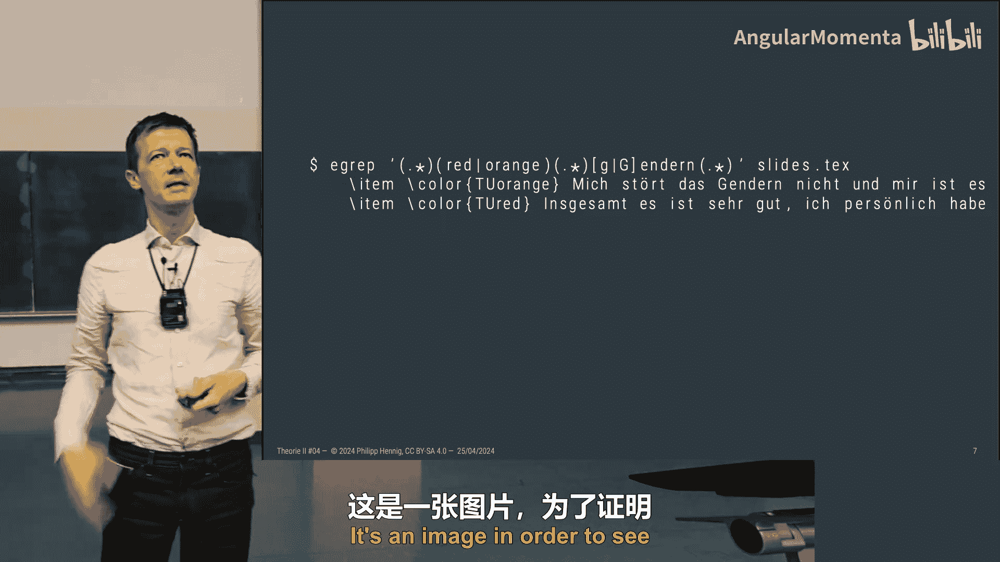
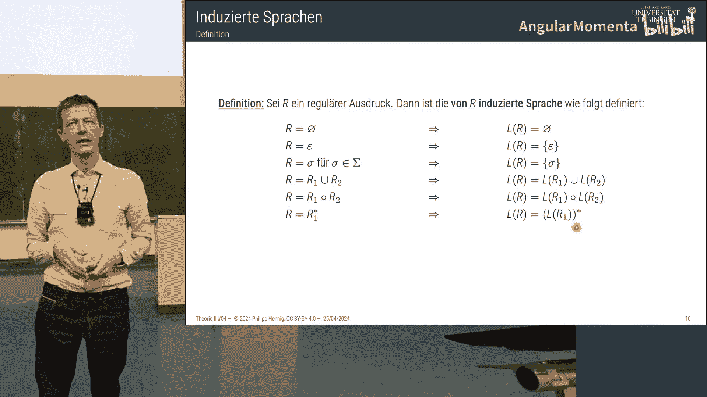
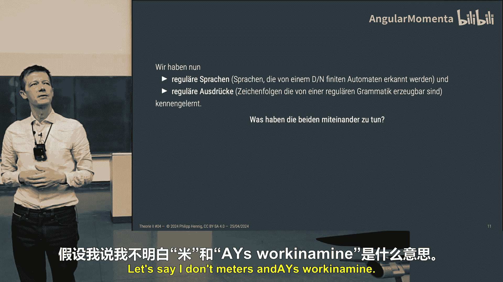
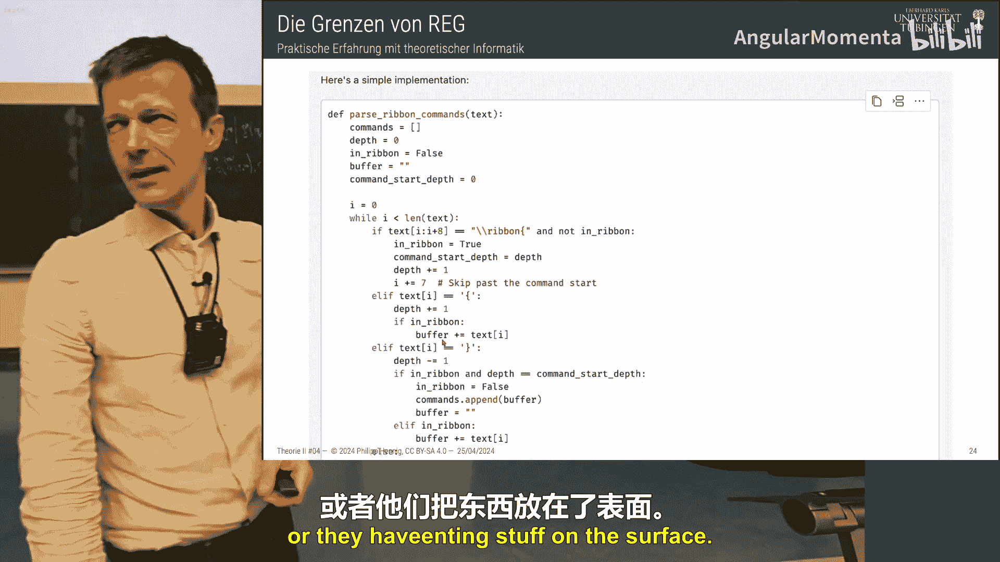
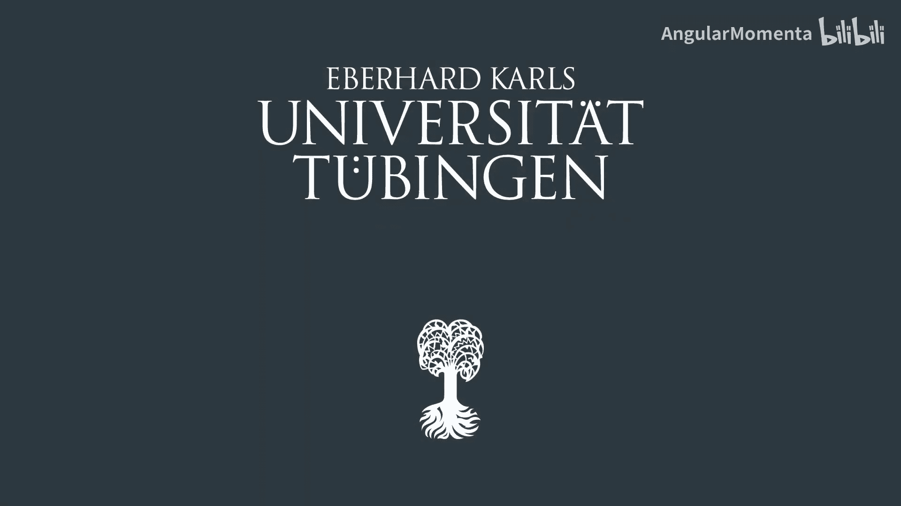

# 004：正则表达式





## 概述
在本节课中，我们将要学习正则表达式。正则表达式是一种强大的工具，用于描述字符串的模式。我们将从基本概念开始，逐步理解其形式化定义、操作以及如何与有限自动机相关联。



## 正则表达式的基本概念
上一节我们介绍了课程概述，本节中我们来看看正则表达式的核心概念。正则表达式是一种用于描述字符串集合（称为语言）的紧凑方式。它们基于一个给定的字母表。

**公式**：设 Σ 是一个字母表。正则表达式 `R` 递归地定义如下：
1.  **ε**（空串）是一个正则表达式。
2.  **∅**（空集）是一个正则表达式。
3.  对于任意 `a ∈ Σ`，**a** 是一个正则表达式。
4.  如果 `R` 和 `S` 是正则表达式，那么 `(R ∪ S)`、`(R ∘ S)` 和 `(R*)` 也是正则表达式。

这些操作分别代表**并集**、**连接**和**克林星号**（零次或多次重复）。



## 正则表达式的操作与示例
理解了定义后，本节我们来看看这些操作的具体含义以及一些简单示例。



以下是每个操作所描述的语言：
*   **并集 (R ∪ S)**： 匹配属于 `R` 的语言 **或** 属于 `S` 的语言的字符串。
*   **连接 (R ∘ S)**： 匹配一个属于 `R` 的语言的字符串后跟一个属于 `S` 的语言的字符串。
*   **克林星号 (R*)**： 匹配由零个或多个属于 `R` 的语言的字符串连接而成的任何字符串。

例如，设字母表 Σ = {0, 1}：
*   表达式 `0` 描述语言 {0}。
*   表达式 `0 ∪ 1` 描述语言 {0, 1}。
*   表达式 `(0 ∘ 1)` 描述语言 {01}。
*   表达式 `(0 ∪ 1)*` 描述所有由0和1构成的字符串的集合，包括空串 ε。

## 正则表达式的语法糖
在实际应用中，正则表达式通常包含一些简写形式，使表达式更简洁易读。这些可以看作是核心操作的“语法糖”。

以下是一些常见的语法糖：
*   **R+**： 表示一次或多次重复，等价于 `(R ∘ R*)`。
*   **R?**： 表示零次或一次出现，等价于 `(R ∪ ε)`。
*   **字符类 [abc]**： 表示匹配 `a`、`b` 或 `c` 中的任意一个字符，等价于 `(a ∪ b ∪ c)`。
*   **范围 [a-z]**： 匹配从 `a` 到 `z` 的任何小写字母。
*   **补集 [^abc]**： 匹配除 `a`、`b`、`c` 外的任何字符。

例如，`[a-zA-Z]+` 描述所有由一个或多个字母（不区分大小写）组成的非空字符串。

## 正则表达式与有限自动机的等价性
一个关键的理论结果是：正则表达式描述的语言类别与有限自动机（FA）接受的语言类别是完全相同的。这意味着任何正则表达式都可以转换为一个等价的有限自动机，反之亦然。

**转换思路**：
1.  **从正则表达式到有限自动机**： 基于正则表达式的递归结构进行构造。基础情况（ε， ∅， 单个字符）对应简单的自动机。并集、连接和克林星号操作则对应自动机的组合操作（如并行运行、顺序连接和添加循环）。
2.  **从有限自动机到正则表达式**： 可以使用诸如**状态消去法**等技术。通过系统地消除自动机中的状态，并在转移边上用正则表达式标记，最终得到一个连接起始状态和接受状态的正则表达式。

这个等价性是形式语言理论中的一个基石，它揭示了用代数（正则表达式）和机器（有限自动机）两种不同方式描述模式的能力是相通的。

## 实践中的正则表达式
在编程和文本处理中，正则表达式被广泛使用。大多数编程语言（如 Python， Java， JavaScript）和命令行工具（如 `grep`， `sed`， `awk`）都内置了正则表达式引擎。

**代码示例（Python）**：
```python
import re

# 定义一个正则表达式模式：匹配一个或多个数字
pattern = r‘\d+‘

# 要搜索的文本
text = “There are 123 apples and 456 oranges.“

# 查找所有匹配项
matches = re.findall(pattern, text)
print(matches)  # 输出: [‘123‘， ‘456‘]
```

在这个例子中，`\d` 是一个语法糖，等价于字符类 `[0-9]`，`+` 表示一次或多次重复。因此，`\d+` 匹配任何连续的数字序列。





## 总结
本节课中我们一起学习了正则表达式。我们从其形式化定义开始，了解了三种基本操作：并集、连接和克林星号。接着，我们探讨了实践中常用的语法糖，使表达式更简洁。最重要的是，我们理解了正则表达式与有限自动机在描述语言能力上是等价的，这是理论计算机科学中的一个核心结论。最后，我们看到了正则表达式在实践中的强大应用，它是在文本中搜索、匹配和替换模式的不可或缺的工具。