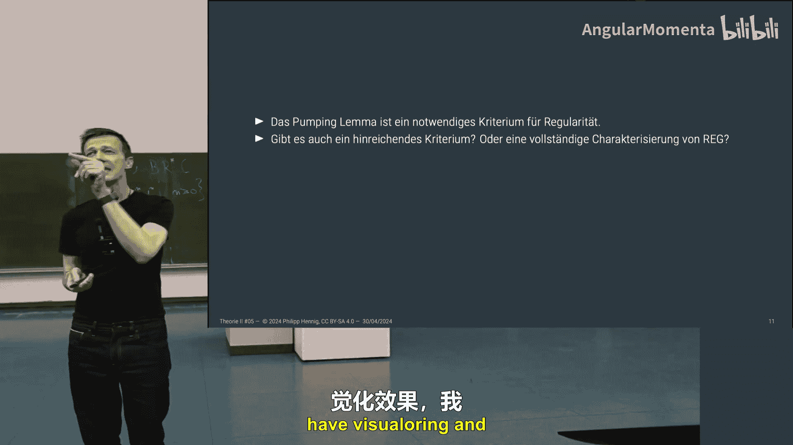
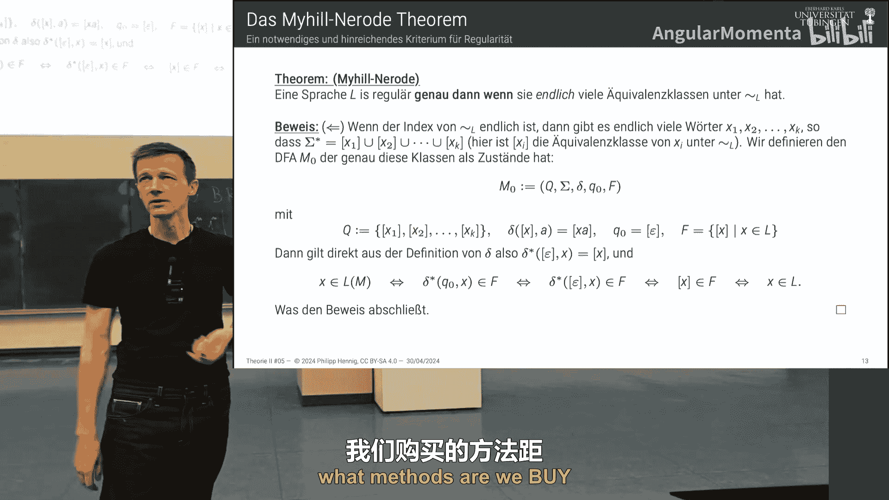

# 005：泵引理


在本节课中，我们将学习一个用于判断语言是否为正则语言的重要工具——泵引理。泵引理为正则语言提供了一个必要条件，我们可以用它来证明某些语言不是正则的。

## 泵引理概述

泵引理是一个关于正则语言性质的定理。它指出，如果一个语言是正则的，那么该语言中所有足够长的字符串都可以被“泵送”。这意味着字符串可以被划分为三个部分，其中中间部分可以重复任意多次（包括零次），而生成的新字符串仍然属于原语言。

## 泵引理的形式化描述

设 **L** 是一个正则语言。那么存在一个常数 **n**（称为泵长度），使得对于 **L** 中任何长度不小于 **n** 的字符串 **w**，都可以被划分为三个子串 **w = xyz**，满足以下条件：

1.  **|y| > 0** （中间部分非空）
2.  **|xy| ≤ n** （前两部分的总长度不超过泵长度 n）
3.  对于所有整数 **i ≥ 0**，字符串 **xyⁱz** 仍然属于语言 **L**。

用公式表示：
```
∃ n ∈ ℕ. ∀ w ∈ L, |w| ≥ n ⇒ ∃ x, y, z. w = xyz ∧ |y| > 0 ∧ |xy| ≤ n ∧ ∀ i ≥ 0. xyⁱz ∈ L
```

## 如何使用泵引理证明语言非正则




上一节我们介绍了泵引理的内容，本节我们来看看如何利用它来证明一个语言不是正则的。其核心思想是反证法。

以下是使用泵引理证明语言 **L** 非正则的标准步骤：

1.  **假设**：首先，假设语言 **L** 是正则的。那么根据泵引理，存在一个泵长度 **n**。
2.  **选择字符串**：精心选择一个属于 **L** 且长度不小于 **n** 的字符串 **w**。这个选择通常依赖于 **n**。
3.  **考虑所有划分**：根据泵引理，**w** 可以被划分为 **w = xyz**，且满足 **|y| > 0** 和 **|xy| ≤ n**。
4.  **导出矛盾**：对于 **w** 所有可能的划分（满足上述条件），找到一个整数 **i**（通常取 **i=0** 或 **i=2**），使得泵送后的字符串 **xyⁱz** 不再属于语言 **L**。这与泵引理的结论矛盾。
5.  **得出结论**：因此，最初的假设（L是正则的）是错误的，所以 **L** 不是正则语言。

## 一个经典示例

让我们通过一个具体的例子来应用上述步骤。考虑语言 **L = { aᵏ bᵏ | k ≥ 0 }**，即由数量相等的 `a` 和 `b` 组成的字符串。

1.  **假设**：假设 **L** 是正则的，设泵长度为 **n**。
2.  **选择字符串**：选择字符串 **w = aⁿ bⁿ**。显然，**w ∈ L** 且 **|w| = 2n ≥ n**。
3.  **考虑划分**：根据泵引理，**w** 可以写为 **xyz**，其中 **|y| > 0** 且 **|xy| ≤ n**。由于 **|xy| ≤ n**，所以 **y** 完全由 `a` 组成，即 **y = aᵖ**，其中 **p > 0**。
4.  **导出矛盾**：现在考虑 **i = 2**。泵送后的字符串为 **xy²z = aⁿ⁺ᵖ bⁿ**。因为 **p > 0**，所以 `a` 的数量 **n+p** 大于 `b` 的数量 **n**，因此 **xy²z ∉ L**。这与泵引理矛盾。
5.  **得出结论**：因此，语言 **L** 不是正则的。

## 泵引理的局限性

需要注意的是，泵引理是一个**必要条件**，而非充分条件。这意味着：
*   如果一个语言是正则的，那么它一定满足泵引理。
*   但是，如果一个语言满足泵引理，我们**不能**断定它就是正则的。存在一些非正则语言也满足泵引理的条件。



因此，泵引理主要用于证明一个语言**不是**正则的。要证明一个语言是正则的，我们通常需要构造一个有限自动机或正则表达式。

## 总结


本节课中，我们一起学习了泵引理。我们首先了解了它的核心思想：正则语言中足够长的字符串必然包含一个可以重复的“循环”部分。然后，我们详细学习了如何利用泵引理，通过反证法来证明一个语言不是正则的，并通过 `{ aⁿ bⁿ }` 这个经典例子进行了实践。最后，我们指出了泵引理的局限性，它只是一个用于证伪的工具。掌握泵引理是理解正则语言性质和应用的关键一步。