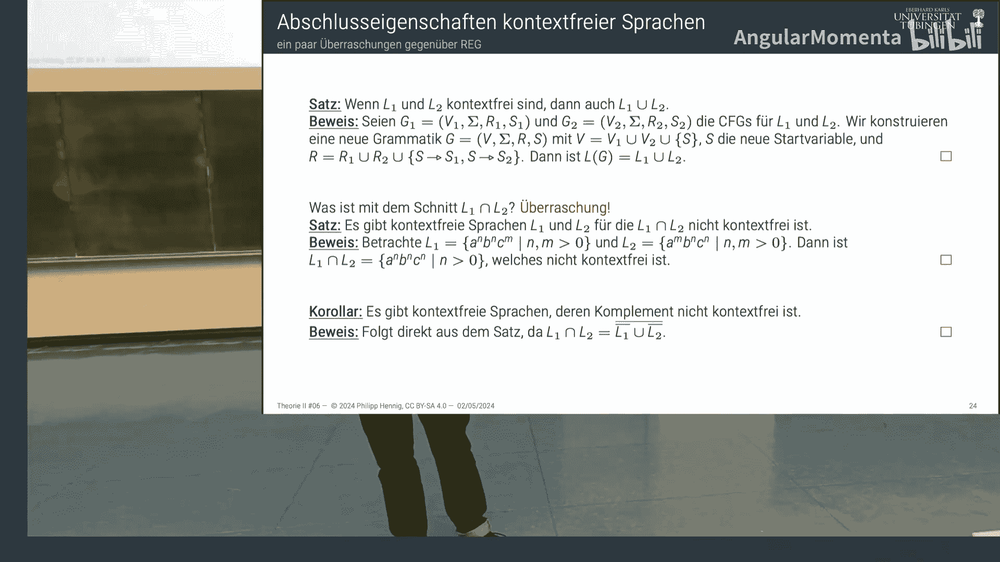

# 006：上下文无关文法


在本节课中，我们将学习形式语言理论中的一个核心概念：上下文无关文法。我们将了解它的定义、形式化表示、与自动机的关系，以及它在计算机科学，特别是编程语言和编译器设计中的重要性。

---

## 概述

上下文无关文法是描述编程语言语法结构的有力工具。它比正则表达式更强大，能够描述嵌套结构（如括号匹配）。本节我们将从直观的语言学例子入手，逐步形式化其定义，并探讨其与下推自动机的等价性。

---

## 从正则文法到上下文无关文法

上一节我们介绍了正则文法和有限自动机，它们擅长描述线性模式。然而，许多语言结构（如算术表达式或程序代码中的嵌套块）需要更强的描述能力。

本节中我们来看看上下文无关文法。它通过引入“变量”或“非终结符”来生成语言，其核心规则允许一个变量被替换为一个符号串。

一个上下文无关文法 `G` 由四个部分组成：
*   **变量（非终结符）集合** `V`
*   **终结符集合** `Σ` （与 `V` 不相交）
*   **产生式规则集合** `P`， 每条规则形式为 `A -> w`，其中 `A ∈ V`， `w ∈ (V ∪ Σ)*`
*   **起始变量** `S ∈ V`

---

## 上下文无关文法的形式化定义

根据乔姆斯基的划分，上下文无关文法是2型文法。其形式化定义如下：

一个上下文无关文法是一个四元组 `G = (V, Σ, P, S)`，其中：
*   `V` 是一个有限集合，称为**变量**或**非终结符**。
*   `Σ` 是一个有限集合，称为**终结符**，且 `V ∩ Σ = ∅`。
*   `P` 是一个有限**产生式**集合，每个产生式形如 `A -> α`，其中 `A ∈ V`， `α ∈ (V ∪ Σ)*`。
*   `S ∈ V` 是**起始变量**。

---

## 推导与语言

从起始符号开始，反复应用产生式规则将变量替换为字符串的过程称为**推导**。文法 `G` 生成的语言 `L(G)` 是所有能由起始符号 `S` 推导出的、仅由终结符组成的字符串的集合。

以下是推导过程的要点：
*   推导从起始变量 `S` 开始。
*   每一步，我们选择一个变量，并用其某个产生式规则的右侧替换它。
*   当字符串中不再包含任何变量时，推导结束，得到的字符串属于该文法生成的语言。

---

## 上下文无关文法示例

让我们看一个描述简单算术表达式的文法。

令 `G = ({E}, {+, *, (, ), id}, P, E)`，其中产生式规则 `P` 为：
```
E -> E + E
E -> E * E
E -> ( E )
E -> id
```
这里，`E` 是变量（表达式），`id` 代表标识符（如变量名或数字）。这个文法可以生成诸如 `id`, `id + id`, `id * (id + id)` 等字符串。

---

## 上下文无关文法与下推自动机

一个重要结论是：上下文无关文法生成的语言类，恰好是**下推自动机**能够识别的语言类。

这意味着：
*   对于任何上下文无关文法，都可以构造一个等价的下推自动机来识别其语言。
*   对于任何下推自动机，都可以构造一个等价的上下文无关文法来生成其识别的语言。

下推自动机可以看作是一个配备了栈的有限自动机，这个栈提供了必要的内存来处理嵌套结构。

---

## 乔姆斯基范式

任何上下文无关文法（除了生成空串的规则）都可以转化为一种标准形式——**乔姆斯基范式**。

在乔姆斯基范式中，所有产生式规则都只能是以下两种形式之一：
1.  `A -> BC` （其中 `A, B, C` 都是变量）
2.  `A -> a` （其中 `A` 是变量，`a` 是终结符）

这种范式简化了语法分析算法（如CYK算法）和理论证明。

---

## 泵引理与上下文无关语言的局限性

与正则语言类似，也存在一个**泵引理**用于证明某个语言不是上下文无关的。

**上下文无关语言的泵引理**：如果一个语言 `L` 是上下文无关的，则存在一个泵长度 `p`，使得 `L` 中任何长度不小于 `p` 的字符串 `s` 都可以写成 `s = uvwxy` 的形式，满足：
1.  `|vwx| ≤ p`
2.  `|vx| ≥ 1`
3.  对于所有 `i ≥ 0`，字符串 `u v^i w x^i y` 也属于 `L`。

利用泵引理可以证明像 `{a^n b^n c^n | n ≥ 0}` 这样的语言不是上下文无关的。

---

## 上下文无关文法的封闭性与决策问题

上下文无关语言在某些运算下是封闭的，但在另一些下则不封闭。

以下是封闭的运算：
*   并集
*   连接
*   克莱尼星号
*   与正则语言的交集
*   同态映射

以下是不封闭的运算：
*   交集（两个上下文无关语言的交集不一定是上下文无关的）
*   补集（上下文无关语言的补集不一定是上下文无关的）

关于上下文无关文法的一些基本决策问题是可判定的，例如：
*   成员性问题：给定字符串 `w` 和文法 `G`，`w` 是否属于 `L(G)`？（是，例如使用CYK算法）
*   空性问题：`L(G)` 是否为空？（是）
*   无穷性问题：`L(G)` 是否无穷？（是）



---

## 总结

本节课中我们一起学习了上下文无关文法。我们从其动机和形式化定义出发，理解了它如何通过变量和产生式规则来描述嵌套结构语言。我们探讨了它与下推自动机的等价关系，这是计算理论中的一个核心结论。我们还介绍了标准形式（乔姆斯基范式）、用于证明语言非上下文无关性的泵引理，以及上下文无关语言的封闭性质。上下文无关文法是编译器前端（语法分析器）的理论基础，对于理解和设计编程语言至关重要。