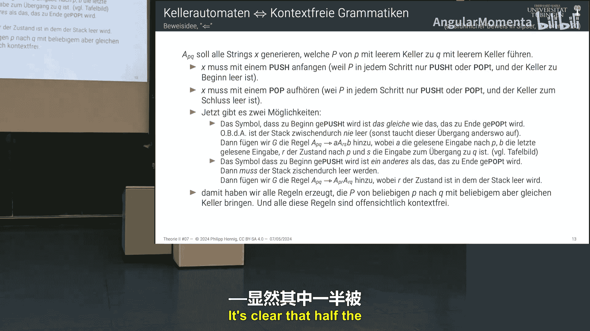
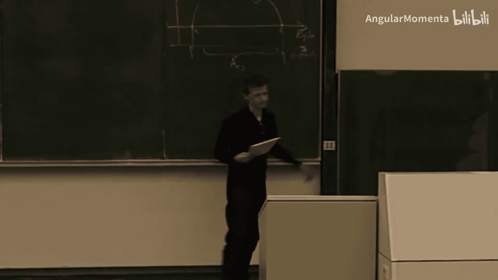
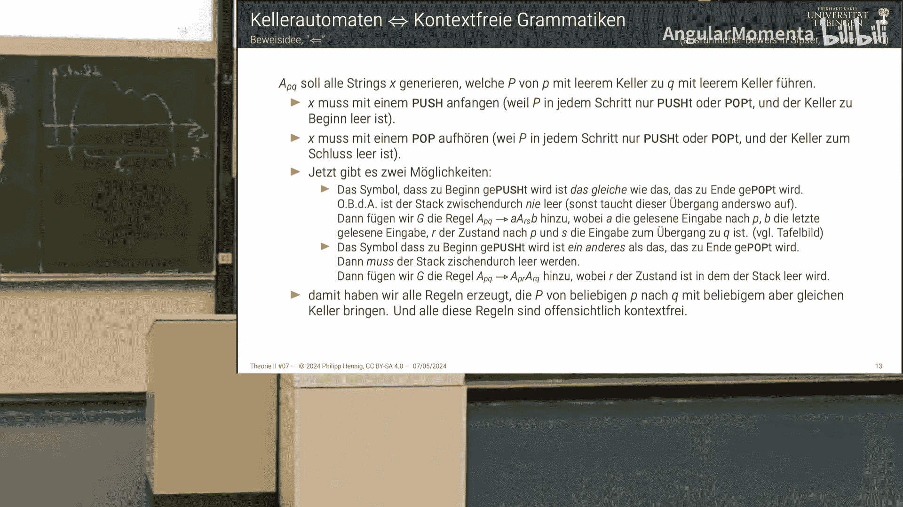
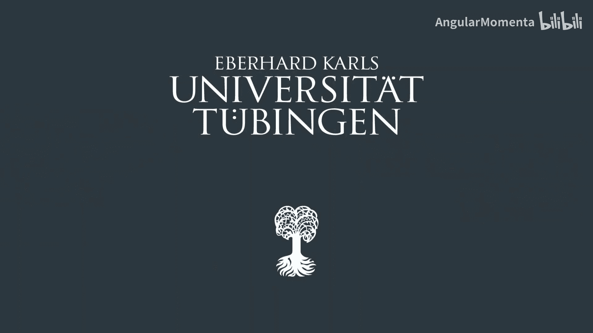

# 007：凯勒自动机


在本节课中，我们将学习凯勒自动机。这是一种特殊的自动机模型，它使用一个栈作为辅助存储。我们将了解其基本定义、工作原理，以及它与上下文无关文法之间的重要联系。

---

## 凯勒自动机的定义

上一节我们介绍了自动机的基本概念，本节中我们来看看凯勒自动机的形式化定义。

一个凯勒自动机是一个六元组：
```
M = (Q, Σ, Γ, δ, q0, Z0, F)
```
其中：
*   **Q** 是有限状态集。
*   **Σ** 是有限的输入字母表。
*   **Γ** 是有限的栈字母表。
*   **δ** 是转移函数：`δ: Q × (Σ ∪ {ε}) × Γ → P_finite(Q × Γ*)`。
*   **q0 ∈ Q** 是初始状态。
*   **Z0 ∈ Γ** 是初始栈符号。
*   **F ⊆ Q** 是接受状态集。

这个定义的核心在于转移函数 **δ**。它根据当前状态、读入的输入符号（或空串 ε）以及栈顶符号，决定下一个状态以及要压入栈顶的符号串（用以替换栈顶符号）。

---

## 凯勒自动机如何工作？

理解了定义后，我们来看看凯勒自动机是如何运行的。其运行依赖于一个称为“格局”的概念。

一个**格局** 是一个三元组 `(q, w, γ)`，其中：
*   `q ∈ Q` 是当前状态。
*   `w ∈ Σ*` 是待处理的剩余输入串。
*   `γ ∈ Γ*` 是当前栈的内容（栈顶在左侧）。

以下是格局之间转移的规则：
如果存在转移 `δ(q, a, Z)` 包含 `(p, β)`，那么可以从格局 `(q, aw, Zα)` 转移到格局 `(p, w, βα)`。这里 `a` 可以是输入符号或 `ε`。

自动机从初始格局 `(q0, w, Z0)` 开始运行。如果经过一系列转移后，到达一个格局 `(q_f, ε, γ)`，其中 `q_f ∈ F`（即接受状态），并且输入串已消耗完，那么自动机就**接受** 输入串 `w`。这种接受方式称为**终态接受**。

另一种等价的接受标准是**空栈接受**：如果自动机运行后到达格局 `(q, ε, ε)`，即栈变为空，则接受输入串。可以证明，这两种接受方式在能力上是等价的。

---

## 凯勒自动机与上下文无关文法

我们已经了解了凯勒自动机如何运行，现在探讨它与其他计算模型的关系。最重要的关系是：**凯勒自动机识别的语言类恰好是上下文无关语言**。

这意味着：
1.  对于任何一个上下文无关文法 **G**，都可以构造出一个凯勒自动机 **M**，使得 `L(M) = L(G)`。
2.  对于任何一个凯勒自动机 **M**，都可以构造出一个上下文无关文法 **G**，使得 `L(G) = L(M)`。

这个等价性是理论计算机科学的一个核心结论。它表明，尽管凯勒自动机（使用栈）和上下文无关文法（使用重写规则）在形式上完全不同，但它们描述语言的能力是完全相同的。

---

## 凯勒自动机的例子

为了加深理解，我们来看一个具体的例子。考虑语言 `L = {a^n b^n | n ≥ 0}`，这是一个经典的上下文无关语言。

我们可以设计一个凯勒自动机来识别它：
*   **思路**：每读入一个 `a`，就向栈中压入一个特定符号（例如 `A`）。然后，每读入一个 `b`，就从栈中弹出一个 `A`。最后检查栈是否为空。
*   **操作**：
    1.  初始状态，栈底为 `Z0`。
    2.  读 `a`：压入 `A`。
    3.  读 `b`：弹出 `A`。
    4.  输入结束时，如果栈中只剩下 `Z0`，则接受。

这个简单的自动机清晰地展示了如何使用栈来“计数”和匹配符号。

---



## 凯勒自动机的变体与性质





凯勒自动机有一些重要的变体和性质。

**确定性凯勒自动机**
我们之前定义的是非确定性的凯勒自动机。如果对转移函数 **δ** 加以限制，使得在任何格局下至多只有一种可能的转移，就得到了**确定性凯勒自动机**。确定性凯勒自动机识别的语言类（确定性上下文无关语言）是真包含于非确定性凯勒自动机所识别的语言类（所有上下文无关语言）的。这意味着非确定性对于凯勒自动机的能力有实质性的增强。

**封闭性**
上下文无关语言（即凯勒自动机识别的语言）在某些运算下是封闭的，在另一些下则不封闭：
*   **封闭于**：并、连接、闭包、与正则语言的交、同态。
*   **不封闭于**：交、补、差。

例如，两个上下文无关语言的交不一定还是上下文无关语言。

---

## 总结



本节课中我们一起学习了凯勒自动机。我们从其形式化定义出发，了解了它如何利用栈进行工作，并通过格局转移来描述其计算过程。我们掌握了凯勒自动机有两种等价的接受方式：终态接受和空栈接受。最重要的是，我们认识到凯勒自动机与上下文无关文法在表达能力上是完全等价的，它们共同定义了上下文无关语言这一重要的语言类。最后，我们简要探讨了其确定性变体以及上下文无关语言的封闭性质。凯勒自动机是连接自动机理论和形式文法理论的关键桥梁，也是理解编译器解析等实际应用的基础。