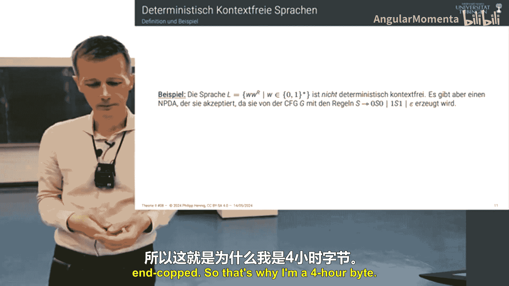
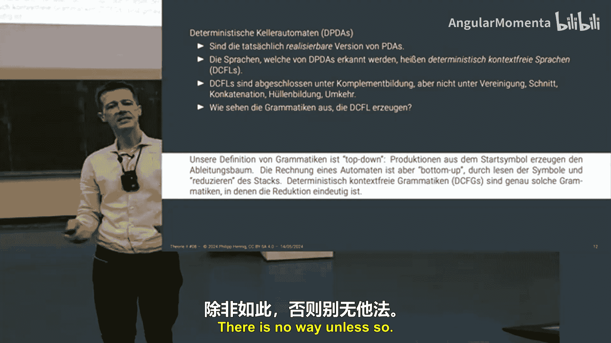
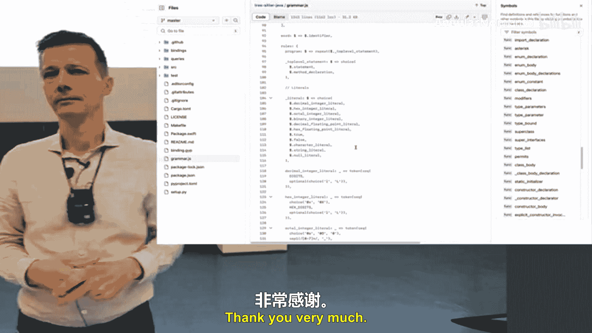

# 008：确定性上下文无关文法

## 概述
在本节课中，我们将学习确定性上下文无关文法。我们将探讨其核心概念、形式化定义，以及它在实际计算中的应用，例如语法高亮和代码解析。

---

## 确定性下推自动机

上一节我们介绍了上下文无关文法，本节中我们来看看其对应的自动机模型——下推自动机。

确定性下推自动机是一种特殊的自动机，它包含一个栈用于存储信息。其形式化定义如下：

一个确定性下推自动机是一个七元组：
`M = (Q, Σ, Γ, δ, q0, Z0, F)`
其中：
*   `Q` 是有限状态集。
*   `Σ` 是有限的输入字母表。
*   `Γ` 是有限的栈字母表。
*   `δ` 是转移函数：`Q × (Σ ∪ {ε}) × Γ → Q × Γ*`。
*   `q0 ∈ Q` 是初始状态。
*   `Z0 ∈ Γ` 是初始栈符号。
*   `F ⊆ Q` 是接受状态集。

确定性下推自动机与普通下推自动机的关键区别在于，对于任何给定的当前状态、输入符号和栈顶符号，其转移函数 `δ` 至多只有一个可能的动作。这意味着其计算路径是唯一确定的。

---

## 确定性上下文无关语言

理解了确定性下推自动机后，我们现在可以定义它所能识别的语言类别。

由确定性下推自动机接受的语言，称为确定性上下文无关语言。并非所有上下文无关语言都是确定性的。确定性上下文无关语言类是真包含于上下文无关语言类的一个子集。

确定性上下文无关语言在实践中有重要价值，因为其对应的解析器可以高效地（在线性时间内）运行。许多编程语言的语法都设计成是确定性上下文无关的，以便于编译和解析。

---

## 句柄与归约

为了理解解析器如何工作，我们需要引入“句柄”这个概念。

在上下文无关文法的推导过程中，句柄是一个产生式的右部，它代表了当前可以进行归约（即用产生式左部替换其右部）的位置。识别句柄是自底向上解析算法的核心。

以下是识别句柄的关键步骤：
1.  从输入字符串开始。
2.  使用文法规则，自底向上地构造推导树。
3.  当某个子串匹配某个产生式 `A → β` 的右部 `β`，并且该归约能最终导向起始符号时，`β` 就是一个句柄。
4.  将句柄 `β` 归约为其左部 `A`。

---

## LL(k) 与 LR(k) 解析器

基于对句柄的不同寻找策略，发展出了两大类主要的确定性解析器。

以下是两种主要的确定性解析算法：
*   **LL(k) 解析器**：这是一种自顶向下的解析方法。`LL(k)` 中的第一个 `L` 表示从左向右扫描输入，第二个 `L` 表示产生最左推导，`k` 表示向前查看 `k` 个符号来决定使用哪个产生式。
*   **LR(k) 解析器**：这是一种自底向上的解析方法。`LR(k)` 中的 `L` 表示从左向右扫描输入，`R` 表示产生最右推导的逆，`k` 同样是向前查看的符号数。LR 解析器能处理比 LL 文法更广泛的文法类，是实践中编译器构造的基石。

LR 解析器家族包括 SLR、LALR 和规范 LR 等，它们在处理能力和状态表大小之间有不同的权衡。

---

## 实际应用：语法高亮与解析

这些理论概念直接应用于我们日常使用的开发工具中。

现代代码编辑器和集成开发环境中的语法高亮、代码自动完成和错误检查功能，其核心就是一个针对该编程语言文法的确定性解析器（通常是 LR 或 LL 变种）。这个解析器在后台运行，分析你的代码文本，识别出关键字、变量、字符串等不同语法成分，并据此进行高亮或提示。

例如，Markdown 语言的解析器也是一个确定性解析器，它识别 `#` 表示标题，`` ` `` 表示代码块等语法结构。

---

## 总结
本节课中我们一起学习了确定性上下文无关文法。我们从其自动机模型——确定性下推自动机开始，定义了它所能识别的确定性上下文无关语言。然后，我们探讨了自底向上解析的核心概念“句柄”，并介绍了基于此的 LL 和 LR 两类主要确定性解析算法。最后，我们看到了这些理论如何直接应用于语法高亮、代码解析等实际场景中，构成了现代编程工具的基础。