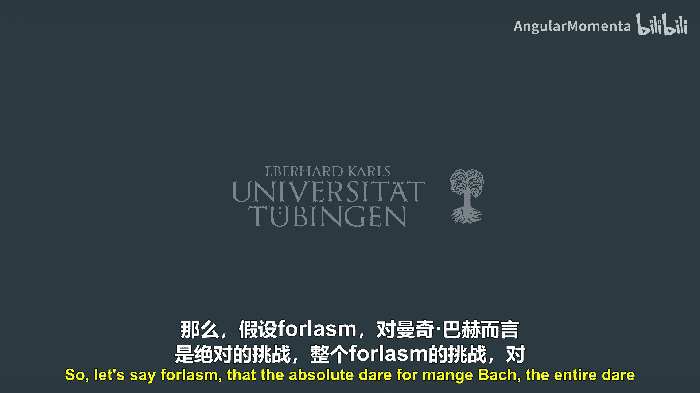
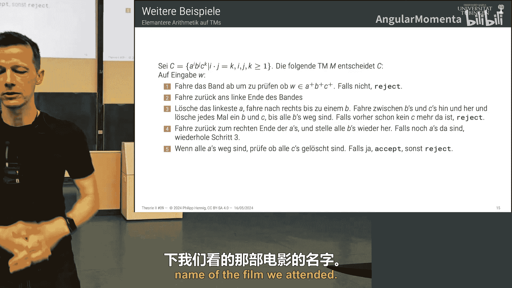
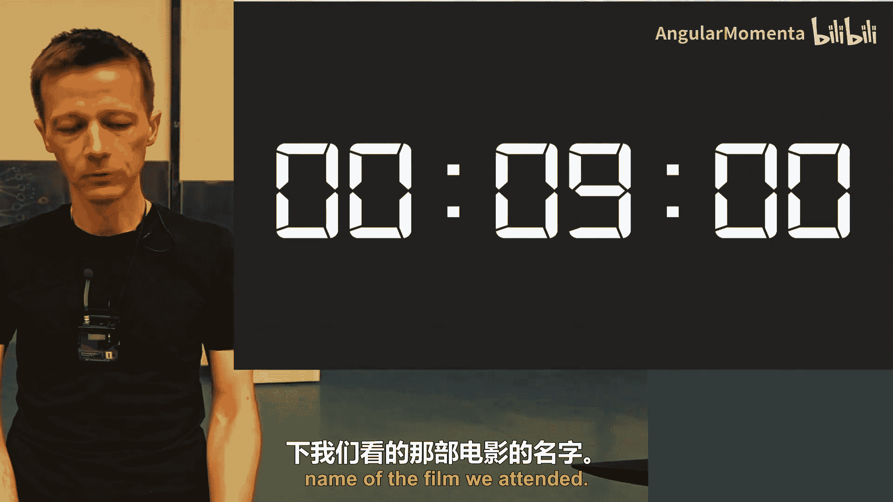
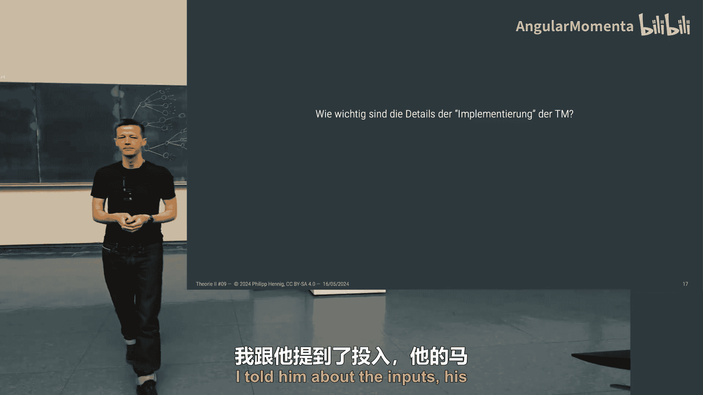
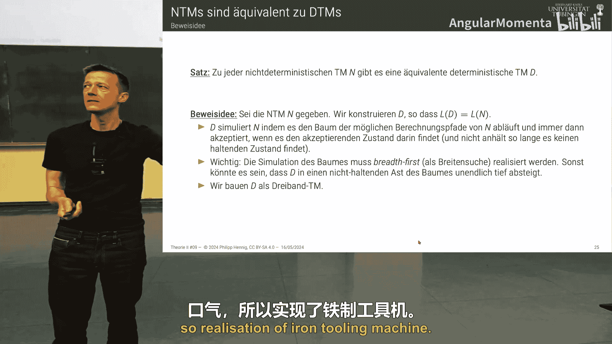
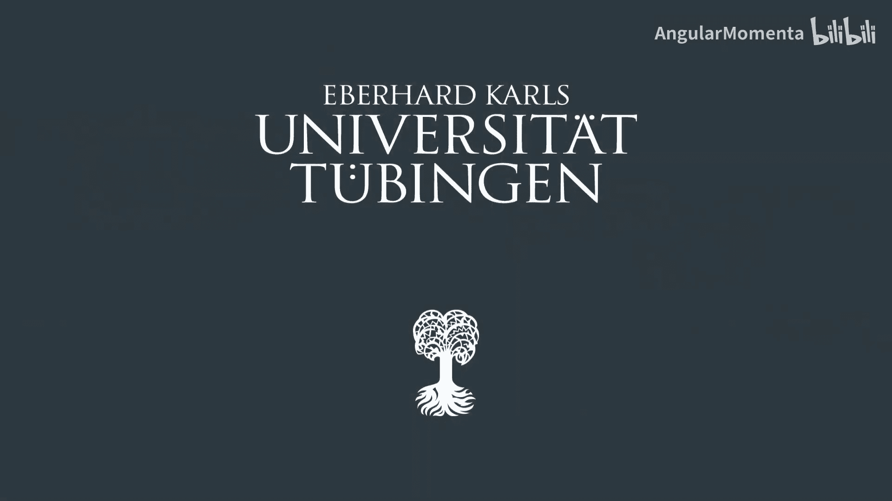

# 009：图灵机 🧠

在本节课中，我们将学习计算机科学的核心模型——图灵机。图灵机是一个抽象的计算模型，它帮助我们理解计算的本质和极限。我们将从图灵机的历史背景开始，逐步介绍其基本构成、工作原理、形式化定义以及其强大的计算能力。

## 历史背景与核心思想 📜

上一节我们介绍了自动机等计算模型，本节中我们来看看一个更强大、更通用的模型。

图灵机由艾伦·图灵于1936年提出。这篇开创性的论文旨在形式化地定义“可计算性”这个概念。图灵设想了一种机器，它能够模拟任何人类“计算机”（指执行计算的人）的思维过程。这个思想实验将机械过程与计算联系起来，为理论计算机科学奠定了基础。

图灵机的核心思想是：**任何可以由算法描述的过程，都可以由图灵机来执行**。这意味着，如果一个问题可以被清晰地计算，那么就存在一台解决这个问题的图灵机。

## 图灵机的基本构成 ⚙️

图灵机是一个物理和概念的混合体。我们可以将其想象为一个带有读写头的机器，在一个无限长的纸带上进行操作。

以下是图灵机的主要组成部分：

1.  **无限长的纸带**：纸带被划分为连续的格子，每个格子可以包含一个符号。纸带是双向无限的。
2.  **读写头**：读写头每次对准纸带上的一个格子。它可以读取当前格子的符号，也可以写入一个新符号。
3.  **状态寄存器**：存储机器当前所处的状态。状态是有限的。
4.  **控制规则表（转移函数）**：这是一个指令集，根据机器当前的状态和读写头读到的符号，决定机器下一步该做什么。下一步动作包括：
    *   写入一个新符号到当前格子。
    *   将读写头向左或向右移动一格。
    *   改变到下一个状态。

图灵机从**初始状态**和输入字符串（写在纸带上，其余格子为空白）开始，一步步执行转移函数。它最终会进入**接受状态**或**拒绝状态**并停机，或者永远循环下去。

## 形式化定义 📐

为了使讨论更精确，我们需要对图灵机进行形式化定义。

一台**确定性图灵机** *M* 可以定义为一个七元组：
`M = (Q, Σ, Γ, δ, q0, q_accept, q_reject)`
其中：
*   **Q** 是有限的状态集合。
*   **Σ** 是有限的输入字母表（不包括空白符号）。
*   **Γ** 是有限的纸带字母表，满足 `Σ ⊆ Γ`，且包含一个特殊的**空白符号**（通常记为 `␣` 或 `B`）。
*   **δ** 是转移函数：`δ: Q × Γ → Q × Γ × {L, R}`。它表示在状态 `q` 读到符号 `a` 时，机器将写入符号 `b`，移动到方向 `D`（左L或右R），并进入新状态 `q‘`。
*   **q0 ∈ Q** 是初始状态。
*   **q_accept ∈ Q** 是接受状态。
*   **q_reject ∈ Q** 是拒绝状态，且 `q_accept ≠ q_reject`。

### 格局与计算

机器的**格局**描述了其在某个时刻的完整快照，包括：
*   当前状态 `q ∈ Q`。
*   纸带内容。
*   读写头的位置。

计算始于**初始格局**（状态为 `q0`，输入字符串写在纸带上，读写头指向输入的第一个符号）。然后，机器根据转移函数 `δ` 从一个格局**推导**到下一个格局。

如果机器最终进入状态 `q_accept`，则称它**接受**输入字符串。如果进入 `q_reject`，则称它**拒绝**输入字符串。如果永远无法进入这两个状态，则机器在输入上**不停机**（循环）。

## 图灵机的计算能力 💪

图灵机是极其强大的计算模型。其核心论点是：

**图灵机可以计算任何“可计算”的函数。**

这被称为**丘奇-图灵论题**。它不是一个可以被证明的定理，而是一个被广泛接受的基本原理。所有合理的计算模型（如λ演算、递归函数、现代编程语言）都被证明与图灵机在计算能力上是**等价**的。

这意味着，如果一个问题无法用图灵机解决，那么在任何现实的计算机上也无法用算法解决。

### 作为语言识别器

图灵机可以识别形式语言。一台图灵机 *M* 所识别的语言 *L(M)* 是所有能被 *M* 接受的字符串的集合。
`L(M) = { w ∈ Σ* | M 接受 w }`

能够被某个图灵机识别的语言称为**递归可枚举语言**。如果对于所有输入，图灵机都保证会停机（即总是进入 `q_accept` 或 `q_reject`），那么它识别的语言称为**递归语言**或**可判定语言**。

## 图灵机的变体 🔄

有许多图灵机的变体，例如多带图灵机、非确定性图灵机、随机存取图灵机等。

一个关键结论是：**许多图灵机的变体在计算能力上与基本的标准单带确定性图灵机是等价的**。它们可能在某些方面（如时间效率）上有所不同，但不能解决更多的问题。

例如：
*   **多带图灵机**：有多个纸带和读写头。这可以简化某些问题的编程，并可能提高效率，但其识别的语言类与单带图灵机相同。
*   **非确定性图灵机**：在每个步骤可以有多个可能的动作（转移）。它通过“猜测”和并行计算来运作。尽管这看起来更强大，但任何非确定性图灵机都可以被一台确定性图灵机模拟，尽管模拟可能需要指数级更多的时间。

## 模拟与等价性证明示例 🧪

为了理解不同变体之间的等价性，我们可以看一个简单的模拟思想：**用单带图灵机模拟多带图灵机**。

基本思路是：
1.  单带图灵机的纸带被划分为多个**轨道**（通过使用一个扩展的字母表，其符号是原字母表符号的元组）。每个轨道模拟多带机的一条纸带。
2.  增加一个特殊的轨道来标记各条模拟纸带上读写头的位置。
3.  单带机的读写头在一次扫描中，可以读取所有轨道上的符号（即一个元组），并根据多带机的转移函数更新这些轨道的内容和头位置标记。

通过这种方式，单带机可以一步步地模拟多带机的计算。这证明了多带图灵机并没有增加根本的计算能力。

## 总结 🎯

本节课中我们一起学习了图灵机，这是理论计算机科学的基石。
*   我们了解了图灵机的历史背景和核心思想：为“可计算性”建立形式模型。
*   我们详细拆解了图灵机的物理构成和形式化数学定义 `(Q, Σ, Γ, δ, q0, q_accept, q_reject)`。
*   我们理解了图灵机如何通过格局转移进行计算，并定义其接受、拒绝和不停机的行为。
*   我们掌握了**丘奇-图灵论题**的核心地位，它断言图灵机抓住了“有效计算”的本质。
*   我们探讨了图灵机的多种变体（如多带机、非确定性机），并认识到它们在计算能力上与基本模型等价，这通过模拟的思想得以证明。

图灵机不仅是一个历史概念，它持续影响着我们对计算复杂性、可判定性以及计算机极限的思考。