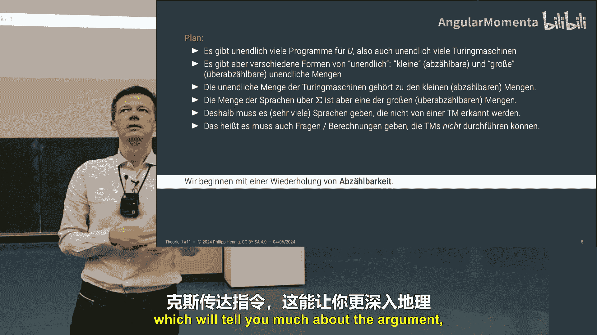
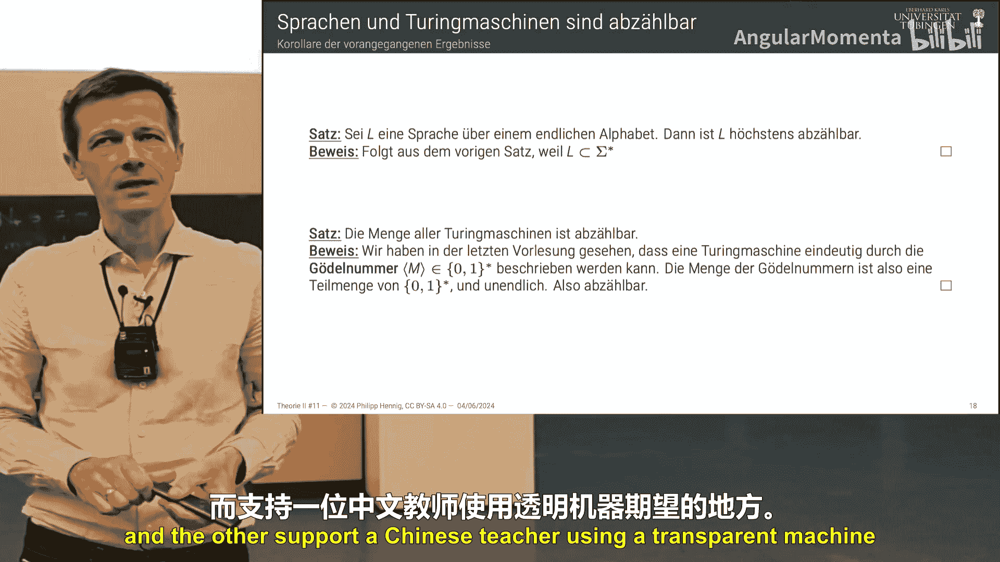
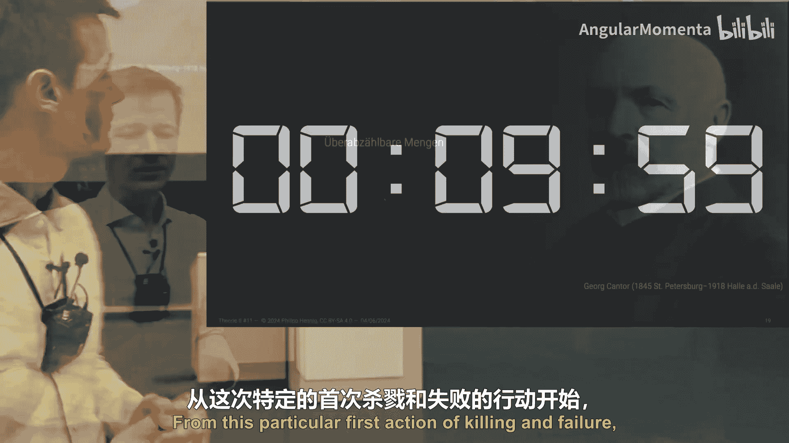
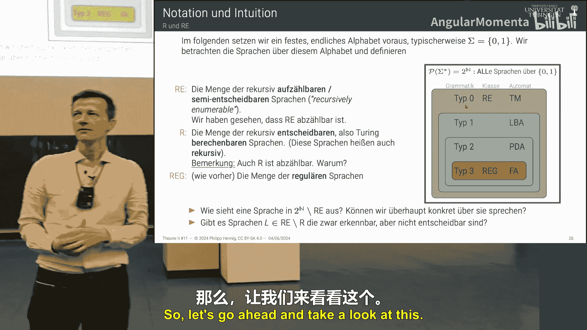

# 010：可数性

在本节课中，我们将学习可数性的核心概念，包括集合的基数、可数集与不可数集的定义，以及康托尔对角线论证法。我们将通过图灵机、编码和函数映射等工具来理解这些概念。

---

## 可数集与不可数集

上一节我们介绍了集合的基本概念，本节中我们来看看如何比较不同集合的“大小”。

一个集合的基数，指的是其元素的数量。如果两个集合之间存在一个**双射函数**，即一个一一对应且映满的函数，那么这两个集合具有相同的基数。

**定义：** 如果存在一个从自然数集 **N** 到集合 **A** 的双射函数 **f: N → A**，则称集合 **A** 是可数的。

这意味着，可数集的元素可以像自然数一样被“数”出来，即使它是无限的（例如自然数集本身、整数集、有理数集）。

---

## 图灵机与编码

为了形式化地讨论可计算性问题，我们需要一个精确的模型。图灵机就是这样一个模型。

一台图灵机由以下几个部分组成：
*   **一个无限长的纸带**，被划分为格子。
*   **一个读写头**，可以读取、写入纸带上的符号，并左右移动。
*   **一套控制规则（状态转移函数）**，根据当前状态和读到的符号，决定写入什么符号、如何移动以及转移到什么新状态。
*   **一个状态寄存器**，记录当前状态。

我们可以用有限的符号（字母表）来编码图灵机的描述。例如，我们可以将图灵机的状态、规则等编码成一个字符串。

**核心概念：** 存在一个**通用图灵机 U**。它接受两个输入：一个是对另一台图灵机 **M** 的描述编码 **<M>**，另一个是输入字符串 **w**。通用图灵机 **U** 能够模拟 **M** 在输入 **w** 上的运行：**U(<M>, w) = M(w)**。

这意味着，所有图灵机的集合是可数的，因为每台图灵机都可以被编码成一个有限的字符串，而所有有限字符串的集合是可数的。

---

## 康托尔对角线论证

现在，我们来看一个著名的论证，它证明了并非所有无限集都是可数的。

考虑所有自然数子集的集合，记作 **P(N)**。我们断言 **P(N)** 是不可数的。

**证明（康托尔对角线法）：**
1.  假设 **P(N)** 是可数的。那么我们可以将其所有元素（即自然数的子集）列成一个无穷序列：**S₁, S₂, S₃, ...**
2.  我们构造一个新的自然数子集 **D**。构造规则如下：对于每个自然数 **i**，检查 **i** 是否属于 **Sᵢ**。
    *   如果 **i ∈ Sᵢ**，则令 **i ∉ D**。
    *   如果 **i ∉ Sᵢ**，则令 **i ∈ D**。
3.  这样构造出的 **D** 是一个自然数的子集。根据假设，它应该出现在我们的列表中，即存在某个 **k**，使得 **D = Sₖ**。
4.  现在问：**k** 是否属于 **D**？
    *   如果 **k ∈ D**，根据 **D** 的定义（**k ∈ D** 当且仅当 **k ∉ Sₖ**），意味着 **k ∉ Sₖ**。但 **D = Sₖ**，所以 **k ∉ D**，矛盾。
    *   如果 **k ∉ D**，根据 **D** 的定义（**k ∉ D** 当且仅当 **k ∈ Sₖ**），意味着 **k ∈ Sₖ**。但 **D = Sₖ**，所以 **k ∈ D**，矛盾。
5.  因此，假设错误。**P(N)** 是不可数的。

这个论证的精妙之处在于，通过“对角线”上的元素（即判断 **i** 是否属于 **Sᵢ**）来构造一个不可能在列表中出现的集合 **D**。

---

## 实数集是不可数的

康托尔对角线论证的一个直接应用是证明实数集 **R** 是不可数的。我们可以将实数（例如0到1之间的实数）用二进制或十进制无限小数表示，然后使用类似的对角线方法构造一个不在列表中的新实数。

**结论：** 实数集 **R** 的基数严格大于自然数集 **N** 的基数。**R** 的基数被称为“连续统的势”。

---

## 可计算函数与不可计算函数

将图灵机编码的思想与康托尔对角线法结合，可以得出深刻的结论。

所有图灵机的集合是可数的。每台图灵机计算一个函数（可能是部分函数）。因此，所有**可计算函数**的集合也是可数的。

然而，所有从自然数到自然数的**函数**的集合 **F = {f | f: N → N}** 是不可数的。这可以通过类似于 **P(N)** 的论证来证明。

**核心结论：** 存在不可计算的函数。因为可计算函数是可数的，而所有函数的集合是不可数的，所以绝大多数函数都是不可计算的。

---

## 停机问题

一个具体的不可判定问题的例子是**停机问题**：给定一台图灵机 **M** 的描述和输入 **w**，判断 **M** 在输入 **w** 上是否会最终停机（而不是无限循环）。

**证明（草图，利用对角线法）：**
1.  假设存在一台图灵机 **H** 可以判定停机问题。即 **H(<M>, w)** 输出“是”如果 **M(w)** 停机，输出“否”如果 **M(w)** 不停机。
2.  我们构造一台新的图灵机 **D**，它以自己的描述编码 **<D>** 作为输入。**D** 的运行如下：
    *   **D** 调用 **H** 来判断 **D(<D>)** 是否会停机。
    *   如果 **H** 判断 **D(<D>)** 会停机，那么 **D** 就进入无限循环。
    *   如果 **H** 判断 **D(<D>)** 不会停机，那么 **D** 就立即停机。
3.  现在分析 **D(<D>)** 的行为：
    *   如果 **D(<D>)** 停机，那么根据 **D** 的构造，**H** 应该判断它不会停机，这意味着 **D(<D>)** 不会停机，矛盾。
    *   如果 **D(<D>)** 不停机，那么根据 **D** 的构造，**H** 应该判断它会停机，这意味着 **D(<D>)** 会停机，矛盾。
4.  因此，这样的判定机 **H** 不可能存在。停机问题是不可判定的。

这个证明是康托尔对角线思想在可计算性理论中的经典应用。

---

## 乔姆斯基层级与可计算性

语言（字符串的集合）可以根据识别它们的计算模型的复杂度进行分类，这就是**乔姆斯基层级**。

以下是主要的层级：
*   **正则语言**： 可以由有限自动机识别。表达能力有限。
*   **上下文无关语言**： 可以由下推自动机识别。常用于描述编程语言的语法。
*   **上下文相关语言**： 可以由线性有界自动机识别。
*   **递归可枚举语言**： 可以由图灵机识别。这是图灵机能够接受的所有语言的集合。
    *   其子集是**递归语言**（或可判定语言），即存在一台图灵机总能判定一个字符串是否属于该语言（总是停机并给出是/否答案）。
    *   停机问题对应的语言是递归可枚举的，但不是递归的。

**核心关系：** 图灵机是这些自动机模型中能力最强的。递归可枚举语言包含了所有可由算法（图灵机）半判定的语言，而递归语言则对应那些可由算法完全判定的语言。

---

## 总结

本节课中我们一起学习了：
1.  **可数性**： 通过建立与自然数的双射来定义可数集。自然数集、整数集、有理数集都是可数的。
2.  **康托尔对角线论证**： 一个强大的证明工具，用于证明某些集合（如自然数幂集 **P(N)**、实数集 **R**）是不可数的，其基数大于自然数集。
3.  **图灵机与编码**： 图灵机是计算的形式模型，可以被有限编码。所有图灵机的集合是可数的。
4.  **可计算性界限**： 由于图灵机可数而所有函数不可数，因此存在（事实上是绝大多数）不可计算的函数。
5.  **停机问题**： 一个具体的、利用对角线法证明的不可判定问题，是计算理论的核心结果之一。
6.  **乔姆斯基层级**： 描述了不同形式语言类与对应计算模型（自动机）之间的关系，图灵机位于这个层级的顶端。

这些概念奠定了理论计算机科学的基础，揭示了计算的本质、能力与极限。