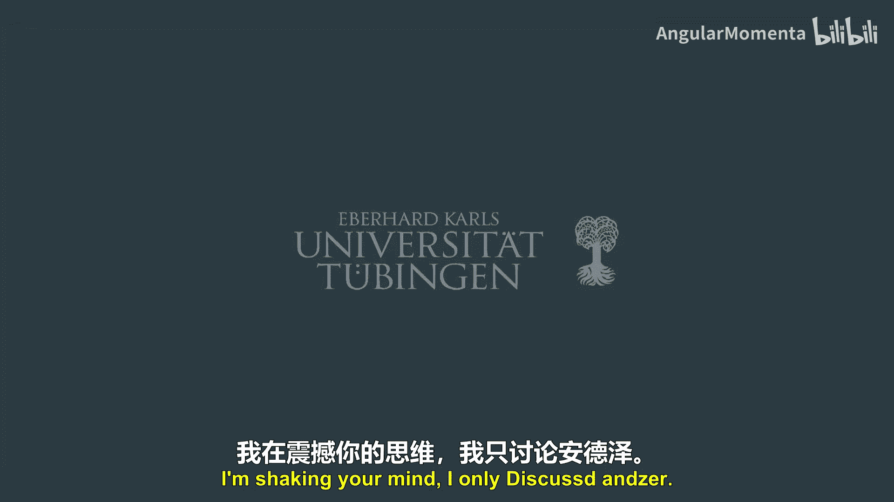
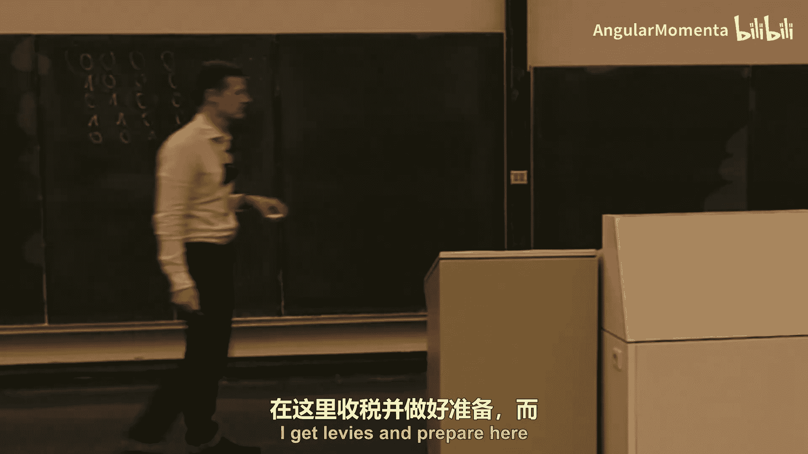
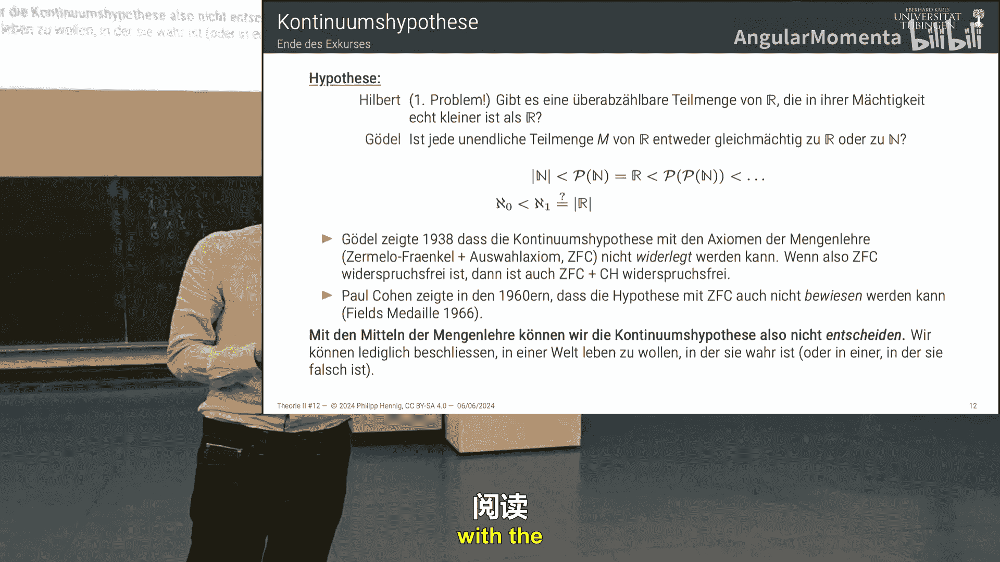
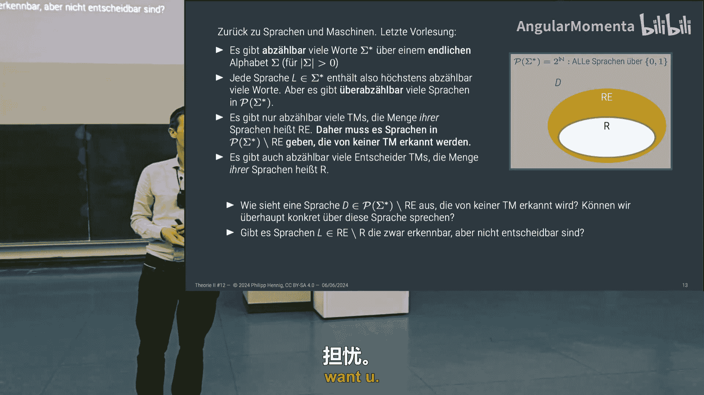
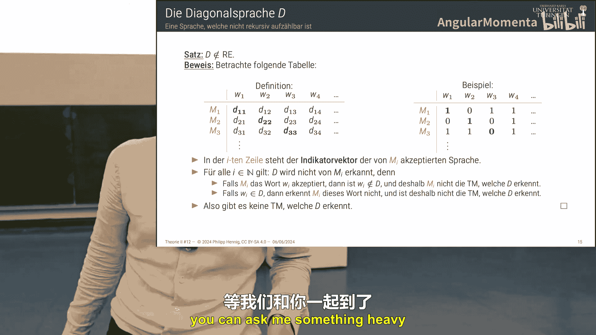
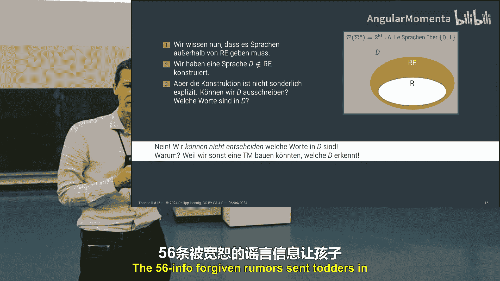
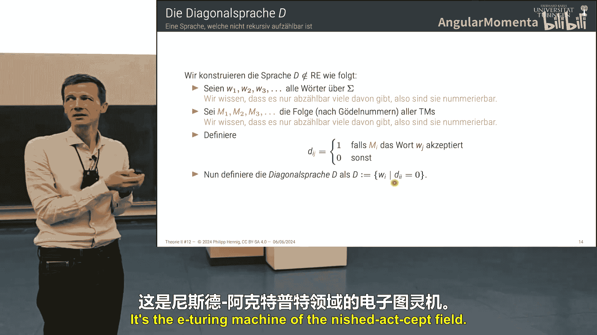
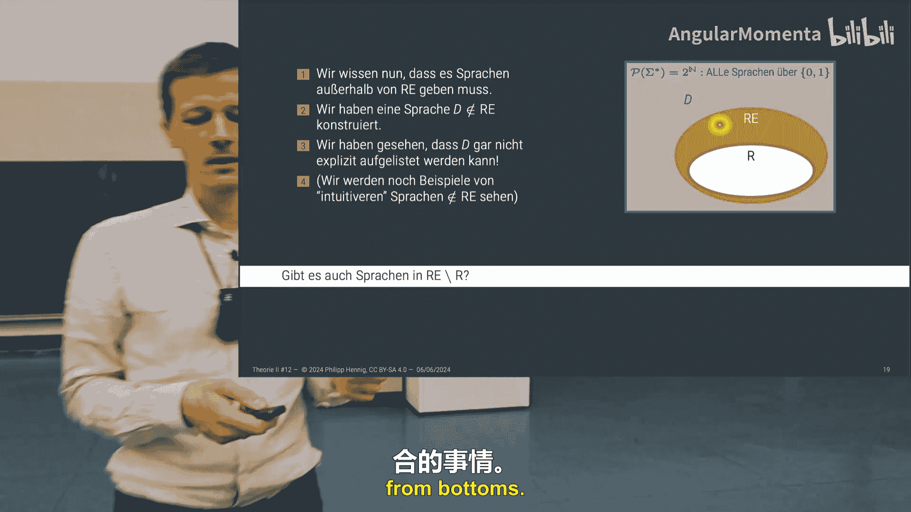
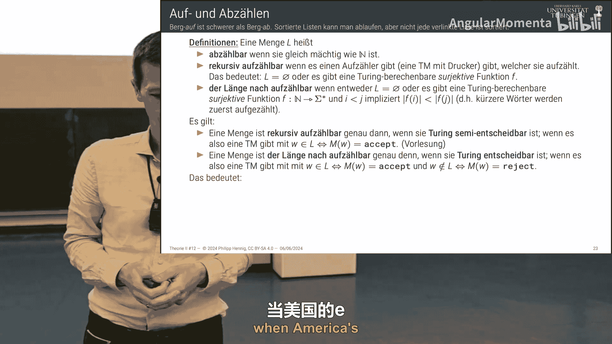
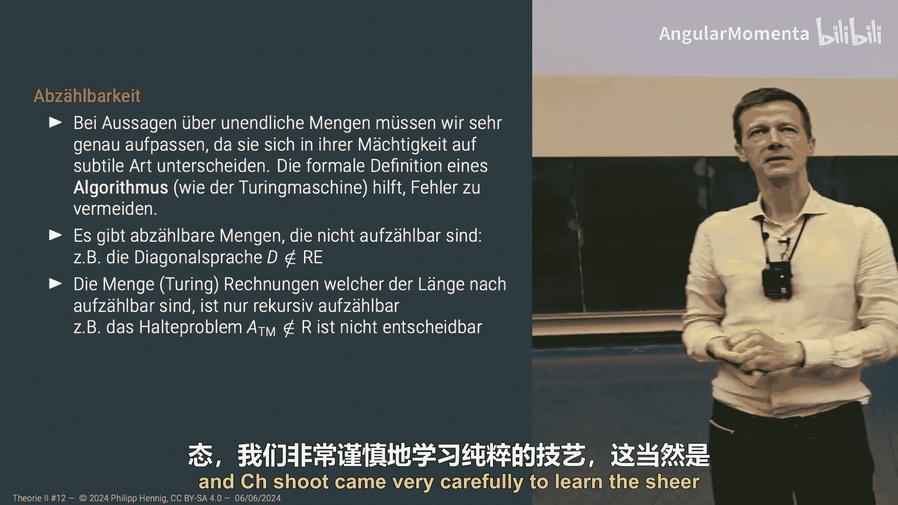

# 011：不可识别与不可判定 🧠

  



## 📌 概述

  

在本节课中，我们将学习理论计算机科学中的两个核心概念：**不可识别（Unrecognizable）**与**不可判定（Undecidable）**问题。通过引入图灵机模型与对角线方法，我们将理解为什么有些问题在计算上是无法解决的，并进一步掌握这些结论的形式化表达。

  



---

  

## 🧩 一、计算模型与问题形式化

  

上一节我们介绍了计算的基本思想，本节首先回顾计算模型的形式化定义。

  

在理论计算机科学中，我们使用**图灵机（Turing Machine）**作为标准计算模型，用于刻画“可计算性”。

  

核心定义如下：

  

```text
图灵机 M = (Q, Σ, Γ, δ, q0, q_accept, q_reject)
```

  

其中：

  

- `Q`：状态集合  
- `Σ`：输入字母表  
- `Γ`：带字母表  
- `δ`：状态转移函数  
- `q0`：初始状态  
- `q_accept / q_reject`：接受/拒绝状态  

  

在这个模型下，我们可以形式化“问题”为**语言（Language）**：

  

```text
L ⊆ Σ*
```

  

即一个字符串集合。

  

---

  

## ⚙️ 二、可判定性与可识别性

  

在建立了计算模型之后，我们来区分两种重要的问题类型。

  

以下是两种基本概念：

  

- **可判定（Decidable）问题**  
- **可识别（Recognizable）问题**

  

其形式化定义如下：

  

### 1️⃣ 可判定问题

  

如果存在一个图灵机 `M`，对任意输入 `w`：

  

```text
w ∈ L  → M 接受  
w ∉ L  → M 拒绝  
```

  

并且**总是停机**，则称语言 `L` 是可判定的。

  

---

  

### 2️⃣ 可识别问题

  

如果存在图灵机 `M`：

  

```text
w ∈ L  → M 接受  
w ∉ L  → M 可能拒绝或无限循环  
```

  

则称 `L` 是可识别的。

  

---

  

在这一基础上，我们可以得到关系：

  

```text
可判定 ⊆ 可识别
```

  

---

  

## 🚫 三、不可判定问题

  

在理解了可判定问题之后，本节重点进入不可判定性。

  

以下是关键结论：

  

> 存在某些问题，不存在任何图灵机可以对所有输入给出正确且终止的判断。

  



经典例子是**停机问题（Halting Problem）**：

  

```text
HALT = { ⟨M, w⟩ | M 在输入 w 上会停机 }
```

  

结论：

  

```text
HALT 是不可判定的
```

  

---

  

## 🧮 四、康托尔对角线方法

  

上一节介绍了计算模型，本节进一步使用数学方法证明不可判定性。

  



核心思想来自**对角线法（Diagonalization）**：

  

假设所有程序可以列举为：

  

```text
M1, M2, M3, ...
```

  

构造一个新函数 `D`：

  

```text
D(i) = 1  如果 Mi(i) = 0  
D(i) = 0  如果 Mi(i) = 1
```

  

该函数在第 `i` 位与 `Mi` 不同，因此：

  

```text
D ≠ Mi  对所有 i
```

  

这说明：

  

> 存在函数不在任何图灵机列表中 → 不可计算

  



---

  



## 🔍 五、不可识别问题

  

在不可判定之外，还有更强的结论：不可识别。

  

定义如下：

  

如果语言 `L`：

  

```text
不存在图灵机 M，使得 w ∈ L 时 M 接受
```

  



则称 `L` 为**不可识别**。

  

---

  

进一步可以得到：

  



```text
不可识别 ⊂ 不可判定
```

  

并且：

  

```text
若 L 不可识别，则 L 和其补集至少一个不可识别
```

  

---

  

## 🔁 六、补集与对称性

  

上一节我们介绍了不可识别语言，本节进一步分析其补集性质。

  

关键结论如下：

  

- 若 `L` 可判定，则：

  

```text
L̄ 也可判定
```

  

- 若 `L` 可识别，则：

  

```text
L̄ 不一定可识别
```

  

---

  

一个重要结论：

  

```text
L 可判定 ⇔ L 和 L̄ 都可识别
```

  

---

  

## 🧠 七、与逻辑和数学基础的联系

  

在理解计算不可解问题后，我们可以将其与数学基础联系起来。

  

相关思想包括：

  

- 形式系统（Formal Systems）  
- 公理化方法（Axiomatic Systems）  
- 哥德尔不完备性  

  

这些理论共同说明：

  



> 某些真命题无法通过有限规则证明  
> 某些问题无法通过算法解决  

  

---

  

## 🏁 总结

  

本节课中，我们一起学习了：

  

- 图灵机作为计算模型的定义  
- 可判定与可识别问题的区别  
- 停机问题的不可判定性  
- 康托尔对角线方法  
- 不可识别语言的概念  
- 补集与可识别性的关系  
- 计算理论与数学逻辑的联系  

  



这些内容构成了理论计算机科学中关于“计算极限”的核心基础，为后续学习复杂性理论与形式语言打下了基础。