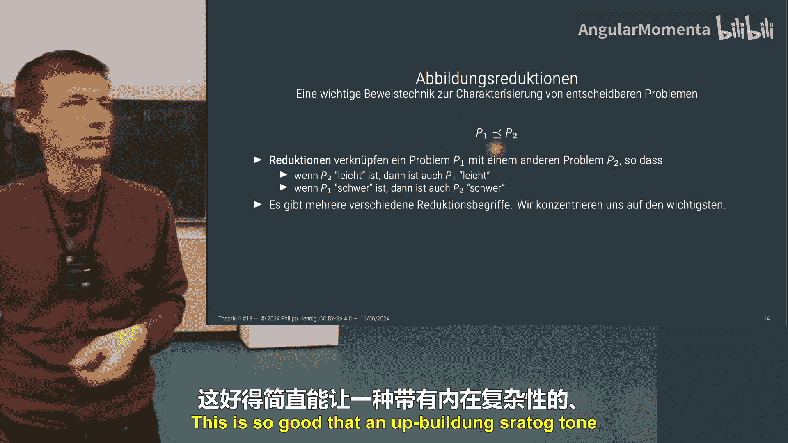
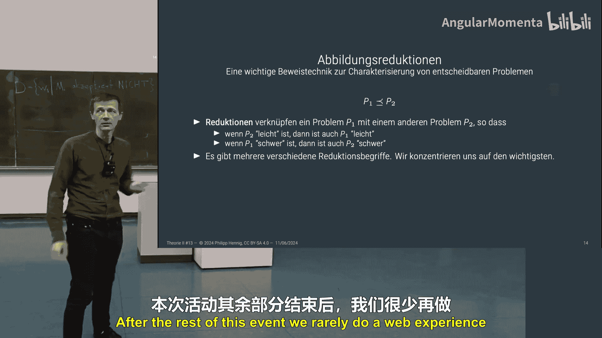
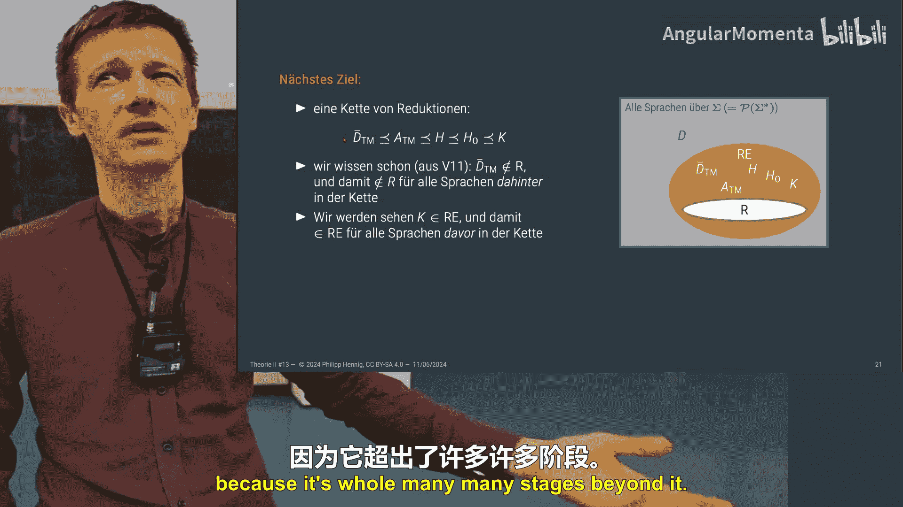
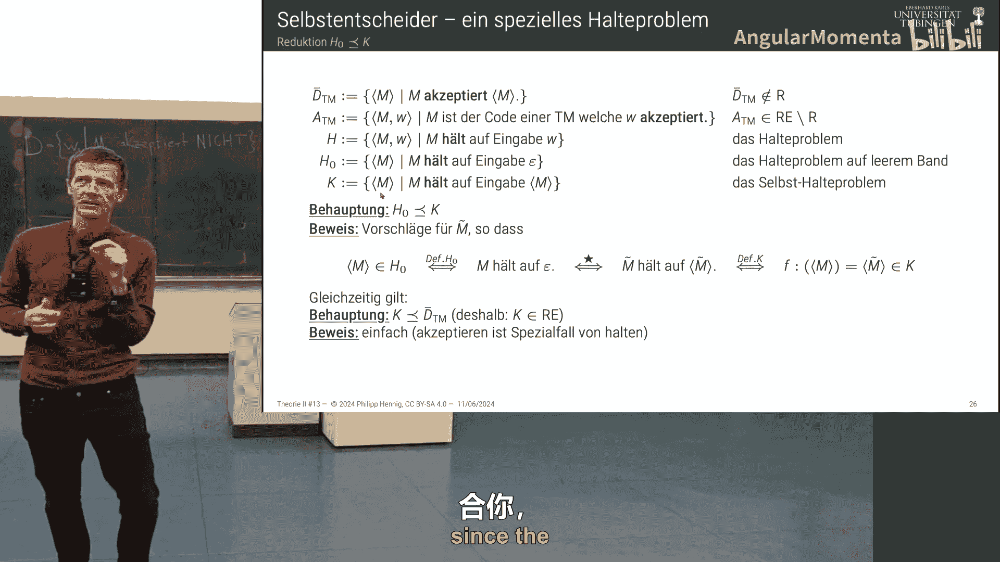

# 012：停机问题与归约


在本节课中，我们将学习计算理论中的一个核心概念：停机问题。我们将探讨其定义、不可判定性证明，以及如何通过“归约”方法，将停机问题与其他计算问题联系起来。

---

## 概述：什么是停机问题？🤔

停机问题探讨的是：是否存在一个通用算法，能够判断任意一个程序在给定输入下是否会最终停止运行，还是会无限循环下去。

这是一个**不可判定问题**，意味着不存在一个图灵机（或算法）能够为所有可能的程序-输入对给出正确的“是/否”答案。

---

## 对角化论证与自指矛盾 🔄

上一节我们介绍了图灵机作为计算模型。本节中我们来看看如何证明停机问题的不可判定性，其核心思想是对角化论证和自指。

我们假设存在一个能解决停机问题的图灵机 **H**。它的描述如下：
```
H(M, w) = 如果图灵机 M 在输入 w 上停机，则接受；否则（即无限循环），则拒绝。
```

现在，我们利用 **H** 来构造另一个图灵机 **D**，它的行为基于 **H** 的判断结果：
```
D(M) = 如果 H(M, M) 接受（即 M 在自身编码上停机），则 D 进入无限循环；
        如果 H(M, M) 拒绝（即 M 在自身编码上不停机），则 D 立即停机。
```

这里出现了矛盾：如果我们问 **D** 在它自身的编码 **<D>** 上是否会停机呢？
*   如果 **D(<D>)** 停机，根据 **D** 的定义，这意味着 **H(D, D)** 必须拒绝，而 **H** 拒绝表示 **D(<D>)** 不停机。
*   如果 **D(<D>)** 不停机，根据 **D** 的定义，这意味着 **H(D, D)** 必须接受，而 **H** 接受表示 **D(<D>)** 停机。

无论哪种情况，我们都得出了矛盾的结论。因此，我们最初的假设——存在能判定停机问题的图灵机 **H**——是错误的。


---



## 补集运算与复杂性类 🔀

我们刚刚证明了停机问题是不可判定的。一个自然的问题是：这个问题的“补集”是否可判定？一个语言的补集包含所有不在原语言中的字符串。

以下是关于补集运算的重要观察：
*   如果一个问题 **A** 是可判定的，那么它的补集 **¬A** 也是可判定的。你只需要运行判定 **A** 的算法，然后反转输出结果即可。
*   然而，对于可识别（递归可枚举）语言，情况则不同。一个语言 **A** 及其补集 **¬A** 如果都是递归可枚举的，那么 **A** 实际上是可判定的。




停机问题的补集（即判断一个程序是否*不停机*）同样也是不可判定的。因为如果它的补集可判定，利用上述第一条性质，我们可以间接判定停机问题本身，这与我们已经证明的结论矛盾。

---

## 归约：比较问题的难度 🧩

要证明一个新问题 **B** 也是不可判定的，我们不需要每次都从头进行复杂的对角化论证。我们可以使用一种称为“归约”的技术。

归约的核心思想是：如果我们已经知道问题 **A**（例如停机问题）是不可判定的，并且我们能将 **A** 的任意实例“转化”为问题 **B** 的一个实例，使得 **A** 的答案等价于 **B** 的答案，那么问题 **B** 也一定是不可判定的。

形式化地说，如果存在一个可计算函数 **f**，使得对于所有输入 **x**：
```
x ∈ A 当且仅当 f(x) ∈ B
```
那么我们就说 **A** 可归约到 **B**（记作 **A ≤ B**）。如果 **A** 不可判定，那么 **B** 也不可判定。

---

## 应用：证明其他问题的不可判定性 🛠️

利用归约技术，我们可以从停机问题出发，证明一大批问题的不可判定性。以下是几个经典例子：




**1. 空白带停机问题**
*   **问题**：给定一个图灵机 **M**，判断 **M** 在空输入（空白带）上是否停机。
*   **归约**：对于任意一个“普通”停机问题实例 **(M, w)**，我们可以构造一个新的图灵机 **M_w**。**M_w** 的行为是：首先在带上写下 **w**，然后将读写头移到起始位置，最后模拟 **M** 在 **w** 上的运行。这样，**M** 在 **w** 上停机 当且仅当 **M_w** 在空白带上停机。由于停机问题不可判定，故空白带停机问题也不可判定。

**2. 语言等价性问题**
*   **问题**：给定两个图灵机 **M1** 和 **M2**，判断它们是否识别相同的语言（即对于所有输入，输出相同）。
*   **归约**：我们可以将空白带停机问题归约到此。构造一个图灵机 **M_∅**，它拒绝所有输入（即识别空集）。对于任意一个图灵机 **M**，判断 **M** 是否与 **M_∅** 等价，实际上就是在判断 **M** 是否拒绝所有输入，这比判断它在空白带上是否停机更难。因此，语言等价性问题不可判定。

**3. 希尔伯特第十问题（丢番图方程整数解）**
*   **问题**：给定一个整系数多项式方程，判断是否存在整数解。
*   **结论**：马蒂亚谢维奇证明了该问题不可判定。这展示了数论中一个看似纯粹的问题，其难度与停机问题相当。

---

## 总结与展望 🎯

本节课中我们一起学习了：
1.  **停机问题**的定义及其通过**对角化论证**证明的不可判定性。
2.  补集运算对**可判定性**和**可识别性**类的影响。
3.  **归约**作为证明问题不可判定性的核心工具：如果问题 **A** 可归约到问题 **B**，且 **A** 不可判定，则 **B** 也不可判定。
4.  利用归约，我们证明了如**空白带停机**、**语言等价性**等多个自然问题是不可判定的。



停机问题是计算理论中许多不可判定性结果的源头。理解它和归约方法，为我们分析算法的极限、以及理解哪些问题在原则上无法通过计算解决，奠定了坚实的基础。在后续课程中，我们将探讨计算复杂性理论，研究那些虽然可判定但需要大量计算资源（如时间、空间）的问题。

---