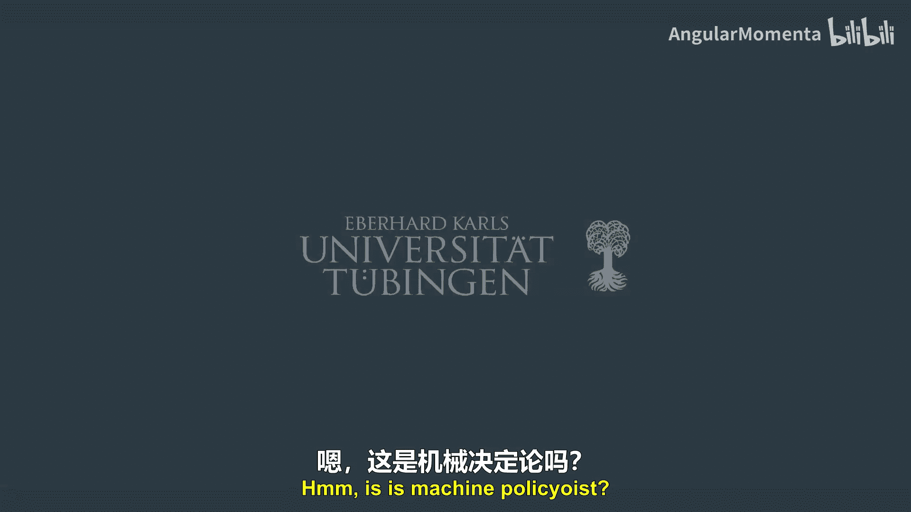
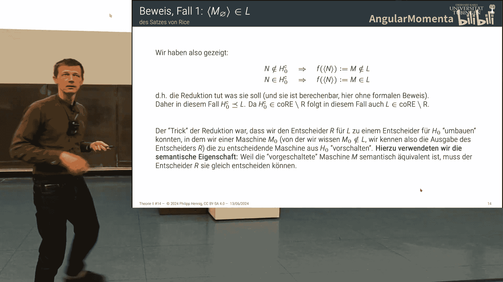
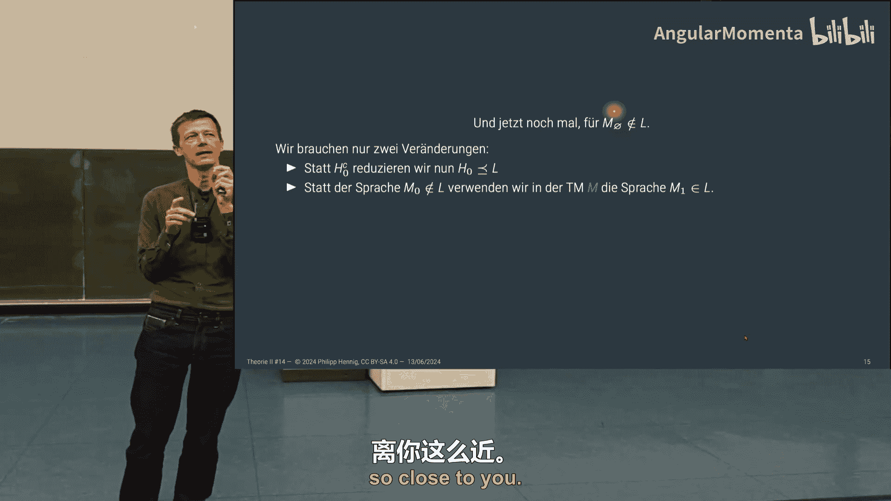
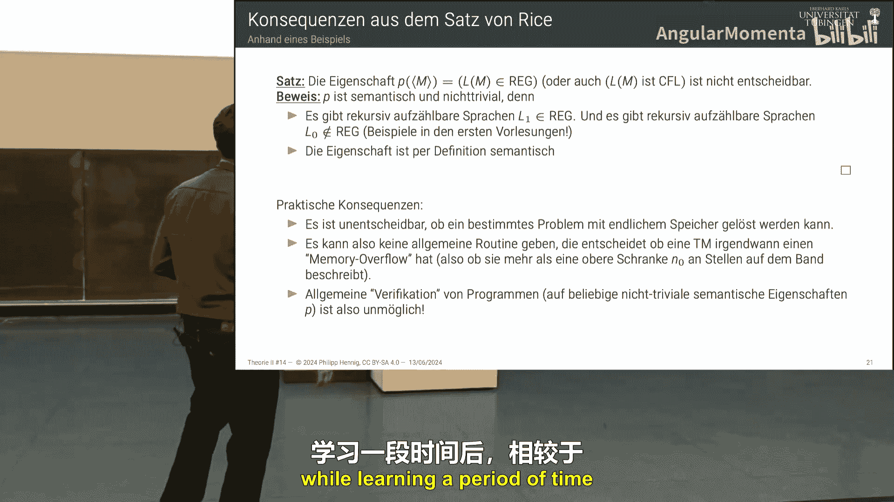
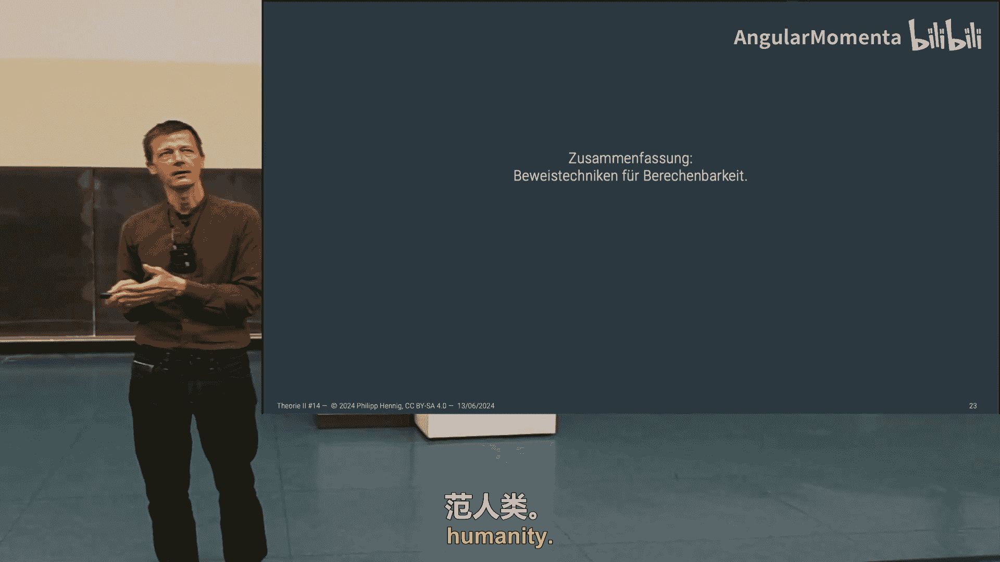
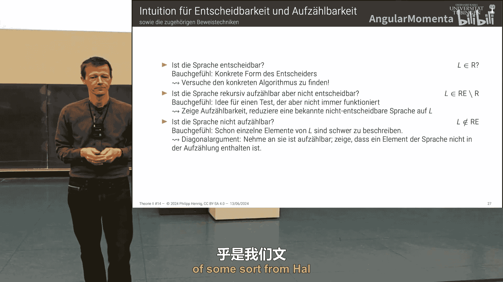
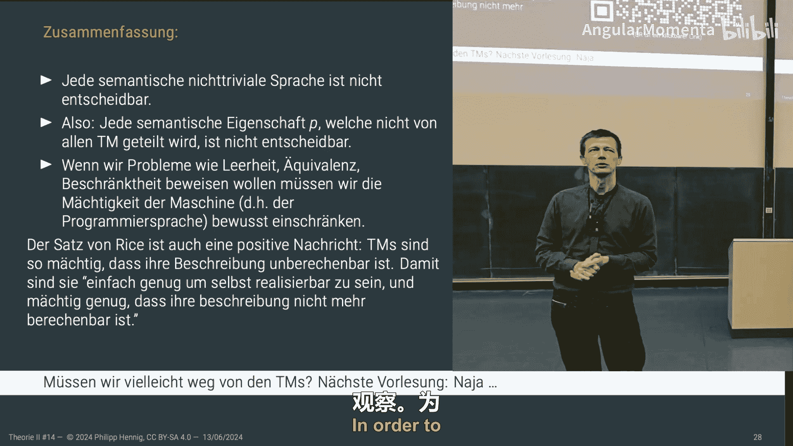

# 013：赖斯定理

## 概述
在本节课中，我们将学习理论计算机科学中的一个核心定理——赖斯定理。该定理揭示了关于图灵机可计算函数非平凡性质的深刻限制。我们将从图灵机的基本概念出发，逐步理解赖斯定理的表述、证明思路及其重要含义。

---

## 图灵机与可计算函数

上一节我们介绍了计算模型的基础。本节中我们来看看图灵机与它定义的可计算函数。

图灵机是一种抽象的计算模型。一台图灵机 **M** 定义了一个从输入字符串到输出字符串的（偏）函数。我们记图灵机 **M** 计算的函数为 **φ_M**。

如果存在一台图灵机 **M** 使得对于所有输入 **x**， **M(x)** 停机并输出 **f(x)**，则称函数 **f** 是**图灵可计算**的。

---

## 问题的归约与不可判定性

在深入赖斯定理之前，我们需要理解“归约”的概念。这是比较问题计算难度的核心工具。

如果我们可以利用解决问题 **A** 的方法来解决问题 **B**，则称问题 **B** 可以**归约**到问题 **A**。形式化地说，如果存在一个可计算函数 **f**，使得对于任意输入 **x**，**x ∈ B** 当且仅当 **f(x) ∈ A**，则 **B ≤_T A**。

一个关键结论是：如果 **A** 是不可判定的（即不存在总是停机的图灵机来判定 **A**），并且 **B ≤_T A**，那么 **B** 也是不可判定的。

---

## 非平凡性质

现在，我们关注图灵机所计算的函数集合的“性质”。

设 **P** 是图灵可计算函数集合的一个性质。我们可以将 **P** 看作一个函数集合：**P ⊆ { f | f 是图灵可计算的 }**。

我们称性质 **P** 是：
*   **平凡的**：如果 **P** 是空集，或者 **P** 包含所有图灵可计算函数。
*   **非平凡的**：如果 **P** 不是平凡的，即至少有一个可计算函数具有性质 **P**，也至少有一个可计算函数不具有性质 **P**。

以下是关于图灵机函数的一些性质示例：
*   函数 **f** 对输入 “0” 的输出是 “1”。
*   函数 **f** 的定义域（即使其停机的输入集合）是空集。
*   函数 **f** 是全函数（对所有输入都停机）。

---

## 赖斯定理的陈述

基于以上概念，我们现在可以陈述赖斯定理。

**赖斯定理**：任何关于图灵可计算函数的非平凡性质都是不可判定的。

更精确地说：对于任何非平凡的性质 **P**，集合 **{ <M> | φ_M 具有性质 P }** 是不可判定的。其中 **<M>** 是图灵机 **M** 的编码。

这意味着，不存在一个通用的算法（即总是停机的图灵机），能够通过检查任意一台图灵机的描述 **<M>**，来判定这台图灵机所计算的函数 **φ_M** 是否具有某个特定的非平凡性质 **P**。

---

## 证明思路（以“函数是否全函数”为例）

赖斯定理的证明通常使用归约法。我们通过将一个已知的不可判定问题（例如停机问题）归约到判定性质 **P** 的问题，来证明后者也是不可判定的。

我们以判定“图灵机 **M** 计算的函数 **φ_M** 是否全函数”为例。这是一个非平凡性质（存在全函数，也存在非全函数）。

1.  **假设**：假设存在一个判定器 **H**，对于输入 **<M>**，它能判定 **φ_M** 是否为全函数。
2.  **构造归约**：我们将停机问题归约到这个问题。对于任意一个图灵机 **M** 和输入 **w**，我们构造一台新的图灵机 **M’**。**M’** 的行为如下：
    *   对于所有输入 **x**，**M’** 首先模拟 **M** 在输入 **w** 上的运行。
    *   如果 **M** 在 **w** 上停机，那么 **M’** 将忽略 **x**，并输出某个固定值（例如 0）。
    *   如果 **M** 在 **w** 上永不停机，那么 **M’** 也永不停机。
3.  **分析**：
    *   如果 **M** 在 **w** 上停机，那么 **M’** 对所有输入 **x** 都停机（并输出0），即 **φ_{M’}** 是全函数。
    *   如果 **M** 在 **w** 上永不停机，那么 **M’** 对所有输入 **x** 都永不停机，即 **φ_{M’}** 不是全函数。
4.  **得出结论**：如果我们能用 **H** 判定 **φ_{M’}** 是否为全函数，我们就能判定 **M** 在 **w** 上是否停机。因为停机问题是不可判定的，所以这样的判定器 **H** 不可能存在。

这个构造方法可以推广到任何非平凡性质 **P** 上，从而证明赖斯定理。

---

## 赖斯定理的含义与影响

赖斯定理是理论计算机科学中一个非常强大且令人惊讶的结论。它意味着：

*   **对程序分析的深刻限制**：我们无法编写一个万能的程序分析器，来判定任意程序是否具有诸如“是否会终止（停机）”、“是否输出某个特定值”、“功能是否等价于另一个程序”等非平凡行为特性。
*   **区分语法与语义**：我们可以轻易地分析程序的**语法**（例如代码格式、变量名），但自动分析程序的**语义**（即程序实际要做什么）在根本上受到限制。
*   **与软件工程的联系**：这解释了为什么自动化软件验证、测试用例生成、程序等价性证明等任务是极其困难的，并且在一般情况下是不可判定的。

---

## 总结

本节课中我们一起学习了赖斯定理。我们从图灵机和可计算函数出发，定义了问题的归约和非平凡性质。赖斯定理指出，任何关于图灵可计算函数的非平凡性质都是不可判定的。我们通过将停机问题归约到“判定函数是否为全函数”的例子，理解了该定理的证明思路。最后，我们探讨了这一定理对程序分析和软件工程带来的根本性限制。赖斯定理清晰地划定了计算机在自动推理关于程序行为问题方面的能力边界。