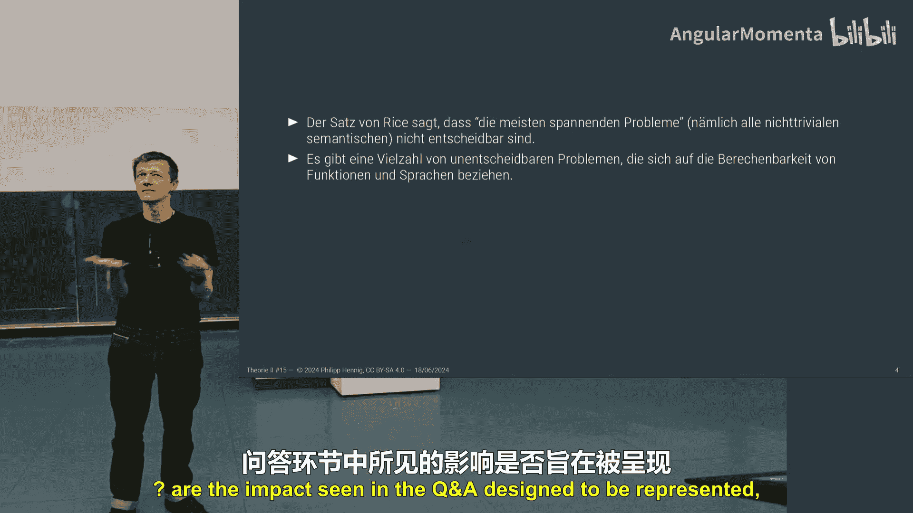
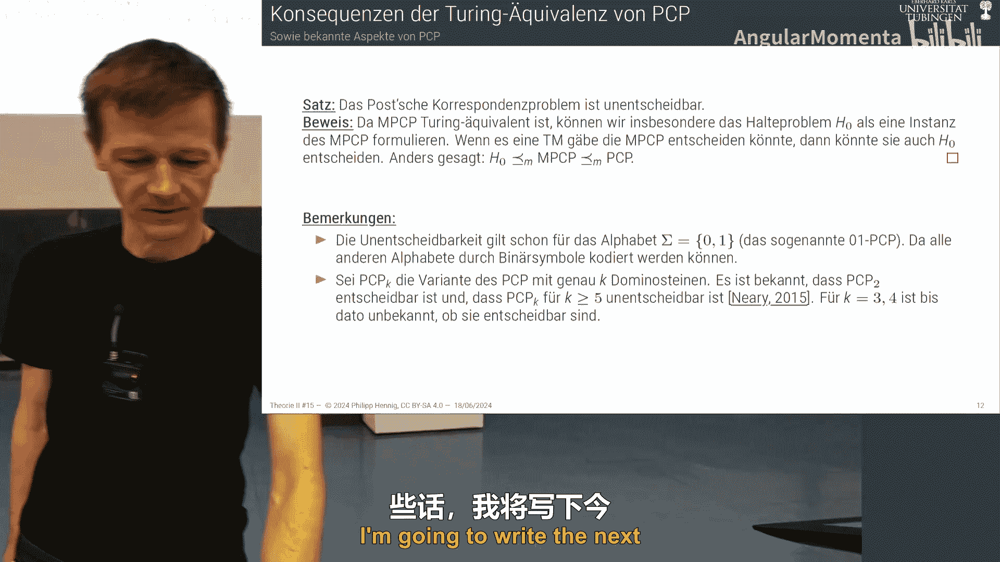
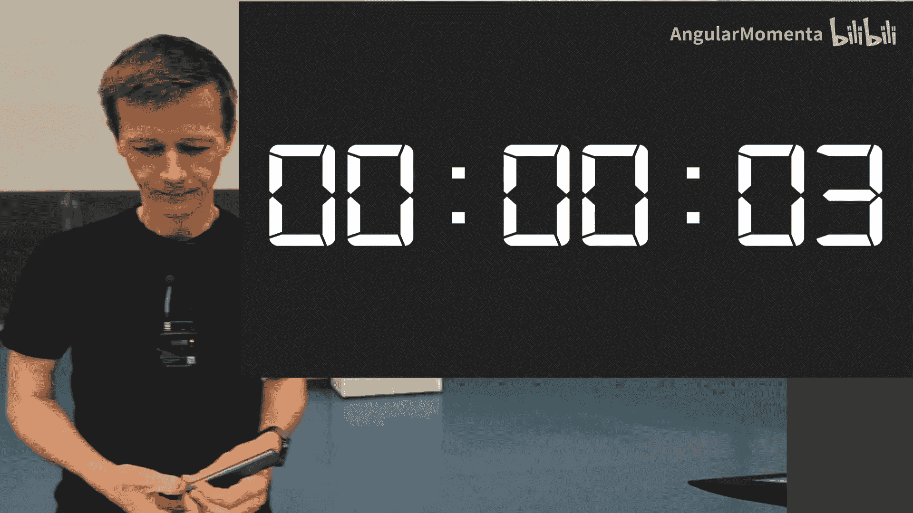
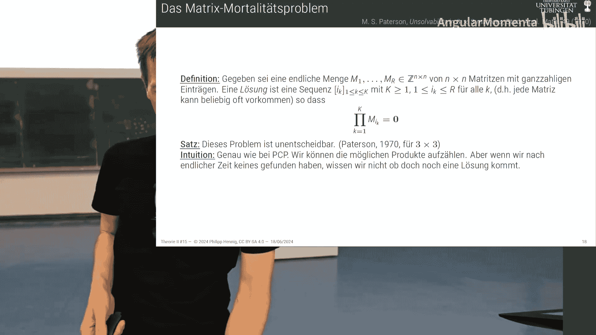

# 014：波斯特对应问题 (Post's Correspondence Problem) 🧩

在本节课中，我们将学习一个名为**波斯特对应问题**的计算理论核心问题。这个问题是理解计算可判定性边界的关键，它以一种看似简单的形式，揭示了某些计算问题的不可判定性。我们将从直观概念入手，逐步构建其形式化定义，并探讨其与图灵机停机问题的深刻联系。

## 概述与直观理解

上一节我们介绍了图灵机作为计算模型的基础。本节中，我们来看看一个由埃米尔·波斯特提出的经典问题。

波斯特对应问题是一个关于字符串匹配的决策问题。其核心思想可以借助“多米诺骨牌”来直观理解。

想象我们有一组多米诺骨牌，每张骨牌被一条线分成上下两部分，每一部分都写着一个由特定字母组成的字符串（单词）。例如，一张骨牌可能上面是“a”，下面是“aba”。

**PCP实例** 就是给定这样一个有限的多米诺骨牌集合。

**问题** 在于：能否从这组骨牌中（允许重复使用同一张骨牌）按某种顺序选取一个有限序列，使得当我们将这些骨牌按顺序排列时，**所有骨牌上方的字符串连接起来**形成的长字符串，与**所有骨牌下方的字符串连接起来**形成的长字符串**完全相同**？

如果能找到这样的序列，我们称该PCP实例有解；否则无解。

## 形式化定义

以下是波斯特对应问题的精确定义。

一个**PCP实例** `P` 是一个定义在字母表 `Σ` 上的有限“骨牌”对列表：
`P = [(α₁, β₁), (α₂, β₂), ..., (αₖ, βₖ)]`
其中，每个 `αᵢ` 和 `βᵢ` 都是 `Σ` 上的非空字符串。

一个**解** 是一个非空的索引序列 `i₁, i₂, ..., iₘ`（`m ≥ 1`），满足：
`αᵢ₁ αᵢ₂ ... αᵢₘ = βᵢ₁ βᵢ₂ ... βᵢₘ`

**波斯特对应问题** 就是：给定一个PCP实例 `P`，判断它是否存在解。

## 示例说明

让我们通过一个具体例子来理解。

假设我们有一个字母表 `Σ = {0, 1}`，并给出以下PCP实例：
`P = [ (1, 101), (10, 00), (011, 11) ]`

我们需要寻找一个索引序列，使得上下字符串相等。

*   尝试序列 `[1]`：上方=`1`，下方=`101`，不相等。
*   尝试序列 `[1, 2]`：上方=`1` + `10` = `110`，下方=`101` + `00` = `10100`，不相等。
*   尝试序列 `[2, 1, 3]`：上方=`10` + `1` + `011` = `101011`，下方=`00` + `101` + `11` = `0010111`，不相等。

实际上，对于这个特定实例，我们可以找到解 `[3, 2, 3, 1]`：
*   上方：`011` + `10` + `011` + `1` = `011100111`
*   下方：`11` + `00` + `11` + `101` = `110011101`

检查发现 `011100111` 不等于 `110011101`，所以这也不是解。这个例子可能无解，但说明了我们需要系统地寻找匹配。

一个更简单的有解例子是：`P = [ (a, aaa), (ab, b), (bba, bb) ]`。解可以是 `[2, 1, 3]`：
*   上方：`ab` + `a` + `bba` = `ababba`
*   下方：`b` + `aaa` + `bb` = `baaabb`
这并不相等。让我们构造一个有解的例子：`P = [ (b, bab), (ab, b), (b, a) ]`。解是 `[1, 2]`：
*   上方：`b` + `ab` = `bab`
*   下方：`bab` + `b` = `babb`
仍然不相等。关键在于找到精确匹配。经典的有解例子是：`P = [ (1, 111), (10111, 10), (10, 0) ]`。解是 `[2, 1, 3]`：
*   上方：`10111` + `1` + `10` = `10111110`
*   下方：`10` + `111` + `0` = `101110`
不匹配。可见，即使问题描述简单，寻找解也非易事。

## 与图灵机停机问题的联系

波斯特对应问题的核心重要性在于它的**不可判定性**。艾伦·图灵和埃米尔·波斯特等人的工作表明，不存在一个通用的算法，能够正确判定**任意**给定的PCP实例是否有解。

这个结论是通过**归约**证明的。证明思路是将另一个已知的不可判定问题——**图灵机停机问题**——归约到PCP上。

1.  **停机问题**：给定一个图灵机 `M` 和它的输入字符串 `w`，判断 `M` 在 `w` 上是否会停机。这是一个不可判定的问题。
2.  **归约构造**：对于任意一个图灵机 `M` 和输入 `w`，我们可以构造一个特定的PCP实例 `P_{M,w}`。这个构造过程是机械的、算法化的。
3.  **等价关系**：可以证明，`P_{M,w}` 有解 **当且仅当** 图灵机 `M` 在输入 `w` 上会**不停机**（即进入无限循环）。
4.  **推出矛盾**：如果存在一个算法 `A` 能判定任意PCP实例，那么我们可以用这个算法来判定停机问题（只需构造 `P_{M,w}` 并用 `A` 判断，然后取反结论即可）。因为停机问题不可判定，所以这样的算法 `A` 不可能存在。

因此，PCP本身也是不可判定的。

## 变体与相关概念

PCP有一些重要的变体和推广：

*   **有界PCP**：限制解序列的长度 `m` 不超过某个给定的数 `k`。这个问题是可判定的，因为我们可以枚举所有长度不超过 `k` 的索引序列。
*   **修改的波斯特对应问题**：要求解序列必须**以第一张骨牌开始**。即索引序列必须满足 `i₁ = 1`。这个变体同样是不可判定的。
*   **上下文无关文法的歧义性**：PCP的不可判定性可以用来证明“判断一个给定的上下文无关文法是否歧义”也是一个不可判定的问题。这是通过将PCP归约到文法歧义性问题来实现的。

## 总结与应用

本节课中我们一起学习了波斯特对应问题。

我们从多米诺骨牌的直观类比开始，给出了PCP的严格形式化定义。通过示例，我们看到了问题本身的简洁性与寻找解的困难性。最重要的是，我们理解了PCP的**不可判定性**，这是通过将其与图灵机停机问题联系起来证明的。最后，我们简要介绍了PCP的一些变体及其在证明其他问题（如上下文无关文法的歧义性）不可判定性中的应用。

波斯特对应问题如同一面镜子，映照出可计算性理论的深度：一个表述极其初等的问题，其解答的界限却触及了计算的本质极限。它不仅是理论计算机科学中的一个里程碑，也是连接抽象计算理论与形式语言问题的重要桥梁。