# 015：图灵完备性与等价性

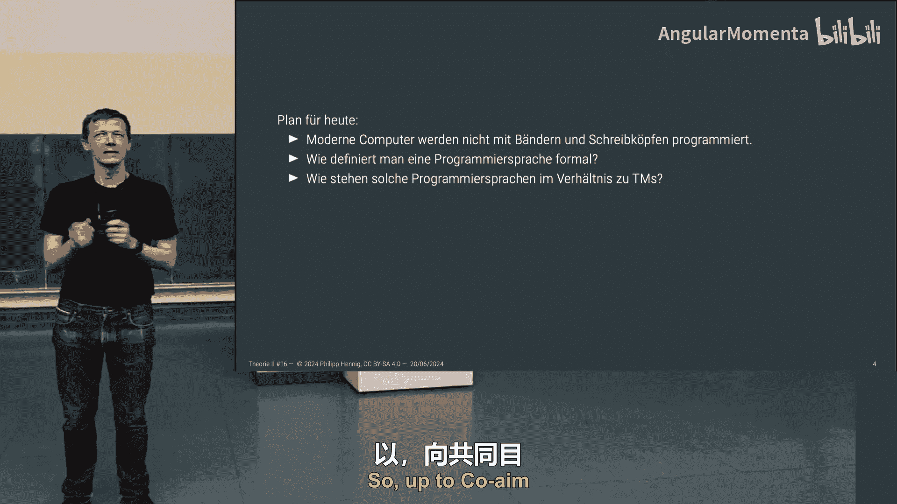

## 概述
在本节课中，我们将学习**图灵完备性**与**等价性**的核心概念。我们将探讨不同的计算模型（如图灵机、编程语言）如何描述相同的计算能力，并理解它们之间相互模拟的原理。课程将使用简单的语言和示例，帮助你掌握这些抽象但基础的理论。

---

## 图灵完备性的核心概念 🧠

上一节我们概述了课程目标，本节中我们来看看什么是图灵完备性。

一个计算模型（例如一种编程语言或一种抽象机器）被称为是**图灵完备的**，如果它能模拟一台**通用图灵机**的计算能力。这意味着，该模型可以计算任何图灵机可计算的函数。

用公式描述，对于一个模型 **M**，如果存在一个编译/解释函数 **C**，使得对于任何图灵机程序 **P_TM** 和输入 **x**，都有：
**M(C(P_TM), x) = P_TM(x)**
那么模型 **M** 就是图灵完备的。其中，**M(program, input)** 表示在模型 M 下执行程序 `program` 并输入 `input` 的结果。


---

## 计算模型的等价性 🔄

理解了图灵完备性后，我们自然会问：不同的模型之间如何比较？这就是等价性要解决的问题。

两个计算模型 **A** 和 **B** 是**计算等价的**，如果满足以下两个条件：
1.  模型 A 可以模拟模型 B 的任何计算。
2.  模型 B 也可以模拟模型 A 的任何计算。

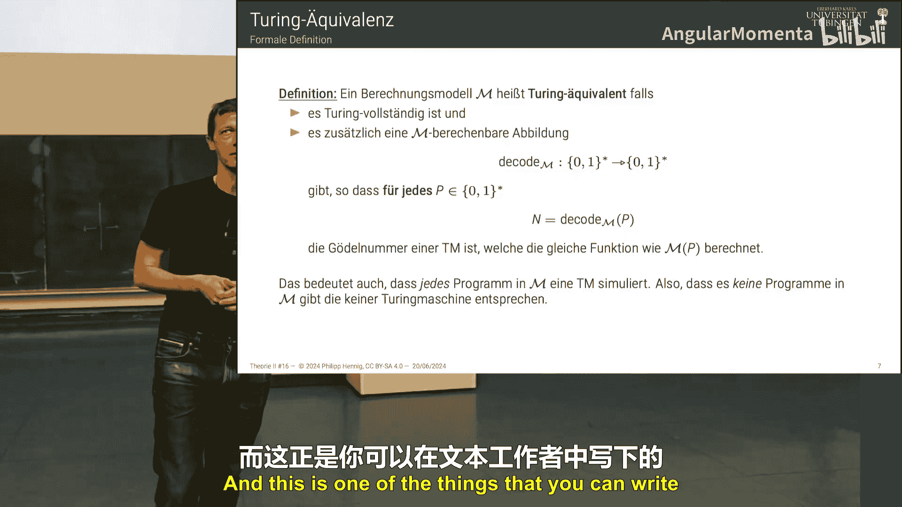

这意味着，在模型 A 中编写的任何程序，都可以在模型 B 中找到功能完全相同的对应程序，反之亦然。图灵机、带有 `while` 循环的简单语言、带有 `goto` 语句的语言，都被证明是彼此计算等价的。

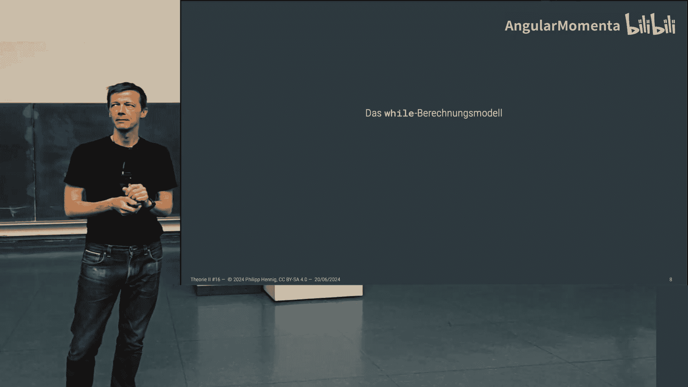


---

## 一个简单的编程模型：WHILE 语言 💻

为了具体说明，我们引入一个极简的编程模型，称为 **WHILE 语言**。我们将看到，即使是这样一个简单的语言，也是图灵完备的。

WHILE 语言的语法非常简单，只包含以下几种元素：
*   **变量**：如 `x`, `y`, `z`，用于存储整数值。
*   **常量**：如 `0`, `1`, `2` 等整数。
*   **算术表达式**：使用 `+`（加）和 `-`（减）运算符。
*   **赋值语句**：`变量 := 表达式`
*   **循环语句**：`while 变量 != 0 do 程序序列 end`
*   **语句序列**：多个语句按顺序排列。

以下是一个 WHILE 语言程序的例子，它将变量 `y` 的值加到变量 `x` 上：
```
while y != 0 do
    x := x + 1;
    y := y - 1
end
```


---

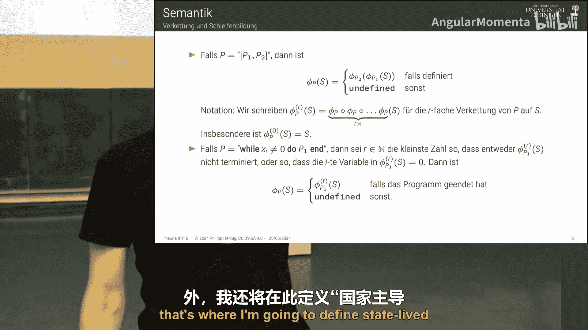

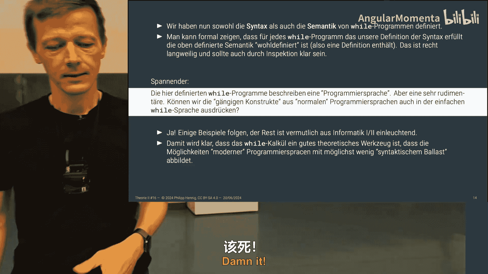

### WHILE 语言的语义

定义了语法（程序长什么样）之后，我们需要定义语义（程序如何运行）。

程序的**状态**由所有变量的当前值定义。执行过程就是状态根据语句规则逐步改变的过程：
*   **赋值** `x := E`：计算表达式 `E` 的值，然后将结果存入变量 `x`。
*   **循环** `while X != 0 do P end`：检查变量 `X` 的值。
    *   如果 `X ≠ 0`，则执行循环体 `P`，然后再次检查 `X`。
    *   如果 `X = 0`，则跳过整个循环，执行后面的语句。

这个模型足够简单，我们可以精确推理其行为。同时，它也足够强大，可以表达复杂的计算。


---

## 语法糖：让语言更易用 🍬

WHILE 语言虽然完备，但写起来很繁琐。在实际编程中，我们会添加“语法糖”——它们不增加语言的计算能力，只是让编程更方便。

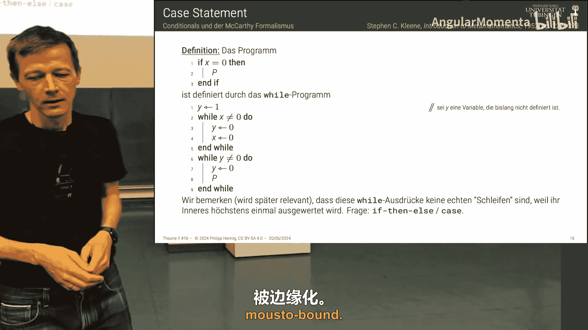

例如，`if-then-else` 条件语句并不是 WHILE 语言的原生结构，但我们可以用现有的 `while` 循环来模拟它。

以下是使用 WHILE 语言模拟 `if X != 0 then P else Q end` 的一种方法：
```
// 假设我们有一个临时变量 ‘flag’，初始值为1
flag := 1;
while X != 0 do
    // 执行 then 部分 P
    P;
    // 将 X 和 flag 都设为 0，以退出循环并跳过 else 部分
    X := 0;
    flag := 0
end;
while flag != 0 do
    // 执行 else 部分 Q
    Q;
    flag := 0
end
```

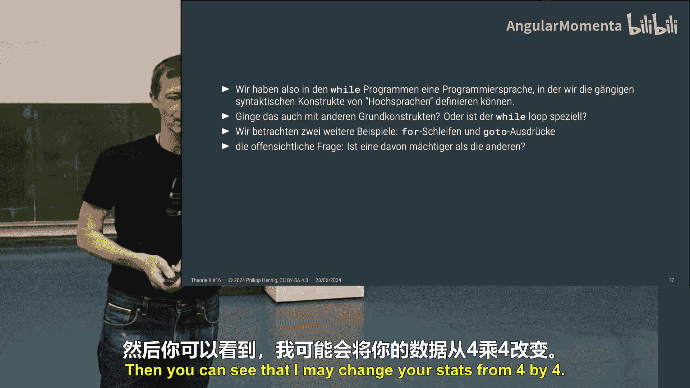

通过类似的方式，我们可以定义出 `for` 循环、`switch-case` 语句等。关键在于，这些“糖”都可以被“脱糖”为只包含基本语句（赋值和 `while` 循环）的程序。


---

## GOTO 语言：另一个等价模型 ⚙️

现在，让我们看看另一个经典模型：**GOTO 语言**。它使用行号和 `goto` 语句来控制流程，在计算能力上与 WHILE 语言等价。

一个 GOTO 语言程序由一系列带行号的语句组成：
*   **赋值**：`L: X := E`
*   **条件跳转**：`L: if X != 0 then goto L1 else goto L2`
*   **停机**：`L: halt`

以下是一个用 GOTO 语言实现循环的例子，它将 `y` 加到 `x`：
```
1: if y == 0 then goto 4 else goto 2
2: x := x + 1
3: y := y - 1
4: goto 1
5: halt
```


---

### WHILE 与 GOTO 的相互模拟

WHILE 语言和 GOTO 语言可以相互模拟，这证明了它们的等价性。

*   **用 GOTO 模拟 WHILE**：一个 `while X != 0 do P end` 循环可以很容易地用 `if` 和 `goto` 语句实现，如上例所示。
*   **用 WHILE 模拟 GOTO**：这稍微复杂一些。我们需要用一个变量（称为“程序计数器” `PC`）来存储当前的行号。程序主体是一个大的 `while` 循环，内部用一个 `if-elseif` 链（可以用多个 `while` 模拟）来检查 `PC` 的值，并执行对应行的语句，然后更新 `PC` 的值（模拟 `goto`）。

这种相互模拟的能力，正是“计算等价性”的核心。

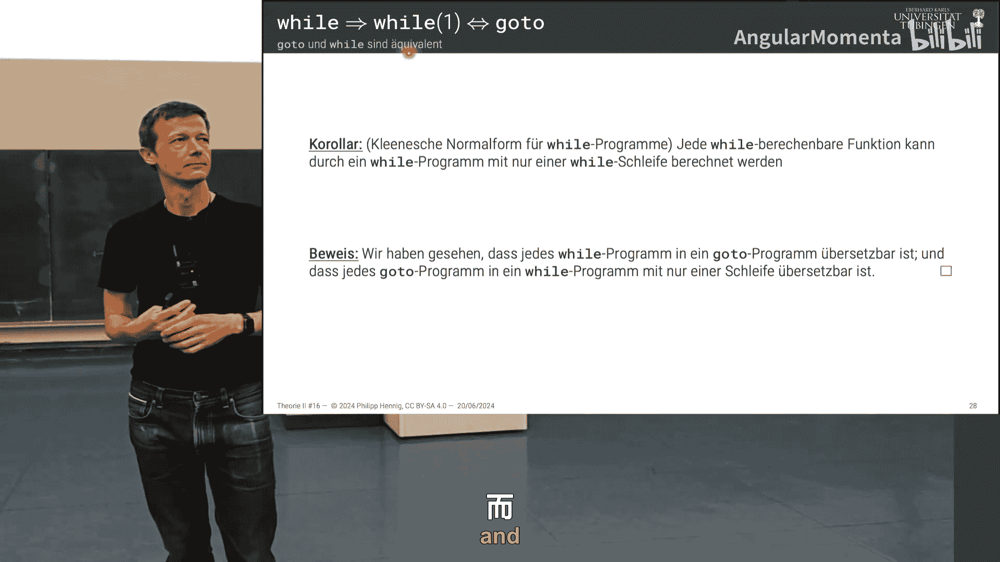

---

## 连接到图灵机 🤖

我们讨论了 WHILE 语言和 GOTO 语言的等价性。那么，它们和图灵机有什么关系呢？


关键结论是：**WHILE 语言（以及等价的 GOTO 语言）是图灵完备的**。这意味着：
1.  **任何图灵机程序都可以用 WHILE 语言编写**。我们可以用 WHILE 语言的变量来模拟图灵机的无限长纸带、读写头和状态转移规则。
2.  **任何 WHILE 语言程序都可以由图灵机执行**。我们可以设计一个图灵机，它的纸带上编码着 WHILE 程序的源代码和当前变量状态，然后通过一系列状态转移来模拟每一步赋值和循环检查。

因此，WHILE 语言、GOTO 语言和图灵机构成了一个**等价模型族**。它们在计算能力上没有区别，区别只在于描述的方便程度和底层机制。

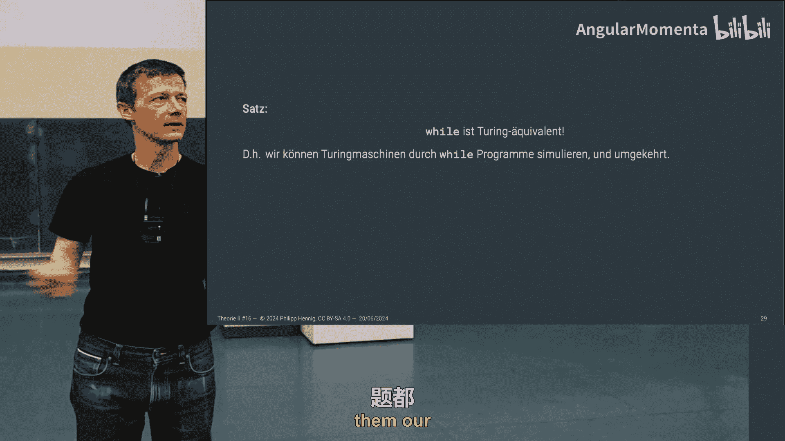


---

## 现实世界的编程语言 🌐

最后，让我们把理论联系实际。现代编程语言如 Python、Java、C++ 显然比 WHILE 语言复杂得多。它们有丰富的数据结构、库函数和编程范式。

然而，在计算能力上，**它们都与 WHILE 语言等价**，因此也是图灵完备的。那些额外的特性（如对象、高阶函数、列表推导式）都可以被看作是“语法糖”或对基本模型的“高效实现”。一个 Python 解释器或 Java 虚拟机，在理论上都可以被一个（非常复杂的）WHILE 程序或一台（非常庞大的）图灵机所模拟。

理解这一点，有助于我们穿透纷繁复杂的语法，看到计算本质的统一性。

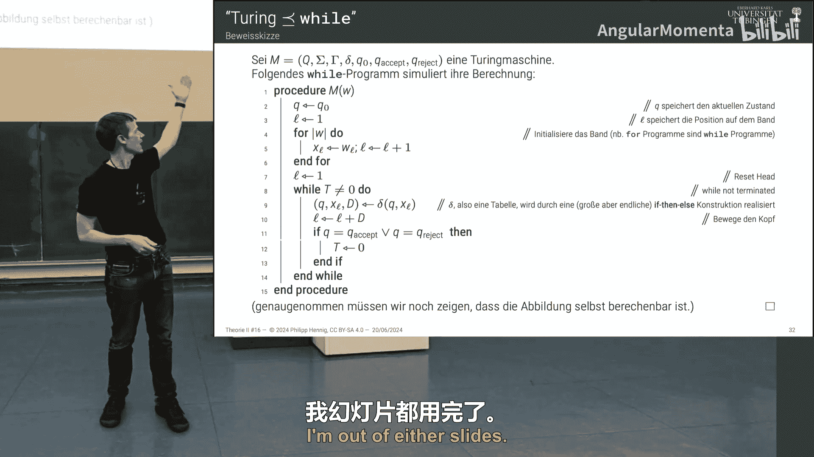

---


## 总结

本节课中我们一起学习了：
1.  **图灵完备性**：一个模型能模拟通用图灵机，即具有最强的计算能力。
2.  **计算等价性**：不同模型（如图灵机、WHILE语言、GOTO语言）可以相互模拟，计算能力相同。
3.  **简单模型的力量**：即使像 WHILE 语言这样只有变量、赋值和循环的极小语言，也是图灵完备的。
4.  **语法糖的作用**：`if-then-else`、`for` 循环等结构是方便编程的“糖”，不改变本质计算能力。
5.  **理论与实际的联系**：所有现代通用编程语言都是图灵完备的，它们在计算本质上与这些抽象模型相通。

掌握这些概念，是理解“计算”本身界限和可能性的第一步。

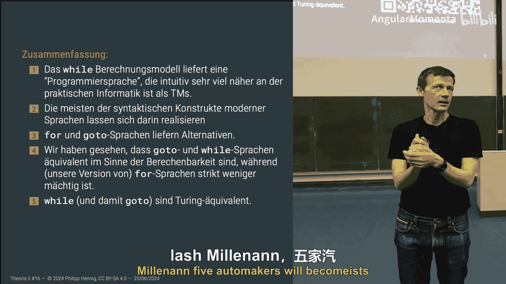

