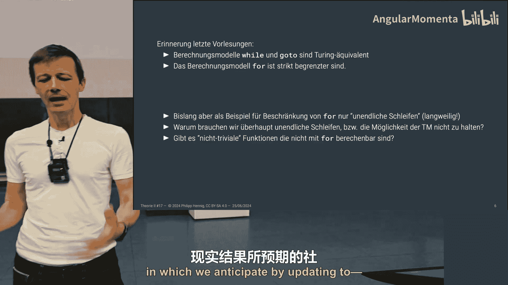
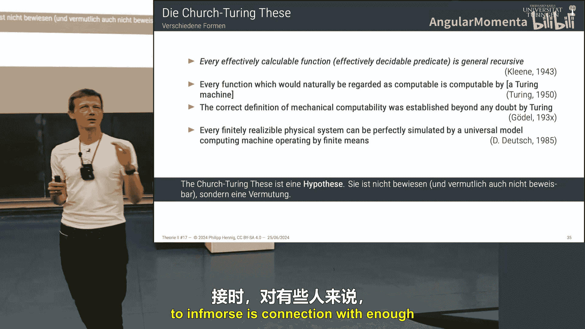
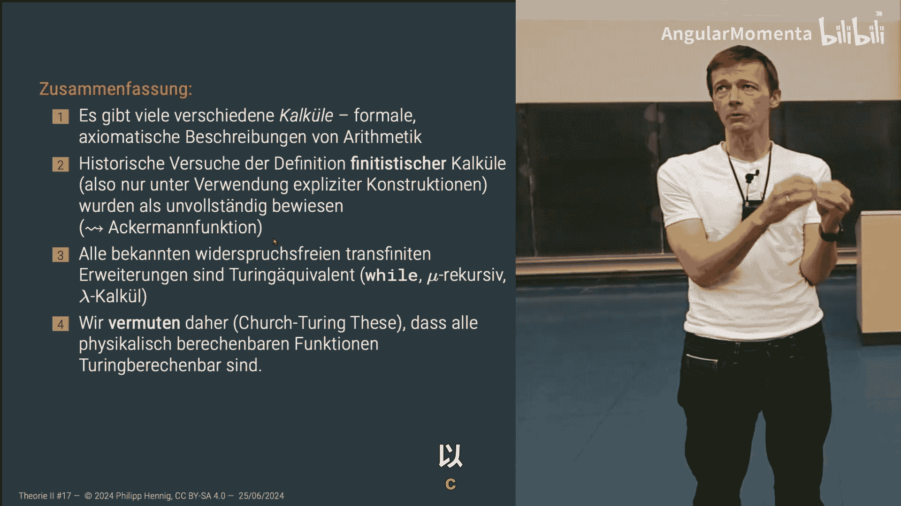

# 016：递归函数

在本节课中，我们将学习递归函数的核心概念，特别是原始递归函数和μ递归函数。我们将看到这些函数如何与图灵机等价，并构成可计算性理论的基础。课程还将简要介绍λ演算，作为另一种计算模型。

## 从图灵机到递归函数

上一节我们介绍了图灵机作为计算模型。本节中我们来看看另一种等价的描述方式：递归函数。

图灵机通过操作纸带上的符号进行计算。然而，存在一种完全不同的方式来形式化“可计算”的概念：通过定义一系列从自然数到自然数的函数。这些函数可以通过一些基本规则来构造，其中最核心的就是**递归**。

## 原始递归函数

原始递归函数是一类可以通过特定规则从简单基础函数构造出来的函数。以下是其定义的核心组成部分：

**1. 基本函数**
首先，我们从三个极其简单的函数开始：
*   **零函数**：`Z(n) = 0`。对于任何输入，输出恒为0。
*   **后继函数**：`S(n) = n + 1`。将输入加1。
*   **投影函数**：`P_i^k(x1, x2, ..., xk) = xi`。从k个参数中选出第i个。

**2. 复合**
如果已有函数 `g` 和 `h1, h2, ..., hm`，可以通过复合得到新函数 `f`：
`f(x1, ..., xn) = g(h1(x1, ..., xn), ..., hm(x1, ..., xn))`
这相当于将多个函数的输出作为另一个函数的输入。

**3. 原始递归**
这是构造新函数的核心机制。给定函数 `g` 和 `h`，可以定义一个新函数 `f`：
*   `f(0, x1, ..., xk) = g(x1, ..., xk)`
*   `f(S(n), x1, ..., xk) = h(n, f(n, x1, ..., xk), x1, ..., xk)`
这个定义是递归的：要计算 `f(n+1, ...)`，你需要知道 `f(n, ...)` 的值。这类似于编程中的循环。

所有能从基本函数出发，通过有限次应用复合与原始递归规则得到的函数，称为**原始递归函数**。

**原始递归函数的例子**
许多常见的算术函数都是原始递归的：
*   **加法**：`add(0, y) = y`； `add(S(x), y) = S(add(x, y))`。
*   **乘法**：`mult(0, y) = 0`； `mult(S(x), y) = add(mult(x, y), y)`。
*   **阶乘**：`fact(0) = 1`； `fact(S(n)) = mult(S(n), fact(n))`。
*   **指数运算**、**前驱函数**等也都是原始递归的。

然而，原始递归函数的集合虽然庞大，但并非包含所有“直观上可计算”的函数。它的计算能力存在限制。

## μ递归函数与可计算性

为了捕捉更广泛的“可计算”概念，我们需要引入一个新的算子：**μ算子**（极小化算子）。

**μ算子定义**
给定一个函数 `g(y, x1, ..., xn)`，μ算子定义一个新函数 `f`：
`f(x1, ..., xn) = μy[g(y, x1, ..., xn) = 0]`
其含义是：寻找最小的自然数 `y`，使得 `g(y, x1, ..., xn) = 0`。如果这样的 `y` 不存在，则该函数在该输入处无定义。

**μ递归函数**
如果一个函数可以从基本函数出发，通过有限次应用**复合**、**原始递归**和**μ算子**得到，则它被称为**μ递归函数**（或**部分递归函数**）。

**关键定理：图灵可计算 ⇔ μ递归**
这是可计算性理论的一个核心结论：
*   每个图灵可计算的函数都是μ递归的。
*   每个μ递归函数都是图灵可计算的。
这意味着，图灵机的计算能力与μ递归函数的定义能力是**完全等价**的。这强有力地支持了“丘奇-图灵论题”：任何“算法可计算”的函数，都可以用图灵机计算，也都可以用μ递归函数来定义。

**阿克曼函数**
阿克曼函数是一个经典的例子，它**不是**原始递归的，但它是μ递归的（因此是图灵可计算的）。它的定义涉及双重递归，增长极其迅速，超越了任何原始递归函数的增长速率。其定义如下：
*   `A(0, n) = n + 1`
*   `A(m+1, 0) = A(m, 1)`
*   `A(m+1, n+1) = A(m, A(m+1, n))`
阿克曼函数的存在表明，μ递归函数类严格大于原始递归函数类。

## λ演算：另一种计算模型

除了递归函数，还有另一种重要的计算模型：**λ演算**。它由阿隆佐·邱奇发明，是函数式编程语言的理论基础。

**λ演算的核心概念**
λ演算只关心三件事：
1.  **变量**：如 `x`, `y`。
2.  **抽象**：`λx.M`。这表示一个函数，参数是 `x`，函数体是 `M`。相当于 `def f(x): return M`。
3.  **应用**：`(M N)`。表示将函数 `M` 应用于参数 `N`。

**β归约**
λ演算的核心计算规则是 **β归约**：
`(λx.M) N → M[x := N]`
意思是，将函数 `(λx.M)` 应用到参数 `N` 上，结果是将函数体 `M` 中所有自由出现的 `x` 替换为 `N`。这就像函数调用。

**邱奇-图灵论题与λ演算**
邱奇同样提出了他的论题：任何“有效可计算”的函数都可以用λ演算定义。随后，图灵证明了**λ可定义函数 ⇔ 图灵可计算函数**。这共同奠定了“丘奇-图灵论题”的坚实基础。

**在λ演算中编码**
有趣的是，我们可以在λ演算中编码自然数、布尔值甚至递归：
*   **邱奇数**：数字 `n` 被编码为高阶函数 `λf.λx. (f (f ... (f x)...))`（`f` 应用 `n` 次）。
*   **递归**：通过 **Y组合子** `Y = λf.(λx.f (x x)) (λx.f (x x))` 可以实现匿名函数的递归调用。

λ演算表明，计算可以纯粹通过函数的抽象和应用来完成，无需任何状态或循环的概念。

## 总结

本节课中我们一起学习了：
1.  **原始递归函数**：通过零函数、后继函数、投影函数，经复合和原始递归规则构造的函数类。它能定义许多常见算术函数。
2.  **μ递归函数**：在原始递归基础上加入μ算子（极小化）得到的函数类。它与**图灵可计算函数**完全等价，这为丘奇-图灵论题提供了关键证据。
3.  **阿克曼函数**作为非原始递归但μ递归（即可计算）的典型例子。
4.  **λ演算**作为另一种等价的计算模型，它纯粹基于函数抽象和应用，并通过β归约进行计算，是函数式编程的基石。

这些模型共同描绘了“可计算性”的数学边界，告诉我们什么是算法本质上可以解决的，什么是不可以的。从图灵机到递归函数，再到λ演算，它们从不同角度揭示了计算的本质。