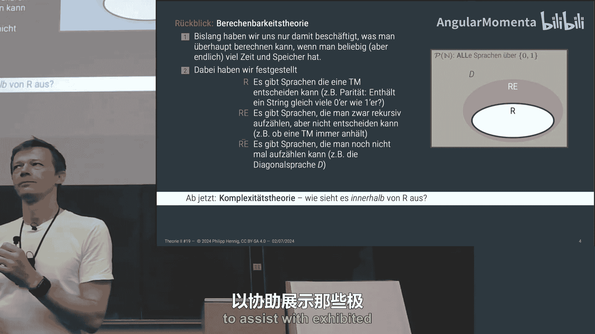
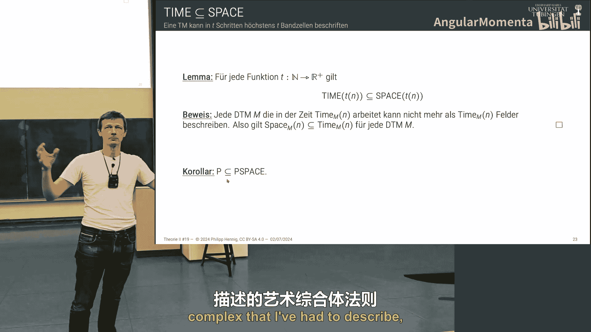
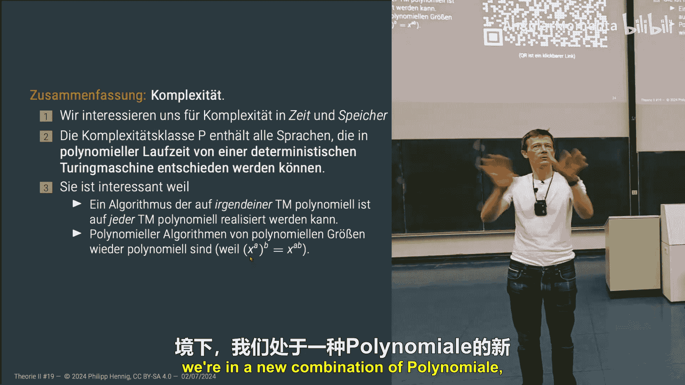

# 017：计算复杂度

在本节课中，我们将学习计算复杂度的核心概念，特别是如何用大O符号（Big O notation）来描述算法的运行时间和空间消耗。我们将从图灵机模型出发，理解复杂度分析的基本思想，并介绍复杂度类P和PSPACE。

## 从图灵机到复杂度

上一节我们介绍了图灵机作为计算模型的基础。本节中，我们来看看如何基于这个模型来定义和衡量计算的“复杂度”。

计算复杂度理论研究算法解决问题所需的资源，主要是**时间**和**空间**。我们使用**图灵机**作为衡量这些资源的抽象模型。一台图灵机解决某个问题所花费的时间（步数）或占用的空间（带子格子数），就定义了该问题的复杂度。

## 大O符号：描述函数增长

为了描述复杂度随输入规模增长的趋势，我们使用**大O符号**。它刻画了函数在渐进意义上的上界。

以下是其核心定义：

*   **大O (O)**: 我们说一个函数 `f(n)` 是 **O(g(n))**，如果存在正常数 `c` 和 `n0`，使得对于所有 `n > n0`，都有 `f(n) ≤ c * g(n)`。这表示 `f(n)` 的增长速度**不快于** `g(n)`。
    *   公式：`f(n) = O(g(n)) ⇔ ∃ c>0, n0>0, ∀ n>n0: f(n) ≤ c·g(n)`

*   **大Ω (Ω)**: 我们说 `f(n)` 是 **Ω(g(n))**，如果存在正常数 `c` 和 `n0`，使得对于所有 `n > n0`，都有 `f(n) ≥ c * g(n)`。这表示 `f(n)` 的增长速度**不慢于** `g(n)`。
    *   公式：`f(n) = Ω(g(n)) ⇔ ∃ c>0, n0>0, ∀ n>n0: f(n) ≥ c·g(n)`

*   **大Θ (Θ)**: 如果 `f(n)` 同时是 `O(g(n))` 和 `Ω(g(n))`，那么我们说 `f(n)` 是 **Θ(g(n))**。这表示 `f(n)` 和 `g(n)` 的增长速度**同阶**。
    *   公式：`f(n) = Θ(g(n)) ⇔ f(n) = O(g(n))` 且 `f(n) = Ω(g(n))`

这些定义可以用极限的概念来等价描述。例如，`f(n) = O(g(n))` 也意味着当 `n` 趋于无穷时，`f(n)/g(n)` 的极限上界是一个常数。

## 复杂度度量与图灵机变体

理解了增长阶的表示方法后，我们具体定义图灵机的复杂度。

对于一台图灵机 `M` 和输入 `x`：
*   **时间复杂度** `Time_M(x)` 是 `M` 在输入 `x` 上停机前所执行的**步数**。
*   **空间复杂度** `Space_M(x)` 是 `M` 在计算过程中使用的**带子格子总数**。

我们通常更关心算法在**最坏情况**下的表现。因此，对于一个解决语言 `L` 的图灵机 `M`，我们定义：
*   **时间复杂度函数** `T_M(n) = max{ Time_M(x) : |x| = n }`，即对所有长度为 `n` 的输入，`M` 所需的最大运行时间。
*   **空间复杂度函数** `S_M(n) = max{ Space_M(x) : |x| = n }`，即对所有长度为 `n` 的输入，`M` 所需的最大空间。

一个关键问题是，图灵机有不同的变体（如单带、多带、非确定性），这会影响复杂度吗？理论表明，这些变体之间可以在**多项式时间**内相互模拟。这意味着，当我们用大O符号讨论复杂度类（如多项式时间）时，这些具体的机器模型选择通常不影响问题的归属。

## 复杂度类：P 与 PSPACE

基于上述度量，我们可以定义重要的复杂度类，它们将问题按照所需资源进行分类。

以下是两个最基础的复杂度类：

*   **P (Polynomial Time)**: 由所有能被**确定性图灵机**在**多项式时间**内判定的语言组成。
    *   形式化定义：`P = ∪_{k≥0} DTIME(n^k)`
    *   直观理解：P类包含了那些存在“高效”算法的问题，其运行时间随输入规模的增长是可控的多项式级（如 `n^2`, `n^3`）。

*   **PSPACE**: 由所有能被**确定性图灵机**在**多项式空间**内判定的语言组成。
    *   形式化定义：`PSPACE = ∪_{k≥0} DSPACE(n^k)`
    *   直观理解：PSPACE类关注的是内存使用效率。一个问题即使需要很长时间，但只要它使用的内存（空间）不超过输入规模的多项式倍，就属于PSPACE。

显然，任何在多项式时间内完成的计算，其空间消耗也不会超过多项式时间（因为每一步最多访问一个新格子），所以我们有 `P ⊆ PSPACE`。但是，`PSPACE` 中的问题是否都能在多项式时间内解决？这是计算复杂性理论中一个著名的未解之谜（`P` vs `PSPACE` 问题）。

## 时间与空间的权衡

时间和空间资源之间常常存在权衡。一个使用较少空间的算法可能需要更多时间，反之亦然。

萨维奇定理描述了这种关系的一个基本界限：任何在空间 `S(n)` 内运行（且 `S(n) ≥ log n`）的确定性图灵机，都可以在至多 `2^(O(S(n)))` 的时间内被模拟。这意味着：
*   `PSPACE` 包含于 `EXPTIME`（指数时间）中。
*   更一般地，`DSPACE(S(n)) ⊆ DTIME(2^(O(S(n))))`。

这个定理表明，多项式空间的计算，其最坏情况下的时间可能是指数级的。这直观地说明了为什么 `PSPACE` 类可能比 `P` 类更大。

## 总结

本节课中我们一起学习了计算复杂度的基础。我们从图灵机模型出发，引入了用于描述算法资源消耗增长趋势的**大O、大Ω和大Θ符号**。接着，我们定义了图灵机的**时间复杂度和空间复杂度**，并解释了为什么在讨论多项式级复杂度时，不同的图灵机变体本质上是等价的。最后，我们介绍了两个核心的复杂度类：**P**（多项式时间可解的问题）和**PSPACE**（多项式空间可解的问题），并了解了连接时间与空间资源的**萨维奇定理**。这些概念为我们理解不同计算问题的内在难度和分类奠定了基础。