# 018：核心概念与复杂性类

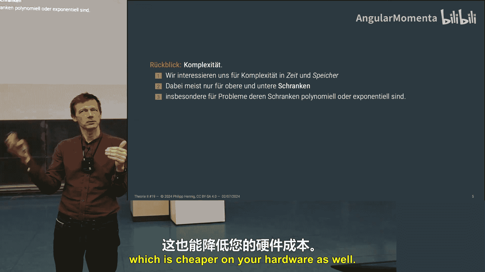

在本节课中，我们将学习计算复杂性理论中的核心概念，特别是确定性图灵机与非确定性图灵机，以及由此定义的P类和NP类。我们将探讨这些复杂性类的基本定义、它们之间的关系，并通过具体问题（如上下文无关文法成员资格问题和团问题）来加深理解。

## 图灵机与复杂性度量

上一节我们介绍了计算模型的基础。本节中我们来看看如何用图灵机来度量计算的复杂性。

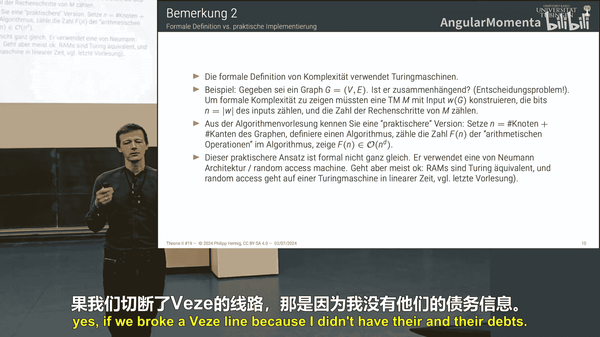

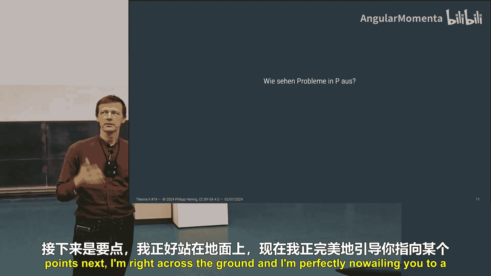

我们使用图灵机作为计算模型。对于一台图灵机M，我们关注其**时间复杂性**和**空间复杂性**。
*   **时间复杂性** `Time_M(n)`：定义为图灵机M在所有长度为n的输入上运行所需的最大步数。
*   **空间复杂性** `Space_M(n)`：定义为图灵机M在所有长度为n的输入上运行时所访问的磁带单元的最大数量。

我们通常关注最坏情况下的复杂性。对于一个函数 `f(n)`，我们可以定义复杂性类。

以下是基于时间复杂性的类：
*   **DTIME(f(n))**：存在一台确定性图灵机D，使得对于所有长度为n的输入，D在 `O(f(n))` 时间内停机并给出正确答案的所有语言（问题）的集合。
*   **NTIME(f(n))**：存在一台非确定性图灵机N，使得对于所有长度为n的输入，N在 `O(f(n))` 时间内停机并给出正确答案的所有语言的集合。

类似地，可以定义基于空间复杂性的类 **DSPACE(f(n))** 和 **NSPACE(f(n))**。

## 多项式时间与P类

上一节我们定义了基于特定函数的复杂性类。本节中我们来看看一个特别重要的类：多项式时间。

我们特别关心那些运行时间可以被输入规模的多项式函数所限定的问题。这引出了P类的定义。

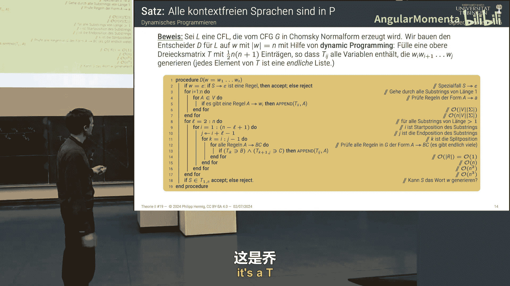

**P类**（Polynomial time）是所有可以在确定性图灵机上以多项式时间解决的**判定性问题**的集合。形式化定义为：
`P = ∪_{k∈ℕ} DTIME(n^k)`

这意味着，一个问题属于P类，当且仅当存在一个常数k和一台确定性图灵机，使得对于任何长度为n的输入，该图灵机都能在 `O(n^k)` 步内给出正确答案。

## 上下文无关文法成员资格问题属于P

为了理解P类，我们来看一个具体例子：上下文无关文法（CFG）的成员资格问题。

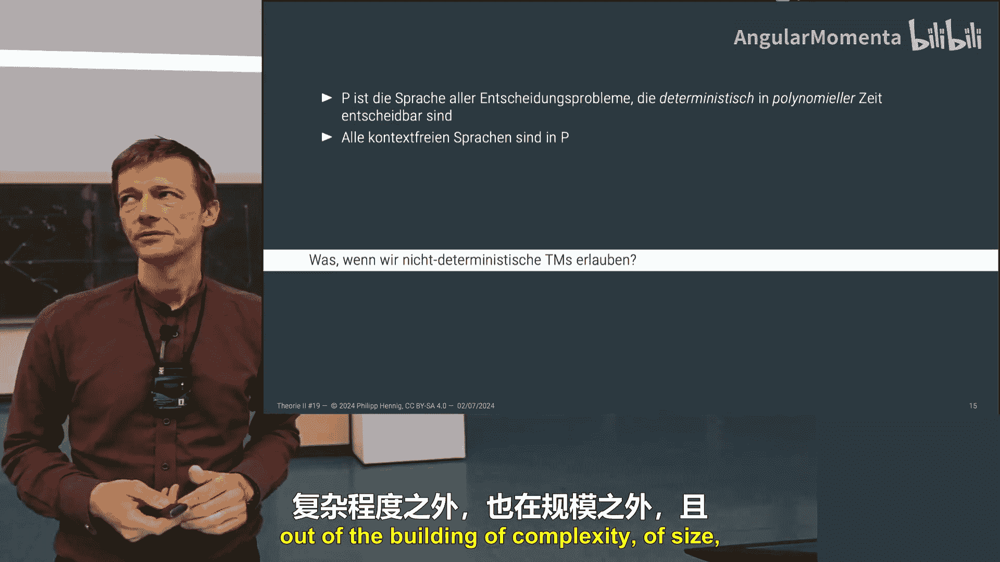

**问题**：给定一个上下文无关文法G和一个字符串w，判断w是否可由G生成（即 w ∈ L(G)？）。
这是一个经典的判定性问题。我们将展示它属于P类。

核心算法是**CYK算法**（Cocke–Younger–Kasami算法）。该算法使用动态规划。

假设文法G是乔姆斯基范式（CNF）的。设字符串 `w = a1 a2 ... an`。
我们定义一个二维布尔数组 `P[i][j]`，其含义为：从第i个字符开始的长度为j的子串是否可由文法G生成。
以下是算法的高层描述：

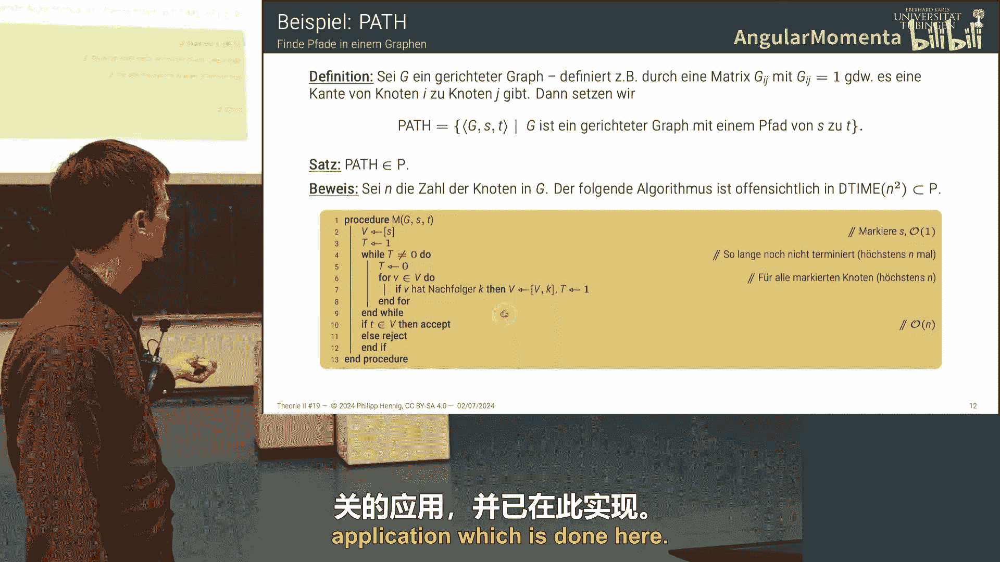

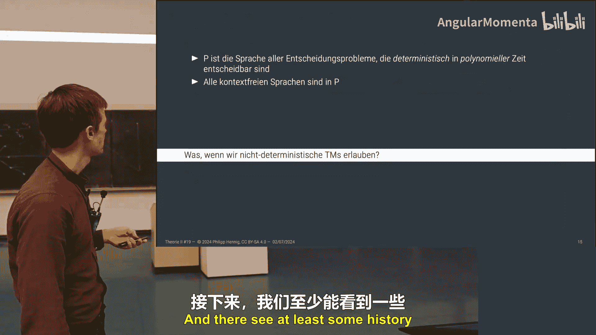

1.  **初始化**：对于每个终结符（单个字符）`ai`，设置 `P[i][1] = true` 当且仅当存在产生式 `A -> ai`。
2.  **动态规划递推**：对于长度 `len` 从2到n，对于起始位置 `i` 从1到 `n-len+1`：
    *   将子串 `w[i:i+len]` 在位置 `k` (1 <= k < len) 处拆分为两部分。
    *   检查是否存在非终结符A，以及产生式 `A -> B C`，使得 `P[i][k]` 对应B生成左半部分，且 `P[i+k][len-k]` 对应C生成右半部分。
    *   如果存在这样的产生式，则设置 `P[i][len] = true`。
3.  **结果**：`w ∈ L(G)` 当且仅当 `P[1][n] = true`。

该算法包含三层嵌套循环，时间复杂度为 `O(n^3)`。由于n是输入规模（字符串长度），这是一个多项式时间算法。因此，上下文无关文法的成员资格问题属于P类。

## 非确定性多项式时间与NP类

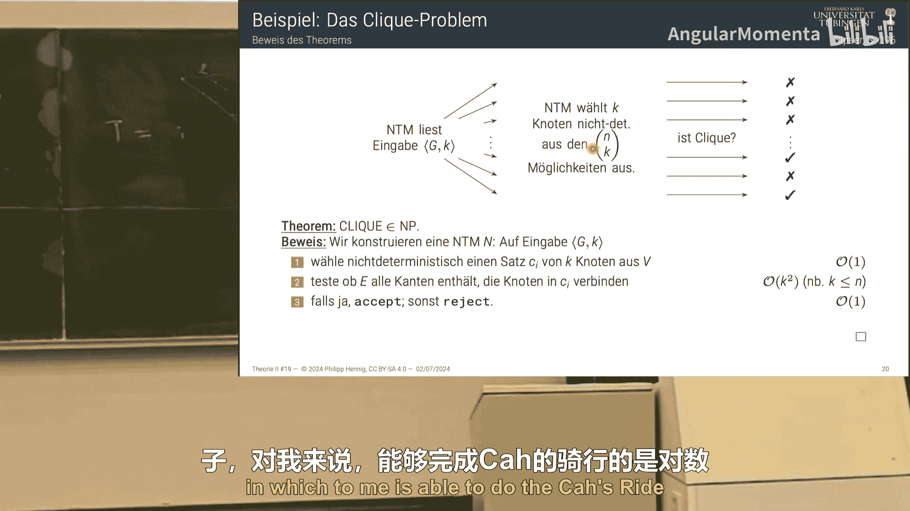

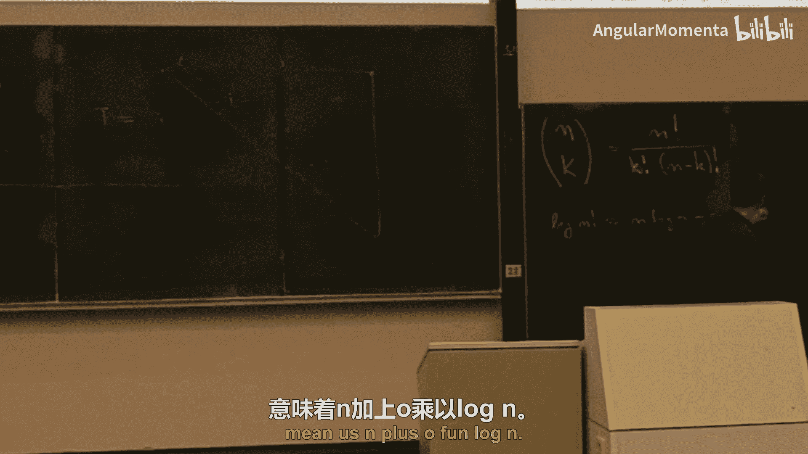

上一节我们看到了一个可在多项式时间内验证解的问题。本节中我们正式定义NP类。

**NP类**（Nondeterministic Polynomial time）的定义有两种等价方式：
1.  所有可以在**非确定性图灵机**上以多项式时间解决的判定性问题的集合。即 `NP = ∪_{k∈ℕ} NTIME(n^k)`。
2.  所有其解可以在**确定性图灵机**上以多项式时间**验证**的判定性问题的集合。

第二种定义更直观。一个问题属于NP，如果对于每个答案为“是”的实例，都存在一个简短的“证书”（或证明），使得我们可以用一台确定性图灵机在多项式时间内验证该证书的有效性。

## 团问题属于NP

让我们通过一个经典问题——团问题（Clique Problem）来理解NP类。

**问题**：给定一个无向图G和一个整数k，判断图G中是否存在一个大小至少为k的团（即一个完全子图，其中每对顶点之间都有边相连）。

首先，团问题显然属于NP。原因如下：
*   **证书**：如果答案为“是”，一个大小为k的顶点子集S（即团）就是一个证书。
*   **验证**：验证算法（确定性图灵机）接收图G、整数k和候选证书S后，需要做两件事：
    1.  检查S是否恰好包含k个顶点。
    2.  检查S中每一对不同的顶点之间在图G中是否都有边相连。
*   **时间分析**：第一步是 `O(k)`，第二步需要检查 `C(k, 2) = O(k^2)` 对顶点。由于k最大为图的顶点数n，验证总时间是 `O(n^2)`，是输入规模的多项式时间。

因此，根据定义2，团问题属于NP。

值得注意的是，我们目前**不知道**是否存在一个多项式时间的确定性算法来解决团问题（即不知道它是否属于P）。寻找这样的算法或证明其不存在，是P与NP问题的核心。

## P与NP的关系及验证的本质

上一节我们通过例子理解了NP的定义。本节中我们来探讨P与NP的关系以及验证过程的本质。

显然，任何属于P类的问题也属于NP类（`P ⊆ NP`）。因为如果一个确定性图灵机能在多项式时间内直接解决问题，那么它当然也可以忽略证书，直接运行该算法来验证答案——证书甚至可以为空。

NP类的核心在于“验证”比“求解”可能更容易。对于NP问题，找到一个解可能非常困难（需要指数时间尝试所有可能性），但一旦有人给了你一个候选解（证书），你可以在多项式时间内检查它是否正确。

验证过程的关键在于：
1.  证书的长度必须是输入规模的多项式。
2.  验证算法本身必须是确定性的，且运行时间是输入规模（包括证书）的多项式。

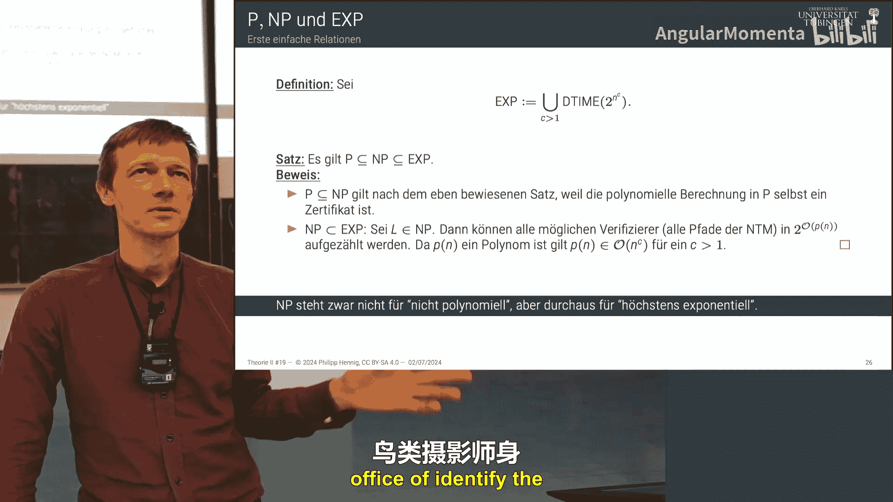

## 总结

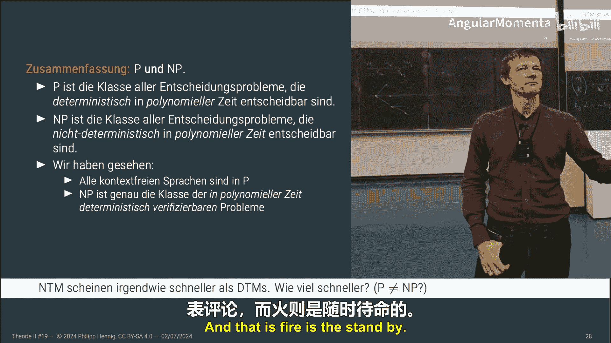

本节课中我们一起学习了计算复杂性理论的核心基础。
*   我们首先回顾了用图灵机度量时间与空间复杂性的方法。
*   然后定义了**P类**，即所有能被确定性图灵机在多项式时间内解决的判定性问题。我们以**上下文无关文法成员资格问题**为例，通过 `O(n^3)` 的CYK算法展示了其属于P类。
*   接着，我们定义了**NP类**，即所有解能在多项式时间内被验证的判定性问题。我们以**团问题**为例，说明了如何通过验证一个大小为k的顶点子集来证明其属于NP。
*   最后，我们讨论了 `P ⊆ NP` 的关系，并强调了NP类中“验证”与“求解”的可能差异。P是否等于NP，是理论计算机科学中悬而未决的核心问题。