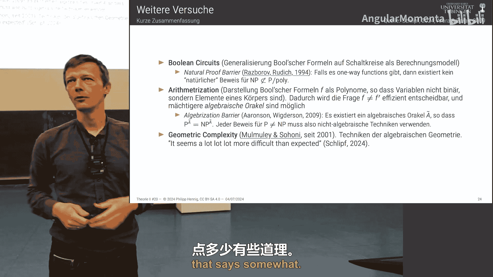

# 019：P 不等于 NP？

在本节课中，我们将探讨理论计算机科学中一个核心且悬而未决的问题：P 与 NP 的关系。我们将介绍复杂性类 P 和 NP 的定义，解释“P 是否等于 NP”这个问题的意义，并讨论相关的概念，如时间与空间复杂性、确定性与非确定性图灵机，以及相对化证明。

## 概述

P 与 NP 问题是克雷数学研究所公布的七个“千禧年大奖难题”之一，解决者将获得一百万美元的奖金。这个问题探讨的是，那些其解可以快速验证的问题（NP），是否也能被快速求解（P）。理解这个问题是理解计算复杂性理论的基础。

## P 与 NP 的定义

上一节我们概述了 P 与 NP 问题的背景，本节中我们来看看这两个复杂性类的精确定义。

P 是确定性图灵机在多项式时间内可判定的所有决策问题的集合。用公式表示，即：
**P = { L | 存在一个确定性图灵机 M 和一个多项式 p(n)，使得 M 在输入长度为 n 时，在 O(p(n)) 步内判定 L }**

NP 是非确定性图灵机在多项式时间内可判定的所有决策问题的集合。这意味着，对于 NP 中的问题，如果给定一个“证书”（例如一个潜在的解），我们可以在多项式时间内验证这个证书的正确性。用公式表示，即：
**NP = { L | 存在一个非确定性图灵机 M 和一个多项式 p(n)，使得 M 在输入长度为 n 时，在 O(p(n)) 步内接受 L }**

一个经典的 NP 问题是布尔可满足性问题（SAT）：给定一个布尔公式，是否存在一组变量赋值使其为真？虽然寻找解可能很难，但验证一个给定的赋值是否满足公式是简单的。

## 时间与空间复杂性

理解了 P 和 NP 的核心定义后，我们需要更广泛地了解衡量计算效率的尺度：时间复杂性和空间复杂性。

时间复杂性关注的是图灵机解决问题所需的步骤数。空间复杂性关注的是图灵机解决问题所需的存储单元（磁带格子）数。

以下是主要复杂性类的关系：
*   **L**：确定性图灵机在对数空间内可判定的问题类。
*   **P**：确定性图灵机在多项式时间内可判定的问题类。
*   **NP**：非确定性图灵机在多项式时间内可判定的问题类。
*   **PSPACE**：确定性图灵机在多项式空间内可判定的问题类。
*   **EXPTIME**：确定性图灵机在指数时间内可判定的问题类。

已知的包含关系是：**L ⊆ P ⊆ NP ⊆ PSPACE ⊆ EXPTIME**。并且已知 **P ≠ EXPTIME**。P 与 NP 是否相等，就位于这个包含链的中间。

## 确定性、非确定性与指数爆炸

我们介绍了复杂性类，现在来深入看看非确定性计算的一个关键特性，以及它如何与确定性计算相关联。

非确定性图灵机可以同时“猜测”多条计算路径。对于 NP 问题，如果至少存在一条接受路径，机器就接受输入。一个简单的模拟方法是使用确定性图灵机尝试所有可能的猜测（例如，所有可能的证书）。然而，如果分支因子是常数，这种穷举搜索会导致计算时间指数级增长。

例如，对于一个运行时间为 O(n^k) 的非确定性图灵机，用确定性图灵机模拟它可能需要 O(2^(n^k)) 的时间。这解释了为什么虽然 NP ⊆ EXPTIME，但我们不知道 NP 是否真的等于 EXPTIME，或者它是否更小（比如等于 P）。

## 对角化技术与相对化障碍

既然我们看到了模拟非确定性计算可能带来指数开销，一个自然的问题是：能否证明 P ≠ NP？历史上，研究者们使用了称为“对角化”的技术来证明某些复杂性类的分离（例如 P ≠ EXPTIME）。

对角化的核心思想是构造一个语言，使得任何运行时间较短的图灵机都无法正确判定它，但一个运行时间较长的图灵机可以。这类似于康托尔证明实数不可数的方法。

然而，Baker、Gill 和 Solovay 在 1975 年证明，仅使用对角化技术（以及“相对化”技术，即允许图灵机访问一个“预言机”）无法解决 P 与 NP 问题。他们构造了预言机 A 和 B，使得：
*   **P^A = NP^A** （在预言机 A 存在下，P 等于 NP）
*   **P^B ≠ NP^B** （在预言机 B 存在下，P 不等于 NP）

这意味着任何证明如果只依赖于图灵机模拟和对角化（即能够“相对化”），则既不能证明 P = NP，也不能证明 P ≠ NP。要解决 P 与 NP 问题，需要不能相对化的新思想。

## 问题的现状与意义

我们讨论了证明 P ≠ NP 的技术障碍，现在来看看这个问题的现状及其实际意义。

P 与 NP 问题仍然是开放的。它不仅仅是理论上的好奇，而且有深刻的实际影响。如果 P = NP，那么许多目前被认为困难的问题（如旅行商问题、集成电路设计、蛋白质折叠等）都将存在高效算法，这将对科学、工程和工业产生革命性影响。

目前，普遍相信 **P ≠ NP**。这意味着存在本质上就难以计算但易于验证的问题。这种信念基于多年的研究，以及许多 NP 问题尽管经过巨大努力仍未找到多项式时间算法的事实。

研究者们正在从多个方向逼近这个问题，包括电路复杂性、描述复杂性、证明复杂性等。例如，电路复杂性试图证明 NP 问题需要超多项式大小的电路，如果成功，则意味着 P ≠ NP。

## 总结

本节课中我们一起学习了 P 与 NP 问题的核心内容。我们定义了复杂性类 P 和 NP，理解了时间与空间复杂性的层次结构，探讨了非确定性计算与指数爆炸的关系，并了解了为什么传统的对角化技术受到相对化障碍的限制而无法解决这个问题。最后，我们审视了该问题的现状及其对计算理论和现实世界的深远意义。尽管答案尚未知晓，但对这个问题的探索持续推动着理论计算机科学的发展。