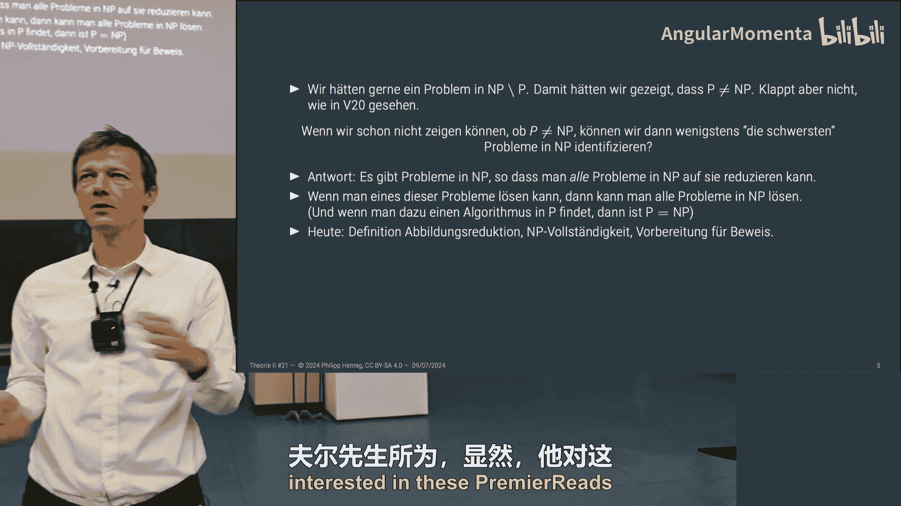
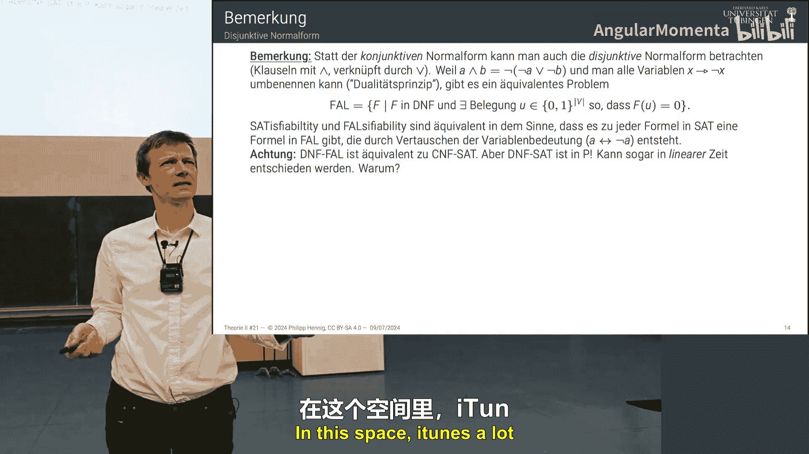
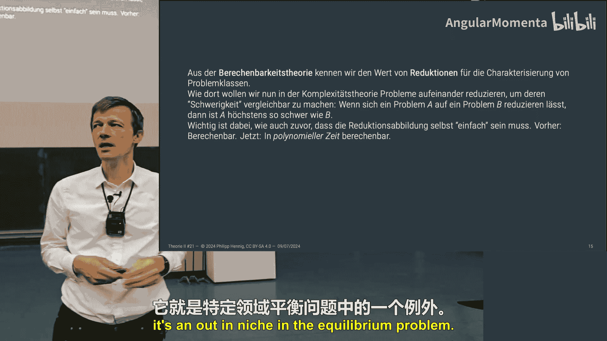
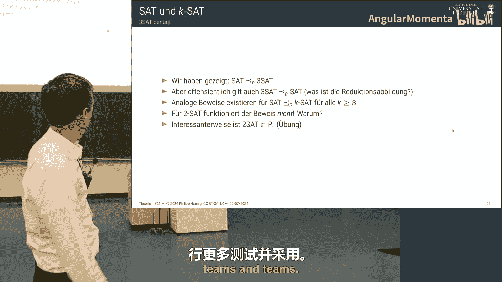
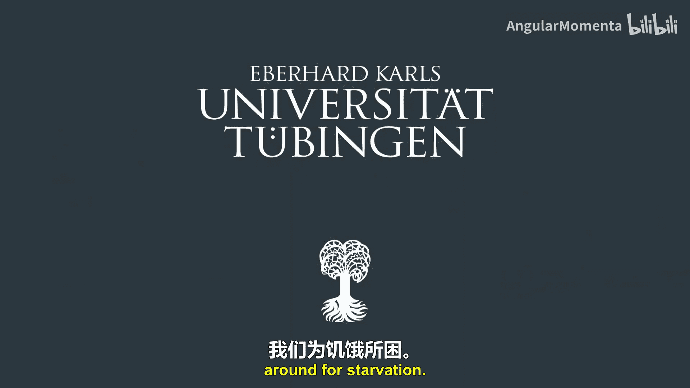

# 020：NP完全性

在本节课中，我们将学习计算复杂性理论中的一个核心概念：NP完全性。我们将探讨P类与NP类的定义，理解什么是多项式时间归约，并最终学习如何证明一个问题是NP完全的。课程的核心是库克-列文定理，它首次证明了布尔可满足性问题（SAT）是NP完全的。

## P类与NP类

上一节我们介绍了计算问题的基本概念。本节中，我们来看看两个最重要的复杂性类：P和NP。

*   **P类**：指所有能在**多项式时间**内被**确定性图灵机**解决的问题的集合。公式化表示为：存在一个确定性图灵机M和一个多项式函数p(n)，使得对于任意长度为n的输入，M都能在p(n)步内停机并给出正确答案。
*   **NP类**：指所有能在**多项式时间**内被**非确定性图灵机**解决的问题的集合。等价地，一个问题属于NP，如果对于每个答案为“是”的实例，都存在一个**多项式长度的“证书”**，使得一个确定性图灵机可以在多项式时间内验证该证书的正确性。

P类问题通常被认为是“容易”或“可高效解决”的问题。NP类则包含了许多我们尚未找到高效算法，但一旦给出一个潜在解（证书），我们却能快速验证其正确性的问题。一个核心的未解问题是：**P是否等于NP？**

## 多项式时间归约

为了比较不同问题的难度，我们使用“归约”的概念。如果我们可以将问题A的任何一个实例，转化为问题B的一个实例，并且这个转化过程本身是高效的，那么我们就说问题A可以归约到问题B。

以下是多项式时间归约的精确定义：
存在一个函数f，它可以在多项式时间内被确定性图灵机计算，并且满足：对于任意输入x，x是问题A的“是”实例 **当且仅当** f(x) 是问题B的“是”实例。

我们用符号 **A ≤ₚ B** 表示“问题A可以在多项式时间内归约到问题B”。这意味着，如果B是容易的（即在P中），那么A也是容易的。反之，如果A是困难的，那么B也是困难的。

## NP完全问题与库克-列文定理

基于归约的概念，我们可以定义NP中最难的一类问题：NP完全问题。

一个问题是**NP完全的**，需要满足两个条件：
1.  它本身属于NP类。
2.  NP中的**每一个**问题都可以在多项式时间内归约到它。

这意味着，如果你找到了一个NP完全问题的多项式时间算法，那么NP中的所有问题就都找到了多项式时间算法，即P=NP。反之，如果证明了任何一个NP完全问题不存在多项式时间算法，那么P≠NP。

那么，第一个被证明是NP完全的问题是什么呢？这就是**库克-列文定理**的核心内容。

**库克-列文定理**：布尔可满足性问题（SAT）是NP完全的。

## 布尔可满足性问题

在证明库克-列文定理之前，我们需要精确定义什么是布尔可满足性问题。

*   **布尔变量**：取值为真或假的变量。
*   **文字**：一个布尔变量或其否定。
*   **子句**：多个文字的析取。例如：(x₁ ∨ ¬x₂ ∨ x₃)。
*   **合取范式**：多个子句的合取。例如：(x₁ ∨ ¬x₂) ∧ (¬x₁ ∨ x₃) ∧ (x₂ ∨ ¬x₃)。
*   **SAT问题**：给定一个布尔公式（通常特指合取范式CNF），问是否存在一组对变量的真值赋值，使得整个公式的值为真。

SAT问题显然是NP的：给定一个公式和一组赋值，我们可以在多项式时间内验证每个子句是否被满足。

## 库克-列文定理证明思路

证明SAT是NP完全的关键在于证明第二部分：**NP中的任何问题L都可以多项式归约到SAT**。

证明思路如下：
1.  因为L在NP中，所以存在一个非确定性图灵机M和一个多项式p(n)，使得M能在p(n)步内验证L的证书。
2.  对于L的任何一个输入x，我们构造一个布尔公式Φ，它编码了图灵机M在输入(x, 证书)上运行p(|x|)步的计算过程。
3.  这个公式Φ是可满足的，**当且仅当**存在一个证书使得M接受(x, 证书)，即**当且仅当**x属于L。
4.  我们需要证明，从x构造Φ的过程可以在关于|x|的多项式时间内完成。

这个构造非常巧妙，它利用布尔变量来表示：
*   在计算的第i步，读写头的位置。
*   在计算的第i步，图灵机所处的状态。
*   在计算的第i步，纸带每个格子上的符号。

然后，我们利用子句来编码图灵机运行的规则（转移函数）、初始配置、接受配置，以及每一步配置到下一步配置的合法转移。最终，所有这些子句合取起来，就构成了公式Φ。

## 从SAT到3-SAT

库克-列文定理证明了最一般的SAT是NP完全的。但在实践中，我们经常使用一个更受限但同样NP完全的版本：3-SAT。

*   **k-SAT**：每个子句恰好包含k个文字的CNF公式的可满足性问题。
*   **3-SAT**：每个子句恰好包含3个文字的CNF公式的可满足性问题。

可以证明，**SAT可以多项式归约到3-SAT**。归约方法是将一个超过3个文字的子句，通过引入新的辅助变量，等价地转化为多个长度为3的子句的合取。例如，子句 (a ∨ b ∨ c ∨ d) 可以转化为 (a ∨ b ∨ z) ∧ (¬z ∨ c ∨ d)。因此，3-SAT也是NP完全的。

## 其他NP完全问题示例

一旦我们有了第一个NP完全问题（SAT），要证明一个新问题B是NP完全的，就只需要做两件事：
1.  证明B属于NP。
2.  证明一个已知的NP完全问题A（如SAT或3-SAT）可以多项式归约到B。

通过这种“归约链”，人们已经发现了成千上万个NP完全问题。以下是一些经典示例及其与3-SAT的归约关系：

*   **团问题**：给定图G和整数k，问G中是否存在一个大小为k的团（即一个每对顶点都相连的子图）。可以从3-SAT归约。
*   **顶点覆盖问题**：给定图G和整数k，问是否存在一个不超过k个顶点的集合，使得图中每条边都至少有一个端点在该集合中。可以从团问题归约。
*   **哈密顿回路问题**：给定图G，问是否存在一个经过每个顶点恰好一次并回到起点的回路。可以从顶点覆盖问题归约。
*   **旅行商问题**：给定城市列表和城市间的距离，问是否存在一条访问每个城市恰好一次并返回起点，且总距离不超过k的路线。可以从哈密顿回路问题归约。

## 总结

本节课中我们一起学习了：
1.  **P与NP类**的定义，理解了“多项式时间可解”与“多项式时间可验证”的区别。
2.  **多项式时间归约**的概念，它是比较问题计算难度的关键工具。
3.  **NP完全性**的定义：属于NP且NP中所有问题都可归约到它。
4.  **库克-列文定理**的历史性意义，它通过构造性地证明**SAT是NP完全的**，为整个NP完全理论奠定了基础。
5.  如何利用归约，从SAT出发证明像**3-SAT**、**团问题**等大量问题是NP完全的。

NP完全性理论解释了为什么我们在现实中遇到许多组合优化问题难以找到高效精确算法，并引导我们转向近似算法、启发式算法等研究方向。P与NP的关系仍然是理论计算机科学中最深刻、最著名的开放问题之一。