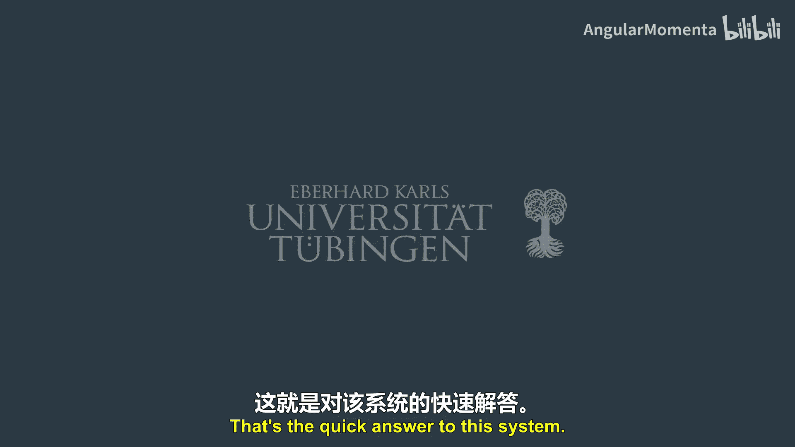
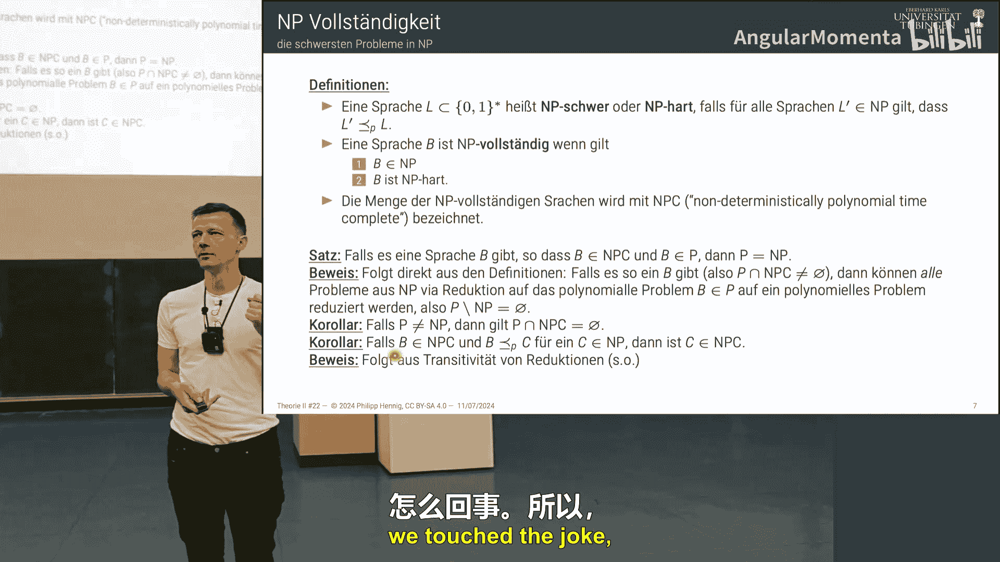
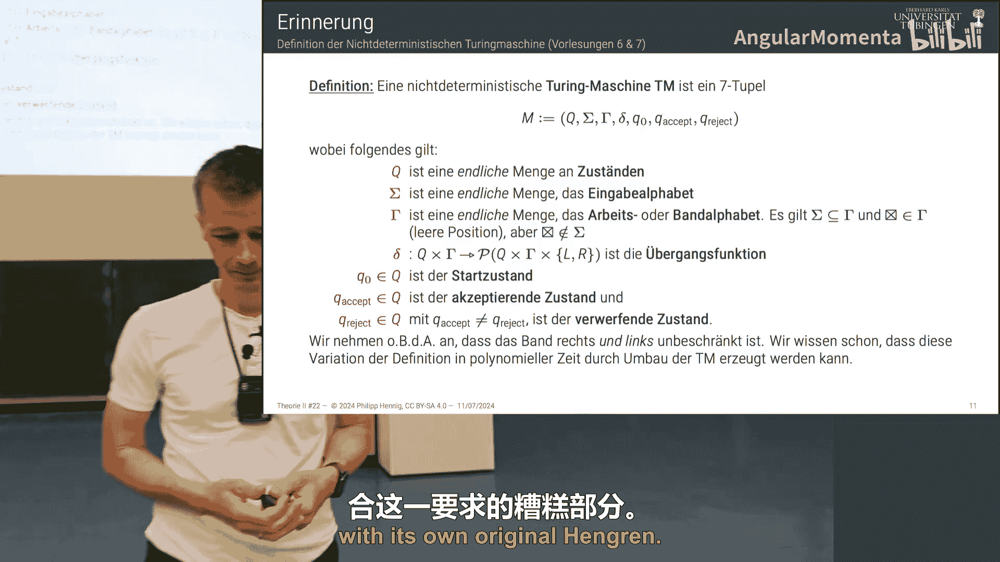
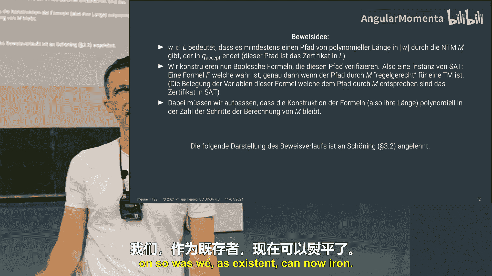
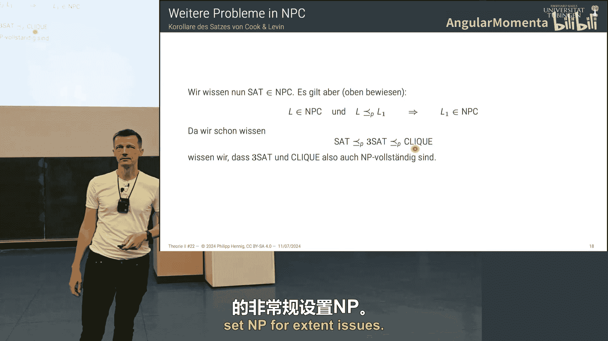
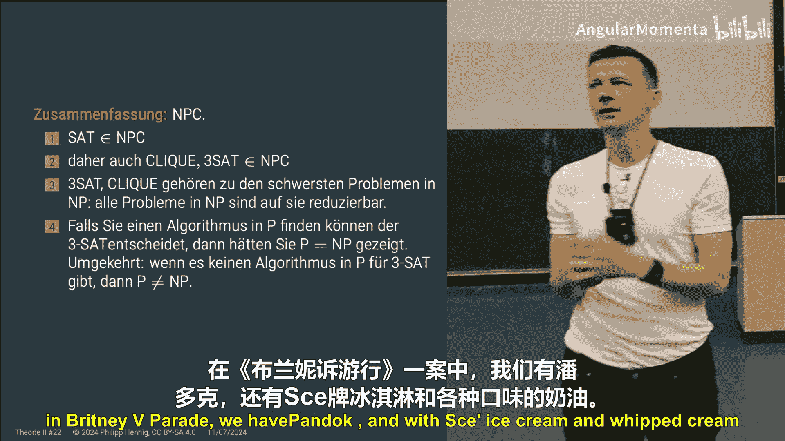

# 021：库克-列文定理

在本节课中，我们将学习计算复杂性理论中的一个核心定理——库克-列文定理。该定理证明了布尔可满足性问题（SAT）是NP完全问题，为理解NP问题的本质以及P与NP关系问题奠定了基础。

## 概述

库克-列文定理是理论计算机科学的基石。它表明，任何可以在多项式时间内被非确定性图灵机验证的问题，都可以在多项式时间内归约到布尔可满足性问题。这意味着SAT是NP完全问题中最“难”的问题之一。如果SAT能在多项式时间内解决，那么所有NP问题都能在多项式时间内解决，即P=NP。

---

## NP类与验证过程

上一节我们介绍了计算复杂性的基本概念。本节中，我们来看看NP类问题的定义。

NP类包含那些其解可以在多项式时间内被**验证**的问题。更形式化地说，一个问题属于NP，当且仅当存在一个多项式时间的确定性图灵机（称为验证机）和一个多项式`p(n)`，使得对于问题的任意一个实例`x`（长度为`n`），`x`是“是”实例当且仅当存在一个长度不超过`p(n)`的“证书”`c`，使得验证机在输入`(x, c)`后接受。

**核心概念**：
*   **NP类定义**： `L ∈ NP` 当且仅当存在多项式`p`和多项式时间确定性图灵机`V`（验证机），使得对于所有输入`x`：
    *   如果 `x ∈ L`，则存在证书`c`（`|c| ≤ p(|x|)`），满足 `V(x, c)` 接受。
    *   如果 `x ∉ L`，则对所有证书`c`，`V(x, c)` 都拒绝。

---

## 多项式时间归约与NP完全性

为了比较不同问题的难度，我们使用“归约”的概念。如果问题A可以归约到问题B，意味着解决B就能解决A。

**多项式时间多一归约**：如果存在一个多项式时间可计算的函数`f`，使得对于所有输入`x`，`x ∈ A` 当且仅当 `f(x) ∈ B`，则称问题A可以在多项式时间内多一归约到问题B，记作 `A ≤_p B`。

**NP完全问题**：一个问题B是NP完全的，需要满足两个条件：
1.  `B ∈ NP`。
2.  对于所有问题 `A ∈ NP`，都有 `A ≤_p B`。

如果一个NP完全问题能在多项式时间内解决（即属于P类），那么所有NP问题都能在多项式时间内解决，即P=NP。

---

## 库克-列文定理的证明思路

库克-列文定理的核心是证明SAT是NP完全的。证明分为两步：

1.  **证明SAT属于NP**：给定一个布尔公式和一组变量赋值（作为证书），我们可以在多项式时间内验证这组赋值是否使公式为真。因此，SAT ∈ NP。
2.  **证明任何NP问题都可以归约到SAT**：这是证明的关键。对于任意一个NP问题L，存在一个非确定性图灵机M和多项式`p(n)`，使得M能在`p(n)`步内判定L。我们需要构造一个从L的实例`x`到布尔公式`φ_x`的归约函数`f`，使得：
    *   `f`可在多项式时间内计算。
    *   `x ∈ L` 当且仅当 `φ_x` 是可满足的。

**构造方法**：公式`φ_x`将模拟图灵机M在输入`x`上的计算过程。我们使用布尔变量来描述计算过程中的三个核心方面：
*   **状态**：在特定时间步，图灵机处于哪个状态。
*   **纸带内容**：在特定时间步，纸带的每个格子包含哪个符号。
*   **读写头位置**：在特定时间步，读写头在纸带的哪个位置。

由于M在`p(n)`步内运行，且使用的纸带格子数也是`p(n)`的多项式，因此描述整个计算过程所需的变量总数是多项式规模的。然后，我们构造一系列子句来编码：
*   **初始配置**：时间步0时，纸带内容是`x`，机器处于起始状态，读写头在起始位置。
*   **转移函数**：每个时间步的配置必须根据图灵机的转移规则，从前一个时间步的配置合法地演变而来。
*   **接受配置**：在`p(n)`步内，机器必须进入接受状态。

如果存在一组变量赋值使`φ_x`为真，那么就对应了M在输入`x`上的一个接受计算路径，即`x ∈ L`。反之亦然。

---

## 证明的技术细节：规范化与编码

为了使构造更清晰，通常会对非确定性图灵机进行规范化，例如确保其只有一个接受状态，并且纸带是单向无限的。然后，将计算表（时间 vs. 纸带位置）的每个单元格可能的情况编码为布尔变量。

以下是构造中涉及的主要逻辑约束类型：

*   **唯一性约束**：每个单元格在每一时刻只能处于一种状态/包含一个符号。
*   **局部一致性约束**：每个单元格在`t+1`时刻的内容，仅由`t`时刻自身及其相邻单元格的状态和内容决定，这编码了图灵机的局部转移规则。
*   **边界约束**：编码初始输入和最终接受条件。

所有这些约束都可以写成合取范式（CNF）的布尔公式，且公式的整体大小是输入规模的多项式。这就完成了从任意NP问题L到SAT问题的多项式时间归约。

---

## 意义与推论

库克-列文定理具有深远的意义：
*   **第一个NP完全问题**：它给出了第一个被证明是NP完全的问题（SAT），为后续证明其他问题的NP完全性提供了基础。通常，要证明问题B是NP完全的，只需证明 `SAT ≤_p B` 且 `B ∈ NP`。
*   **NP完全问题的普遍性**：大量来自图论、调度、逻辑、组合优化等领域的实际问题（如旅行商问题、背包问题、图着色问题、哈密顿路径问题等）都被证明是NP完全的。这意味着它们极有可能不存在多项式时间精确算法。
*   **P vs. NP问题的核心**：SAT的NP完全性使得它成为研究P与NP关系的关键。如果找到SAT的多项式时间算法，就证明了P=NP；如果证明SAT不存在多项式时间算法，则证明了P≠NP。这正是“千禧年大奖难题”之一。

---

## 总结

本节课中我们一起学习了库克-列文定理。我们首先回顾了NP类问题的定义，即那些解能在多项式时间内验证的问题。接着，我们引入了多项式时间归约和NP完全性的概念，它们是衡量问题计算难度的关键工具。

库克-列文定理的核心证明在于，对于任何一个NP问题，我们都可以构造一个多项式时间的归约，将其转换为一个布尔可满足性问题（SAT）。这个构造通过用布尔变量和子句模拟非确定性图灵机的计算过程来实现。该定理不仅证明了SAT是NP完全的，也揭示了NP完全问题在计算复杂性中的核心地位，将无数实际问题的计算难度与一个根本性的逻辑问题联系起来。理解这一定理是深入探索计算复杂性理论的基础。