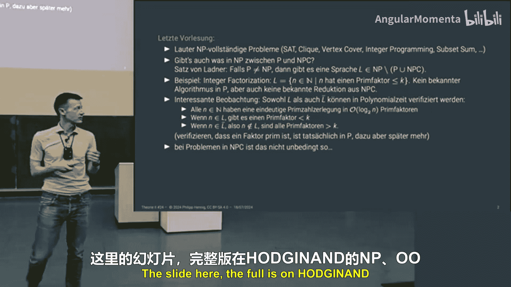
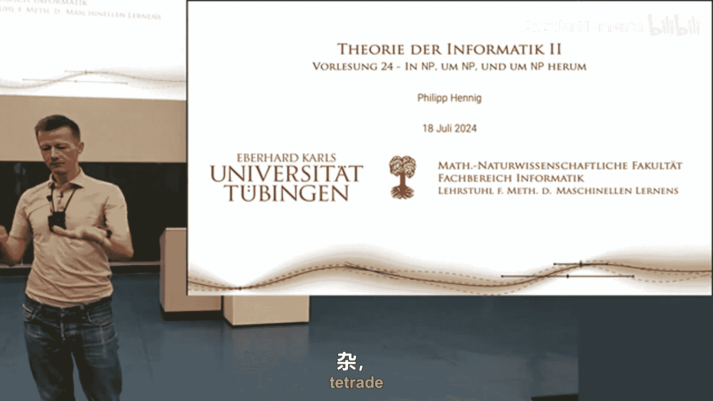
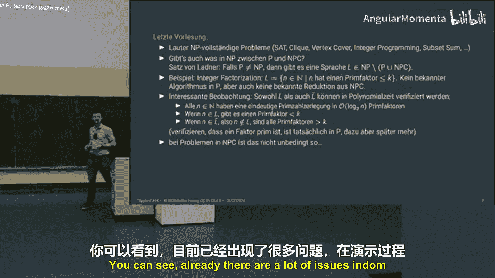
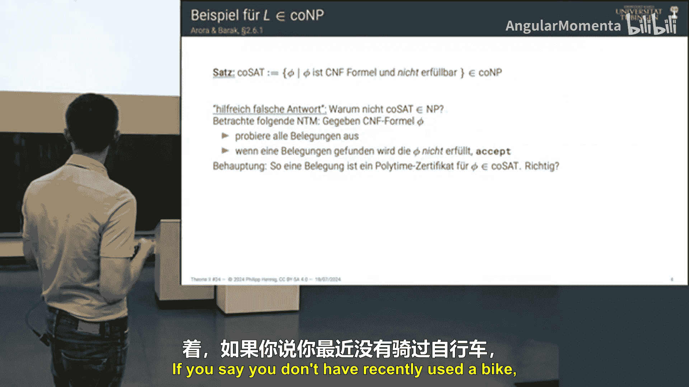
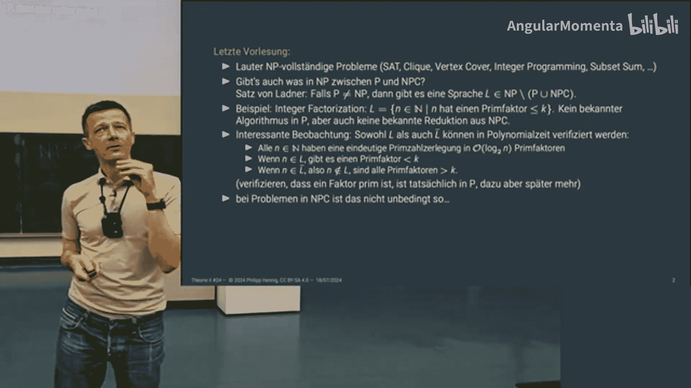
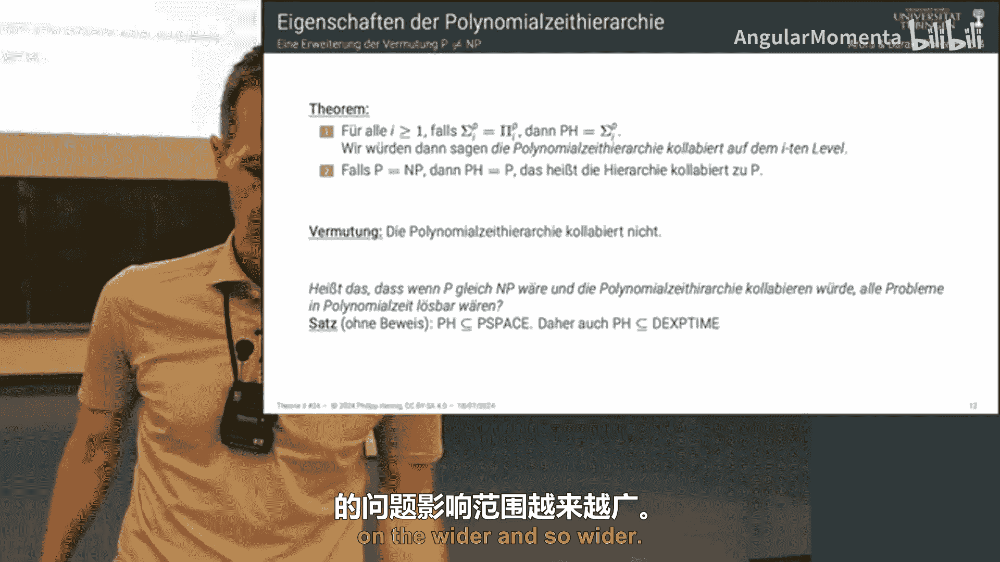
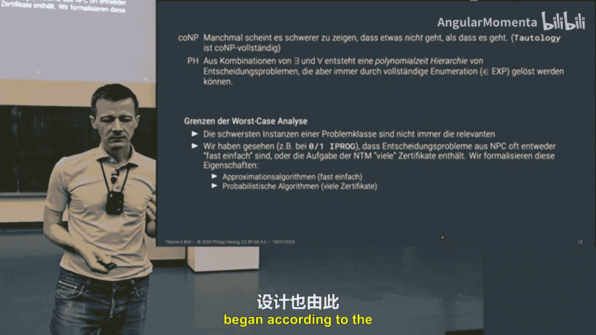
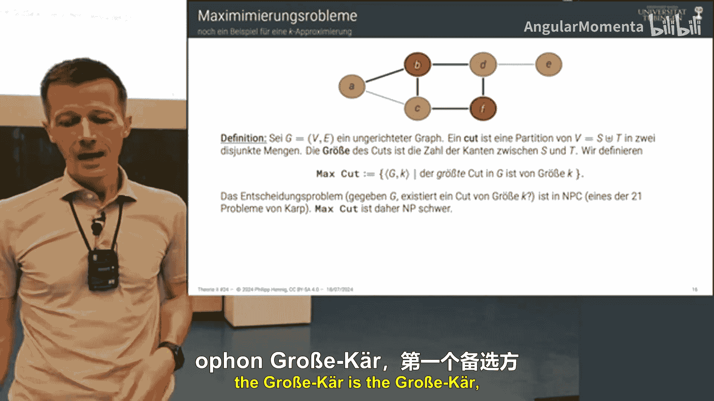
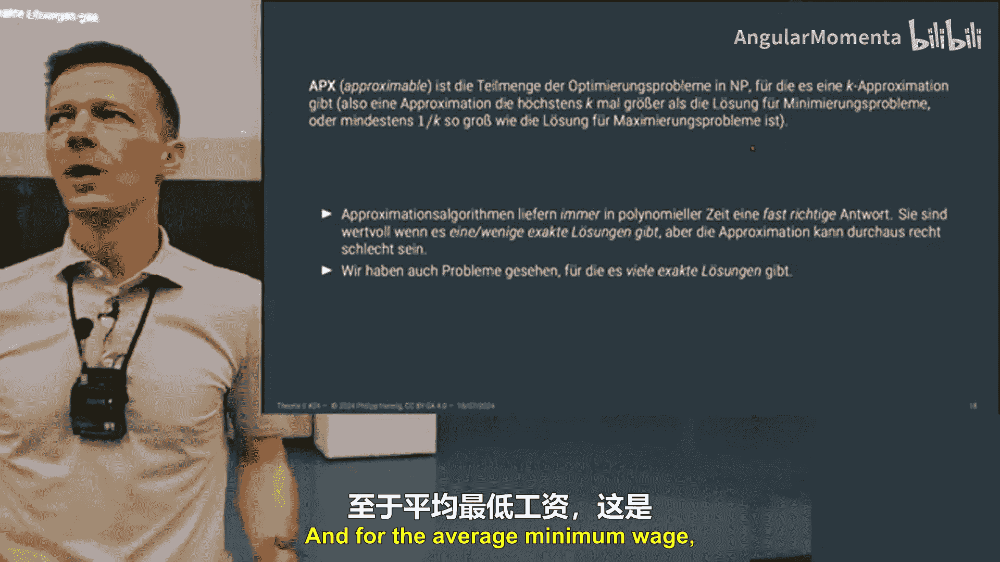
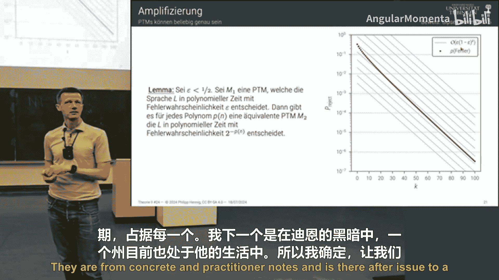

# 022：在NP中，围绕NP，以及NP周围

在本节课中，我们将学习计算复杂性理论中的核心概念，特别是P、NP、co-NP等复杂性类。我们将探讨这些类的定义、它们之间的关系，以及一些典型的NP完全问题。课程还将介绍近似算法和概率图灵机等扩展概念。

## P与NP的定义

上一节我们介绍了计算复杂性理论的基本框架，本节中我们来看看P和NP这两个核心复杂性类的正式定义。

*   **P类**：指所有可以由**确定性图灵机**在**多项式时间**内解决的判定问题集合。形式化地，一个问题L属于P，如果存在一个确定性图灵机M和一个多项式函数p(n)，使得对于任意长度为n的输入x，M在最多p(n)步内停机，并且当且仅当x是L的实例时，M接受x。
*   **NP类**：指所有可以由**非确定性图灵机**在**多项式时间**内解决的判定问题集合。等价地，一个问题L属于NP，如果存在一个多项式时间验证算法（验证者）V和一个多项式函数q(n)，使得对于任意实例x：
    *   如果x是L的实例（即答案为“是”），则存在一个长度不超过q(|x|)的“证书”c，使得V(x, c)接受。
    *   如果x不是L的实例，则对于所有可能的证书c，V(x, c)都拒绝。

## NP完全问题与co-NP

理解了NP的定义后，我们来看看NP中一类特别困难的问题——NP完全问题，以及NP的“补集”类co-NP。

以下是几个经典的NP完全问题示例：
*   整数规划
*   背包问题
*   旅行商问题
*   子集和问题

**co-NP类**定义为NP中所有问题的补集所构成的类。形式化地，co-NP = { L | L的补集 ∈ NP }。这意味着，对于co-NP中的一个问题L，其“是”实例的补集（即“否”实例）可以在NP中被高效验证。一个关键问题是：**P = NP 是否成立？** 如果成立，那么NP = co-NP。但即使NP = co-NP，P也可能不等于NP。

## 多项式时间归约与复杂性类层级

为了比较不同问题的难度，我们使用多项式时间归约的概念。如果问题A可以多项式时间归约到问题B，那么解决B的算法也能用来解决A。

基于此，我们可以构建更复杂的复杂性类层级，例如多项式层级：
*   **Σ₁P = NP**
*   **Π₁P = co-NP**
*   **Σ₂P**：存在一个NP预言机可以解决的问题。
*   **Π₂P**：co-NP预言机可以解决的问题的补集。

一个典型的问题是**独立集问题**：给定一个图G和一个整数k，问G中是否存在一个大小至少为k的独立集（即顶点集合，其中任意两点无边相连）。这个问题是NP完全的。而它的补问题（即判断图G是否不存在大小至少为k的独立集）则属于co-NP。

## 近似算法

对于NP难问题，我们通常无法在多项式时间内找到精确最优解。因此，我们转向寻找近似解。近似算法的目标是，在多项式时间内，找到一个解，其目标函数值（如成本或收益）与最优值的比值在一个可证明的常数因子之内。

以下是两个经典问题的近似算法示例：
*   **顶点覆盖问题**：贪心算法可以给出一个2-近似解（即找到的覆盖大小不超过最优解的两倍）。
*   **最大割问题**：随机分配顶点到两个集合，或者使用局部搜索算法，可以获得一个0.5-近似解（即找到的割大小至少是最优解的一半）。

## 概率图灵机与复杂性类BPP

除了确定性计算，我们还可以考虑概率性计算。概率图灵机在计算过程中可以进行随机选择。

**BPP类**（有界错误概率多项式时间）是指那些存在概率图灵机在多项式时间内解决的问题，并且对于所有输入：
*   如果答案为“是”，则接受概率至少为2/3。
*   如果答案为“否”，则接受概率至多为1/3。
这里的错误概率1/3可以通过多次运行算法并取多数结果来任意减小。

概率算法为许多问题提供了简洁高效的解决方案，例如素数测试。

## 总结

本节课中我们一起学习了计算复杂性理论的核心内容。我们从P和NP的定义出发，探讨了NP完全问题的概念以及co-NP类。我们了解了如何使用多项式时间归约来比较问题难度，并简要接触了多项式层级。面对NP难问题，我们介绍了近似算法的思想，并以顶点覆盖和最大割问题为例进行了说明。最后，我们扩展到了概率计算模型，定义了BPP复杂性类。这些概念构成了我们理解计算问题内在难度和设计高效算法的基础。