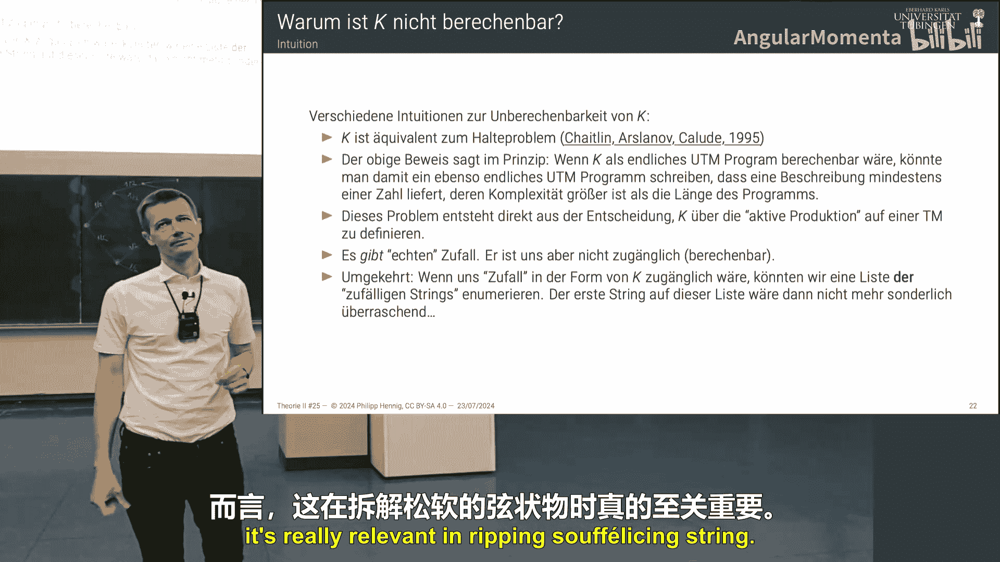

# 023：信息与随机性

在本节课中，我们将学习信息论与随机性的核心概念，特别是柯氏复杂度的定义、性质及其与可计算性和概率计算的关系。我们将从图灵机的基本概念出发，逐步构建对算法信息论的理解。

---

## 柯氏复杂度：定义与基本性质

上一节我们介绍了计算理论的基础。本节中，我们来看看如何量化一个字符串的信息内容，这引出了柯氏复杂度的概念。

柯氏复杂度 **K(x)** 定义为：输出字符串 **x** 的最短程序的长度。更形式化地说，对于一个通用图灵机 **U**，字符串 **x** 的柯氏复杂度是满足 **U(p) = x** 的最短程序 **p** 的长度。

以下是柯氏复杂度的几个关键性质：
*   **依赖于通用机，但仅差一个常数**：选择不同的通用图灵机 **U** 和 **U'**，对应的复杂度 **K_U(x)** 和 **K_U'(x)** 最多相差一个与 **x** 无关的常数 **c**。即 **|K_U(x) - K_U'(x)| ≤ c**。
*   **存在不可压缩字符串**：对于任意长度 **n**，都存在长度为 **n** 的字符串 **x**，其柯氏复杂度 **K(x) ≥ n**。这样的字符串被认为是“随机的”或“不可压缩的”。
*   **大多数字符串不可压缩**：随着字符串长度 **n** 的增长，绝大多数字符串的柯氏复杂度都接近 **n**。只有极少数字符串是高度可压缩的。

---

## 柯氏复杂度与随机性

我们已经看到，柯氏复杂度可以定义字符串的随机性。本节中，我们来看看如何利用这个概念区分随机字符串与非随机字符串。

直观上，如果一个字符串的模式可以被一个简短的程序描述，那么它就不是随机的。反之，如果描述它的最短程序几乎和它本身一样长，那么它就是随机的。以下是判断随机性的核心思路：
*   对于一个字符串 **x**，如果其柯氏复杂度 **K(x)** 不小于其长度 **|x|**，则 **x** 被认为是随机的。
*   然而，由于 **K(x)** 是不可计算的，我们无法精确判断一个给定字符串是否随机。但我们可以证明，随机字符串是存在的，并且在所有字符串中占绝大多数。

---

## 柯氏复杂度与概率计算类 BPP

之前我们讨论了确定性计算。本节中，我们来看看柯氏复杂度如何与概率计算联系起来，特别是与有界错误概率多项式时间类 **BPP** 的关系。

**BPP** 类包含那些存在多项式时间概率图灵机可以解决的问题，该机器对任何输入的错误概率小于 **1/3**。以下是 **BPP** 与柯氏复杂度的联系：
*   研究显示，如果存在足够多的“柯氏随机”字符串（即复杂度很高的字符串），那么这些字符串可以作为概率算法中理想的随机比特源。
*   理论上，如果我们可以获取真正的高柯氏复杂度字符串，那么 **BPP** 类中的许多算法可以变得更高效或更可靠。这连接了算法信息论与计算复杂性理论。

---

## 不可压缩性方法及其应用

我们了解了随机字符串的存在性。本节中，我们来看看如何利用字符串的不可压缩性来证明计算问题的下界，这种方法称为“不可压缩性方法”。

其核心思想是：如果一个问题的所有解都很长，那么假设存在一个很短的解，就可以构造出一个描述长随机字符串的短程序，这与该字符串的高柯氏复杂度（即不可压缩性）矛盾。以下是应用此方法的典型步骤：
1.  假设某个问题存在一个大小（或运行时间）很小的算法或解决方案。
2.  选择一个高柯氏复杂度的长随机字符串。
3.  利用假设中的小方案，可以简短地描述这个随机字符串。
4.  这与该随机字符串的不可压缩性（即高柯氏复杂度）产生矛盾。
5.  从而反证原假设不成立，即证明了该问题需要较大的解决方案或较长的运行时间。

这种方法常用于证明数据结构的下界、通信复杂度等问题。

---

## 总结

本节课中我们一起学习了柯氏复杂度的核心概念。我们首先定义了字符串的柯氏复杂度 **K(x)**，并理解了它作为信息内容度量的基本性质。接着，我们探讨了如何用柯氏复杂度来定义随机性，并认识到大多数字符串实际上是随机的、不可压缩的。然后，我们将这一概念与概率计算类 **BPP** 联系起来，看到了理想随机源的理论价值。最后，我们介绍了强大的“不可压缩性方法”，展示了如何利用柯氏复杂度来证明计算问题的下界。这些内容构成了算法信息论的基础，连接了信息、随机性与计算复杂性。