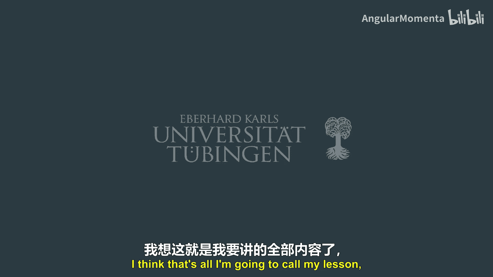
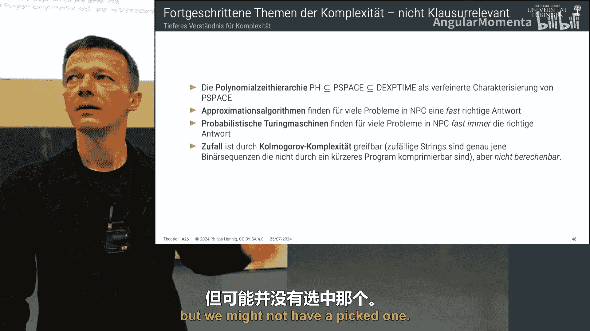
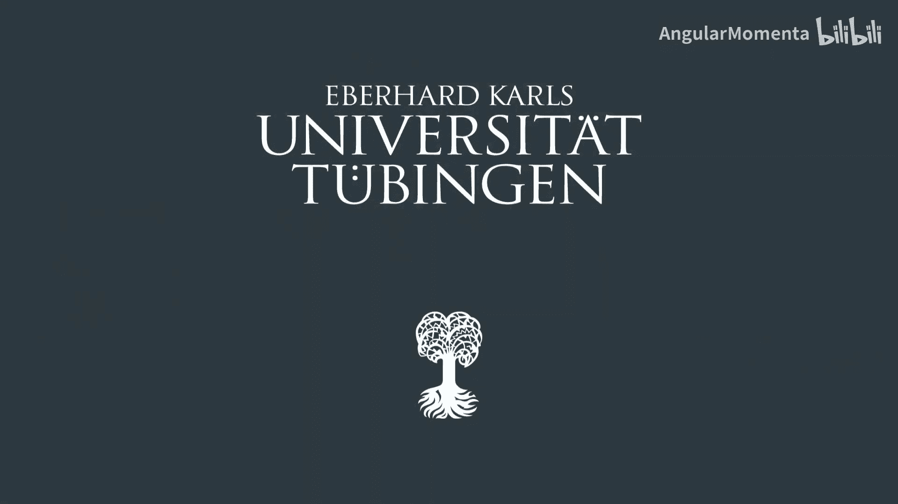

# 024：摘要与总结 📚



在本节课中，我们将回顾理论计算机科学课程的核心概念。我们将从形式语言和自动机的基础知识开始，逐步深入到图灵机、可计算性以及计算复杂性理论。课程旨在构建一个从简单到复杂的知识体系，帮助初学者理解计算理论的基本框架。

---

## 形式语言与自动机 🤖

上一节我们介绍了计算理论的基本范畴，本节中我们来看看形式语言与自动机理论。这是理论计算机科学的基石，它研究如何用数学模型描述语言和计算过程。

形式语言是由符号组成的字符串集合。我们使用**文法**来形式化地定义语言。例如，一个上下文无关文法可以表示为：
```
G = (V, Σ, R, S)
```
其中 `V` 是非终结符集合，`Σ` 是终结符集合，`R` 是产生式规则集合，`S` 是起始符号。

自动机是用于识别语言的抽象机器。最基本的自动机是有限自动机。

以下是几种关键的语言类及其对应的自动机模型：
*   **正则语言**： 由正则表达式描述，可由有限自动机识别。
*   **上下文无关语言**： 由上下文无关文法描述，可由下推自动机识别。
*   **上下文相关语言**： 由上下文相关文法描述，可由线性有界自动机识别。
*   **递归可枚举语言**： 由无限制文法描述，可由图灵机识别。

这些语言类之间存在严格的包含关系，构成了著名的**乔姆斯基谱系**。

---

## 图灵机与可计算性 💻

在掌握了自动机模型后，我们进入更强大的计算模型——图灵机。图灵机是理论计算机科学中最重要的概念之一，它定义了什么是“可计算”。

一台图灵机可以形式化地定义为一个七元组：
```
TM = (Q, Σ, Γ, δ, q0, q_accept, q_reject)
```
其中 `Q` 是状态集合，`Σ` 是输入字母表，`Γ` 是纸带字母表，`δ` 是转移函数，`q0` 是初始状态，`q_accept` 是接受状态，`q_reject` 是拒绝状态。

图灵机的核心思想是模拟人类使用纸笔进行计算的过程。它具有无限长的纸带和一个读写头，可以根据当前状态和读到的符号进行写入、移动和状态转换。

关于图灵机，有几个根本性的结论：
*   **通用图灵机**： 存在一台特殊的图灵机，它可以模拟任何其他图灵机在给定输入上的行为。这是现代存储程序式计算机的理论原型。
*   **停机问题**： 不存在一个算法（图灵机），能够判断任意图灵机在任意输入上是否会停机。这表明有些问题是**不可判定**的。
*   **丘奇-图灵论题**： 任何在算法上可计算的功能，都可以被一台图灵机计算。这确立了图灵机作为计算能力极限的地位。

不可判定性通过**对角化论证**等技术得到证明，揭示了计算的固有局限性。

---

## 计算复杂性理论 ⏱️

了解了什么是可计算之后，我们自然要问：哪些可计算问题是“容易”的，哪些是“困难”的？计算复杂性理论试图回答这个问题。

我们主要根据解决问题所需的时间资源来对问题进行分类。时间通常表示为输入规模 `n` 的函数。

以下是两个最重要的复杂性类：
*   **P 类**： 包含所有可以由**确定性图灵机**在**多项式时间**内解决的问题。例如，排序、搜索。
*   **NP 类**： 包含所有可以由**非确定性图灵机**在多项式时间内解决的问题，或者等价地说，其解可以在多项式时间内被**验证**的问题。例如，布尔可满足性问题、旅行商问题。

P 与 NP 的关系是理论计算机科学中悬而未决的核心问题，即 **“P 是否等于 NP？”**。目前普遍认为 P ≠ NP，但尚未得到证明。

为了比较问题的难度，我们使用**多项式时间归约**的概念。如果问题 A 可以归约到问题 B，那么 B 至少和 A 一样难。NP 类中最难的问题被称为 **NP 完全问题**，例如 SAT 问题。如果任何一个 NP 完全问题被证明属于 P，那么 P 就等于 NP。

---

## 总结与展望 🎯

本节课中我们一起学习了理论计算机科学的核心脉络。

我们从**形式语言与自动机**出发，建立了语言和计算的形式化模型。然后，我们引入了强大的**图灵机**模型，它定义了计算的边界，并揭示了像停机问题这样的固有局限性。最后，我们进入了**计算复杂性理论**，探讨了在可计算的问题中，如何区分“易”与“难”，并了解了 P、NP 和 NP 完全性等关键概念。





这门课程不仅提供了理解计算机科学本质的理论工具，也为后续学习编译器构造、算法分析、密码学等领域奠定了坚实的基础。尽管有些结论（如不可判定性）看起来是消极的，但它们深刻地刻画了计算的本质，并指导着我们在可行的范围内设计和分析高效的算法。