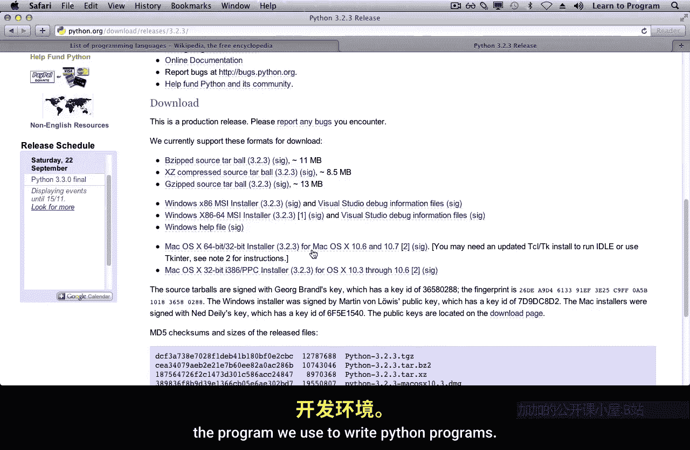
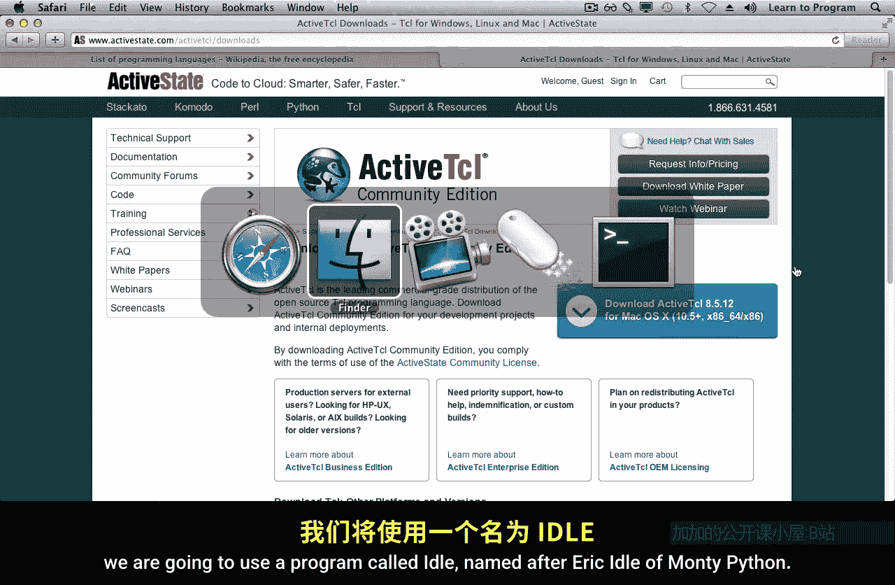
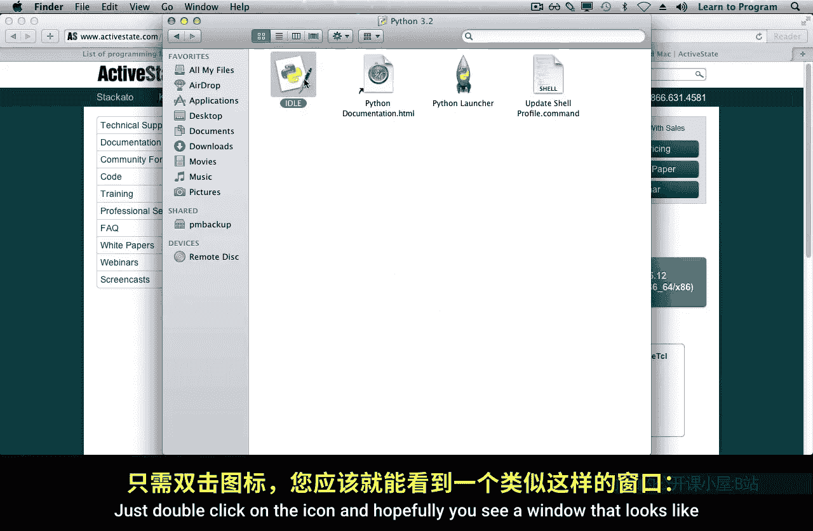
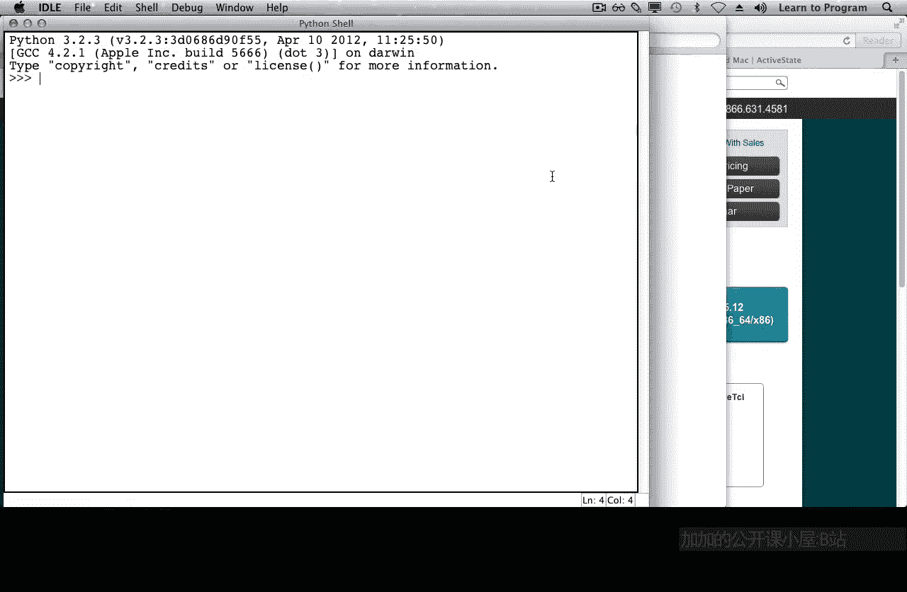

# 002：安装Python 🐍

在本节课中，我们将学习如何下载和安装Python编程语言，并初步了解什么是程序。

程序无处不在。当你使用网页浏览器、玩电脑游戏或在手机上发送短信时，你都在使用程序。甚至你的操作系统，如macOS、Linux或Windows，本身也是一个程序。**程序本质上是一组指令的集合**。我们通常说程序被“运行”或“执行”。

程序运行在硬件上，例如你的手机、笔记本电脑或平板电脑。同时，程序也可以被其他程序运行。例如，当你在网页浏览器中玩游戏时，你的浏览器知道如何运行一种名为JavaScript的编程语言编写的程序。

维基百科上有一个页面列出了所有曾被记录过的编程语言，数量多达数百种。你可能听说过其中一些，但几乎没有人能了解这里列出的所有语言。

Python就是众多编程语言中的一种。为了运行Python程序，你需要下载一个能理解这种语言的程序，就像浏览器理解JavaScript一样。

---

## 下载Python

为了完成本课程的学习，你需要从Python官网下载这个程序。Python主要有两个版本：Python 2和Python 3。我们将使用Python 3。

以下是下载步骤：
1.  访问Python官网。
2.  点击“Quick links”下的下载链接，进入Python 3的下载页面。
3.  根据你的操作系统选择对应的安装包：
    *   **Linux用户**：可以使用包管理器安装Python 3。
    *   **Windows用户**：点击对应的Windows安装链接。
    *   **macOS用户**：点击对应的macOS安装链接。

对于使用较新版本macOS的用户，可能还需要安装一个名为“Tkinter”的组件，以便运行我们用来编写Python的程序。

如果你是Mac用户，请滚动到页面底部，点击相关链接，然后下载并安装最新版本的ActiveTcl。

---

## 编写Python的工具：IDLE

下载并安装Python后，我们将使用一个名为**IDLE**的程序来编写Python代码。IDLE是以Monty Python成员Eric Idle的名字命名的，它会随Python一同安装。

启动IDLE非常简单：
1.  在你的电脑上找到IDLE图标。
2.  双击该图标。

启动后，你应该能看到一个类似下图的窗口，这表明你的Python环境已经准备就绪。

---

本节课中，我们一起学习了程序的基本概念，并完成了Python编程环境的搭建。我们了解到程序是指令的集合，并成功从官网下载了Python 3，同时认识了我们将要使用的代码编辑器IDLE。现在，你的电脑已经准备好运行Python程序了。