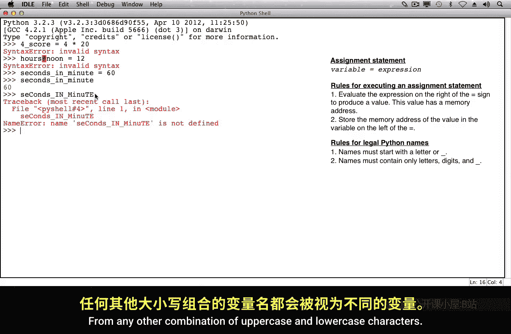
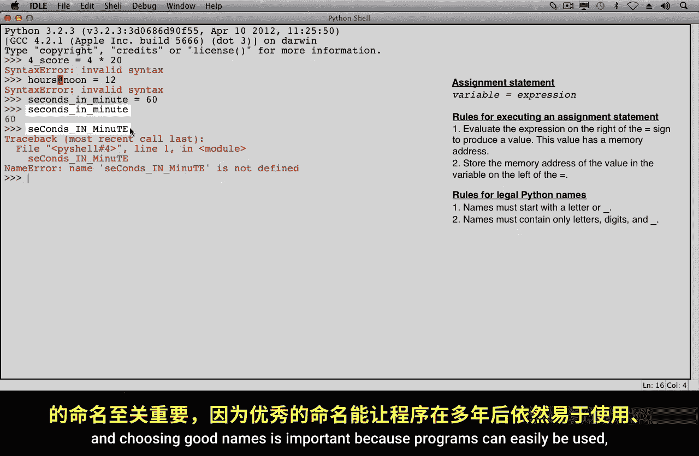
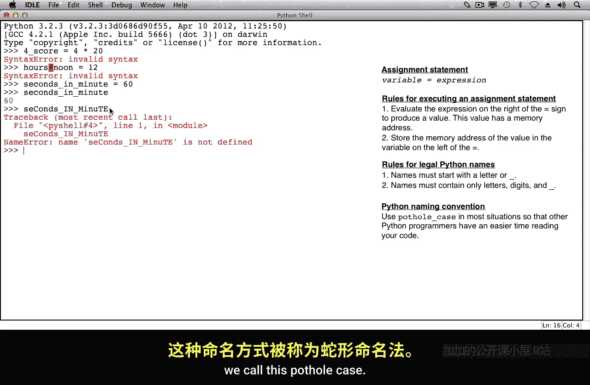

# 005：变量 📦

在本节课中，我们将学习如何记住Python表达式的计算结果，以便后续使用这些值。我们将通过计算三角形面积的例子来探索这一概念。

## 概述

上一节我们介绍了如何在Python中计算表达式。本节中，我们来看看如何将计算结果保存起来，以便在后续的代码中重复使用。我们将学习**变量**和**赋值语句**，这是编程中存储和操作数据的基础。

## 计算三角形面积

作为回顾，如果我们知道三角形的**底边长度**和**高度**，那么其面积的计算公式为：

**面积 = (底边长度 × 高度) / 2**

例如，如果高度是12，底边长度是20，那么面积就是 `(20 * 12) / 2`。

让我们在Python中探索这个计算过程。

## 引入变量

你已经知道如何在Python中输入并计算表达式。但为了计算多个三角形的面积，我们将向你展示如何引入像 `base` 和 `height` 这样的词来代表具体的数值。这通过**赋值语句**来完成。

以下是一个例子：

```python
base = 20
```

这条语句会计算 `20` 这个值，并将其与变量 `base` 关联起来。`base` 被称为**变量**，因为它的值可以改变，我们稍后会看到这一点。

我们可以为另一个变量 `height` 做类似的操作：

```python
height = 12
```

之后，这两个名字就可以在Python交互式环境中像它们的值一样被使用。因此，`base` 的值是20，`height` 关联的值是12。

## 理解赋值语句

请注意，编程中的等号 `=` 与数学中的等号含义非常不同。在编程中，`=` 表示**赋值**，即将右边的值赋予左边的变量。

由于计算机程序可能变得相当复杂，我们将引入一种描述变量及其值的图示方法。

我们会为变量 `base` 画一个旁边的方框。在Python中，值 `20` 并不直接放在这个方框里。相反，像Python中的所有其他值一样，`20` 存储在特定的**内存地址**中。

假设在内存地址 `x3` 处存储着值 `20`。赋值语句 `base = 20` 会获取这个地址 `x3`，并将其放入与 `base` 关联的方框中。因此，`base` 包含 `x3`，这意味着它**指向**存储着值 `20` 的内存地址 `x3`。

类似地，变量 `height` 也有一个方框来跟踪其值，其值也是一个内存地址。假设是 `x7`，它指向存储着值 `12` 的地方。这些地址是任意的，由Python管理，我们无需关心具体是什么地址，只需理解变量与其值之间的这种关联关系即可。

## 在表达式中使用变量

回到我们的编程问题，我们可以在表达式中使用 `base` 和 `height`：

```python
area = base * height / 2
```

执行 `base * height / 2` 会得到与直接计算 `20 * 12 / 2` 相同的结果。我们还可以将这个表达式的结果赋值给另一个变量，我们称之为 `area`。

让我们检查一下 `area` 的值：

```python
print(area)  # 输出：120.0
```

## 修改变量的值

现在，我们将再次使用赋值语句为 `base` 和 `height` 赋予新的值：

```python
base = 2.5
height = 7
```

在我们的图示中，这会将一个新值 `2.5` 放在某个内存地址（例如 `x4`）处，然后赋值语句会用 `x4` 替换掉 `base` 方框中原先的 `x3`。这样，`base` 就不再指向 `20`，而是关联到 `2.5`。

同样，`height = 7` 会将值 `7` 放在某个地址（例如 `x1`）处，并将 `x1` 放入变量 `height` 的方框中，从而断开旧的联系，使 `height` 现在指向 `7`。

如果我们再次计算面积：

```python
area = base * height / 2
print(area)  # 输出：8.75
```

新的面积是8.75，这正是 `2.5 * 7 / 2` 的结果。

## 赋值语句的规则

每个赋值语句都具有以下形式：

**`variable = expression`**

以下是执行赋值语句的规则，你应该尽力记住它们，因为这在课程中会反复出现：

1.  **计算**等号右边的表达式。
2.  这个表达式的值有一个内存地址。
3.  **存储**这个内存地址到等号左边的变量中。

## 变量的命名规则

每种编程语言都有一套关于合法名称的规则。在Python中：

以下是有效的变量名规则：
*   变量名必须以**字母**或**下划线** `_` 开头。
*   变量名可以包含字母、数字和下划线。
*   允许使用大写和小写字母。

格式错误的变量名会导致语法错误。例如：

```python
2nd_base = 10  # 错误：不能以数字开头
my-variable = 5  # 错误：包含了连字符“-”
```

Python也是**大小写敏感**的。这意味着 `seconds_in_minute` 和 `Seconds_In_Minute` 是两个不同的变量。

```python
seconds_in_minute = 60
Seconds_In_Minute = 60  # 这是另一个不同的变量
```



第一个变量名 `seconds_in_minute` 显然比第二个带有大写字母的版本更具可读性。选择好的变量名非常重要，因为程序可能会被阅读和改进很多年。

## Python的命名约定

每种编程语言都有一套命名约定，就像网站有特定的风格和布局一样。在Python中，大多数变量名只使用**小写字母**，并用**下划线**来分隔单词。我们称之为**蛇形命名法**。



例如：
*   `user_name`
*   `total_count`
*   `is_valid_input`

## 总结

本节课中，我们一起学习了Python中**变量**的核心概念。我们了解了如何使用**赋值语句**（`=`）将值存储到变量中，以及变量在内存中如何通过地址指向实际的值。我们还学习了如何修改变量的值，以及在表达式中使用变量进行计算。最后，我们掌握了Python中变量名的**命名规则**和推荐的**蛇形命名法**约定。



理解变量是编写任何程序的基础，它使我们能够保存数据、传递信息并构建复杂的逻辑。在接下来的课程中，我们将继续利用变量来探索更多的编程概念。