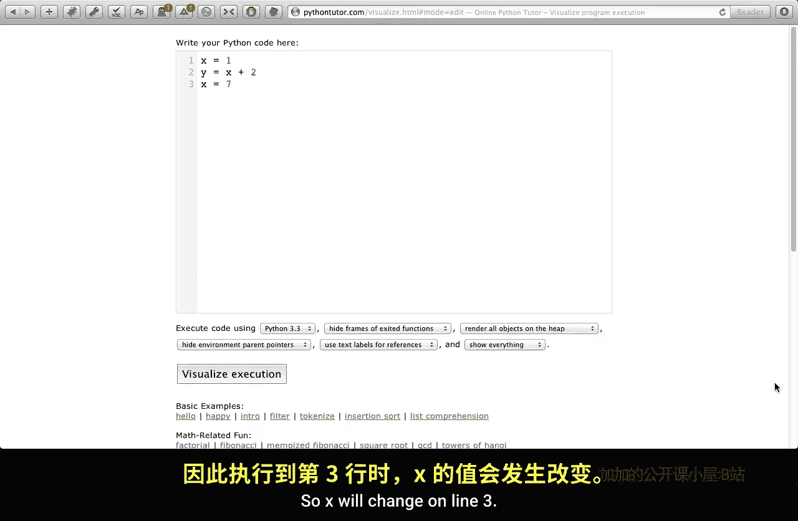
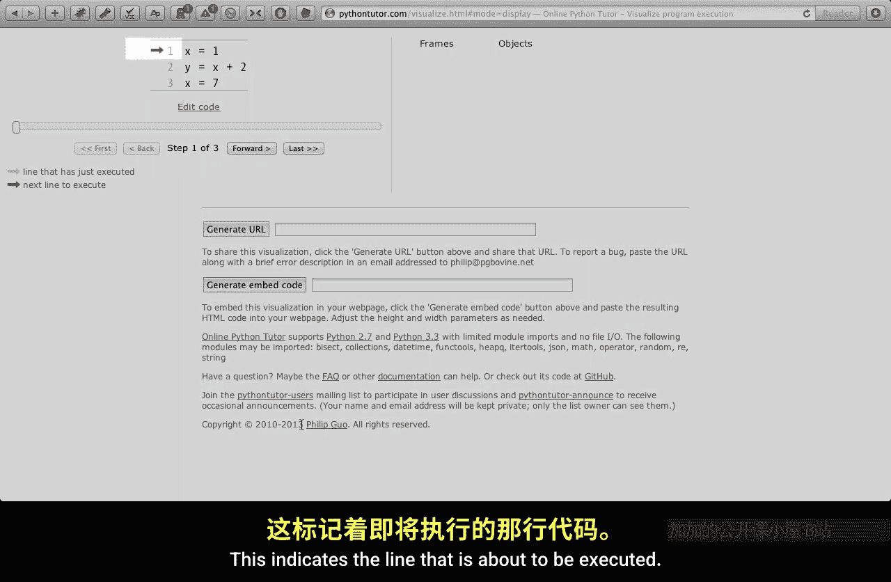
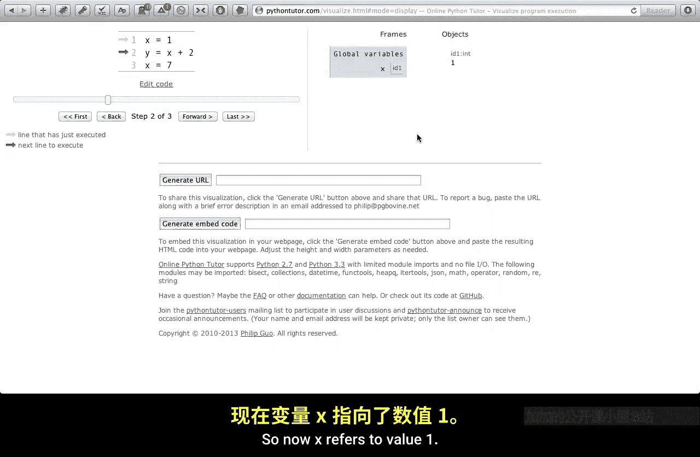
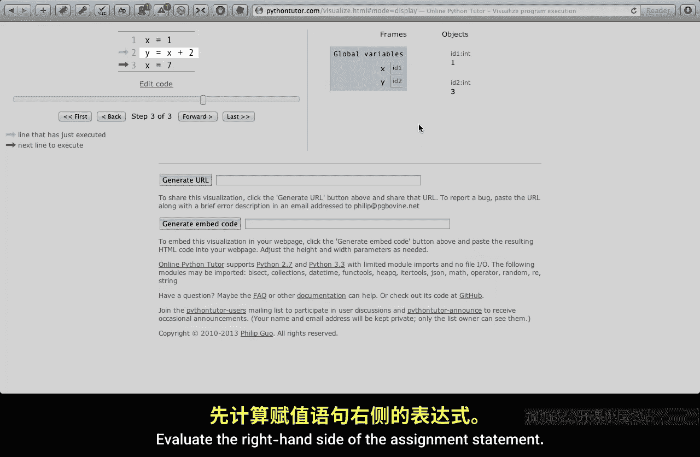
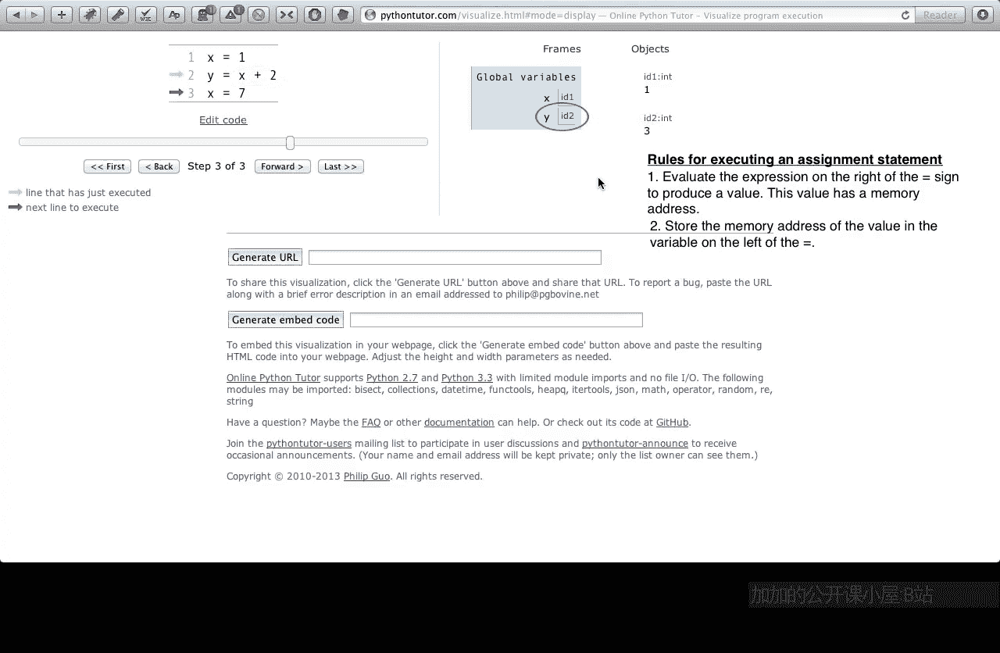
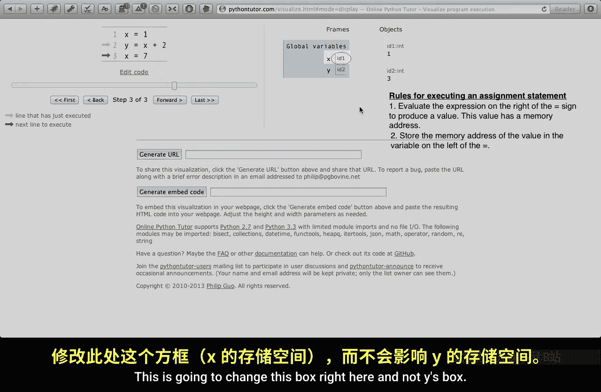
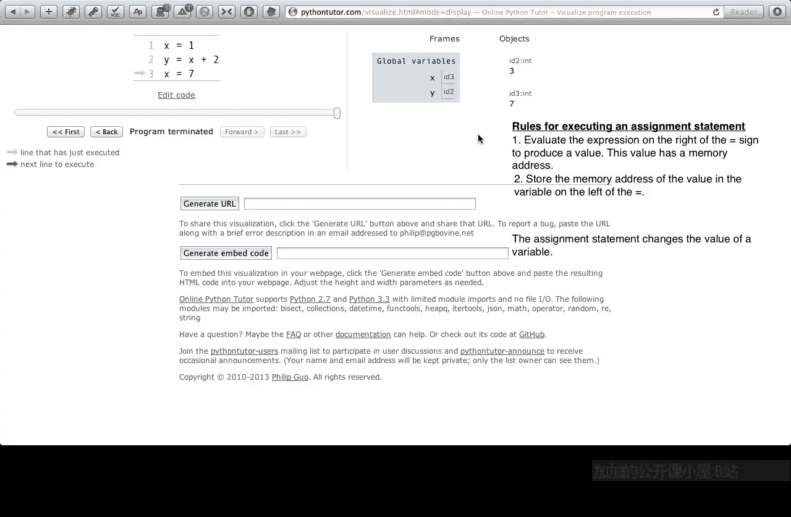

# 006：可视化赋值语句 🖥️


在本节课中，我们将学习如何使用可视化工具来观察程序执行过程中计算机内存的状态变化。这有助于我们更直观地理解变量和赋值语句的工作原理。

## 概述 📋


我们已经学习了变量和赋值语句的基本概念。现在，我们将探索一个名为“可视化器”的工具。这个工具能让我们在程序执行时，清晰地看到计算机内存中变量的状态变化。

## 可视化赋值语句执行过程

以下是我们要分析的代码片段，包含三个赋值语句：



```python
x = 1
y = x + 2
x = 7
```

第一个语句将值 `1` 赋给变量 `x`。
第二个语句计算表达式 `x + 2` 的值，并将结果赋给变量 `y`。
第三个语句将值 `7` 再次赋给变量 `x`。这意味着 `x` 的值在第三行会发生变化。



## 逐步执行与内存状态观察

让我们使用可视化器来逐步执行这些语句，并观察内存的变化。

### 初始状态

程序尚未开始执行，因此内存中还没有创建任何变量。可视化器中的高亮行表示即将执行的语句。



### 执行第一行语句

当我们点击“向前”执行第一行 `x = 1` 时，会发生以下情况：
*   计算机会在内存中创建一个值为 `1` 的对象。
*   变量 `x` 将存储这个对象的内存地址（即指向它）。
在可视化器中，我们可以看到变量 `x` 的方框内有一个箭头，指向内存中值为 `1` 的存储块。此时，`x` 引用了值 `1`。

### 执行第二行语句

接下来，我们准备执行第二行 `y = x + 2`。执行过程分为两步：
1.  **计算右侧表达式**：计算 `x + 2` 的值。由于 `x` 当前是 `1`，所以 `1 + 2` 的结果是 `3`。
2.  **赋值**：将结果 `3` 的内存地址存储到变量 `y` 中。

点击执行后，我们确实看到：
*   内存中创建了一个值为 `3` 的新对象。
*   变量 `y` 的方框内出现箭头，指向这个值为 `3` 的对象。
*   将鼠标悬停在 `y` 上，可以清楚地看到它与值 `3` 之间的引用关系。

**重要提示**：赋值语句 `y = x + 2` 与数学等式有本质区别。它并不意味着 `y` 永远等于 `x + 2`。它只是在执行这一行代码的瞬间，将当时 `x + 2` 的计算结果赋给 `y`。

### 执行第三行语句





现在，我们要执行第三行 `x = 7`。这将清晰地展示变量值的独立性。

当我们点击执行时，会发生以下变化：
*   计算机会在内存中创建值为 `7` 的新对象。
*   变量 `x` 的引用被更新，转而指向这个新对象（值为 `7`）。
*   **关键观察**：变量 `y` 的引用**没有改变**，它仍然指向值为 `3` 的对象。



因此，执行完毕后，`x` 的值变为 `7`，而 `y` 的值仍然是 `3`。这证明了赋值语句只会改变被赋值变量（本例中是 `x`）的引用，不会影响其他变量（本例中是 `y`）。

## 总结 🎯

本节课中，我们一起学习了：
1.  使用可视化工具跟踪程序执行和内存状态。
2.  逐步分析了 `x = 1`， `y = x + 2`， `x = 7` 这三个赋值语句的执行过程。
3.  理解了赋值语句的两个核心步骤：**计算右侧表达式**和**将结果地址存入左侧变量**。
4.  明确了赋值语句 `=` 不是声明永恒等式，它只改变特定变量在特定时刻的值。
5.  通过最后一步 `x = 7` 的执行，直观地看到了变量 `x` 值的改变并不会影响之前已经赋值的变量 `y`。



通过可视化观察，我们巩固了对变量、内存地址和赋值操作的理解，这是编程中非常基础且重要的概念。