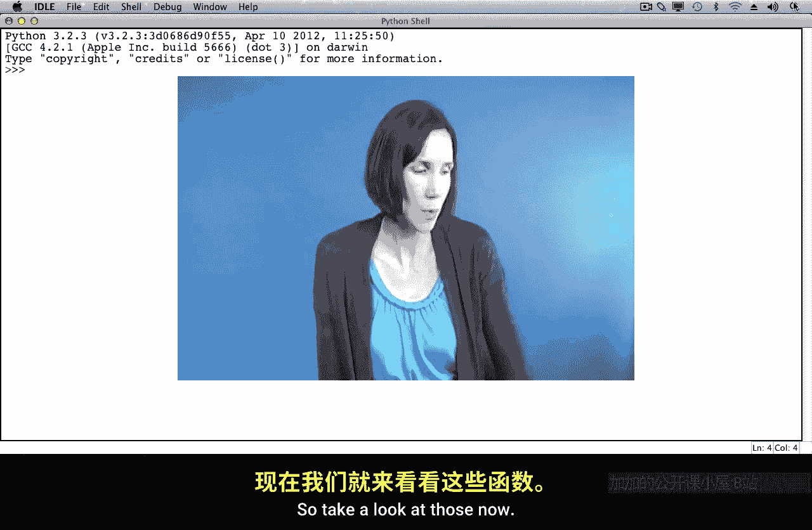
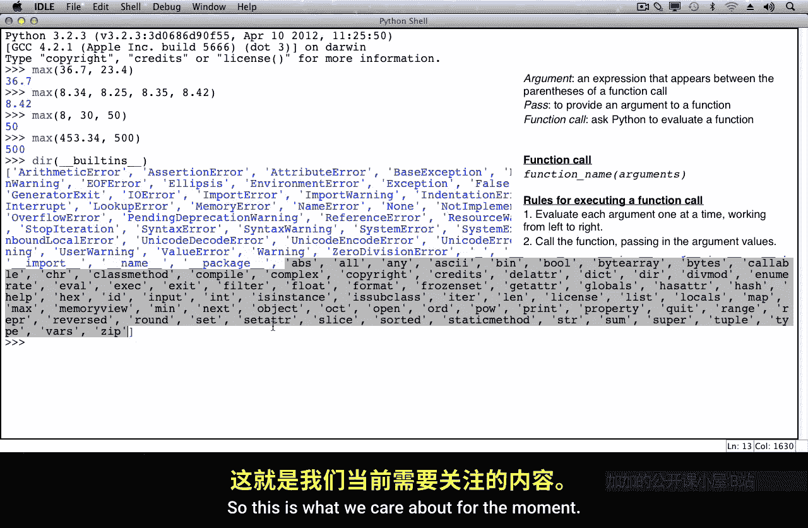
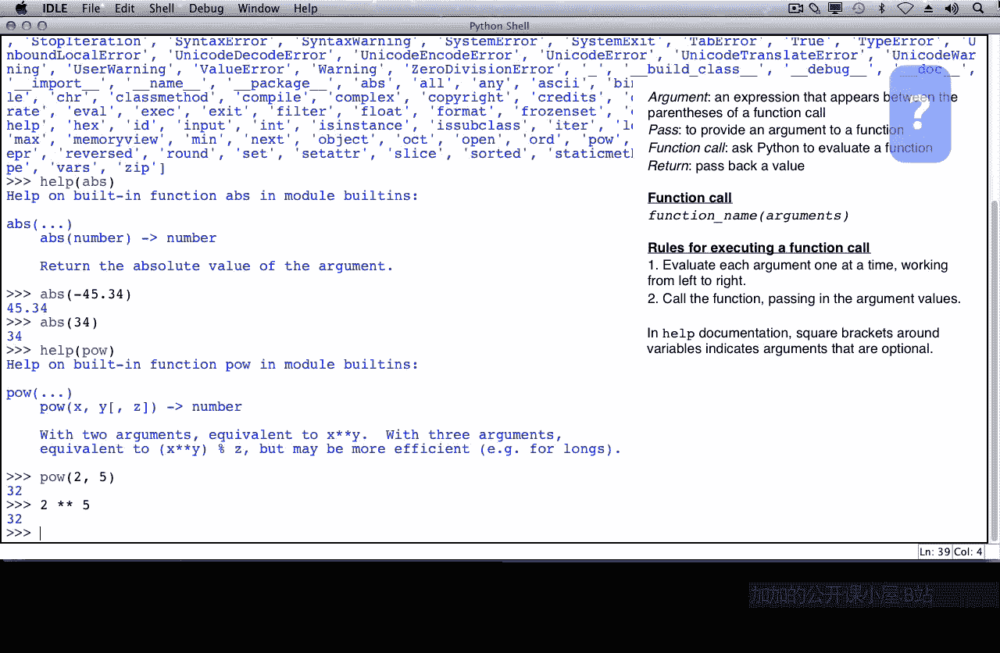

# 007：内置函数


在本节课中，我们将要学习Python中的内置函数。我们将了解什么是函数调用，如何查找可用的内置函数，以及如何使用`help`函数来了解特定函数的功能。

## 什么是内置函数？

上一节我们介绍了Python的数学运算符，如乘法和减法。然而，除了数学运算，我们还需要执行许多其他操作，但并没有足够多的符号来表示所有这些操作。



例如，我们可能想找出几个数字中最大的一个。这个操作就没有对应的符号。因此，Python提供了一组内置函数，允许我们执行这些操作。本节中我们来看看这些函数。

## 使用 `max` 函数

让我们从刚才提到的例子开始：找出几个数字中最大的一个。我们将使用的Python内置函数是 `max` 函数。

函数调用的形式是：函数名、一个开括号、一个由逗号分隔的表达式列表（称为参数），以及一个闭括号。当调用函数时，Python首先计算参数的值，然后调用函数。

以下是 `max` 函数的一些调用示例：

*   调用 `max` 并传入两个参数：
    ```python
    max(36.7, 23.4)
    ```
    这将返回 `36.7`。

*   调用 `max` 并传入多个参数：
    ```python
    max(36.7, 23.4, 100.0, 98.6)
    ```
    这将返回 `100.0`。

*   调用 `max` 并传入整数参数：
    ```python
    max(10, 20, 30)
    ```
    这将返回 `30`。

*   调用 `max` 并传入不同类型的参数：
    ```python
    max(10.5, 20)
    ```
    这将返回 `20`。

## 如何发现内置函数？

我们如何知道 `max` 函数存在？如何知道它需要什么参数以及会返回什么值？

我们可以使用另一个名为 `dir` 的内置函数来查找可用的内置函数。调用 `dir(__builtins__)` 会返回一个很长的列表。目前，我们只需关注那些完全由小写字母组成的函数名。

## 使用 `help` 函数了解详情

内置函数 `help` 可以用来获取关于某个函数的详细信息。例如，我们可以用它来了解 `abs` 函数。



调用 `help(abs)` 会返回对 `abs` 函数的描述。从中我们可以看到，`abs` 接受一个数字参数，并返回该数字的绝对值。

让我们尝试使用 `abs` 函数：

*   传入一个浮点数参数：
    ```python
    abs(-3.5)
    ```
    这将返回 `3.5`。

*   传入一个整数参数：
    ```python
    abs(-10)
    ```
    这将返回 `10`。

## 探索 `pow` 函数

现在，我们使用 `help` 来了解另一个内置函数 `pow`。调用 `help(pow)` 会显示其描述。

从描述中可以看到，`pow` 函数有两个必需参数（x 和 y），以及一个在方括号内的可选参数（z）。这意味着调用 `pow` 时，至少需要两个参数，也可以提供第三个参数。`pow` 函数会返回一个数字。

让我们调用 `pow` 函数：

*   传入两个参数：
    ```python
    pow(2, 5)
    ```
    这将返回 `32`。实际上，这等价于使用幂运算符计算 2 的 5 次方：`2 ** 5`。



本节课中我们一起学习了Python内置函数的基本概念。我们了解了如何使用 `max` 函数求最大值，如何使用 `dir` 函数发现可用函数，以及如何使用 `help` 函数获取函数说明。我们还实践了 `abs` 和 `pow` 函数的使用。理解如何调用和探索内置函数是掌握Python编程的重要一步。