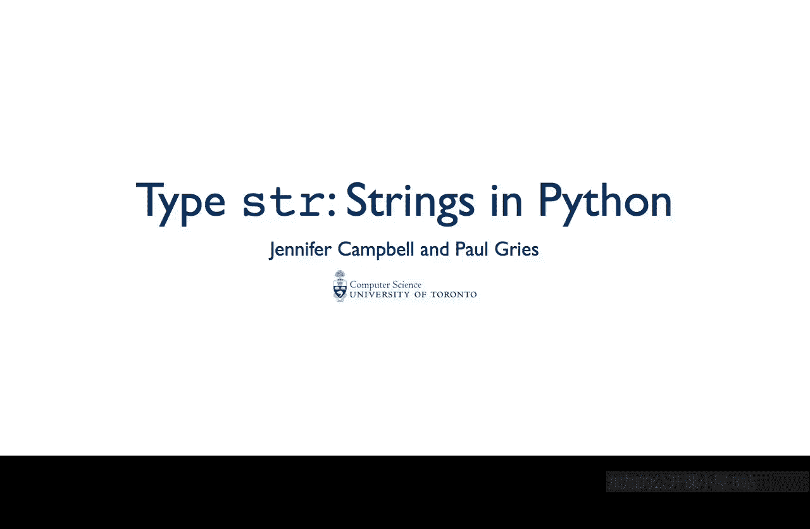
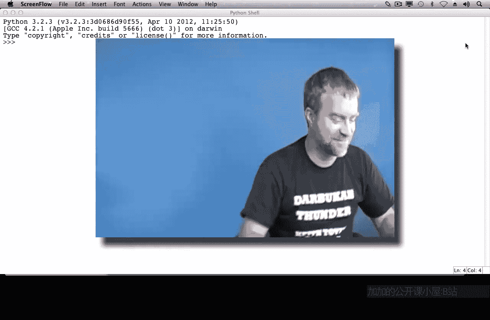
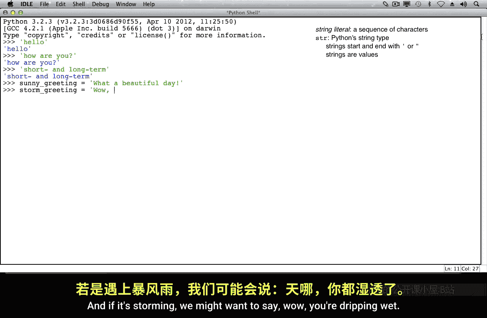
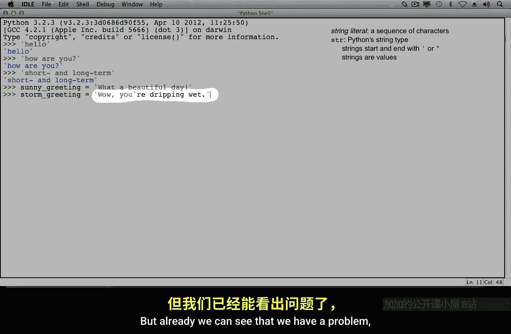
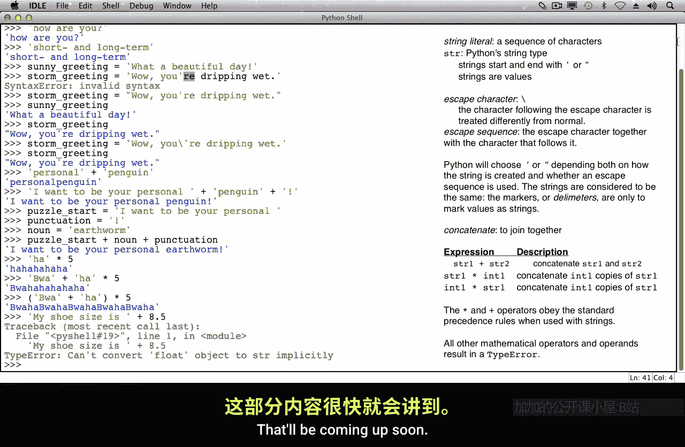

# 009：字符串类型 🧵



在本节课中，我们将要学习Python编程中的一个基础且无处不在的数据类型：字符串。我们将了解如何创建字符串、处理字符串中的特殊字符，以及如何对字符串进行基本的操作。

---

## 字符串字面量

字符串字面量是由字符组成的序列。在Python中，这种类型被称为 `str`。



字符串以单引号或双引号开始和结束。例如：`'hello'` 或 `"How are you?"`。

字符串中可以包含标点符号，正如我们刚才所见，也可以包含连字符。

字符串是值，可以用于赋值语句中。

例如，在晴天我们可能想说：“多么美好的一天。” 如果是暴风雨天，我们可能想说：“浑身湿透了。”



---

## 引号与转义字符



但是，我们立即遇到了一个问题。当我们尝试在单引号字符串内部使用单引号时，Python会产生语法错误，因为它无法区分字符串的结束和内部的引号。

为了解决这个问题，Python允许你使用双引号来定义字符串。这样，内部的单引号就不会引起混淆。

我们还有另一种选择：使用转义字符（转义序列）。如果我们使用反斜杠 `\`，Python会将其后的单引号视为字符串内容的一部分，而不是字符串的结束标记。在输出时，我们不会看到这个反斜杠，并且字符串两端的引号可能会被转换为双引号。

**示例代码：**
```python
# 使用双引号
sunny_greeting = "It's a beautiful day."
# 使用转义字符
stormy_greeting = 'It\'s all wet.'
```

---

## 字符串操作

我们可以使用加号 `+` 运算符来连接字符串。需要注意的是，连接时我们必须自己添加空格。

**示例代码：**
```python
start = "I love "
noun = "programming"
result = start + noun  # 结果为 "I love programming"
```

利用这个特性，我们可以编写一个简单的“填词游戏”（madlibs）。例如，我们询问朋友一个名词，然后将它插入到一个句子中。

我们还可以使用乘法运算符 `*` 来重复一个字符串。与常规数学运算一样，乘法的优先级高于加法。我们可以使用括号 `()` 来改变运算顺序。

**示例代码：**
```python
word = "Ha"
repeated = word * 3  # 结果为 "HaHaHa"
combined = "Start" + word * 2  # 结果为 "StartHaHa"
combined_with_parens = ("Start" + word) * 2  # 结果为 "StartHaStartHa"
```

---

## 类型错误与限制

然而，我们不能将一个字符串与一个整数或浮点数相加。Python不会隐式地将数字转换为字符串，尝试这样做会导致类型错误（TypeError）。

**示例代码：**
```python
# 这会导致 TypeError
# result = "Number: " + 42
```



同样，我们也不能对两个字符串使用乘法运算符，即使字符串内部是数字。其他运算符如减法 `-`、除法 `/` 和幂运算 `**` 也不能用于两个字符串之间。所有这些操作都会引发类型错误。

**示例代码：**
```python
# 以下操作都会导致 TypeError
# result = "hello" - "o"
# result = "10" / "2"
# result = "a" ** 2
```

---

## 总结

本节课中，我们一起学习了Python中字符串类型的基础知识。我们了解了如何用单引号或双引号创建字符串，如何处理字符串内的引号冲突（使用不同的引号或转义字符），以及如何使用 `+` 和 `*` 运算符进行字符串的连接与重复。同时，我们也明确了字符串与数字不能直接相加，以及字符串之间不支持减、除、乘方等运算的限制。掌握这些是进行更复杂文本处理的第一步。