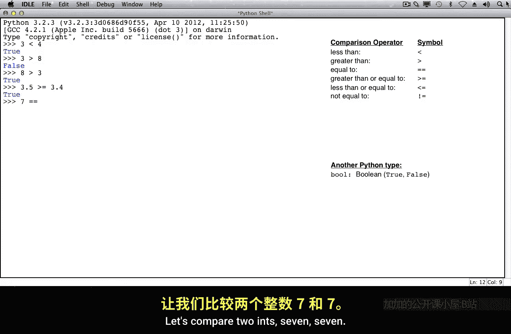
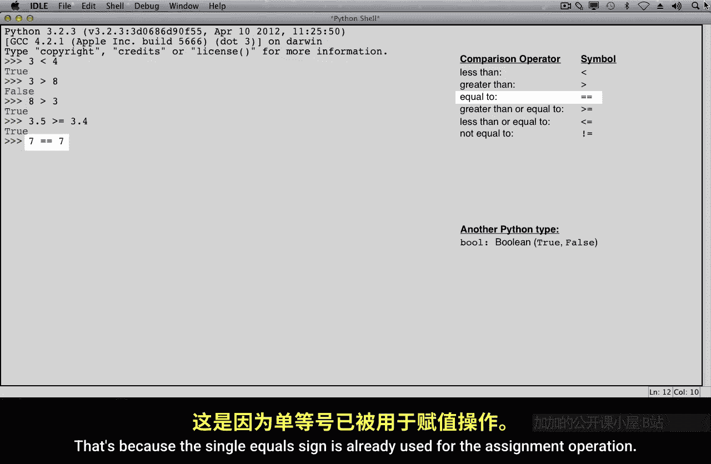
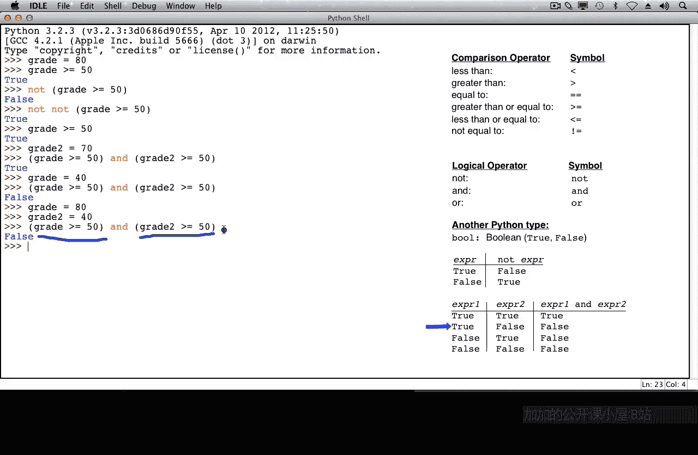
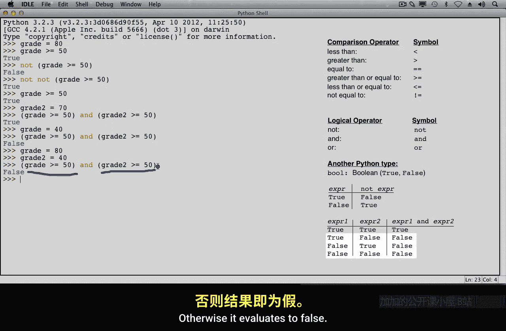
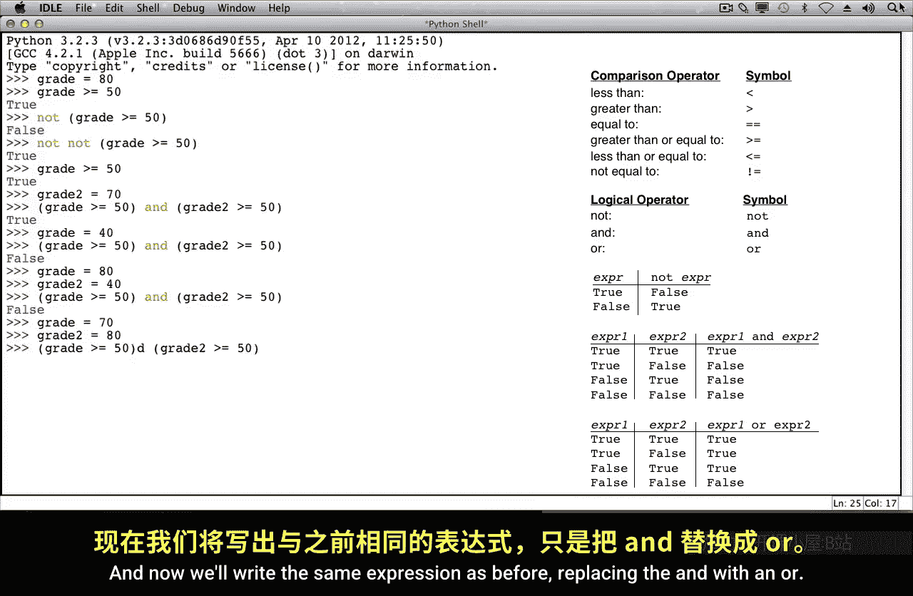
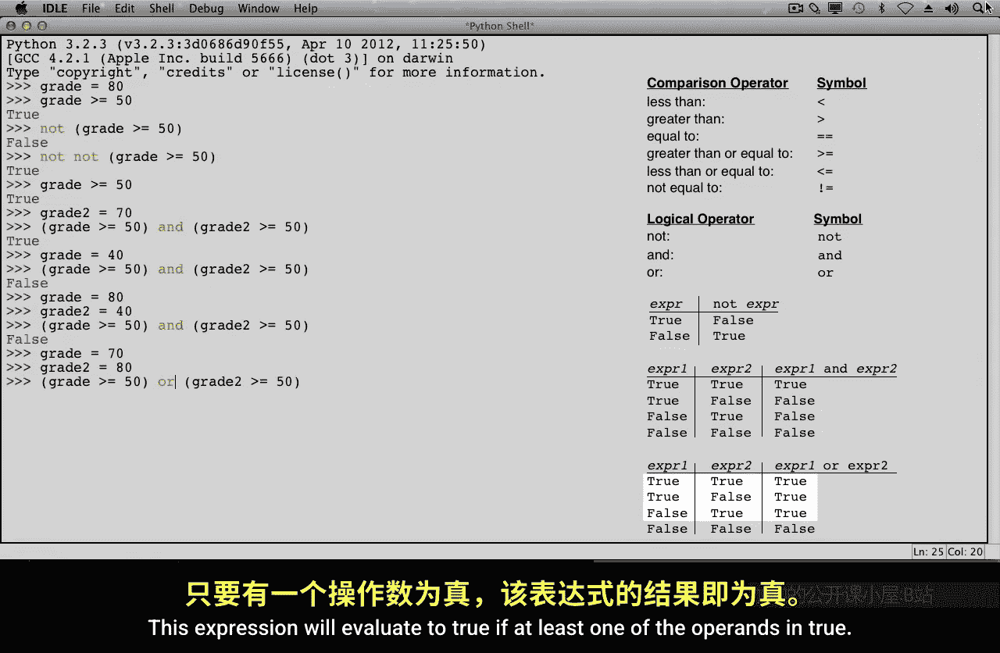
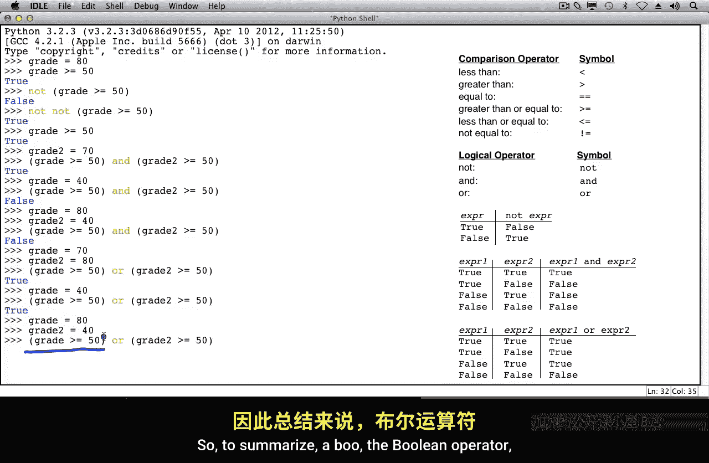
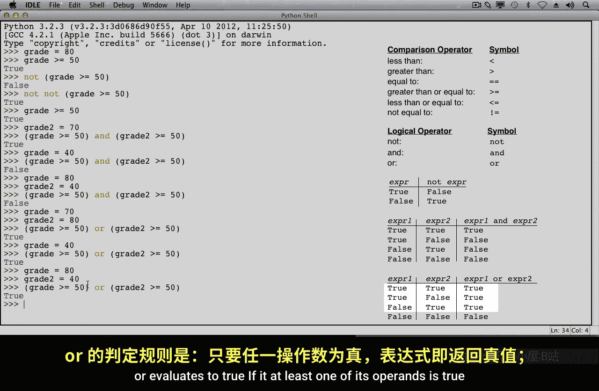
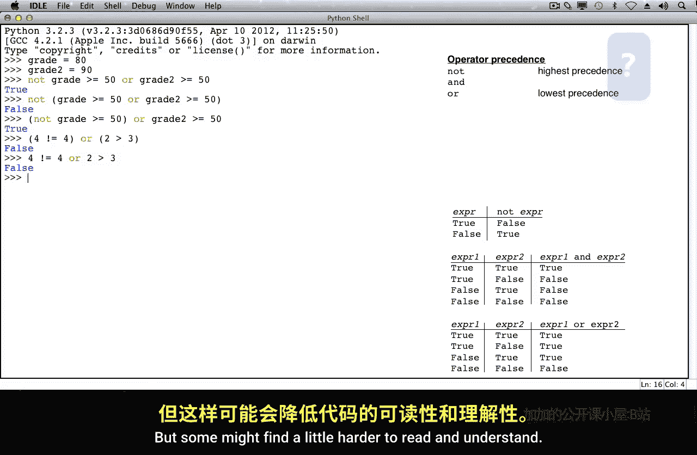

# 016：布尔类型 🔢

在本节课中，我们将学习真与假的值，也就是布尔值。我们将探索Python中的布尔类型以及可以应用于布尔值的运算符。

## 比较运算符

上一节我们介绍了算术运算符，如乘法和减法。本节中，我们来看看Python中的一些比较运算符。

以下是Python中常用的比较运算符：

*   `3 < 4`：小于运算符。表达式求值后返回一个布尔值。
*   `3 > 8`：大于运算符。返回 `False`。
*   `8 > 3`：返回 `True`。
*   `3.5 >= 3.4`：大于或等于运算符。返回 `True`。

## 相等与不等运算符

接下来，我们学习相等与不等运算符。

以下是相等与不等运算符的示例：

*   `7 == 7`：相等运算符。注意，需要使用两个等号 `==`，因为单个等号 `=` 用于赋值操作。
*   `7 == 7.0`：整数与浮点数比较，结果也为 `True`。
*   `x = 7; y = 8; x == y`：将相等运算符应用于变量，结果为 `False`。
*   `3 != 4`：不等运算符。检查两个值是否不相等，结果为 `True`。

## 逻辑运算符

现在，我们进入逻辑运算符的学习。逻辑运算符应用于布尔值，并产生布尔结果。

Python有三个主要的逻辑运算符：`not`、`and` 和 `or`。

### `not` 运算符

`not` 运算符用于对布尔值取反。

以下是 `not` 运算符的用法：

*   `grade = 80`
*   `grade >= 50`：结果为 `True`。
*   `not (grade >= 50)`：对 `True` 取反，结果为 `False`。
*   `not not (grade >= 50)`：两次取反，结果等同于 `grade >= 50`，为 `True`。

### `and` 运算符

`and` 运算符用于检查两个条件是否同时为真。

以下是 `and` 运算符的用法：

*   `grade = 80; grade2 = 70`
*   `(grade >= 50) and (grade2 >= 50)`：两个条件都为真，结果为 `True`。
*   `grade = 40; (grade >= 50) and (grade2 >= 50)`：第一个条件为假，整个表达式立即求值为 `False`，不会检查第二个条件。
*   `grade = 80; grade2 = 40; (grade >= 50) and (grade2 >= 50)`：第一个为真，检查第二个为假，结果为 `False`。

**总结**：`and` 运算符仅在两个操作数都为 `True` 时才返回 `True`，否则返回 `False`。

### `or` 运算符

`or` 运算符用于检查两个条件中是否至少有一个为真。

以下是 `or` 运算符的用法：

*   `grade = 80; grade2 = 70`
*   `(grade >= 50) or (grade2 >= 50)`：至少一个为真，结果为 `True`。
*   `grade = 40; (grade >= 50) or (grade2 >= 50)`：第一个为假，检查第二个为真，结果为 `True`。
*   `grade = 80; grade2 = 40; (grade >= 50) or (grade2 >= 50)`：第一个为真，整个表达式立即求值为 `True`，不会检查第二个条件。

**总结**：`or` 运算符在至少一个操作数为 `True` 时返回 `True`，否则返回 `False`。

## 运算符优先级与括号

最后，我们学习如何将多个运算符组合在单个表达式中，并理解运算符的优先级。

让我们分析一个复合表达式：`not grade >= 50 or grade2 >= 50`。

这个表达式有两种可能的解释，取决于运算符的优先级：

1.  `or` 先运算，然后 `not`：`not (grade >= 50 or grade2 >= 50)`
2.  `not` 先运算，然后 `or`：`(not grade >= 50) or grade2 >= 50`

在Python中，逻辑运算符的优先级顺序是：`not` > `and` > `or`。因此，上述表达式实际按第二种方式求值。

为了确保表达式按你期望的顺序求值，并提高代码的可读性，建议使用括号。

例如：
*   `(grade >= 50) and (grade2 >= 50)`：括号使逻辑更清晰。
*   `(grade + grade2) / 2 >= 50`：算术运算符优先级高于比较运算符，但括号使意图更明确。

**总结**：使用括号可以明确指定运算顺序，避免混淆，并让代码更容易理解。

---

本节课中我们一起学习了布尔类型、比较运算符（`<`, `>`, `==`, `!=`）以及逻辑运算符（`not`, `and`, `or`）。我们了解了每个运算符的行为，并通过示例掌握了如何组合它们来构建更复杂的条件判断。最后，我们强调了使用括号来控制运算顺序和提升代码可读性的重要性。