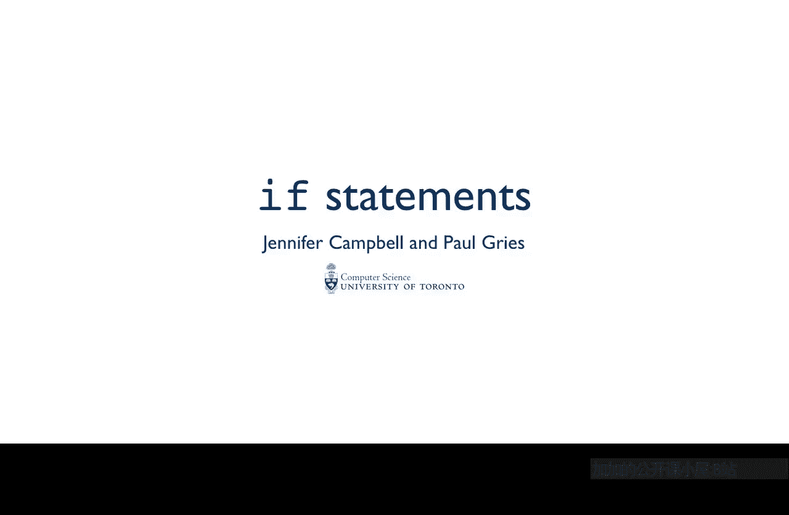
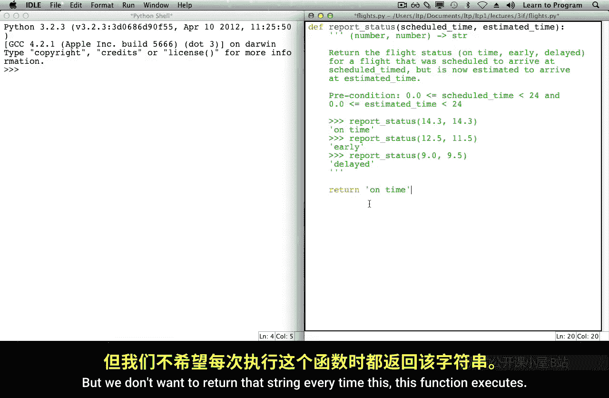
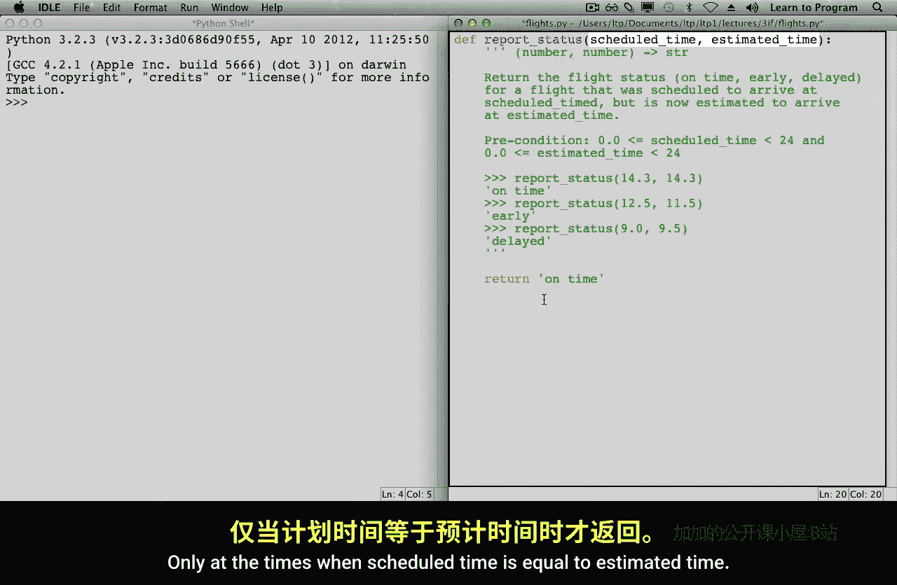
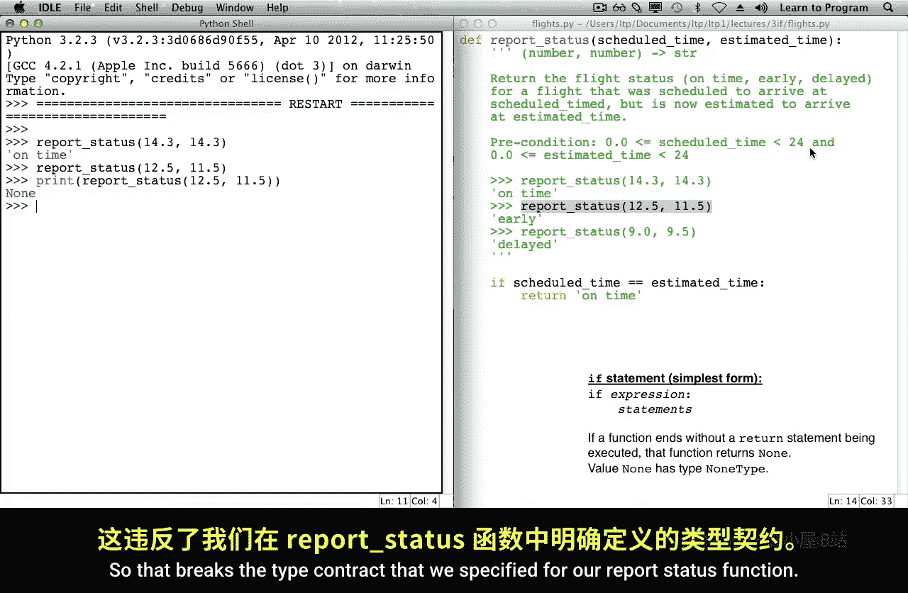
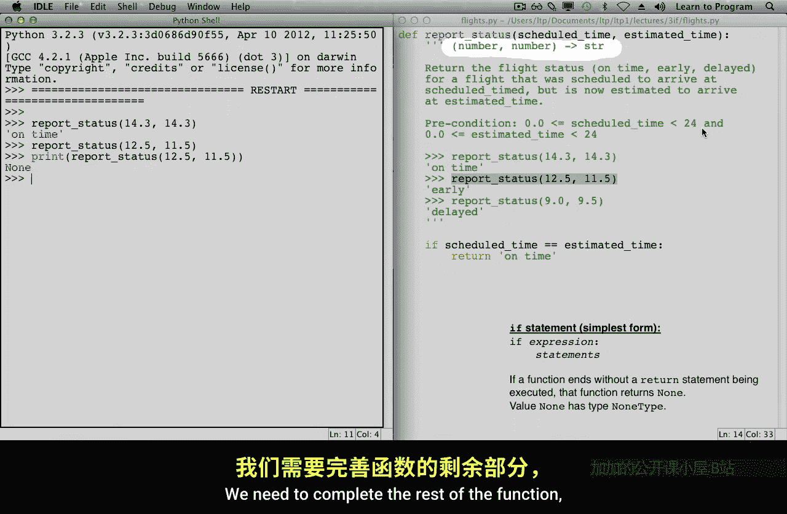
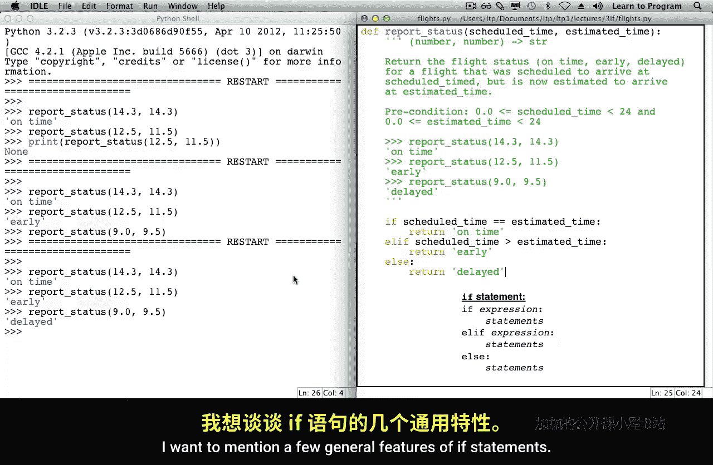
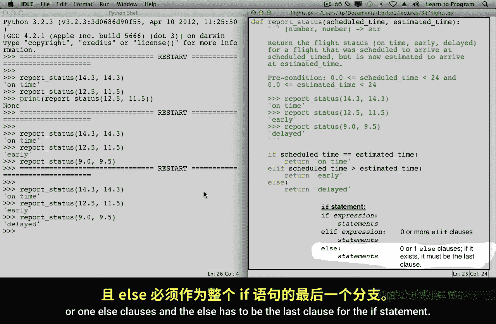
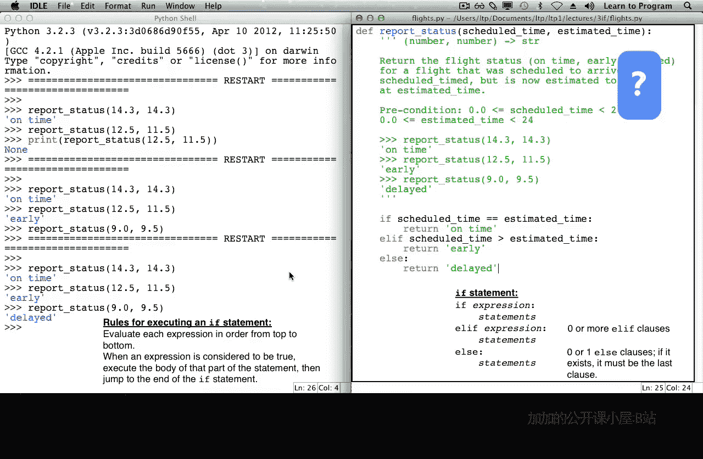

# 019：条件语句




在本节课中，我们将学习如何使用布尔表达式来控制程序执行哪些指令。到目前为止，我们编写的程序每次运行时都执行相同的指令序列。通过引入条件语句，我们可以让程序根据不同的情况做出不同的反应。

## 问题引入


让我们考虑一个实际问题。一个航班原计划在特定时间到达，但现在预计在另一个时间到达。我们需要编写一个函数，根据这两个时间返回航班状态：准时、提前或延误。

对于这个函数，时间将用一个浮点数表示。例如，凌晨3点表示为 `3.0`，下午2点30分（即14:30）表示为 `14.5`。因此，我们处理的时间将在 `0.0`（包含）到 `24.0`（不包含）之间。这被称为**前置条件**。在编写函数时，我们期望提供的时间会在这个范围内。

## 定义函数

让我们开始定义这个函数。首先，我们写一些函数调用的例子。我将这个函数命名为 `report_status`，它有两个参数：第一个是计划到达时间，第二个是新的预计到达时间。

以下是函数在不同情况下的预期行为：
*   当两个时间相同时，返回消息 `"on time"`。
*   当计划时间是 `12.5`，而新的预计到达时间是 `11.5` 或更早时，函数返回 `"early"`。
*   当计划时间是 `9.0`，而新的预计到达时间更晚时，函数应返回消息 `"delayed"`。

现在，我们来编写函数头。函数有两个参数，都是数字。在这些例子中，我传入的是浮点数，但我们也可以传入整数值，所以参数类型可以使用 `number`。函数将返回一个字符串。

函数头如下：
```python
def report_status(scheduled_time, estimated_time):
```
接下来是文档字符串。这个函数将返回航班状态，是三个字符串之一：`"on time"`、`"early"` 或 `"delayed"`。它返回的是针对计划在 `scheduled_time` 到达，但现在预计在 `estimated_time` 到达的航班的狀態。文档字符串中还需要添加一个信息：前置条件是 `scheduled_time` 和 `estimated_time` 都必须在 `0.0` 到 `24.0` 之间。

## 编写函数体

现在，是时候编写函数体了。我们将分几个步骤来完成，最终让整个函数正常工作。

首先，我们需要弄清楚如何有时执行某些语句，有时不执行。例如，我们想返回字符串 `"on time"`，但我们不希望每次函数执行时都返回这个字符串，而只在 `scheduled_time` 等于 `estimated_time` 时才返回。





我们将使用 **`if` 语句** 来表达这一点。这个 `if` 语句将有一个布尔条件：`scheduled_time` 等于 `estimated_time`。我们将把这个 `return` 语句放在 `if` 的代码块内。注意，它是缩进的，这表明它属于 `if` 语句。

我们这样理解这段代码：如果 `scheduled_time` 等于 `estimated_time`（即该布尔表达式为真），那么就执行 `return "on time"` 语句。否则，就不执行，程序将继续执行 `if` 语句之后的任何代码。

让我们保存并运行它。当我在交互式环境中用相等的时间调用这个函数时，它报告状态为 `"on time"`。如果此时我用一对不相等的时间调用这个函数，那么什么也不会返回。更准确地说，看起来什么也没返回，因为即使没有执行 `return` 语句，函数仍然会返回一个值。

让我们打印这个函数调用，这样函数返回的任何值都会被打印出来。我们可以看到打印出了 `None`。当一个函数调用执行时，如果没有执行任何 `return` 语句，函数就会返回值 `None`。`None` 的类型是 `NoneType`，而不是 `string`，这违反了我们在 `report_status` 函数中指定的类型约定。我们需要完成函数的其余部分，确保遵守该类型约定。

## 扩展条件判断




让我们回到函数定义。现在我们只有一个 `if` 语句，当这个布尔条件为真时，返回 `"on time"`。当它为假时，我们想做点别的事情。所以，我们先检查这个条件是否为真，然后我们将使用 `elif`（`else if` 的缩写）来检查第二个条件。

这次，我们将检查 `scheduled_time` 是否大于 `estimated_time`。如果是，我们将返回 `"early"`。


在这个阶段，让我们运行它。当我们用相等的时间调用这个函数时，它说 `"on time"`。当我们用更早的预计时间调用它时，它报告 `"early"`。但是此时，当我们用更晚的预计时间调用它时，返回的是 `None`，所以我们还没有完全完成。

我们将为 `if` 语句添加第三部分，即一个 `else` 子句。`else` 表示：如果前面的所有条件或表达式都不为真，那么就执行这个。我们已经检查了它们是否相等、是否大于，剩下的唯一情况就是 `scheduled_time` 小于 `estimated_time`。在这种情况下，函数将返回 `"delayed"`。

让我们再次运行它，检查所有情况：当时间相等时、当预计时间更早时、当预计时间更晚时。现在我们得到了正确的报告。

## `if` 语句的一般特性



以下是关于 `if` 语句结构的一些要点：
*   一个 `if` 语句可以关联零个或多个 `elif` 子句。
*   一个 `if` 语句可以关联零个或一个 `else` 子句。
*   `else` 子句必须是 `if` 语句的最后一个子句。




当我们有一个包含多个表达式的 `if` 语句时，我们按顺序计算每个表达式。对于第一个计算结果为 `True` 的表达式，就执行该部分 `if` 语句的代码块。在该代码块执行完毕后，`if` 语句就终止了，程序会退出并继续执行它后面的代码，而不再检查任何后续条件。


## 总结




本节课中，我们一起学习了如何使用 `if`、`elif` 和 `else` 语句来编写条件判断逻辑。我们通过一个航班状态报告器的例子，实践了如何根据不同的输入（计划时间和预计时间）执行不同的代码路径。关键点在于理解布尔表达式如何控制程序流程，以及 `if` 语句各部分的执行顺序和规则。这使我们能够编写出可以根据不同情况做出决策的程序。