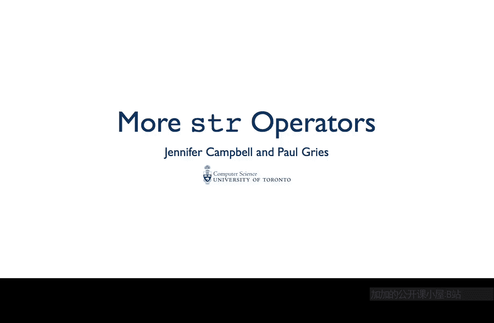
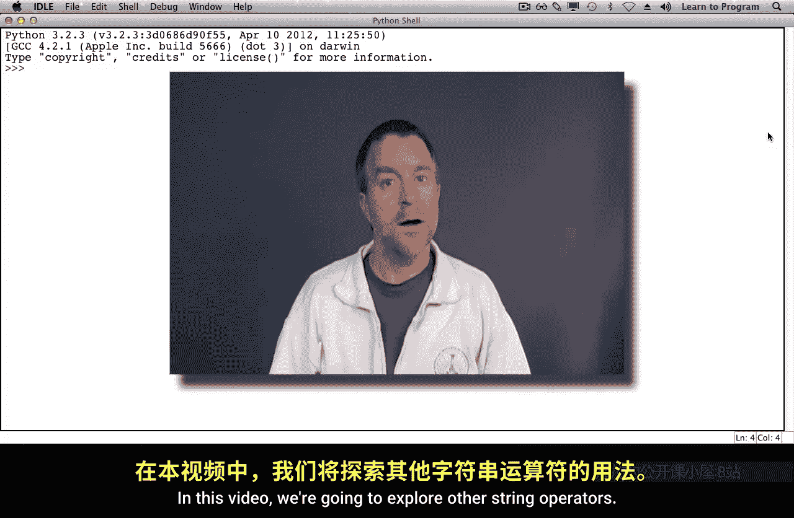
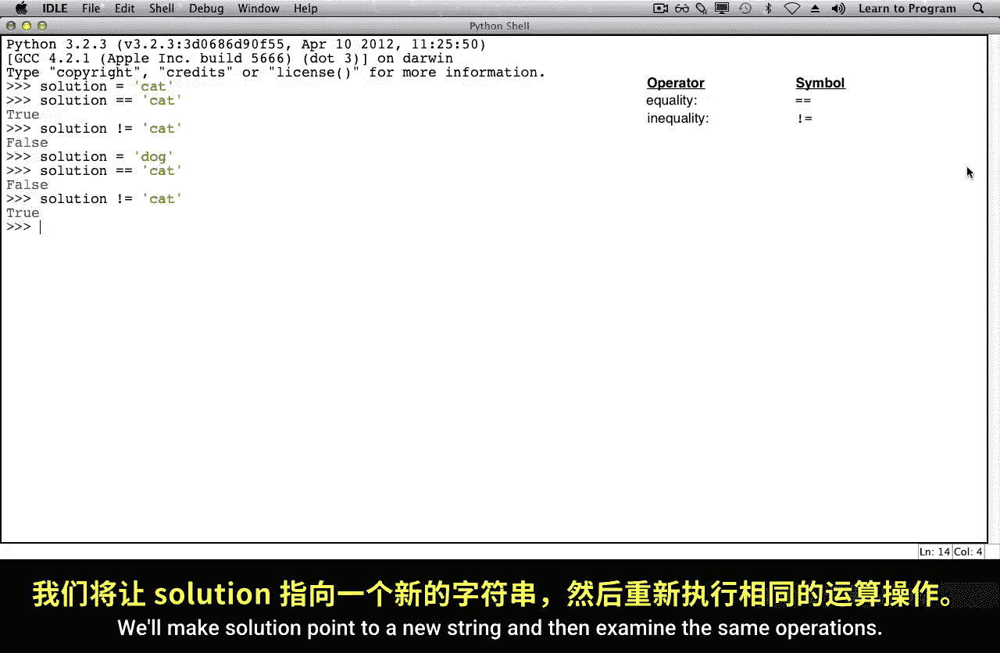
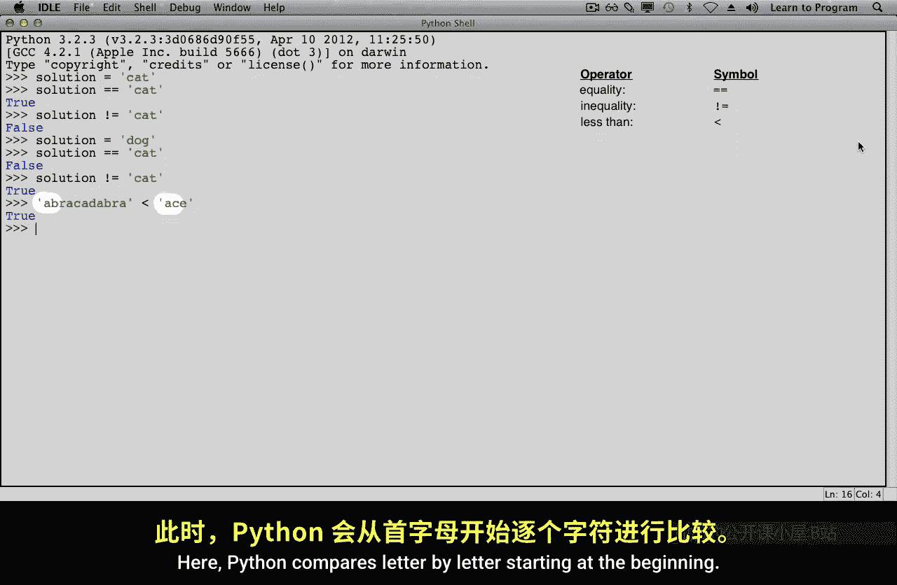
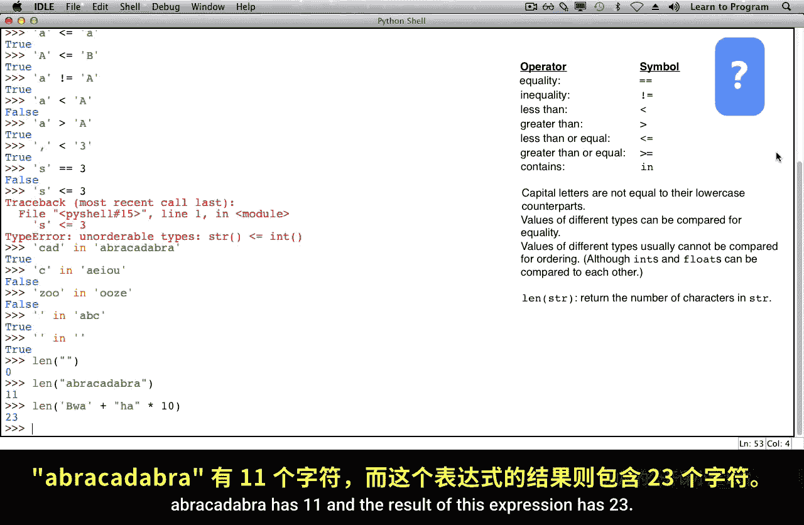

# 022：更多字符串运算符 📚

在本节课中，我们将学习Python中除加法和乘法之外的其他字符串运算符。我们将探索如何比较字符串、检查子字符串以及获取字符串的长度。



---

你已经了解了如何将两个字符串相加，以及如何通过将字符串与整数相乘来重复该字符串。

在本视频中，我们将探索其他字符串运算符。

---

## 相等与不等比较

我们首先来看如何比较两个字符串是否相等。



我们将字符串 `"cat"` 赋值给变量 `solution`。现在，我们使用两个等号 `==` 来比较 `solution` 是否指向字符串 `"cat"`。

```python
solution = "cat"
print(solution == "cat")  # 输出：True
```

此外，还有一个不等运算符，它由一个感叹号和一个等号组成 `!=`。

```python
print(solution != "cat")  # 输出：False
```

接下来，我们让 `solution` 指向一个新的字符串，然后检查相同的操作。

```python
solution = "dog"
print(solution == "cat")  # 输出：False
print(solution != "cat")  # 输出：True
```

---

## 字典序比较

我们还可以比较两个字符串的字典顺序（即字母顺序）。

以下是字典序比较的运算符。



```python
print("cat" < "dog")  # 输出：True
```

在这里，Python 会从字符串开头开始，逐个字母进行比较。

例如，比较 `"cat"` 和 `"dog"`：
1.  首先比较第一个字母 `'c'` 和 `'d'`。由于 `'c'` 在字母表中位于 `'d'` 之前，因此 `"cat"` 小于 `"dog"`。



上面我们使用了小于运算符 `<`。我们同样有大于运算符 `>`。

```python
print("cat" > "dog")  # 输出：False
```

我们还有小于等于 `<=` 和大于等于 `>=` 运算符。

```python
print("cat" <= "cat")  # 输出：True
print("cat" >= "cat")  # 输出：True
```

---

## 大小写与不同类型比较

我们也可以比较大写字母。实际上，大小写是重要的，并且大写字母被认为小于小写字母。

```python
print("A" < "a")  # 输出：True
```

任何你可以输入的字母都可以进行比较。

我们总是可以比较两个不同类型的值是否相等或不等。

```python
print(42 == "42")  # 输出：False
print(42 != "42")  # 输出：True
```

但是，我们通常不能比较两种不同类型的项目的顺序。

```python
# 以下代码会引发 TypeError
# print(42 < "42")
```

---

## 成员检查运算符 `in`

这是一个新的字符串运算符。我们可以使用 `in` 来检查一个字符串是否包含在另一个字符串中。

```python
print("a" in "apple")  # 输出：True
```

使用这个运算符，我们可以检查字母 `'C'` 是否是元音字母。

```python
print("C" in "AEIOUaeiou")  # 输出：False
```

字母的顺序很重要。`"zoo"` 并不在 `"woos"` 中。

```python
print("zoo" in "woos")  # 输出：False
```

我们可以询问空字符串是否在另一个字符串中，答案是肯定的。同时，空字符串也包含在它自身中。

```python
print("" in "hello")  # 输出：True
print("" in "")       # 输出：True
```

---

## 获取字符串长度：`len()` 函数

本节课我们将讨论的最后一个内容是一个函数，而不是运算符。`len()` 函数接收一个字符串，并告诉你其中有多少个字符。

```python
print(len(""))                # 输出：0
print(len("Abracadabra"))     # 输出：11
print(len("a" * 10 + "bc"))   # 输出：12 (10个'a' + 'b' + 'c')
```

空字符串有 0 个字符。`"Abracadabra"` 有 11 个字符，而表达式 `"a" * 10 + "bc"` 的结果有 12 个字符。



---

本节课中，我们一起学习了Python中更多的字符串操作。我们掌握了如何使用 `==` 和 `!=` 比较字符串是否相等，如何使用 `<`、`>`、`<=`、`>=` 进行字典序比较，以及大小写在比较中的影响。我们还学习了使用 `in` 运算符检查子字符串，并使用 `len()` 函数获取字符串的长度。这些工具将帮助你更有效地处理和检查文本数据。